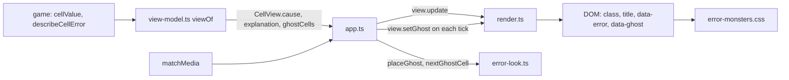
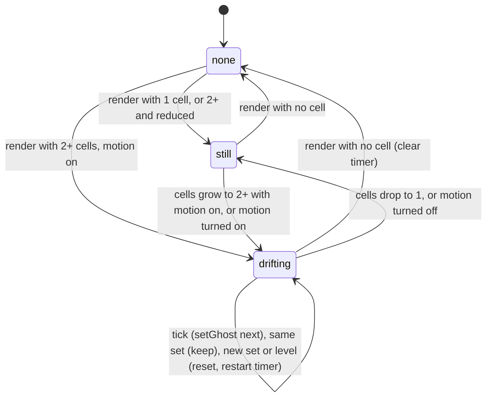

# Design Document

## Overview

`error-monsters` is a thin visual layer over the finished `grid-ui`. It adds no rule and no game state. The engine already gives every error cell a `kind: 'error'` Value with `error`, `cause` and `origin`, and `describeCellError` returns the plain-English cause. This spec turns those into five looks, a `title`, an explanation line and a drifting ghost.

Five pieces carry the work:

1. **A pure module `src/ui/error-look.ts`** holds the class table, the ghost interval, the Cycle_Cell test, the reading-order scan, and the two ghost helpers (`nextGhostCell`, `placeGhost`).
2. **The view model** gains `CellView.cause`, `ViewModel.explanation` and `ViewModel.ghostCells`. `viewOf` stays pure.
3. **The view** sets `title`, fills the explanation line and ghost note, and moves `data-ghost` in place through `View.setGhost`.
4. **`app.ts` owns the ghost** (position, timer, reduced-motion listener) in closure variables. The controller and `AppState` are untouched.
5. **`src/styles/error-monsters.css`** draws everything with classes, custom properties and pseudo-elements.

Property-based testing is off (Decision D11). Examples and exhaustive loops cover the pure parts, fake timers cover the ghost, and one Playwright flow covers the browser.

### Decisions

| # | Decision | Where it lands |
| --- | --- | --- |
| D1 | CSS shapes on pseudo-elements, no emoji | "CSS design": `::before` per kind, `::after` for the ghost |
| D2 | Native `title` for hover | `updateCell` in `render.ts`: `setAttr(td, 'title', cell.cause)` |
| D3 | Visible `#cell-explanation`, not a live region | Skeleton in `render.ts`; added to the Formula_Bar `aria-describedby` |
| D4 | Cycle_Cell = `#CYCLE!` with `origin` equal to its own address | `isCycleCell` in `error-look.ts` |
| D5 | One ghost step per 800 ms from `setInterval` in `app.ts` | `GHOST_INTERVAL_MS`; "Ghost state machine" |
| D6 | Ghost drawn by `td[data-ghost]::after` | `View.setGhost`; CSS ghost rule |
| D7 | `MountOptions.matchMedia`, else `doc.defaultView`, unreadable means still | `readMotion` in `app.ts`; "Reduced motion" |
| D8 | `error-look.ts` and `error-monsters.css`; `ERROR_CLASS` moves, `render.ts` re-exports | "Files"; cross-spec edits to `module.test.ts` |
| D9 | Separate fixture entry `errors.html` | "Fixture" |
| D10 | Smaller error text so `#DIV/0!` fits | CSS: `0.5rem`, with the arithmetic and the Playwright fit check |
| D11 | No property-based tests | "Correctness Properties" |
| D12 | Screenshots only after the real levels exist | See "Screenshots": `src/main.ts` already imports `LEVELS`, so one was taken |
| D13 | All five keep the blocking look; cycle cells add the haunted mark and the ghost | CSS `cell-error-cycle`; `ghostCells` list |
| D14 | Entity drawn on top of the error look; the `.cell-text` hide rule is kept | "Layering" |
| D15 | Restart detection from state the render sees | `run.level` reference, see "Ghost reset signal" |
| D16 | Reduced motion read with `addEventListener` only, no legacy `addListener` fallback | `readMotion`/`onMotion` in `app.ts`; "Reduced motion" |

## Architecture



### Files

| File | Change |
| --- | --- |
| `src/ui/error-look.ts` | New, pure. `ERROR_CLASS`, `GHOST_INTERVAL_MS`, `isCycleCell`, `cycleCellsOf`, `sameCells`, `nextGhostCell`, `placeGhost`. |
| `src/ui/render.ts` | Imports and re-exports `ERROR_CLASS`; sets `title`; adds `#cell-explanation`, `#ghost-note`, two `aria-describedby` values; adds `View.setGhost`. |
| `src/ui/view-model.ts` | `cause` per error cell; `explanation`; `ghostCells`. One pass over the 228 cells. |
| `src/ui/app.ts` | Ghost closure state, timer, motion listener, `paint` helper, `destroy` cleanup. |
| `src/ui/types.ts` | `CellView.cause`, `ViewModel.explanation`, `ViewModel.ghostCells`, `MountOptions.matchMedia`, `MediaQueryLike`, `View` stays in `render.ts`. |
| `src/ui/strings.ts` | `errorCauseFallback`, `ghostNote(count)`. |
| `src/styles/error-monsters.css` | New. Looks, colour pairs, ghost, `.visually-hidden`, reduced motion, forced colours. |
| `src/main.ts`, `tests/fixtures/main.ts` | Add `import './styles/error-monsters.css'` (fixture path `../../src/styles/error-monsters.css`). |
| `tests/fixtures/errors.html`, `errors-main.ts`, `errors.ts` | New e2e entry, its composition root and the level `03-fixture-errors`. |
| `tests/e2e/error-monsters.spec.ts` | New, one flow. |
| `src/ui/error-look.test.ts`, `ghost.test.ts`, `fixture-errors.test.ts` | New unit, timer and fixture tests. |
| `render.test.ts`, `view-model.test.ts`, `strings.test.ts`, `module.test.ts` | Additions and the cross-spec edits below. Existing view-model and render fixtures that build `CellView`/`ViewModel` by hand gain the new fields. |

### Cross-spec edits to `src/ui/module.test.ts`

Read from the real file:

1. `EXPECTED_MODULES` (the array starting at line 10): add `'error-look'` after `'controller'`. The layout test sorts both sides, so position is cosmetic.
2. `DOM_FILES = ['app.ts', 'render.ts']` stays. `error-look.ts` is scanned as `'pure'`: the pure deny-list names `document`, `window`, `Element`, `Event`, `navigator` and others, so the file must not mention them. The design avoids them by typing the media query as `MediaQueryLike` (own interface, `() => void` listeners). `app.ts` is scanned as `'dom'` (denies `window`), so it uses `doc.defaultView`.
3. `MAIN_FILES` (line 185): append `join(ROOT, 'tests', 'fixtures', 'errors-main.ts')`. The entry test then requires exactly one `ui/` import, `mountApp` and `browserStorage` from `ui/index`, and a `browserStorage()` call. `errors-main.ts` satisfies all three. CSS and `./errors` imports contain no `ui` path segment.
4. The "no AI tool names" file list (the `files` array near line 252): add `join(SRC, 'styles', 'error-monsters.css')` and `...listFiles(join(ROOT, '.kiro', 'specs', 'error-monsters'), () => true)`. `tests/fixtures` is already walked recursively, so the new fixture files are covered. Word choice matters here: the deny-list is case-insensitive substring, so the CSS and this document avoid the property and tool names that contain those fragments.
5. The test `keeps the stylesheet free of url(, @import and http` (line 267) reads only `grid-ui.css`. Turn it into `it.each(['grid-ui.css', 'error-monsters.css'])` over the same three regexes.

`src/ui/index.ts` and its export test do not change. `render.ts` still exports `ERROR_CLASS`.

## Components and Interfaces

### `src/ui/error-look.ts`

Imports `parseAddress` and the types `ErrorKind`, `Value` from `../engine/index`. No browser global.

```ts
export const ERROR_CLASS: Readonly<Record<ErrorKind, string>>; // moved unchanged from render.ts (same five entries and shape)
export const GHOST_INTERVAL_MS = 800;

export interface AddressValue {
  readonly address: string;          // canonical, as in CellView.address
  readonly value: Value | undefined; // cellValue(run, address)
}

/** value.kind === 'error' && value.error === '#CYCLE!' && value.origin === address (D4). */
export function isCycleCell(address: string, value: Value | undefined): boolean;

/** Cycle_Cells in reading order (row, then column). Downstream #CYCLE! cells are excluded. Total. */
export function cycleCellsOf(cells: Iterable<AddressValue>): string[];

export function sameCells(a: readonly string[], b: readonly string[]): boolean;

/** Requirement 8.1: next in the list; first when current is undefined or not listed; wraps; undefined for []. */
export function nextGhostCell(list: readonly string[], current: string | undefined): string | undefined;

export interface PlaceInput {
  readonly prevCells: readonly string[];
  readonly prevAt: string | undefined;
  readonly cells: readonly string[];
  readonly levelChanged: boolean;
  readonly still: boolean;           // Reduced_Motion
}
/** Where the ghost sits after a render. */
export function placeGhost(input: PlaceInput): string | undefined;
```

`ErrorKind` spellings in the engine are `'#REF!' | '#NAME?' | '#DIV/0!' | '#VALUE!' | '#CYCLE!'`, as in `values.ts`; `ERROR_CLASS` keys match them. The error `Value` fields are `kind`, `error`, `cause`, `origin`; `origin` is the bare canonical address (`errors.ts`), so a plain string compare with `address` is correct. `cycleCellsOf` keeps entries where `isCycleCell` holds and `parseAddress(address).ok`, sorts by `(row, col)` and does not rely on input order. `placeGhost`:

```ts
if (cells.length === 0) return undefined;
if (still || levelChanged || !sameCells(prevCells, cells)) return cells[0];
return prevAt !== undefined && cells.includes(prevAt) ? prevAt : cells[0];
```

The module exports exactly the seven runtime/by-name exports of Requirement 8.1: `ERROR_CLASS`, `GHOST_INTERVAL_MS`, `isCycleCell`, `cycleCellsOf`, `sameCells`, `nextGhostCell` and `placeGhost`. The `AddressValue` and `PlaceInput` interfaces above are supporting types, not among the seven; they are exported as types so callers and tests can name the inputs.

### Strings (`strings.ts`)

```ts
errorCauseFallback: 'This cell holds an error, but its cause could not be read.',
ghostNote: (count: number): string =>
  count === 1
    ? 'A ghost haunts the one cell of a circular reference.'
    : `A ghost drifts along ${count} cells of a circular reference.`,
```

`errorCauseFallback` is used by `viewOf` (the Cause_Fallback, Requirement 3.2). `ghostNote` is used by `render.ts` only. The existing `strings.test.ts` walks `STRINGS`, calls every function with `'x'` and checks nothing is empty; both new entries pass. Add one example test for the singular and plural sentence.

### View model (`view-model.ts`, `types.ts`)

```ts
interface CellView { /* existing */ readonly cause: string | undefined; } // defined exactly when errorKind is defined
interface ViewModel { /* existing */
  readonly explanation: { readonly text: string; readonly kind: ErrorKind } | undefined;
  readonly ghostCells: readonly string[];
}
export interface MediaQueryLike {
  readonly matches: boolean;
  addEventListener?(type: 'change', listener: () => void): void;
  removeEventListener?(type: 'change', listener: () => void): void;
}
interface MountOptions { /* existing */ readonly matchMedia?: (query: string) => MediaQueryLike; }
```

The native `MediaQueryList` is assignable to `MediaQueryLike` (method parameters are bivariant), so tests and the browser both fit.

`viewOf` change: the row loop reads each `Value` once. `cellViewOf(state, col, row)` is split so it receives the Value: `const value = cellValue(run, address)`, then `cellViewOf(state, value, col, row)`; the loop also pushes `{ address, value }` into an array that `cycleCellsOf` consumes. For an error Value, `cause = describeCellError(run, address) ?? STRINGS.errorCauseFallback`. The cause is read on every render and never cached (Requirement 3.1). `explanation` is built from the CellView of `state.selection` (found while building rows; the selection is never in row 13): `{ text: cell.cause, kind: cell.errorKind }` when both are defined, else `undefined`. `viewOf` stays pure and total; with no run, `ghostCells` is `[]` and `explanation` is `undefined`.

### View (`render.ts`)

New skeleton nodes, built once:

```html
<div class="formula-row"> ... <span id="formula-alert" ...></span>
  <p id="cell-explanation" class="cell-explanation" hidden></p>   <!-- no role, no aria-live -->
</div>
<input id="formula-bar" ... aria-describedby="formula-note formula-alert cell-explanation" />
<table id="grid-table" ... aria-describedby="ghost-note"> ... </table>
<p id="ghost-note" class="visually-hidden"></p>                    <!-- after the table, before #end-banner -->
```

`update(vm)` additions, all through the existing helpers so a repeated value writes nothing:

- `updateCell`: `setAttr(td, 'title', cell.cause)`. `setAttr` removes the attribute for `undefined`, so a cell that stops being an error loses its `title` (Requirement 3.2). The `title` is set with `setAttribute`; the cause reaches the DOM as an attribute value, never as markup.
- Explanation line: `setText(explanation, vm.explanation?.text ?? '')`, `setAttr(explanation, 'data-error', vm.explanation?.kind)`, and `explanation.hidden = vm.explanation === undefined` (written only when it differs).
- Ghost note: `setText(ghostNote, vm.ghostCells.length === 0 ? '' : STRINGS.ghostNote(vm.ghostCells.length))`. `setText` skips equal text, so the sentence is written only when its content changes, and it is emptied when the list becomes empty (Requirement 6.5).
- `update` never reads or writes `data-ghost`.

`View` gains one method:

```ts
export interface View { update(viewModel: ViewModel): void; setGhost(address: string | undefined): void; }
```

`createView` keeps `let ghostAt: string | undefined`. `setGhost(next)`: if `next === ghostAt` return; remove `data-ghost` from `cells.get(ghostAt)` when set; set `data-ghost="true"` on `cells.get(next)` when it exists; store `ghostAt`. That is at most two attribute writes and no scan of the 228 cells. Only `data-ghost` changes, so layout is unchanged (Requirement 6.4).

## The ghost state machine

### Ownership

The ghost lives in **closure variables in `app.ts`**, not in `AppState`. Reasons: the position changes on a timer that must not go through `step` (no render, no controller call, no event); `step` and `viewOf` stay pure; and the controller tests need no change. `render.ts` stores only the DOM mirror (`ghostAt`), and `update()` never touches the attribute, so a normal render cannot reset or fight the timer's position.

```ts
let ghostCells: readonly string[] = [];
let ghostAt: string | undefined;
let seenLevel: Level | undefined;               // RunState['level'] of the last render
let ghostTimer: ReturnType<typeof setInterval> | undefined;
let reduced: boolean;                           // set from readMotion before the first paint
```

### Ghost reset signal (D15)

`AppState` exposes `levelIndex` and `run`. The signal is **`run.level !== seenLevel`** (reference comparison of the frozen `Level`). Checked against the real code: `startRun` calls `loadLevel`, which builds a new `Level` object every time (a second `startRun` of the same document gives a different reference, verified with a throwaway test), while `applyAction` (moves, waits, edits, and undo) always copies `level: prev.level`, so the reference is stable through every turn including undo. Every path that restarts or switches (`startLevel`: Recover, tab, next level, confirm) calls `startRun`, so all of them change the reference. This is the least invasive signal: it needs no new hook, no turn counter and no change to `controller.ts`.

The reset fires only on these two signals: a `run.level` reference change, or a changed Cycle_Cell set. There is no turn-0 clause. A turn counter would misfire: undoing the first turn returns to turn 0 without a restart, and the ghost would jump back. Every real restart already changes the level reference, so the reference comparison and the Cycle_Cell-set comparison cover every case.

### States, inputs, transitions

States are derived from `ghostCells`, `reduced` and `ghostTimer`:

- **none**: no Cycle_Cell; no `data-ghost`; no timer.
- **still**: one or more Cycle_Cells; the ghost sits on a cell; no timer (exactly one cell, or Reduced_Motion).
- **drifting**: two or more Cycle_Cells, motion allowed; the timer runs.



| Input | Cells after | Ghost position | Timer |
| --- | --- | --- | --- |
| Render, set unchanged, same level (move, wait, edit elsewhere, undo) | same | kept (`prevAt`) | untouched; never restarted, so a player acting faster than 800 ms cannot starve the ghost |
| Render, set changed (an edit adds or removes cycle cells) | new list | first cell | restarted (a full interval on the first cell) if 2+ and motion on, else cleared |
| Render, level reference changed (restart, tab, next) | any | first cell, even if the set is equal | cleared, then started again only if 2+ and motion on (Requirement 6.3) |
| Render, no cycle cell | `[]` | removed (`setGhost(undefined)`) | cleared |
| Tick | unchanged | `nextGhostCell(ghostCells, ghostAt)` | unchanged |
| Motion preference turns reduced | unchanged | first cell | cleared |
| Motion preference turns normal | unchanged | kept | started if 2+ cells |
| `destroy()` | n/a | n/a | cleared; listener removed; `destroyed` blocks any queued call |

Cases the table fixes: a **single Cycle_Cell** shows the ghost on it with no timer. **Cycle cells that change after an edit** reset to the first of the new list. A **broken cycle** removes the ghost in the same render and clears the timer. **Downstream cells** are not in `ghostCells`, so the ghost never visits them, though they keep the haunted look. A **motion toggle at run time** takes effect in the same task, with no remount.

### Pseudocode (`app.ts`)

```ts
function paint(vm: ViewModel, run: RunState | undefined): void {
  view.update(vm);
  const levelChanged = run?.level !== seenLevel;
  seenLevel = run?.level;
  const changed = levelChanged || !sameCells(ghostCells, vm.ghostCells);
  ghostAt = placeGhost({ prevCells: ghostCells, prevAt: ghostAt, cells: vm.ghostCells, levelChanged, still: reduced });
  ghostCells = vm.ghostCells;
  view.setGhost(ghostAt);
  if (ghostCells.length < 2 || reduced) stopTimer();
  else if (changed || ghostTimer === undefined) startTimer();   // startTimer clears first
}
function startTimer() { stopTimer(); if (!destroyed) ghostTimer = setInterval(tick, GHOST_INTERVAL_MS); }
function tick() { if (destroyed) return; ghostAt = nextGhostCell(ghostCells, ghostAt); view.setGhost(ghostAt); }
```

`tick` calls neither `step`, `dispatch` nor `view.update`. `paint` replaces the three `view.update(viewOf(...))` call sites (startup, `dispatch`, `fail`). In `dispatch` it receives `result.state.run`; in `fail` the run is the current `state.run`, so the level is unchanged and the ghost is kept. A throw inside `paint` stays inside the existing `try` and ends in `fail()`.

Ordering: the first `paint` runs after `reduced` is read, so no timer starts before the preference is known. A timer from one `mountApp` call cannot leak into the next: each call has its own closure, and `destroy()` clears its own handle.

### Reduced motion

```ts
const QUERY = '(prefers-reduced-motion: reduce)';
function readMotion(): MediaQueryLike | undefined {
  try {
    const win = doc.defaultView;          // not the identifier "window" (module scan)
    const ask = options.matchMedia ?? (win !== null && typeof win.matchMedia === 'function'
      ? (q: string) => win.matchMedia(q) : undefined);
    return ask?.(QUERY);
  } catch { return undefined; }
}
const motion = readMotion();
reduced = motion === undefined || motion.matches !== false;   // unreadable means still (D7)
const onMotion = () => {
  if (destroyed) return;
  reduced = motion === undefined || motion.matches !== false;
  ghostAt = placeGhost({ prevCells: ghostCells, prevAt: ghostAt, cells: ghostCells, levelChanged: false, still: reduced });
  view.setGhost(ghostAt);
  if (reduced || ghostCells.length < 2) stopTimer(); else startTimer();
};
motion?.addEventListener?.('change', onMotion);
// destroy(): stopTimer(); motion?.removeEventListener?.('change', onMotion);
```

The legacy `addListener` fallback is **not** supported. `addEventListener` on `MediaQueryList` exists in every browser the game targets (Safari 14 and later). If it is missing, the preference is read once at mount and not tracked. In happy-dom `defaultView.matchMedia` exists and reports `matches: false`; tests that need a ghost inject their own stub.

## CSS design

### Colours

`grid-ui.css` has no colour-scheme mechanism beyond `@media (prefers-color-scheme: dark)` blocks on `.grimsheet-app`. `error-monsters.css` does the same: pairs under `:root`, dark variants under `@media (prefers-color-scheme: dark)`. Ratios are computed with the WCAG relative-luminance formula (a node one-liner during design); the floor is 4.5 for text.

| Pair (`fg` on `bg`) | Light | Ratio | Dark | Ratio |
| --- | --- | --- | --- | --- |
| `--error-ref-fg` on `--error-ref-bg` | `#3b1d00` on `#f0d9b5` | 11.23 | `#f5deb3` on `#4a2a0a` | 9.82 |
| `--error-name-fg` on `--error-name-bg` | `#1a1a1a` on `#d0d0d0` | 11.28 | `#f0f0f0` on `#3a3a3a` | 9.98 |
| `--error-div0-fg` on `--error-div0-bg` | `#ffffff` on `#000000` | 21.00 | `#ffffff` on `#000000` | 21.00 |
| `--error-value-fg` on `--error-value-bg` | `#404040` on `#c8c8c8` | 6.20 | `#e0e0e0` on `#505050` | 6.11 |
| `--error-cycle-fg` on `--error-cycle-bg` | `#2a0a5e` on `#e6dcff` | 12.31 | `#e6dcff` on `#3a1a7a` | 9.97 |

The generic grave (unknown kind) reuses the `--error-name-*` pair. Two non-text checks: the div0 crack colour `--error-div0-crack: #5a5a5a` against the black cell is 3.04 (above the 3.0 floor for graphics) and white text on the crack is 6.90, so the crack may sit under text. The ghost uses `currentColor` (the cycle `fg`) for its body and the cycle `bg` for its eyes, so it keeps the 12.31 and 9.97 ratios against the cell and its own eyes.

### Shared rules

```css
.grid-table td.cell-error { color: var(--err-fg); background-color: var(--err-bg); }
.grid-table td.cell-error .cell-text {            /* Requirement 1.2, D10 */
  position: relative; z-index: 1;                 /* above the shape */
  font-size: 0.5rem; padding: 0 1px;
  background: var(--err-bg);                      /* masks shape strokes behind the text */
}
.cell-error::before {                             /* generic grave: also the unknown-kind look */
  content: ''; position: absolute; z-index: 0; pointer-events: none;
  inset: 3px 7px 2px; border: 2px solid currentColor; border-radius: 50% 50% 0 0 / 35% 35% 0 0;
}
```

Each kind class sets `--err-fg` and `--err-bg` from its pair and overrides `::before` completely (`border`, `border-radius`, `clip-path`, `background`, `inset`). The generic rule is limited to cells with no kind class: `.cell-error:not([class*='cell-error-'])`. Shapes use `currentColor` or a `linear-gradient(currentColor, currentColor)` so forced-colours mode keeps them (it overrides `background-color` but not `background-image`).

### Per kind (sketches; final polish is by eye in the browser)

| Class | Technique |
| --- | --- |
| `cell-error-ref` coffin | `::before { inset: 2px 4px; border: 0; background: linear-gradient(currentColor, currentColor); clip-path: polygon(30% 0, 70% 0, 100% 22%, 70% 100%, 30% 100%, 0 22%, 30% 0, 36% 10%, 12% 25%, 36% 90%, 64% 90%, 88% 25%, 66% 10%, 36% 10%, 30% 0); }` A ring: the outer six points clockwise, a zero-width bridge, the inner six points counter-clockwise (the hole under the default fill rule). |
| `cell-error-name` tombstone | `::before { inset: 3px 7px 2px; border: 2px solid currentColor; border-radius: 50% 50% 0 0 / 40% 40% 0 0; box-shadow: inset 0 0 0 2px var(--err-bg), inset 0 0 0 3px currentColor; }` The inner ring is the empty engraved plate (no name). |
| `cell-error-div0` crack | Black cell. `::before { inset: 0 auto; left: 50%; width: 8px; margin-left: -4px; border: 0; background: var(--error-div0-crack); clip-path: polygon(40% 0, 60% 0, 45% 20%, 65% 40%, 40% 60%, 60% 80%, 45% 100%, 25% 100%, 45% 80%, 25% 60%, 50% 40%, 30% 20%); }` |
| `cell-error-value` wilted | Grey fill. `::before { inset: 1px; border: 2px dashed currentColor; border-radius: 0 0 40% 40% / 0 0 60% 60%; }` and the `.cell-text` is `font-style: italic`. |
| `cell-error-cycle` haunted | `::before { inset: 2px; border: 2px dotted currentColor; border-radius: 40% 40% 12% 12%; }`, the text underline is `wavy` (`text-decoration-style: wavy`), and the **wisp mark** is two small radial-gradient dots on the `td` itself, bottom right: `background-image: radial-gradient(circle at 82% 84%, currentColor 1.5px, transparent 2px), radial-gradient(circle at 72% 72%, currentColor 1px, transparent 1.5px);`. This uses the `td` background layers because `::before` and `::after` are both taken. |

Silhouettes differ without colour: a six-sided ring, a rounded slab with an inner plate, a vertical zigzag on black, a dashed drooping outline with italic text, and a dotted outline with a wavy underline and wisp dots.

### The ghost

```css
td[data-ghost]::after {
  content: ''; position: absolute; z-index: 3; left: 50%; bottom: 2px; width: 14px; height: 16px;
  transform: translateX(-50%); pointer-events: none;
  background:
    radial-gradient(circle at 35% 40%, var(--error-cycle-bg) 1.5px, transparent 2px),
    radial-gradient(circle at 65% 40%, var(--error-cycle-bg) 1.5px, transparent 2px),
    linear-gradient(currentColor, currentColor);
  clip-path: polygon(0 100%, 0 40%, 20% 10%, 50% 0, 80% 10%, 100% 40%, 100% 100%, 83% 85%, 66% 100%, 50% 85%, 33% 100%, 16% 85%);
  animation: ghost-bob 1.6s ease-in-out infinite;
}
@keyframes ghost-bob { 50% { transform: translateX(-50%) translateY(-1px); } }
```

The ghost is on a Cycle_Cell, which always has the cycle colours, so `currentColor` is the cycle `fg`.

### Layering (D14)

Paint order inside a cell, bottom to top: `td` background, `::before` shape (z 0), `.cell-text` (z 1), `.entity-glyph` and `.padlock` (z 2, set in this file), ghost `::after` (z 3). The grid-ui rule `td[data-entity] .cell-text { visibility: hidden }` stays and is not overridden, so under an entity the text is hidden and the shape remains. One override is needed: `.entity-glyph` has `background: inherit`, which would cover the shape, so `.grid-table td.cell-error .entity-glyph { background: transparent; text-shadow: 0 0 2px var(--err-bg), 0 0 2px var(--err-bg); }` lets the shape show around the `@` or `M` while a halo keeps the glyph readable. This touches only the glyph background, not the hide rule. The `aria-label` is unchanged, and the `title` carries the cause. The padlock sits top right (screenshot below), the text strip is centred, and the shapes are inset, so they do not collide.

### Motion, hidden text, forced colours

```css
@media (prefers-reduced-motion: reduce) {
  td[data-ghost]::after, .cell-error::before { animation: none; transition: none; }
}
.visually-hidden { position: absolute; width: 1px; height: 1px; margin: -1px; padding: 0; border: 0;
  overflow: hidden; clip-path: inset(50%); white-space: nowrap; }
@media (forced-colors: active) {
  .grid-table td.cell-error { background-color: Canvas; color: CanvasText; }
  td[data-ghost]::after { --error-cycle-bg: Canvas; }
}
```

`grid-ui.css` already has a blanket reduced-motion rule; this one stays explicit for Requirement 7.3. No `url(`, no `@import`, no `http`, no `style` attribute anywhere.

### `#DIV/0!` in a 2.5rem cell

The real cell is 2.5rem (40 px at the default 16 px) wide, with a collapsed 1 px border, so about 39 px of content. The screenshot below shows the default 16 px bold monospace text clipping `#DIV/0!` to `#DIV`, and four glyphs spanning about 38 px, so the advance is about 0.6em. The stack's fonts run from 0.55em (Consolas) to 0.6em (Liberation Mono). At `0.5rem` (8 px) seven glyphs need at most 7 x 4.8 = 33.6 px, plus 2 px padding = 35.6 px, inside 39 px. At `0.55rem` the worst case is 7 x 5.28 + 2 = 39.0 px, with no margin, so `0.5rem` is chosen. `#VALUE!` and `#CYCLE!` also have seven characters, so one size covers all errors. Eight pixels is small; contrast is not the issue, size is (see the open points on minimum-font-size and the eye pass). The fit is proven by the Playwright `scrollWidth <= clientWidth` check on the `#DIV/0!` cell.

## Data Models

No persisted data. Runtime shapes are the interfaces above. The fixture level is a `Level_Document`:

```ts
// tests/fixtures/errors.ts
const WALL = '############';
const FLOOR = '#..........#';
const map = [WALL, FLOOR, FLOOR, FLOOR, FLOOR, FLOOR, FLOOR, FLOOR, FLOOR, FLOOR, '#.........X#', WALL];
const ERRORS = {
  schemaVersion: 1, id: '03-fixture-errors', title: 'Fixture Errors', hint: 'Look at the errors.',
  map,                                   // 12 x 12, hero on floor B2, exit at K11, no monster
  cells: [
    { address: 'B9', raw: '=M30' },       { address: 'D9', raw: '=FOO(1)' },
    { address: 'F9', raw: '=1/0' },       { address: 'H9', raw: '="a"+1' },
    { address: 'J9', raw: '=K9' },        { address: 'K9', raw: '=J9' },
    { address: 'L9', raw: '=K9+1' },      // downstream of the cycle: haunted look, no ghost
  ],
  hero: { at: 'B2' }, monsters: [], startingHp: 9, ink: 3, seed: 3,
};
export const ERROR_FIXTURE_LEVELS: readonly unknown[] = [ERRORS];
```

Map-area formula cells are allowed (levels 4 and 5 already do it); the cell specs override the map glyph. None sits on the hero start. HP is 9 because the cycle haunts for 1 HP per turn. A temporary test (deleted afterwards) ran `startRun` on exactly this document against the real engine:

| Cell | Raw | ErrorKind | Cause text |
| --- | --- | --- | --- |
| B9 | `=M30` | `#REF!` | `B9 refers to M30, which does not exist` |
| D9 | `=FOO(1)` | `#NAME?` | `D9 calls FOO, which is not a function` |
| F9 | `=1/0` | `#DIV/0!` | `F9 divides by zero` |
| H9 | `="a"+1` | `#VALUE!` | `H9 used text where a number is needed` |
| J9 | `=K9` | `#CYCLE!`, origin `J9` | `J9 is on a circular reference with K9` |
| K9 | `=J9` | `#CYCLE!`, origin `K9` | `K9 is on a circular reference with J9` |
| L9 | `=K9+1` | `#CYCLE!`, origin `K9` (not `L9`) | `K9 is on a circular reference with J9` |

Also verified there: after `K9` is edited to `0`, `J9` is the number 0; a move keeps `run.level` by reference, undo keeps it, and a second `startRun` gives a new reference.

## Correctness Properties

This spec does not enable property-based testing (Decision D11), so it defines no universally quantified properties and uses no `fast-check` tag. Exhaustive example loops and fake-timer tests substitute for it: `ERROR_CLASS` has five keys; `nextGhostCell` is looped over every list length from 0 to 240 and every current position; `cycleCellsOf` is checked on a downstream-cell example; the ghost timer is driven by Vitest fake timers. The domain is small and fully enumerable, so the loop is stronger than random sampling.

## Error Handling

- `describeCellError` returns `undefined` for an error cell: `cause` is `STRINGS.errorCauseFallback`, so `title` and the explanation are never empty.
- `ErrorKind` missing from `ERROR_CLASS` (unknown kind): `cellClasses` keeps `cell cell-error`, `data-error` is still set, and the CSS generic-grave rule applies. `title` still carries the cause.
- `matchMedia` missing, throwing or returning no `matches` boolean: Reduced_Motion is on, the ghost is still, no timer runs. No listener is added when `addEventListener` is absent.
- `cellValue` is `undefined` (bad address or no run): the cell is not an error and not a Cycle_Cell.
- A throw in `paint` is caught by the existing `try` in `dispatch` and ends in `fail()`; the timer handler only calls `setGhost`, which cannot throw for an unknown address (it does nothing).
- After `destroy()`: the timer and listener are cleared, and `tick` and `onMotion` return on `destroyed`.
- A cause containing markup (a name like `<b>`) is only ever written with `setAttribute` and `textContent`, so it shows as text.

## Testing Strategy

**`error-look.test.ts` (Node).** Every `ErrorKind` maps to its class; an unknown kind is absent from the table. `isCycleCell`: own origin yes, other origin no, non-error no. `cycleCellsOf`: scrambled input comes back in reading order; `A1=A1, B1=A1+1` style downstream cell excluded; invalid addresses dropped. `nextGhostCell`: order, wrap, one cell, unlisted current, `undefined` current, empty list, and a loop over lengths 0 to 240 checking that stepping `n` times returns to the start. `placeGhost`: all branches (empty, still, level changed, set changed, kept, stale `prevAt`).

**`view-model.test.ts`.** `cause` equals `describeCellError` for error cells and is `undefined` otherwise; `explanation` follows the selection; `ghostCells` for the fixture.

**`render.test.ts` (happy-dom).** Classes plus `data-error` for each kind; `title` set, removed when the cell stops being an error; the explanation line text, `data-error` and `hidden`; no `role` and no `aria-live` on the explanation or ghost note; `aria-describedby` values on the bar and table; ghost note singular, plural and emptied; an error cell with an entity keeps `aria-label` and `title`; no `style` attribute anywhere; a cause of `` shows as text; `setGhost` moves the attribute, leaves exactly one `[data-ghost]`, removes it for `undefined`, and ignores an unknown address; `update()` after `setGhost` leaves `data-ghost` alone.

**`ghost.test.ts` (happy-dom, fake timers).** `vi.useFakeTimers()` before `mountApp(root, { levels: ERROR_FIXTURE_LEVELS, storage, matchMedia })`. The stub:

```ts
function stubMedia(initial: boolean) {
  let matches = initial; const listeners = new Set<() => void>();
  const mq: MediaQueryLike = {
    get matches() { return matches; },
    addEventListener: (_t, l) => { listeners.add(l); },
    removeEventListener: (_t, l) => { listeners.delete(l); },
  };
  return { matchMedia: (_q: string) => mq, listeners, set(v: boolean) { matches = v; [...listeners].forEach((l) => l()); } };
}
```

Cases: ghost starts on J9; after 800 ms on K9; after 1600 ms back on J9; a move (ArrowRight) keeps it where it is and does not restart the timer; an edit of K9 to `0` removes `data-ghost` and `vi.getTimerCount()` is 0; Recover (click twice, confirm) resets a ghost on K9 back to J9 and leaves one timer; `destroy()` leaves no timers and no listener; `matches: true` keeps J9 across 5 s with no timer; `set(true)` at run time stops the drift and returns to J9, `set(false)` restarts it; an injected `matchMedia` that throws gives a still ghost and no timer; two mounts and two destroys leave no timer.

**`fixture-errors.test.ts` (Node).** The fixture starts; the kinds and cause texts in the table above; `J9` and `K9` are Cycle_Cells, `L9` is not.

**Module scan.** The edits listed under Architecture. The scan then enforces: no `window`, `eval`, `innerHTML`, clock or random reads in `error-look.ts`, `render.ts`, `app.ts`, and no AI tool name.

**Playwright (one flow, `tests/e2e/error-monsters.spec.ts`, Playwright 1.65 so `page.clock` exists).**

1. `await page.clock.install()` (before `goto`), `goto('/tests/fixtures/errors.html')`.
2. Classes and `data-error`: `#cell-B9` has `cell-error-ref` and `#REF!`, `#cell-D9` `cell-error-name` and `#NAME?`, `#cell-F9` `cell-error-div0` and `#DIV/0!`, `#cell-H9` `cell-error-value` and `#VALUE!`, `#cell-J9`, `#cell-K9` and `#cell-L9` `cell-error-cycle` and `#CYCLE!`.
3. `#cell-B9` has `title` `B9 refers to M30, which does not exist`.
4. The grid is focused with the hero at B2. Press `ControlOrMeta+ArrowDown` seven times: `#cell-explanation` reads the B9 text and has `data-error="#REF!"`. Then two `ControlOrMeta+ArrowRight` presses per step reach D9, F9, H9 and J9; assert each text from the table. Selection moves cost no turn, so HP stays 9.
5. Ghost: `#cell-J9` has `data-ghost`; exactly one `[data-ghost]` exists. `page.clock.runFor(800)`: K9 has it. L9 never has it.
6. Fit: `page.evaluate` on `#cell-F9 .cell-text`: `scrollWidth <= clientWidth`.
7. `page.emulateMedia({ reducedMotion: 'reduce' })`: the ghost is on J9; `runFor(2400)`: still J9. Switch back with `reducedMotion: 'no-preference'`: `runFor(800)` moves it to K9.
8. Select K9 (`ControlOrMeta+ArrowRight`), `Enter`, `ControlOrMeta+a`, type `0`, `Enter`: `[data-ghost]` count is 0, `#cell-J9` has no `cell-error`, and the explanation line is `hidden`.

Pass any wait through `expect(...)` auto-retry; the clock steps are the only time control.

### Screenshots

`src/main.ts` already imports `LEVELS` from `./levels/index`, so levels task 5.1 is done. The real levels contain error cells (level 4: `F6`, `B15`; level 5: `B18`/`B19`, a named cycle). One screenshot of level 4 was taken with the Playwright MCP against a Vite server on port 5199, which was stopped afterwards; the screenshot and all temporary files were deleted. What it showed and how it informed the CSS: `#DIV/0!` at the default size is clipped to `#DIV` (this confirms D10 and the 0.5rem choice), the padlock sits at the top right of each locked cell (so shapes are inset and the padlock gets `z-index: 2`), and cells are about 40 px square. The error looks themselves could not be viewed because the CSS does not exist yet; the shape sketches above need an eye pass at implementation, using `errors.html`.

## Open points for review

The following items were resolved while amending the requirements and are no longer open: the Ghost reset signal (Requirement 5.4 and D15 now agree on the `run.level` reference change and the Cycle_Cell-set change, with no turn-0 clause); the entity-glyph transparent background (approved, D14); the `.cell-text` background strip (approved); the legacy `addListener` fallback (approved: none, D16); and the extra exports `isCycleCell`, `sameCells` and `placeGhost` (now first-class in Requirement 8.1, which lists all seven).

These remain open:

1. **Browser minimum-font-size.** `0.5rem` is the largest size that fits `#DIV/0!` with margin in a 2.5rem cell. A browser minimum-font-size setting could grow the text and clip it again. The e2e fit check covers the default only. A larger cell is a `skin-and-sound` option.
2. **Shapes unverified by eye.** The CSS polygons are sketches. Contrast numbers and the fit are computed, but the silhouettes are not yet seen in a browser and need an eye pass at implementation.
3. **Eight-pixel legibility.** The 8px error text is small; its legibility is to be confirmed by the final Playwright MCP eye pass once the real levels and the CSS are in the app.
