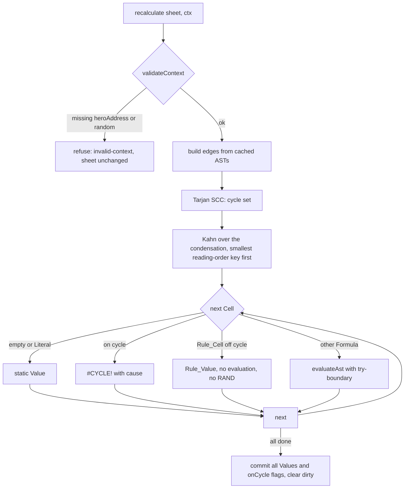
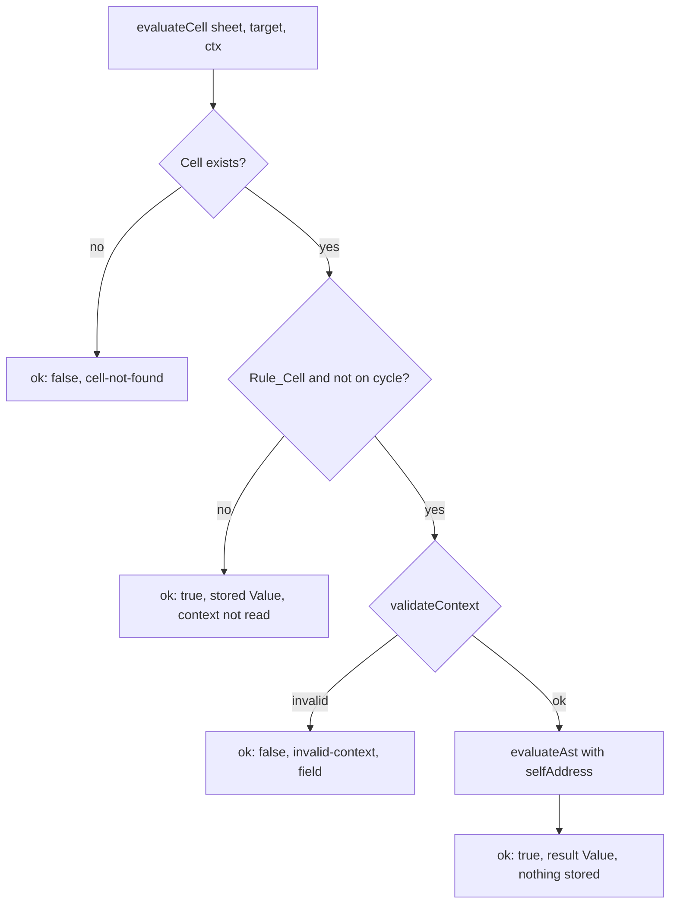

# Design Document

## Overview

The Formula_Engine is a DOM-free TypeScript module under `src/engine/`. It implements the frozen formula subset from `docs/BRIEF.md` section 4 and `.kiro/steering/formulas.md`. It has no game rules. Hero position, the monster position and the random number source arrive through an Evaluation_Context supplied by the caller.

The engine does five jobs:

1. **Read text.** A hand-written tokenizer and recursive-descent parser turn Raw_Text into an AST or a single `Col N: <message>.` Parse_Error.
2. **Write text.** A printer turns an AST back into canonical formula text. Parse, print, parse is stable.
3. **Store cells.** A Sheet holds exactly 240 Cells (`A1` to `L20`) with Raw_Text, an optional name, a cached AST, and the last recalculated Value.
4. **Recalculate.** A Recalculator builds a Dependency_Graph from the cached ASTs, finds cycles with Tarjan's SCC algorithm, orders Cells with a deterministic topological sort (ties by Address reading order), and evaluates each Cell once.
5. **Evaluate on demand.** Per_Monster_Evaluation evaluates one Rule_Cell with a Self_Address and returns the result to the caller without storing it.

### Design decisions and rationale

| Decision | Rationale |
|---|---|
| Recalculation is always a full, from-scratch pass over 240 Cells. | A Sheet has at most 240 Cells, so a full pass is cheap. No state from earlier recalculations is read, so order independence (Requirement 11) follows from the structure, not from careful bookkeeping. |
| The engine stores parsed ASTs on Cells. The Dependency_Graph is rebuilt at every recalculation, not stored. | A refused edit cannot leave the graph half-updated (Requirement 6, criterion 1). Names are bound late, so assigning or removing a Cell_Name needs no graph repair. |
| Operands are lazy `ref` / `range` / `value` objects, not eagerly dereferenced values. | `ROW`, `COL`, `DIST` and `TOWARD` need the Address that `HERO`, `SELF`, a Cell_Name or a Cell reference resolves to, not the Cell's Value (Requirement 8, criterion 9). |
| Errors are ordinary Values that carry a cause and an origin Address. | Propagation (Requirement 10) is returning the same Value unchanged. The cause names the originating Address by construction. |
| `#CYCLE!` precedence lives in one function, `pickError`. | Requirement 13, criterion 9 touches every operator and function. One chokepoint keeps it uniform. |
| AST height is capped at 200 by the parser, and the parser's own recursion is capped at 200. | Every later pass (printer, evaluator, dependency extraction) recurses over a tree of height at most 200, so no input can overflow the stack. |
| No API function throws. Each returns a result object with a discriminant. | Requirements 6.6, 12 and 14. |
| Property-based tests: exactly three (Requirements 5, 11, 12). Everything else uses example-based tests. | Matches the requirements. |

### Research summary

No external research was needed. The design rests on well-known techniques, noted here with sources.

- Tarjan's strongly connected components algorithm finds every Cell on a cycle in linear time. A component is on a cycle if it has two or more members, or one member with a self-edge ([Wikipedia: Tarjan's SCC algorithm](https://en.wikipedia.org/wiki/Tarjan%27s_strongly_connected_components_algorithm)).
- Kahn's algorithm gives a topological order. Choosing the smallest ready node each step makes the order deterministic ([Wikipedia: Topological sorting](https://en.wikipedia.org/wiki/Topological_sorting)).
- `Number.prototype.toExponential()` with no argument returns as many digits as needed to identify the number uniquely, which gives the shortest round-trip digits to expand into plain decimal text ([MDN: toExponential](https://developer.mozilla.org/en-US/docs/Web/JavaScript/Reference/Global_Objects/Number/toExponential)). Content was rephrased for compliance with licensing restrictions.
- fast-check 4.x offers `fc.letrec` for recursive arbitraries, `fc.assert` with `numRuns` and `seed`, and failure reports that include the seed, the path and the shrunk counterexample ([fast-check documentation](https://fast-check.dev/docs/core-blocks/arbitraries/combiners/recursive/)).

## Architecture

### Module layout

```
src/engine/
  index.ts              public API: named exports only, no default export
  address.ts            GridPoint, parseAddress, formatAddress, readingIndex, bounds, constants
  names.ts              Cell_Name pattern, reserved names, function-name list, validateCellName
  values.ts             Value types, constructors, formatNumber, formatValue
  errors.ts             ErrorKind, makeError, pickError, truncateCause
  ast.ts                AST node types, MAX_DEPTH, isRuleAst, walk helpers
  tokenizer.ts          tokenize (strict) and scan (partial, internal)
  parser.ts             parseFormula: tokens to AST or ParseError
  printer.ts            printFormula: AST to canonical text
  functions.ts          function table: arity, argument modes, implementations
  evaluator.ts          evaluateAst over an EvalEnv
  context.ts            EvaluationContext type and validateContext
  graph.ts              extractDependencies, findCycles (Tarjan), topologicalOrder (Kahn)
  sheet.ts              Sheet store, createSheet, setRawText, setCellName, reads
  recalculator.ts       recalculate
  evaluate-cell.ts      evaluateCell (Per_Monster_Evaluation), listCycleCells, describeError
  testing/arbitraries.ts  fast-check generators (test support, not exported from index.ts)
  *.test.ts             example-based tests, next to the source
  *.prop.test.ts        the three property-based tests
```

Dependencies inside the engine point one way. Nothing under `src/engine/` imports from `src/model/`, `src/game/` or `src/ui/` (Requirement 14, criterion 7).

```mermaid
flowchart TD
  index[index.ts] --> sheet
  index --> recalculator
  index --> evaluate-cell
  index --> parser
  index --> printer
  recalculator --> graph
  recalculator --> evaluator
  recalculator --> context
  evaluate-cell --> evaluator
  evaluate-cell --> context
  evaluator --> functions
  functions --> errors
  evaluator --> errors
  graph --> ast
  sheet --> parser
  sheet --> names
  printer --> ast
  parser --> tokenizer
  parser --> ast
  tokenizer --> address
  ast --> address
  errors --> values
  values --> address
  names --> address
```

### Recalculation flow



### Per_Monster_Evaluation flow



### Why full recalculation gives order independence

The Sheet stores 240 Cells in a fixed array indexed by reading order. The only inputs to `recalculate` are:

- each Cell's Raw_Text (through its cached AST),
- each Cell's name,
- `heroAddress`, and
- the sequence of numbers the Random_Source returns.

The Dependency_Graph, the SCCs and the evaluation order are computed from those inputs. Every iteration runs over arrays in index order, never over insertion-ordered maps. The order in which Cells were defined or edited is not stored anywhere. Two Sheets with the same final Raw_Text and names therefore run the same computation and draw the same random numbers in the same order.

`RAND()` order is the evaluation order of Cells. That order is the topological order with ties broken by smallest Address reading index (row, then column). Within one Cell, `RAND()` calls happen in source order, left to right. Rule_Cells are never evaluated during recalculation, so they never draw.

### Why evaluation is total

Totality is argued by structure first. A try-boundary is only defense in depth.

- The tokenizer is a single forward scan. It does bounded work per character and ends at the end of the text.
- The parser's recursion depth is capped at 200 (a counter checked on entry to `parseUnary` and to each parenthesized or call-argument expression), and the height of the AST is capped at 200 (computed bottom-up, including the loops that build left-deep binary chains). Deeper input becomes a Parse_Error. The tree height bound then limits recursion in the printer, the evaluator and dependency extraction to about 200 frames, far below the stack limit.
- A Range is bounds-checked at its two endpoints before it is enumerated, so a Range covers at most 240 Cells.
- The graph algorithms (Tarjan, Kahn) use explicit stacks and arrays and run over at most 240 nodes.
- Arithmetic results are checked with `Number.isFinite`; a non-finite result becomes `#VALUE!` (Requirement 12, criterion 5).
- The only external call is `context.random()`. It runs inside a guard. A throw, a non-number or a value outside [0, 1) becomes `#VALUE!` for that `RAND()` call.
- Defense in depth: `evaluateAst` runs per Cell inside `try/catch`. A caught exception becomes `#VALUE!` with a cause that starts with `internal error`. Every public function has an outer `try/catch` that returns a refused result. The property tests assert that no Cell cause contains `internal error`, so the boundary firing is itself a test failure.

## Components and Interfaces

All public types and functions are exported from `src/engine/index.ts` by name. Imports use `export type` for types because the project uses `verbatimModuleSyntax`.

### Addresses and names (`address.ts`, `names.ts`)

```ts
/** 1-based column and row. A GridPoint may lie outside the Sheet (used for out-of-sheet references). */
export interface GridPoint {
  readonly col: number; // integer; A = 1
  readonly row: number; // integer
}

export const SHEET_COLUMNS = 12; // A..L
export const SHEET_ROWS = 20;
export const SHEET_CELL_COUNT = 240;

export function isInSheet(p: GridPoint): boolean;
/** Strict Address parser for API input (Requirement 1, criteria 2 to 4). Returns the canonical form. */
export function parseAddress(text: string): { ok: true; point: GridPoint; canonical: string } | { ok: false };
export function formatAddress(p: GridPoint): string; // "B9"; col beyond 26 is not formattable
/** Reading-order index 0..239: (row - 1) * 12 + (col - 1). Only defined for in-sheet points. */
export function readingIndex(p: GridPoint): number;

export type NameCheckFailure = 'pattern' | 'reserved' | 'function' | 'address-like';
export function validateCellName(
  name: string,
): { ok: true; canonical: string } | { ok: false; failed: NameCheckFailure };
```

`parseAddress` accepts `^[A-La-l]([1-9]|1[0-9]|20)$`. This rejects leading zeros, signs, decimal points, whitespace and everything outside `A1`..`L20`.

`validateCellName` checks, in this order: the `[A-Za-z_][A-Za-z0-9_]*` pattern, then the reserved names `HERO`, `SELF`, `TRUE`, `FALSE`, then the function names (`SUM`, `MIN`, `MAX`, `ABS`, `MOD`, `IF`, `AND`, `OR`, `NOT`, `ROW`, `COL`, `DIST`, `TOWARD`, `RAND`), then the "reads as an Address" test `^[A-La-l][0-9]+$`. All comparisons are case-insensitive. The canonical form is upper case.

### Values and errors (`values.ts`, `errors.ts`)

```ts
export type ErrorKind = '#REF!' | '#NAME?' | '#DIV/0!' | '#VALUE!' | '#CYCLE!';

export type Value =
  | { readonly kind: 'number'; readonly value: number }   // always finite
  | { readonly kind: 'string'; readonly value: string }
  | { readonly kind: 'boolean'; readonly value: boolean }
  | { readonly kind: 'error'; readonly error: ErrorKind; readonly cause: string; readonly origin: string }
  | { readonly kind: 'rule'; readonly text: string };

/** Display text: number via formatNumber, string as-is, TRUE/FALSE, the ErrorKind, or the Rule_Cell's Raw_Text. */
export function formatValue(v: Value): string;
/** Shortest round-trip decimal text, no exponent, "-0" prints as "0". */
export function formatNumber(n: number): string;
```

An `error` Value has a `cause` of 1 to 200 characters and an `origin`, the canonical Address of the Cell where the error was created. A propagated error is the same object, so cause and origin never change on the way up (Requirement 10, criteria 3 and 11).

```ts
/** Build an error Value. The cause always starts with the origin Address (and its name, if any). */
export function makeError(kind: ErrorKind, origin: string, text: string): Value;
/**
 * Choose the winning error from errors listed in source order.
 * If any is #CYCLE!, return the #CYCLE! with the lowest origin reading index (first one on a tie).
 * Otherwise return the first error in the list.
 */
export function pickError(errors: readonly ErrorValue[]): ErrorValue;
/** Cut to at most 200 code points, never splitting a surrogate pair. Keeps the start (the origin). */
export function truncateCause(text: string): string;
```

### AST (`ast.ts`)

```ts
export const MAX_DEPTH = 200;

export type BinaryOperator = '+' | '-' | '*' | '/' | '&' | '=' | '<>' | '<' | '>' | '<=' | '>=';

export type Node =
  | { readonly kind: 'number'; readonly value: number }          // finite, >= 0 (a leading '-' is a 'negate' node)
  | { readonly kind: 'string'; readonly value: string }
  | { readonly kind: 'boolean'; readonly value: boolean }
  | CellNode
  | { readonly kind: 'range'; readonly from: CellNode; readonly to: CellNode }  // as written, not normalized
  | { readonly kind: 'name'; readonly name: string }             // upper case; never TRUE, FALSE or a function
  | { readonly kind: 'negate'; readonly operand: Node }
  | { readonly kind: 'binary'; readonly op: BinaryOperator; readonly left: Node; readonly right: Node }
  | { readonly kind: 'call'; readonly name: string; readonly args: readonly Node[] }; // upper-case name

export interface CellNode {
  readonly kind: 'cell';
  readonly col: number; // 1..26, letter A..Z
  readonly row: number; // integer 0..1_000_000 (anything above 20 is out of the Sheet; larger rows are clamped)
}

/** True when the AST contains a name node SELF or a call to TOWARD, anywhere (including untaken IF branches). */
export function isRuleAst(root: Node): boolean;
```

Rule_Cell detection runs on the AST. `SELF` or `TOWARD` inside a string literal is only a string node, so it never triggers it. The result is cached on the Cell when the Raw_Text is set.

### Tokenizer (`tokenizer.ts`)

```ts
export type TokenKind =
  | 'number' | 'string' | 'boolean' | 'address' | 'ident'
  | 'op' | 'lparen' | 'rparen' | 'comma' | 'colon' | 'eof';

export interface Token {
  readonly kind: TokenKind;
  readonly column: number;   // 1-based, counted in UTF-16 code units, the leading '=' is column 1
  readonly text: string;     // upper-cased for ident, address and boolean; operator text for op
  readonly number?: number;  // number tokens
  readonly string?: string;  // decoded string literal (doubled quotes collapsed)
}

export interface ParseError { readonly column: number; readonly message: string; readonly text: string } // text = `Col N: msg.`

/** Strict form (Requirement 2): either all tokens or one error and no tokens. */
export function tokenize(rawText: string): { ok: true; tokens: readonly Token[] } | { ok: false; error: ParseError };
/** Internal form used by the parser: the tokens before the first lexical error, plus that error. */
export function scan(rawText: string): { tokens: readonly Token[]; error: ParseError | null };
```

Scanning rules:

- Skip only U+0020. Tab, newline and any other unknown character is a Parse_Error at its column.
- A word is `[A-Za-z_][A-Za-z0-9_]*`. `TRUE` and `FALSE` (any case) become `boolean` tokens. A word matching `^[A-Za-z][0-9]+$` becomes an `address` token (so `M30`, `A0` and `Z99` are tokens that later evaluate to `#REF!`). Any other word is an `ident`.
- A number is digits, then optionally `.` and one or more digits. A `.` with no digit after it, or a second `.`, is a Parse_Error at that `.`. A digit string that converts to a non-finite number is a Parse_Error at the number's column. `-` is always its own operator token.
- Operators use longest match: `<=`, `>=`, `<>`, then single characters.
- A string starts and ends with `"`. A doubled `""` is one quote character inside the string. A missing closing quote is a Parse_Error at the opening quote.
- `$` is a Parse_Error at its column with the message `absolute references are not supported`.

### Parser (`parser.ts`)

```ts
export type ParseResult =
  | { readonly ok: true; readonly ast: Node }
  | { readonly ok: false; readonly error: ParseError };

/** Parse a full Raw_Text. Raw_Text that does not start with '=' fails at Col 1. Never throws. */
export function parseFormula(rawText: string): ParseResult;
```

Grammar (EBNF), with the precedence required by Requirement 3:

```
formula    := '=' comparison EOF
comparison := concat   ( ('=' | '<>' | '<' | '>' | '<=' | '>=') concat )*   ; left-associative
concat     := additive ( '&' additive )*
additive   := term     ( ('+' | '-') term )*
term       := unary    ( ('*' | '/') unary )*
unary      := '-' unary | primary
primary    := NUMBER | STRING | BOOLEAN | ADDRESS | IDENT
            | IDENT '(' [ arg ( ',' arg )* ] ')'
            | '(' comparison ')'
arg        := ADDRESS ':' ADDRESS        ; only when the next token is ',' or ')'
            | comparison
```

Parser behaviour:

- **Range placement.** In `arg`, the parser looks ahead for `ADDRESS ':' ADDRESS` followed by `,` or `)`. If found, it builds a `range` node. In `primary`, an `ADDRESS` followed by `:` is a Parse_Error at the first character of the Range (`range is only allowed as a function argument`). This covers `SUM(A1:A3+1)`, `=A1:A3` and `=(A1:A3)`.
- **Names.** An `ident` not followed by `(` becomes a `name` node. Existence is not checked (Requirement 3, criterion 12). An `ident` followed by `(` becomes a `call` node, whether or not the function exists (Requirement 9, criterion 20).
- **Leading zeros.** Addresses are accepted in formulas with leading zeros in the row (`A01` is `A1`). The printer prints the canonical row.
- **Lowest column wins.** The parser runs on the tokens from `scan`. When `scan` reports a lexical error, the parser treats the end of the partial token list as an `eof` token placed at the lexical error's column. The final error is the parser's error if its column is lower than the lexical error's column, otherwise the lexical error. The parser stops at its first error (a left-to-right parse finds the lowest column first).
- **Depth.** `parseUnary`, parenthesized expressions and call arguments increment a recursion counter and fail at 201. Each node is created with its height (`max(child heights) + 1`) tracked in a parallel return value. When a node's height would exceed 200, the parser fails at the column of the token that triggered it, with `formula is nested too deeply`. This covers `1+1+1+...` chains, which loop but build a deep left-leaning tree.
- **Error columns.** An unexpected token is reported at its column. End of input is reported at `rawText.length + 1`. A leftover token after a complete expression is reported at its column.

Parse_Error messages are fixed short phrases, at most 80 characters (Requirement 6, criterion 3), with no trailing period. The formatter adds the period: `Col ${column}: ${message}.`.

| Situation | Message |
|---|---|
| First character is not `=` | `formula must start with '='` |
| Unknown character | `unexpected character <shown>` |
| Bad number | `number needs a digit after '.'`, `number has a second '.'`, `number is too large` |
| Unclosed string | `string is missing its closing quote` |
| `$` | `absolute references are not supported` |
| Missing operand | `expected a value here` |
| Unexpected token | `unexpected <shown>` |
| Missing close | `expected ')'`, `expected ',' or ')'` |
| End of input | `unexpected end of formula` |
| Leftover input | `unexpected <shown> after the formula` |
| Range misuse | `range is only allowed as a function argument` |
| Too deep | `formula is nested too deeply` |

`<shown>` is the offending character or token, with control and non-printing characters written as `U+XXXX` and long tokens cut to 20 characters, so a message never exceeds 80 characters.

### Printer (`printer.ts`)

```ts
export type PrintResult =
  | { readonly ok: true; readonly text: string }
  | { readonly ok: false; readonly error: { readonly kind: 'non-finite-number' | 'invalid-node'; readonly detail: string } };

/** Canonical text for an AST. Never throws, never returns partial text. */
export function printFormula(ast: Node): PrintResult;
```

Precedence table used for parenthesization:

| Node | Level |
|---|---|
| comparison `= <> < > <= >=` | 1 |
| `&` | 2 |
| `+ -` | 3 |
| `* /` | 4 |
| `negate` | 5 |
| number, string, boolean, cell, name, call, parenthesized | 6 |

Rules: a `binary` node at level L prints its left child in parentheses only if the child's level is below L. It prints its right child in parentheses if the child's level is at or below L, because every binary operator is left-associative and `a-(b-c)` differs from `a-b-c`. A `negate` prints its operand in parentheses if the operand's level is below 5. Nothing else gets parentheses, so parentheses are inserted only where removal would change the AST (Requirement 4, criterion 4). A `negate` operand that is itself a `negate` prints as `--3`, which tokenizes as two minus operators.

Formatting: the text starts with `=`, has exactly one space on each side of a binary operator, separates arguments with `, `, prints Addresses, names, function names and `TRUE`/`FALSE` in upper case, and doubles every embedded `"` in a string. Numbers use `formatNumber`.

`formatNumber(n)`:

1. If `n` is `-0`, return `"0"`.
2. Take the digits and exponent from `n.toExponential()` (shortest round-trip digits).
3. Place the decimal point by hand: a positive exponent pads with zeros (`1e21` prints as `1000000000000000000000`), a negative exponent prefixes `0.` and zeros (`5e-7` prints as `0.0000005`). The result never contains an exponent.

Printer failures (no partial text): a non-finite number node is `non-finite-number`. A negative number node, a `range` anywhere except as a direct `call` argument, a `col` outside 1..26, a negative or non-integer `row`, an unknown `kind`, a missing child, and a tree taller than `MAX_DEPTH` are `invalid-node`.

### Functions (`functions.ts`)

A table keyed by upper-case name. Each entry has the arity (`min`, `max`), the argument mode per position, and a pure implementation that receives already-checked arguments.

| Function | Arity | Argument mode | Result |
|---|---|---|---|
| `SUM`, `MIN`, `MAX` | 1 or more | `rangeOrValue` | number; empty Cells (single or in a Range) are skipped; `SUM` of nothing is `0`, `MIN`/`MAX` of nothing is `#VALUE!` |
| `ABS` | 1 | `number` | number |
| `MOD` | 2 | `number`, `number` | number with the sign of the divisor |
| `IF` | 3 | `lazy` | the chosen branch operand |
| `AND`, `OR` | 1 or more | `boolean` | boolean (all arguments evaluated, no short circuit) |
| `NOT` | 1 | `boolean` | boolean |
| `ROW`, `COL` | 1 | `ref` | number |
| `DIST` | 2 | `ref`, `ref` | number |
| `TOWARD` | 1 | `ref` | `"N"`, `"S"`, `"E"`, `"W"` or `"-"` |
| `RAND` | 0 | none | number in [0, 1) |

`TOWARD(target)` with Self_Address `(sc, sr)` and target `(tc, tr)`: let `dr = tr - sr` and `dc = tc - sc`. If both are `0`, return `"-"`. If `|dr| >= |dc|`, go vertical (`"N"` if `dr < 0`, else `"S"`). Otherwise go horizontal (`"W"` if `dc < 0`, else `"E"`). Ties go vertical. `N` is toward row 1 and `W` is toward column `A`.

`MOD(a, b)` with `b` not `0`: `r = a % b`; if `r !== 0` and the sign of `r` differs from the sign of `b`, `r += b`. If the result is not finite or `|r| >= |b|` because of rounding, the result is `0`.

### Evaluator (`evaluator.ts`)

```ts
/** What the evaluator needs to know about one Cell. */
export interface CellView {
  readonly empty: boolean;            // Raw_Text is "" (distinct from a Formula that yields "")
  readonly name: string | null;
  readonly value: Value;              // stored Value; kind 'rule' for a Rule_Cell off a cycle
}

export interface EvalEnv {
  readonly origin: GridPoint;                           // Cell whose Formula is being evaluated (labels causes)
  readonly cellAt: (p: GridPoint) => CellView;          // p is always in the Sheet
  readonly resolveName: (upper: string) => GridPoint | undefined; // Cell_Name lookup (never HERO or SELF)
  readonly hero: GridPoint;                             // validated, may be outside the Sheet
  readonly self: GridPoint | undefined;                 // absent during recalculation
  readonly random: () => number;
}

/** Evaluate one Formula AST to a final Value (never 'rule'). Never throws. */
export function evaluateAst(ast: Node, env: EvalEnv): Value;
```

Internally the evaluator returns an `Operand`:

```ts
type Operand =
  | { readonly t: 'val'; readonly v: Value }             // number, string, boolean or error (never 'rule')
  | { readonly t: 'ref'; readonly point: GridPoint }     // an in-sheet Cell, not yet read
  | { readonly t: 'range'; readonly from: GridPoint; readonly to: GridPoint }; // in-sheet, normalized
```

Node evaluation:

| Node | Operand |
|---|---|
| number, string, boolean | `val` |
| cell | In the Sheet: `ref`. Outside (column beyond `L`, row `0` or beyond `20`): `val` `#REF!` with cause `B9 refers to M30, which does not exist`. |
| range | Both endpoints in the Sheet: `range` (normalized to top-left and bottom-right, so `A5:A1` is `A1:A5`). Otherwise `val` `#REF!`. |
| name `HERO` | `ref` to `env.hero` if it is in the Sheet, else `#REF!` |
| name `SELF` | `ref` to `env.self` if present and in the Sheet, else `#REF!` |
| other name | `ref` to `env.resolveName(name)` if found, else `#REF!` (`B9 refers to NOSUCH, which is not a cell name`) |
| negate, binary, call | Per the rules below |

`deref(operand)` produces a *scalar*, which is a Value or the empty marker:

- `val` returns itself.
- `ref` reads `env.cellAt(point)`. If the stored Value is `rule`, the result is `#VALUE!` with a cause naming the Rule_Cell, for example `B2 refers to C3 (MOVE_M1), which is a rule, not a value`. If the Cell is empty, the result is the empty marker. Otherwise it is the stored Value. A stored `#CYCLE!` therefore flows in unchanged.
- `range` is `#REF!` (`B2 uses the range A1:A3 where a single value is needed`).

Coercions applied after `deref` (Requirement 7, criteria 5 to 10):

| Context | Empty marker becomes |
|---|---|
| arithmetic (`+ - * /`, unary `-`, `ABS`, `MOD`) | number `0` |
| `&` | string `""` |
| comparison against a string | `""` |
| comparison against a number or another empty | `0` |
| comparison against a boolean | `FALSE` |
| boolean context (`IF` condition, `AND`, `OR`, `NOT`) | `FALSE` |
| final result of a Formula, or an `IF` branch used as a result | number `0` |

Operator rules:

- **Arithmetic.** Both operands are evaluated left to right. The errors among them go through `pickError`. A string or boolean operand is `#VALUE!`. `/` with a divisor equal to `0` (including `-0`) is `#DIV/0!`. A non-finite result is `#VALUE!`.
- **`&`.** Numbers use `formatNumber`; booleans become `TRUE` or `FALSE`; empty becomes `""`; the result is a string.
- **Comparison.** After empty coercion, both operands must have the same type (number, string or boolean), else `#VALUE!`. Numbers compare numerically. Strings compare case-insensitively (Requirements 9.4 and 9.25): each side is converted with `String.prototype.toUpperCase()` (locale-independent), then the results compare ordinally by UTF-16 code unit, so `"a" = "A"` is `TRUE` and `"a" < "B"` is `TRUE`. Booleans compare with `FALSE < TRUE`. The result is a boolean.
- **Unary `-`.** A number is negated. A string or boolean is `#VALUE!`. `=--3` is `negate(negate(3))`.

Call evaluation pipeline, for every call except the lazy part of `IF`:

1. Look up the function. Evaluate every argument operand in source order, with no short circuit. This keeps `#CYCLE!` precedence uniform and keeps `RAND()` draws in a fixed order.
2. Collect the argument errors in source order. `scanErrors` returns: for a `val` error, itself; for a `ref` in `value` or `rangeOrValue` mode, the error of its `deref`, if any; for a `ref` in `ref` mode, nothing (the Cell is not read); for a `range` in `rangeOrValue` mode, the errors of its member Cells in row-major order; for a `range` in any other mode, a `#REF!`.
3. If any collected error is `#CYCLE!`, return the one that `pickError` selects.
4. If the function is unknown, return `#NAME?` (`B9 calls FOO, which is not a function`). Argument values are not used.
5. If the argument count does not match the arity, return `#VALUE!`.
6. If any argument error remains, return the leftmost one (Requirement 10, criterion 4).
7. Check argument types (`#VALUE!` on a mismatch) and compute.

`IF` is evaluated lazily when it has exactly 3 arguments. The condition is evaluated and dereferenced first. An error condition is returned immediately, and the branches are not evaluated (Requirement 10, criterion 7). A non-boolean condition is `#VALUE!`. Otherwise only the chosen branch is evaluated, and its operand is returned as-is, so `SUM(IF(c, A1:A3, B1:B3))` works and `TOWARD(IF(c, HERO, B2))` works. The untaken branch is never an operand, so an error or `#CYCLE!` value in it has no effect (Requirement 13, criterion 9c). `IF` with any other argument count follows the general pipeline.

`SUM`, `MIN` and `MAX` gather numeric members over their arguments. A Range member that is a number counts. Empty, string and boolean Range members are skipped. A Rule_Cell member makes the call `#VALUE!` (subject to `#CYCLE!` precedence). A single (non-Range) argument is dereferenced: a number counts, an empty Cell is skipped, exactly like an empty Range member, and a string or boolean is `#VALUE!`. So `MIN(A1, 5)` with an empty `A1` is `5`, `MAX(A1, -5)` is `-5`, and `SUM(A1)` is `0`.

`RAND()` calls `env.random()` once per call. The result must be a finite number in [0, 1); otherwise, and if the call throws, the call is `#VALUE!` with the cause `B9 got an invalid number from the random source`.

`ROW`, `COL`, `DIST` and `TOWARD` need a `ref` operand. A `val` that is not an error is `#VALUE!`. A `range` is `#REF!`. `TOWARD` also needs `env.self` in the Sheet; otherwise it is `#REF!` (`B9 uses SELF, but no monster is being evaluated`).

The final Value of a Formula is the `deref` of the result operand, with the empty marker mapped to number `0`.

### Dependency graph (`graph.ts`)

```ts
export interface DependencyGraph {
  /** edges[i] = sorted, de-duplicated indices of the Cells that Cell i depends on. */
  readonly edges: readonly (readonly number[])[]; // length 240
}

export function extractDependencies(
  ast: Node,
  resolveName: (upper: string) => number | undefined,
  options: { readonly heroIndex: number | undefined; readonly isRule: boolean },
): number[];

export function buildGraph(sheet: SheetState, heroIndex: number | undefined): DependencyGraph;

/** Tarjan's algorithm (iterative). Returns the Cell indices on a circular reference, ascending. */
export function findCycleCells(graph: DependencyGraph): number[];

/** Kahn's algorithm over the condensation; smallest reading-order key among ready components first. */
export function topologicalOrder(graph: DependencyGraph): number[];
```

Edges (Requirement 11, criterion 1, and Requirement 13, criteria 7 and 8):

- one edge to every in-sheet Cell reference,
- one edge to every member of a Range whose two endpoints are both in the Sheet,
- one edge to the Cell that each Cell_Name reaches,
- no edge for an out-of-sheet reference, a Range with an out-of-sheet endpoint, or an unknown name.

All edges come from the text of the Formula, so a reference in the branch `IF` does not take still counts. A self-reference is an edge from a Cell to itself.

One extra edge is added beyond Requirement 11, criterion 1. A non-Rule_Cell that uses `HERO` in value position (anywhere except as a direct argument of `ROW`, `COL` or `DIST`) gets an edge to the hero's Cell if `heroAddress` is in the Sheet. Without it, `=HERO` would read a Cell that may not be evaluated yet. See Open Question 18.

`findCycleCells` marks a component as circular if it has two or more members, or one member with a self-edge. `topologicalOrder` condenses the SCCs. A component is ready when all components it depends on are done. Its key is the smallest reading index among its members. Each step takes the ready component with the smallest key. With at most 240 components, a linear scan for the minimum is enough. Members of a circular component are emitted together in ascending index order. The result is a function of the graph alone.

### Sheet store (`sheet.ts`)

```ts
export interface Sheet { readonly [sheetBrand]: true } // opaque; internals live in sheet.ts

export function createSheet(): Sheet;

export type CellTarget = { readonly address: string } | { readonly name: string };

export type SetRawTextResult =
  | { readonly accepted: true; readonly address: string; readonly kind: 'formula' | 'literal'; readonly canonicalText: string | null }
  | { readonly accepted: false; readonly error: { readonly kind: 'invalid-address' } }
  | { readonly accepted: false; readonly error: { readonly kind: 'parse-error'; readonly parseError: ParseError } };

export function setRawText(sheet: Sheet, address: string, rawText: string): SetRawTextResult;

export type SetNameResult =
  | { readonly accepted: true; readonly address: string; readonly name: string | null }
  | { readonly accepted: false; readonly error:
      | { readonly kind: 'invalid-address' }
      | { readonly kind: 'invalid-name'; readonly failed: NameCheckFailure }
      | { readonly kind: 'duplicate-name'; readonly name: string; readonly heldBy: string } };

/** Pass null to clear the name. A refused call changes nothing. */
export function setCellName(sheet: Sheet, address: string, name: string | null): SetNameResult;

export type ReadResult =
  | { readonly ok: true; readonly address: string; readonly name: string | null; readonly value: Value; readonly stale: boolean }
  | { readonly ok: false; readonly error: { readonly kind: 'cell-not-found' } };

export function getValueByAddress(sheet: Sheet, address: string): ReadResult;
export function getValueByName(sheet: Sheet, name: string): ReadResult;
```

`setRawText` behaviour:

- A Raw_Text that does not start with `=` is a Literal. It is stored without parsing and can never produce a Parse_Error (Requirement 6, criterion 5). Its AST is `null`.
- A Raw_Text that starts with `=` is parsed first. On failure the result is `accepted: false` and *nothing* about the Cell changes (Raw_Text, AST, Value, name, graph).
- On success the engine stores the Raw_Text, the AST and `isRule = isRuleAst(ast)`, and sets the Sheet's `dirty` flag. `canonicalText` is the printed form of the AST, so a UI can offer to normalize the text. The stored Raw_Text is exactly what the caller typed.
- `setRawText` does not recalculate. Reads after an edit and before the next `recalculate` return the Value from the last recalculation, with `stale: true`. A new Sheet reads as the string `""` for every Cell, with `stale: false` until the first edit.

Address checks use `parseAddress`; an invalid Address in an edit returns `invalid-address` and leaves the Sheet unchanged. In a read, an Address that is outside the Sheet or malformed, or an unassigned name, returns `cell-not-found` (Requirement 14, criterion 3). Name lookups are case-insensitive.

### Evaluation_Context (`context.ts`)

```ts
export interface EvaluationContext {
  readonly heroAddress: GridPoint;        // required; may lie outside the Sheet
  readonly selfAddress?: GridPoint;       // optional; only used by evaluateCell
  readonly random: () => number;          // required; returns a number in [0, 1)
}

export type ContextField = 'heroAddress' | 'random';
export function validateContext(
  ctx: unknown,
): { ok: true; hero: GridPoint; self: GridPoint | undefined; random: () => number } | { ok: false; field: ContextField };
```

`validateContext` is a runtime check for plain-JavaScript callers. `heroAddress` is valid if it is an object whose `col` and `row` are safe integers. `random` is valid if it is a function. A malformed `selfAddress` is treated as absent. A well-formed `selfAddress` outside the Sheet is kept, and `SELF` evaluates to `#REF!` for it.

### Recalculator (`recalculator.ts`)

```ts
export type RecalculateResult =
  | { readonly accepted: true; readonly cycleCells: readonly string[] }
  | { readonly accepted: false; readonly error: { readonly kind: 'invalid-context'; readonly field: ContextField } };

export function recalculate(sheet: Sheet, ctx: EvaluationContext): RecalculateResult;
```

Algorithm:

1. `validateContext`. On failure return `accepted: false` and leave every stored Value and Raw_Text unchanged.
2. Build the graph from the cached ASTs and the name index.
3. Find the cycle Cells with Tarjan. Compute the order with Kahn.
4. Evaluate in order into a fresh array of 240 Values:
   - empty Raw_Text: the string `""`;
   - Literal: a number Value if the Raw_Text matches `^[+-]?\d+(\.\d+)?$` and converts to a finite number, else the string Value taken as-is (`"1e3"`, `" 5"` and `"0x10"` are strings);
   - Cell on a cycle (Formula or Rule_Cell): `#CYCLE!` with origin = this Cell. The cause is `B1 refers to itself` for a self-reference, otherwise `B2 is on a circular reference with C3, D4` (this Cell's Address first, then the other members in reading order, cut to 200 characters);
   - Rule_Cell off a cycle: `{ kind: 'rule', text: rawText }`, with no evaluation and no `random()` call;
   - other Formula: `evaluateAst` inside `try/catch`, with `self` undefined.
5. Commit the array, the cycle flags and `dirty = false` in one step. Return `accepted: true` with the cycle Addresses.

### Per_Monster_Evaluation and queries (`evaluate-cell.ts`)

```ts
export type EvaluateCellResult =
  | { readonly ok: true; readonly value: Value; readonly source: 'evaluated' | 'stored'; readonly stale: boolean }
  | { readonly ok: false; readonly error: { readonly kind: 'cell-not-found' } }
  | { readonly ok: false; readonly error: { readonly kind: 'invalid-context'; readonly field: ContextField } };

export function evaluateCell(sheet: Sheet, target: CellTarget, ctx: EvaluationContext): EvaluateCellResult;

/** Addresses of all Cells on a circular reference, reading order, no duplicates (from the last recalculation). */
export function listCycleCells(sheet: Sheet): string[];

export type ErrorDescription = { readonly kind: ErrorKind; readonly cause: string; readonly origin: string };
export type DescribeErrorResult =
  | { readonly ok: true; readonly description: ErrorDescription | null } // null when the Cell does not hold an error
  | { readonly ok: false; readonly error: { readonly kind: 'cell-not-found' } };
export function describeError(sheet: Sheet, target: CellTarget): DescribeErrorResult;
```

`evaluateCell` order of checks: (1) the Cell exists; (2) if it is a Rule_Cell not on a cycle, validate the context; (3) evaluate with `self` set to the context's `selfAddress`, or return the stored Value for any other Cell without looking at the context (Requirement 8, criteria 16 to 19). Evaluation reads dependencies from the *stored* Values, so a Rule_Cell that references another Rule_Cell sees `#VALUE!`, and no dependency is ever evaluated with a Self_Address. Nothing is written to the Sheet. If the Formula yields an error, `ok: true` is returned with the error Value; the caller decides what that means. The result has `stale: true` when the Sheet has been edited since the last recalculation.

### Public API (`index.ts`)

| Operation (Requirement 14, criterion 2) | Export |
|---|---|
| parse text | `parseFormula` |
| print an AST | `printFormula` |
| create a Sheet | `createSheet` |
| set Raw_Text of a Cell | `setRawText` |
| assign a Cell_Name | `setCellName` |
| recalculate with an Evaluation_Context | `recalculate` |
| read a Value by Address | `getValueByAddress` |
| read a Value by name | `getValueByName` |
| Per_Monster_Evaluation | `evaluateCell` |
| list cycle Cells | `listCycleCells` |
| describe an Error_Value on a Cell | `describeError` |

Supporting exports: `tokenize`, `formatValue`, `formatNumber`, `parseAddress`, `formatAddress`, `isRuleAst`, `MAX_DEPTH`, and the types named above (`Node`, `Value`, `ErrorKind`, `ParseError`, `ParseResult`, `PrintResult`, `Sheet`, `CellTarget`, `EvaluationContext`, `GridPoint` and the result types). There is no default export.

## Data Models

### Cell record (internal to `sheet.ts`)

```ts
interface CellRecord {
  readonly index: number;      // 0..239 reading order
  raw: string;                 // "" means empty
  name: string | null;         // canonical upper case, unique in the Sheet
  ast: Node | null;            // null for Literals and empty Cells
  isRule: boolean;             // isRuleAst(ast), cached when Raw_Text is set
  value: Value;                // last recalculated Value, initially the string ""
  onCycle: boolean;            // from the last recalculation
}

interface SheetState {
  readonly cells: CellRecord[];                   // exactly 240, fixed order
  readonly names: Map<string, number>;            // upper-case name -> index; lookups only, never iterated
  dirty: boolean;                                 // edited since the last recalculation
}
```

### Value classification

| Cell | Stored Value |
|---|---|
| Raw_Text `""` | string `""` (the Cell is *empty*) |
| Literal matching `^[+-]?\d+(\.\d+)?$` | number |
| Any other Literal | string, as-is |
| Formula | result of evaluation |
| Rule_Cell off a cycle | `{ kind: 'rule', text: rawText }` |
| Any Cell on a cycle | `#CYCLE!` error |

### Example

For a Sheet where `A1` is `3`, `A2` is `=A1*2`, `A3` holds `=IF(DIST(HERO, SELF) < 4, TOWARD(HERO), "-")`, and `B1` is `=B1+1`:

| Cell | Stored Value after `recalculate` |
|---|---|
| `A1` | `{ kind: 'number', value: 3 }` |
| `A2` | `{ kind: 'number', value: 6 }` |
| `A3` | `{ kind: 'rule', text: '=IF(DIST(HERO, SELF) < 4, TOWARD(HERO), "-")' }` |
| `B1` | `{ kind: 'error', error: '#CYCLE!', cause: 'B1 refers to itself', origin: 'B1' }` |

A cause for a cycle of several Cells lists the other members, for example `B2 is on a circular reference with C3, D4`.


## Correctness Properties

*A property is a characteristic or behavior that should hold true across all valid executions of a system-essentially, a formal statement about what the system should do. Properties serve as the bridge between human-readable specifications and machine-verifiable correctness guarantees.*

The prework found three groups of criteria that are universal over a large input space: print and parse (Requirement 5), recalculation order (Requirement 11) and evaluation totality (Requirement 12). Property reflection merged redundant items. Criteria 5.1, 5.2 and 5.5 share one generator and become Property 1. Criteria 11.3, 11.4, 11.5, 11.6, 11.9, 11.10 and 11.11 become Property 2, because once the generator includes `RAND()`, Rule_Cells and cycles, equality of all stored Values covers them all. Criteria 12.1, 12.2 and 12.3 become Property 3. Every other requirement is covered by example-based tests (see Testing Strategy).

### Property 1: Parse-print-parse is stable

*For any* valid AST (every node kind, every operator, nesting depth from 0 to at least 5, string literals of 0 to 50 characters including embedded double quotes), printing it gives text that the parser accepts (`ok: true`), the AST parsed from that text is structurally equal to the original AST, and printing the parsed AST gives text character-for-character identical to the first printed text.

**Validates: Requirements 5.1, 5.2, 5.3, 5.5**

### Property 2: Recalculation is independent of definition order and edit order

*For any* Sheet of 1 to 50 Cells (random Addresses, Ranges, Cell_Names, `RAND()` calls, Rule_Cells and cyclic references), any Random_Source seed, any Hero_Address and any permutation of the order in which the Cells are defined, and *for any* sequence of edits (including refused edits and intermediate recalculations) that ends in the same final Raw_Text and names, recalculating with a fresh Random_Source built from the seed produces, for every Cell, a stored Value (kind, payload, cause and origin) identical to the Value from the baseline definition order. The number of `random()` calls is identical as well, and no Rule_Cell draws a number.

**Validates: Requirements 11.3, 11.4, 11.5, 11.6, 11.7, 11.9, 11.10, 11.11**

### Property 3: Evaluation is total and terminates

*For any* scenario drawn from (a) an arbitrary string of 0 to 10,000 characters including arbitrary Unicode, (b) a random Sheet with an arbitrary Evaluation_Context, or (c) a reference chain of up to 240 Cells, a self-reference or a cyclic reference, the engine never throws; parsing returns exactly one of a Parse_Error or an AST; recalculation either refuses an invalid context or ends with every one of the 240 Cells holding exactly one Value (a number, a string, a boolean, an Error_Value or a Rule_Value, with `#CYCLE!` on every Cell of a cycle); and the whole run finishes within 5,000 milliseconds.

**Validates: Requirements 12.1, 12.2, 12.3, 12.4, 12.7**

## Error Handling

| Failure | Where it is detected | Result |
|---|---|---|
| Lexical or syntax error in a Formula | tokenizer, parser | `parseFormula` returns `{ ok: false, error }` with text `Col N: <message>.`. `setRawText` returns `{ accepted: false, error: { kind: 'parse-error', parseError } }` and changes nothing. |
| Formula deeper than 200 levels | parser | A Parse_Error `formula is nested too deeply`. No stack overflow, since recursion and tree height are both capped. |
| Invalid Address in an edit | `setRawText`, `setCellName` | `{ accepted: false, error: { kind: 'invalid-address' } }`. |
| Invalid or duplicate Cell_Name | `setCellName` | `invalid-name` with the failed check, or `duplicate-name` with the conflicting name and the holder's Address. The previous name stays. |
| Address outside the Sheet or unassigned name in a read, an `evaluateCell` call or `describeError` | `sheet.ts`, `evaluate-cell.ts` | `{ ok: false, error: { kind: 'cell-not-found' } }`. |
| Missing or malformed `heroAddress` or `random` | `validateContext` | `recalculate` returns `accepted: false` with `invalid-context` and the field name. `evaluateCell` does the same only for a Rule_Cell off a cycle. Nothing stored changes. |
| Reference, name, function, type, division or cycle problems | evaluator, recalculator | Error Values (`#REF!`, `#NAME?`, `#VALUE!`, `#DIV/0!`, `#CYCLE!`) with a cause. Evaluation continues for every other Cell. |
| Non-finite arithmetic result | evaluator | `#VALUE!`. |
| Misbehaving Random_Source (throws, returns a non-number or a value outside [0, 1)) | `RAND` | `#VALUE!` for that call only. |
| Unexpected internal exception | per-Cell and per-API `try/catch` | `#VALUE!` with a cause beginning `internal error`, or a refused result. This is defense in depth; the property tests fail if it ever fires. |
| Stale reads | `getValue*`, `evaluateCell` | `stale: true` while the Sheet has edits not yet recalculated. |

Error causes are plain English, 1 to 200 characters, and begin with the originating Address (and the name in parentheses if the Cell has one). Examples: `B9 refers to M30, which does not exist`; `B9 refers to NOSUCH, which is not a cell name`; `B9 calls FOO, which is not a function`; `B9 divides by zero`; `B2 refers to C3 (MOVE_M1), which is a rule, not a value`. A propagated error keeps the original cause and origin. A cause longer than 200 code points is cut from the end, so the origin Address always survives.

## Testing Strategy

### Dual approach

- **Property-based tests** (fast-check 4.10.2, already pinned in `package.json`): exactly three, one per correctness property, in `*.prop.test.ts` files. They map to Requirements 5, 11 and 12.
- **Example-based unit tests** (Vitest, `vitest --run`): everything else, in `*.test.ts` files next to the source.
- Property-based testing applies here because the engine is a pure, DOM-free library: parsers, a printer and an evaluator, with large input spaces and clear invariants. It is limited to the three properties the requirements call for. Tokenizer rules, function semantics and error rules are small tables of specific cases, so examples cover them more precisely.

### Property test configuration

- `numRuns` at least 100 for every property. Property 1 uses 500, Property 2 uses 200 (each case does several recalculations), Property 3 uses 300.
- Each test carries a comment: `// Feature: formula-engine, Property N: <text>`.
- Each property is exactly one `fc.assert(fc.property(...))` call. No property-testing code is written from scratch.
- Reproduction: `fc.assert` is called with `seed` taken from the `FC_SEED` environment variable when set. On failure fast-check reports the seed, the path and the shrunk counterexample, and the test reports the generated AST and printed text (Property 1), the Sheet definition and shuffles (Property 2) or the scenario (Property 3). A failed property fails the run.
- Randomness in tests: a small seeded generator (`mulberry32`) lives in `testing/arbitraries.ts` and is used as the Random_Source. Tests never call `Math.random`.
- Property 3 includes a time check: it measures elapsed time per case with `performance.now()` and fails above 5,000 ms.

### Generator designs (`testing/arbitraries.ts`)

**Valid AST generator (Property 1).** `fc.letrec` with a depth limit.

- Leaves: numbers (non-negative finite: small integers, decimals, `0`, `1e21`, `5e-7`, `Number.MAX_SAFE_INTEGER`, `0.1 + 0.2`), strings of 0 to 50 characters made from a mix of ordinary characters, `"`, spaces, `=`, `,`, parentheses and non-ASCII characters, booleans, cells (column 1 to 26, row 0 to 40), names (upper-case identifiers that are not `TRUE`, `FALSE`, an Address-shaped word or a function name, plus `HERO` and `SELF`).
- Interior nodes: `negate`, `binary` (all 11 operators with weights so that low-precedence operators often sit under high-precedence ones, which forces parentheses), and `call` (names from the known functions and a few unknown ones, 0 to 4 arguments).
- Ranges are generated only as direct `call` arguments, with endpoints in either order.
- Nesting depth is drawn from 0 to 8 so that parenthesis depth reaches at least 5. The generator checks that coverage with `fc.statistics`/`fc.pre`-free tagging: a separate sanity example test builds an AST at depth 6 by hand.

**Random Sheet generator (Property 2).** Produces a *definition list* of 1 to 50 entries `{ address, rawText, name? }`.

- Addresses come from the 240 Cells without repeats.
- Raw_Text is drawn from templates: number and string Literals, arithmetic over other Cells in the list, Ranges inside `SUM`, `MIN` and `MAX`, Cell_Name references, `RAND()` terms, `IF` with references in both branches, Rule_Cell formulas (`SELF`, `TOWARD`), forward and backward references, self-references, and mutual cycles. References are drawn from the same Address pool so that edges are dense.
- A Cell_Name, when present, is unique within the Sheet.
- Alongside the list, the generator draws: a Random_Source seed, a Hero_Address (inside and outside the Sheet), a *permutation seed* (an integer fed to a deterministic Fisher-Yates shuffle, which shrinks cleanly), and an *edit script*, a list of steps `{ address, text }` of intermediate values (valid Formulas, invalid Formulas that must be refused, Literals) plus optional recalculation points.

**Property 2 procedure.** Build the baseline Sheet by applying the definitions in list order, then `recalculate` with a fresh `mulberry32(seed)`. Build a second Sheet with the shuffled order. Build a third Sheet by first replaying the edit script (with recalculations at the chosen points, each using its own fresh generator) and finally applying the final Raw_Text and names. Recalculate the second and third Sheets with a fresh generator from the same seed. Assert that all 240 Values are deeply equal across the three Sheets, that the three generators were called the same number of times, and that `listCycleCells` agree. Names are assigned after all Raw_Text, in the shuffled order of the same list, so the final names are the same.

**Arbitrary context generator (Property 3).** Mixes valid contexts (`heroAddress` inside and outside the Sheet, `selfAddress` present, absent or outside, a seeded `random`) with invalid ones: missing `heroAddress`, `heroAddress` with non-integer or `NaN` fields, a non-object, a missing `random`, a `random` that throws, returns `NaN`, returns `2`, or returns a string.

**Totality scenarios (Property 3).** A tagged union drawn with `fc.oneof`:

1. `{ tag: 'text', text }` where text is `fc.string({ unit: 'binary', maxLength: 10_000 })` mixed with formula-shaped strings built from random tokens, deeply nested strings (parentheses, unary minus and calls up to 100,000 levels, left-deep `1+1+...` chains), out-of-range references, unknown names and unknown functions.
2. `{ tag: 'sheet', definitions, context }` using the Property 2 sheet generator and the arbitrary context generator.
3. `{ tag: 'chain', kind }` where kind is a 240-Cell reference chain (`A1` to `L20`, each Cell referencing the previous one, in forward and reverse definition order), a whole-Sheet `SUM` Range, a self-reference, a long cycle, or 240 Cells each holding a 10,000-character Formula of Ranges.

Checks per scenario: no exception, one outcome per `parseFormula` call, 240 Values each of a valid kind, `#CYCLE!` on every Cell reported by `listCycleCells`, no cause containing `internal error`, every cause length in 1..200 for error Values, and elapsed time under 5,000 ms.

### Key example-based tests

| File | Key cases |
|---|---|
| `address.test.ts` | `A1`, `L20`, `b7` becomes `B7`; rejects `M1`, `A0`, `A21`, `A01`, `+A1`, `A1.0`, ` A1`, empty. |
| `names.test.ts` | Accepts `HP`, `_X`, `move_m1`; rejects `1HP`, `HERO`, `self`, `SUM`, `A1`, `l20`, bad characters; each failure reports the right check. |
| `tokenizer.test.ts` | Longest-match operators; `2.`, `2.5.1` and `1..2` fail at the right `.`; columns count the leading `=` as 1; doubled quotes; unterminated string at the opening quote; `$A$1` fails at `$`; tab and newline fail; case-insensitive keywords. |
| `parser.test.ts` | Precedence and left associativity (`1-2-3`, `1+2*3`, `1&2=3`, `-2*3`, `--3`); parentheses; Range only as a direct argument (`SUM(A1:A3)` ok, `SUM(A1:A3+1)`, `=A1:A3`, `=(A1:A3)` fail at the Range start); EOF column is length + 1; leftover token column; the lowest-column rule with a syntax error before a lexical error; message format and length; unknown function accepted; names not checked; depth 200 accepted, 201 and 100,000 rejected for parentheses, unary minus, calls and `1+1+...`. |
| `printer.test.ts` | Parenthesization table (`(1+2)*3`, `1-(2-3)`, `-(1+2)`, `(1=2)=3`); spacing; `, ` between arguments; upper-casing; string escaping; number table (`0.1`, `1e21`, `5e-7`, `-0`, `123456789012345680000`); non-finite and malformed ASTs refused with no partial text. |
| `sheet.test.ts` | 240 Cells; literal classification (`"1e3"`, `" 5"`, `"-5"`, `"+5"`, `"5."`, `""`); refused edit leaves everything unchanged; duplicate name case-insensitive; stale reads. |
| `evaluator.test.ts` | Reference coercions for an empty Cell in every operator and comparison; out-of-sheet and unknown-name `#REF!`; string-versus-number comparison `#VALUE!`; case-insensitive string comparison (`"a"="A"` `TRUE`, `"a"<"B"` `TRUE`, `"a"<>"A"` `FALSE`, `""=""` `TRUE`, `"ß"="SS"` `TRUE`, an empty Cell against a string compared as `""`); Range as a plain value `#REF!`; every function including `TOWARD` ties and `"-"`, `MOD` signs, `SUM` of nothing, arity and type errors; `#NAME?`; `#DIV/0!` including `-0`; overflow to `#VALUE!`; lazy `IF`; `RAND` once per call. |
| `errors.test.ts` | Leftmost error wins; `#CYCLE!` beats other errors; `pickError` tie on origin; cause truncation keeps the origin and does not split surrogate pairs; Range error order is row-major. |
| `graph.test.ts` | Edges for Addresses, Ranges, names; none for out-of-sheet references or unknown names; Tarjan on self-loop, two-cell cycle, cycle with tail; Kahn order with ties by reading order; deterministic across input shuffles; `HERO` value-position edge. |
| `recalculator.test.ts` | Dependent before dependency in the definition order; cycle breaking and `#CYCLE!` clearing; downstream `#CYCLE!`; untaken `IF` branch not an operand but still an edge; Range member `#CYCLE!`; Rule_Cell on a cycle holds `#CYCLE!`; Rule_Cell off a cycle holds `rule`; a Cell that reads a Rule_Cell gets `#VALUE!` with the right cause; scripted Random_Source shows call order and that Rule_Cells draw nothing; `heroAddress` outside the Sheet makes `HERO` `#REF!`; invalid context is refused and nothing changes. |
| `evaluate-cell.test.ts` | Cell-not-found before context check; Rule_Cell evaluated with `selfAddress`; absent or out-of-sheet `selfAddress` gives `#REF!`; non-Rule_Cell and cycle Rule_Cell return stored Values without a context; empty Cell returns `""`; result not stored; Rule_Cell referencing another Rule_Cell sees `#VALUE!`; erroring formula returns the Error_Value; `stale` flag. |
| `index.test.ts` | Exactly the documented named exports, no default export. |
| `constraints.test.ts` | Scans `src/engine/**/*.ts` (excluding tests) for `eval`, `new Function`, `Math.random`, `document`, `window`, `localStorage`, `sessionStorage`, `navigator`, `fetch`, `XMLHttpRequest`, and for imports from `src/model`, `src/game`, `src/ui`. The `lib` setting in `tsconfig.json` includes DOM types, so this scan is what enforces DOM-freeness. |

### Requirements traceability

| Requirement | Design elements | Tests |
|---|---|---|
| 1 Sheet and Cell Model | `address.ts`, `names.ts`, `sheet.ts`, literal classification in `recalculator.ts` | `address.test.ts`, `names.test.ts`, `sheet.test.ts` |
| 2 Tokenizer | `tokenizer.ts` | `tokenizer.test.ts` |
| 3 Parser and AST | `parser.ts`, `ast.ts` | `parser.test.ts`, Property 1 (indirectly) |
| 4 Printer | `printer.ts`, `formatNumber` | `printer.test.ts`, Property 1 |
| 5 Parse-Print-Parse Stability | `parser.ts`, `printer.ts`, `testing/arbitraries.ts` | Property 1 |
| 6 Parse Error Reporting | `parser.ts`, `sheet.ts` (`setRawText` atomic refusal) | `parser.test.ts`, `sheet.test.ts` |
| 7 References and Names | `evaluator.ts` (`deref`, coercion table) | `evaluator.test.ts` |
| 8 Evaluation Context and Special Names | `context.ts`, `evaluator.ts`, `recalculator.ts`, `evaluate-cell.ts` | `recalculator.test.ts`, `evaluate-cell.test.ts`, `constraints.test.ts`, Property 2 |
| 9 Operators and Functions | `functions.ts`, `evaluator.ts` | `evaluator.test.ts`, Property 3 |
| 10 Error Values and Propagation | `errors.ts`, `evaluator.ts` call pipeline | `errors.test.ts`, `evaluator.test.ts` |
| 11 Dependency Graph and Order Independence | `graph.ts`, `recalculator.ts` | `graph.test.ts`, `recalculator.test.ts`, Property 2 |
| 12 Total Evaluation | depth caps in `parser.ts`, try-boundaries, finite checks | `parser.test.ts` (depth), `evaluator.test.ts` (overflow), Property 3 |
| 13 Cycle Detection | `graph.ts` (Tarjan), `errors.ts` (`pickError`), `recalculator.ts` | `graph.test.ts`, `recalculator.test.ts`, Properties 2 and 3 |
| 14 Public API and Constraints | `index.ts`, `sheet.ts`, `evaluate-cell.ts` | `index.test.ts`, `constraints.test.ts`, `sheet.test.ts`, `evaluate-cell.test.ts` |

## Open Questions and Chosen Defaults

Each item records an edge case the requirements leave open or only imply, the default chosen, and the principle behind it. The principles are: `#CYCLE!` takes precedence over everything; a broken rule makes the monster stand still; and ordinary spreadsheet behaviour is preferred for empty Cells and types. Items 1 to 16 were raised before design. Items 17 to 29 were found while designing.

1. **A Range with several non-cycle errors.** The first error in row-major order wins (Requirement 10, criterion 8). If any member is `#CYCLE!`, the result is `#CYCLE!` (the member with the lowest origin reading index).
2. **`IF` with an erroring condition whose untaken branches contain a cycle reference.** The condition error wins (Requirement 10, criterion 7; 13, criterion 9c). The cycle edge still exists for cycle detection (13, criterion 7), so the Cell holding the reference can be on a cycle even if no value flows.
3. **Which cycle Cell a downstream `#CYCLE!` cause names.** Among the `#CYCLE!` errors an operation sees, `pickError` picks the one whose origin has the lowest Address in reading order. The choice is deterministic and does not depend on source order.
4. **`TOWARD` or `SELF` inside a string literal.** It does not make a Rule_Cell. Detection runs on the AST, where a string literal is a string node.
5. **Per_Monster_Evaluation of a Rule_Cell that references another Rule_Cell.** The reference is `#VALUE!` (Requirement 8, criterion 17). Dependencies are read from stored Values and are never evaluated with the Self_Address.
6. **Malformed Evaluation_Context.** A non-Address `heroAddress` (not an object with safe-integer `col` and `row`) or a non-function `random` counts as a missing field, for `recalculate` and for Rule_Cell calls. A malformed `selfAddress` counts as absent. An out-of-sheet `heroAddress` is allowed and makes `HERO` `#REF!` (Requirement 8, criterion 6).
7. **Per_Monster_Evaluation when the Formula errors.** It returns `ok: true` with the Error_Value. The engine never decides what a broken rule means for a monster; the game layer treats any non-direction result as "stand still". It never throws.
8. **Empty Cell versus a Formula yielding `""`.** An empty Cell is one whose Raw_Text is `""`. Its stored Value is the string `""` (Requirement 1, criterion 9), but references to it use the empty-Cell coercions of Requirement 7. A Cell holding `=""` has Raw_Text `=""`, is not empty, and is an ordinary empty string.
9. **Stale reads.** `setRawText` and `setCellName` do not recalculate. They set a dirty flag. Reads return the last recalculated Value with `stale: true`. A Rule_Cell edited into a non-rule formula is evaluated at the next recalculation.
10. **String comparison.** Final decision (Requirement 9, criterion 25): comparison is case-insensitive. Both strings are converted with `String.prototype.toUpperCase()` and then compared ordinally by UTF-16 code unit, so `"a" = "A"` is `TRUE`, `"a" < "B"` is `TRUE` and `"a" <> "A"` is `FALSE`. This supersedes the earlier case-sensitive, ordinal default. `toUpperCase()` is locale-independent (unlike `toLocaleUpperCase()`), so results do not vary by machine and stay deterministic. Comparison is by the upper-cased form, not character by character: `'ß'` upper-cases to `'SS'`, so `"ß" = "SS"` is `TRUE`. A boolean against a number and a string against a boolean are `#VALUE!` (Requirement 9, criterion 22).
11. **Number to text in `&`.** Shortest round-trip decimal text with no exponent (`1e21` is `"1000000000000000000000"`), and `-0` is `"0"`.
12. **Unary minus on a string or boolean.** `#VALUE!`. `=--3` parses as `negate(negate(3))` and evaluates to `3`.
13. **A Rule_Cell inside a Range given to `SUM`, `MIN` or `MAX`.** `#VALUE!` (Requirement 8, criterion 17), subject to `#CYCLE!` precedence.
14. **`HERO` and `SELF` inside Ranges or as plain values.** They cannot be Range endpoints (the grammar has Addresses only). As an argument to `ROW`, `COL`, `DIST` or `TOWARD` they resolve to an Address; anywhere else they resolve to the Value of the Cell at that Address (Requirement 8, criteria 9 and 10).
15. **Range orientation.** `A5:A1` is kept as written in the AST (so print and parse are stable) and normalized to `A1:A5` by the evaluator and the graph. Members are enumerated in row-major order.
16. **Literals such as `"1e3"` or `"  5"`.** They are strings. Only `^[+-]?\d+(\.\d+)?$` is a number (Requirement 1, criterion 8).
17. **Final result that is an empty-Cell reference.** `=A1` with `A1` empty evaluates to the number `0`, like ordinary spreadsheets. The requirements do not say.
18. **`HERO` in value position adds a dependency edge.** A non-Rule_Cell using `HERO` where its Value is needed gets an edge to the hero's Cell, in addition to the edges in Requirement 11, criterion 1. Otherwise the Cell could read a Value not yet computed. The result is that `=HERO` placed on the hero's own Cell is a cycle. `HERO` as a direct argument of `ROW`, `COL` or `DIST` adds no edge. `TOWARD(IF(c, HERO, B2))` adds an edge, because the position is not a direct argument.
19. **Unknown function.** Arguments are evaluated (so `#CYCLE!` precedence holds and `RAND()` draw order stays fixed) but their Values are not used. The call is `#NAME?` unless an argument is `#CYCLE!`. Requirement 14, criterion 10 ("do not evaluate the unsupported part") is read as "do not execute the function".
20. **Order of checks in a call.** `#CYCLE!` in any argument, then unknown function (`#NAME?`), then wrong argument count (`#VALUE!`), then the leftmost argument error, then type errors, then the result. Problems with the call itself come before problems with its arguments.
21. **Empty and boolean arguments to `SUM`, `MIN`, `MAX`.** Empty and boolean Range members are skipped. A single empty Cell argument is skipped too, as in ordinary spreadsheets (so `MIN(5, A1)` with an empty `A1` is `5`, the same as `MIN(5, A1:A1)`). `MIN` or `MAX` of only empty Cells is `#VALUE!`, and `SUM` of them is `0`. A single string or boolean argument is `#VALUE!`. (Changed after the first formula-reviewer review: the earlier rule counted a single empty Cell as `0`, which made `MIN(5, A1)` differ from `MIN(5, A1:A1)`.)
22. **Empty Cell in boolean context** (`IF` condition, `AND`, `OR`, `NOT`): `FALSE`, matching Requirement 7, criterion 9.
23. **Columns are counted in UTF-16 code units**, as JavaScript string indices, not in code points or grapheme clusters.
24. **A Literal with a huge digit string** that converts to a non-finite number is a string Value. A Formula number token that converts to a non-finite number is a Parse_Error (`number is too large`).
25. **`MOD` rounding.** If rounding makes the result's absolute value reach the divisor's, the result is `0`.
26. **A Random_Source outside its contract** (throws, non-number, outside [0, 1)) makes that `RAND()` call `#VALUE!`. The engine does not trust the caller.
27. **Addresses in Formulas.** Leading zeros are accepted (`A01` is `A1`) and printed canonically. Rows above 1,000,000 are clamped to 1,000,000 in the AST, which is out of the Sheet anyway. API input uses the strict form of Requirement 1, criterion 2.
28. **A Range with one endpoint outside the Sheet.** It evaluates to `#REF!` as a whole and has no dependency edges, not even for the members that lie inside the Sheet. So a `#CYCLE!` inside such a Range is not seen.
29. **`ROW(A1:A3)` and other Range arguments to functions that do not take Ranges.** `#REF!` (Requirement 7, criterion 11) rather than `#VALUE!` (Requirement 9, criterion 23). `IF` passes a Range operand through, so `SUM(IF(c, A1:A3, B1:B3))` works.
30. **A name shaped like a cell address is always a cell reference.** A word matching `^[A-Za-z][0-9]+$` becomes an `address` token (see the tokenizer rules), even when a Cell is named that way, so `F2` is the Cell F2 and never a function or a Cell_Name. `=F2(1)` is therefore a Parse_Error (an address token cannot be followed by `(`), not `#NAME?`. Only words that do not read as an Address can be function names (`=FOO(1)` is `#NAME?`). `validateCellName` refuses names that read as an Address in columns A to L (such as `F2`), so a Sheet cannot hold one. It still accepts `M1` to `Z9`, which the tokenizer also reads as address tokens, so those names can never be referenced (the second formula-reviewer review reports this; it is not fixed yet).
