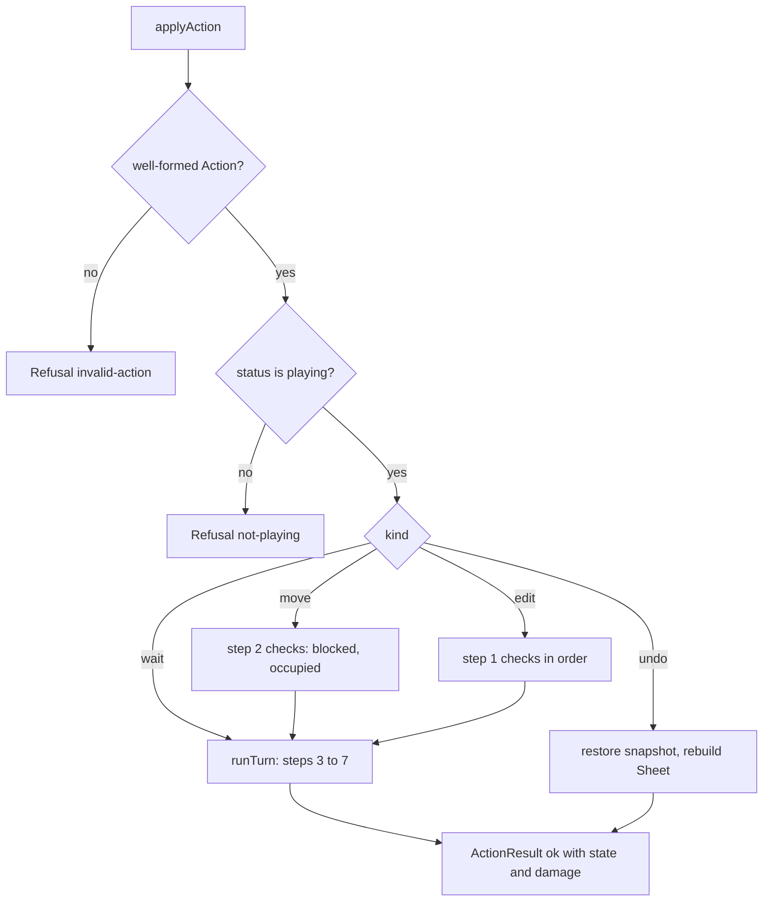

# Design Document

## Overview

The Game_Module is a DOM-free TypeScript module under `src/game/`. It owns the Run_State and turns one Action into either a new Run_State plus a Damage_Log or a Refusal. It holds no rendering, no `localStorage`, no audio. It reaches the model only through `src/model/index.ts` and the engine only through `src/engine/index.ts`.

The main ideas:

1. **A Run_State is a frozen value.** Its Sheet is not a field. It lives in a module-private `WeakMap` keyed by the Run_State, and the game never writes to a Sheet after it has been registered there.
2. **One way to make a Sheet.** `makeSheet(level, edits)` copies what the model loader does (map characters, then specs, then names) and then applies the Edit_Record. Every accepted Action builds a fresh Sheet this way, and undo uses the same path. Nothing is shared between Run_States (Requirement 11).
3. **Undo is an exact rebuild.** The Run_State records the hero Address and the Rng_State of the recalculation whose Values the Sheet holds. A rebuild replays that recalculation, so even `RAND()` Cells get the same Values (see "Undo and RAND()").
4. **Damage is whole numbers.** Every rule number is floored, and only a floored value of 1 or more is damage. Each logged amount is capped so that `hp` stays a safe integer (see "Whole-number damage").
5. **Total.** `applyAction` validates the Action shape first, wraps the rest in one `try/catch`, and never throws.

### Decisions

Decisions 1 to 19 are the confirmed decisions of the requirements. The rows below say where each one lands in this design. Decisions D1 to D8 close the points that were open in the earlier draft.

| # | Decision | Consequence in this design |
| --- | --- | --- |
| 1 | The only way to win is to stand on `X`. | No attack or kill logic anywhere. |
| 2 | Blocked moves cost nothing. | A refused move returns no state; `turn` and the monsters are untouched. |
| 3 | Loss beats win. | The outcome tests `hp <= 0` before the exit. |
| 4 | Entities are never evicted. | Cell values are read only for a move target, a monster target and the step 7 outcome. |
| 5 | An edit is a full turn; `unchanged` is not a turn. | Edits run steps 3 to 7. Validation happens before any Sheet is built. |
| 6 | Monsters enter only `.` cells. | Monster target test is `value == "."` plus no hero and no monster. |
| 7 | Undo rebuilds the Sheet; no engine change. | `makeSheet` plus one recalculation at the stored position. |
| 8 | HP is not a Cell. | HP is a Run_State field only. |
| 9 | Dead and won are final. | `not-playing` for every Action once `status` is not `playing`. |
| 10 | A trap needs a `TRAP` number of at least 1 after flooring. | Step 5 floors `getValueByName(sheet, "TRAP")`. |
| 11 | Accepted Turn_Actions report their damage. | `ActionResult.damage` on every accepted Action. |
| 12 | Bad seeds fall back to 0. | `seedOf(doc)` in `random.ts`. |
| 13 | Undo restores HP and ink exactly. | Snapshot copies the numbers; no clamp. |
| 14 | Monster reach belongs to the formulas. | No range constant in the module. |
| 15 | Damage is whole numbers. | `wholeDamage(n)` floors and caps; see below. |
| 16 | Edit text is capped at 500 characters. | Check 7 of the edit checks. |
| 17 | The Sheet is private. | Registry plus the read API below. |
| 18 | Blocked comes before occupied. | Step 2 tests walkability first. |
| 19 | Every accepted Action builds a fresh Sheet. | No cache; caching is deferred and changes no behaviour. |
| D1 | The 500-character cap is accepted. | A longer edit is `parse-error` with the message `Text is longer than 500 characters.` It matches the model loader cap. |
| D2 | `valuesHero` and `valuesRngState` are accepted. | They are Run_State and Undo_Snapshot fields, and part of State_Equality, as the Glossary says. |
| D3 | The private Sheet registry is accepted. | No `sheet` field on the Run_State. |
| D4 | Blocked before occupied is accepted. | A monster on a Cell that is no longer walkable gives `blocked`. |
| D5 | A Sheet is rebuilt for every accepted Action. | See Decision 19. If the solver needs speed later, cache parsed specs per Level; no API changes. |
| D6 | `isPlaying`, `describeCellError`, `cellName` and `canUndo` are accepted. | They are read helpers; see "Read API". `canUndo` is a convenience for `undoSnapshot !== null`. |
| D7 | Each logged amount is capped at `MAX_DAMAGE = 1e9`. | See "Whole-number damage". |
| D8 | The `valuesHero` and `valuesRngState` fields are compared in `stateDifference`. | Stricter than a bare field list, never weaker. |

## Architecture

```
ui -> game -> model -> engine
```



### Files under `src/game/`

| File | Purpose |
| --- | --- |
| `types.ts` | All public types, `REFUSAL_REASONS` and `MAX_DAMAGE`. |
| `random.ts` | `createRandom` (mulberry32) and `seedOf`. |
| `state.ts` | Internal: the Sheet registry, `makeSheet`, `recalc`, `makeState` (freeze and register), Level lookups, Reading_Order helpers, `wholeDamage`. |
| `run.ts` | `startRun`, `cellValue`, `cellRawText`, `isCellLocked`, `cellName`, `describeCellError`, `isPlaying`, `canUndo`. |
| `monsters.ts` | `stepMonsters`: step 4 for all monsters. |
| `turn.ts` | `applyAction`, action parsing, edit checks, `runTurn` (steps 3 to 7), undo, refusal messages. |
| `index.ts` | Public API, named exports only (exact set below). |
| `random.test.ts`, `run.test.ts`, `turn.test.ts`, `monsters.test.ts` | Example tests for Requirements 1 to 11. |
| `module.test.ts` | Source scan for Requirement 15, including the exact export set. |
| `determinism.prop.test.ts`, `undo.prop.test.ts`, `invariants.prop.test.ts` | The three property files (Requirements 12, 13, 14). |
| `testing/arbitraries.ts` | Level and Action generators, `stateDifference`, `assertProperty`. Not exported from `index.ts`. |
| `testing/arbitraries.test.ts` | Sanity: generated levels start, generated action lists are well-typed. |

## Components and Interfaces

### Engine and model surface used

Checked against `src/engine/index.ts`, `src/model/index.ts` and the sources behind them.

| Need | Export | Notes |
| --- | --- | --- |
| Load and validate | `loadLevel(doc, random)` returns `{ ok, level, sheet }` or `{ ok, errors }` | The returned `sheet` is discarded; see `startRun`. |
| Fresh Sheet | `createSheet()` | 240 empty Cells. |
| Set text | `setRawText(sheet, address, raw)` | Literal (no leading `=`) is always accepted. A formula is parsed; a refusal changes nothing. |
| Set name | `setCellName(sheet, address, name)` | |
| Recalculate | `recalculate(sheet, { heroAddress, random })` | Full from-scratch pass. Result `{ accepted }`. |
| Rule evaluation | `evaluateCell(sheet, { name }, { heroAddress, selfAddress, random })` | Stores nothing. Returns the stored Value for non-rule Cells. |
| Reads | `getValueByAddress`, `getValueByName`, `listCycleCells`, `describeError` | |
| Parse check | `parseFormula(raw)` returns `{ ok: false, error: { text } }` with `Col N: <message>.` | |
| Addresses | `parseAddress(text)` returns `{ ok, point, canonical }`; `formatAddress(point)` | |

The engine does not expose a raw-text getter, so `cellRawText` reads the Level and the Edit_Record (see "Level lookups"). The engine turns a non-finite result into `#VALUE!` (`numberResult` in `evaluator.ts`), so a number a rule returns is finite, but it can still be as large as about `1.8e308`. That is why damage needs a cap.

### Types (`types.ts`)

```ts
import type { Level, LoadError } from '../model/index';
import type { Value } from '../engine/index';

export type Direction = 'N' | 'S' | 'E' | 'W';
export type Status = 'playing' | 'won' | 'lost';

export type Action =
  | { readonly kind: 'move'; readonly dir: Direction }
  | { readonly kind: 'wait' }
  | { readonly kind: 'edit'; readonly address: string; readonly raw: string }
  | { readonly kind: 'undo' };

export interface EditRecordEntry { readonly address: string; readonly raw: string } // address is canonical

export interface MonsterState {
  readonly id: string;
  readonly at: string;   // canonical Address
  readonly move: string; // Cell_Name of the move rule
  readonly atk: string;  // Cell_Name of the atk rule
}

/** Everything the last accepted Turn_Action changed. Holds no snapshot of its own. */
export interface UndoSnapshot {
  readonly edits: readonly EditRecordEntry[];
  readonly hero: string;
  readonly monsters: readonly MonsterState[];
  readonly hp: number;
  readonly ink: number;
  readonly turn: number;
  readonly status: Status;
  readonly rngState: number;
  readonly valuesHero: string;
  readonly valuesRngState: number;
}

export interface RunState extends UndoSnapshot {
  readonly level: Level;
  readonly undoSnapshot: UndoSnapshot | null;
}
// There is no `sheet` field. See "Immutability and the private Sheet".

export const REFUSAL_REASONS = [
  'not-playing', 'blocked', 'occupied', 'locked', 'bad-address', 'reserved-row',
  'unchanged', 'no-ink', 'parse-error', 'nothing-to-undo', 'invalid-action', 'internal-error',
] as const;
export type RefusalReason = (typeof REFUSAL_REASONS)[number];

/** Largest amount one Damage_Log entry can carry. See "Whole-number damage". */
export const MAX_DAMAGE = 1_000_000_000;

export type DamageSource =
  | { readonly kind: 'monster'; readonly id: string }
  | { readonly kind: 'trap' }
  | { readonly kind: 'haunt' };
export interface DamageEntry { readonly source: DamageSource; readonly amount: number } // whole, 1 to MAX_DAMAGE
export type DamageLog = readonly DamageEntry[];

export interface Refusal { readonly ok: false; readonly reason: RefusalReason; readonly message: string }
export type ActionResult =
  | { readonly ok: true; readonly state: RunState; readonly damage: DamageLog }
  | Refusal;

export type StartRunResult =
  | { readonly ok: true; readonly state: RunState }
  | { readonly ok: false; readonly errors: readonly LoadError[] };

export interface RandomGenerator {
  next(): number;              // in [0, 1)
  readonly state: number;      // Rng_State: unsigned 32-bit integer
}
```

### Read API

The Sheet is private, so the UI reads a Run_State through its fields and these functions. This is the complete set `grid-ui` can use.

```ts
// Fields of RunState (plain readonly data; the UI reads them directly)
state.hero: string                       // canonical Address
state.monsters: readonly MonsterState[]  // id, at, move, atk; Author_Order
state.hp: number                         // safe integer, may be 0 or negative after a loss
state.ink: number
state.turn: number
state.status: Status
state.level: Level                       // title, hint, labels and the rest of the Level

// Functions (run.ts). Each returns undefined for an Address that is
// not a string, is outside the Sheet, or does not apply, and never throws.
export function cellValue(state: RunState, address: string): Value | undefined;
export function cellRawText(state: RunState, address: string): string | undefined;
export function isCellLocked(state: RunState, address: string): boolean | undefined;
export function cellName(state: RunState, address: string): string | undefined;        // undefined when the Cell has no Cell_Name
export function describeCellError(state: RunState, address: string): string | undefined; // undefined when the Value is not an error
export function isPlaying(state: RunState): boolean;
export function canUndo(state: RunState): boolean;                                      // convenience for state.undoSnapshot !== null

// Returned with each accepted ActionResult, not stored on the state
result.damage: DamageLog
```

- `canUndo` is true only while the Status is `playing` and the snapshot is not `null`, which is the condition under which `applyAction` accepts an undo. Requirement 1.4 does not list it; it is a convenience so that the UI can enable the Undo button without reading `undoSnapshot`.
- `cellName` reads the Level index (Cell_Spec `name`); the Game_Module never renames a Cell, so the name of a Cell is fixed for a run. `describeCellError` and `cellValue` read the private Sheet.
- A Run_State not made by this module gives `undefined` from the Sheet-backed readers, `false` from `isPlaying` and `canUndo`, and `internal-error` from `applyAction`.

### Public exports of `src/game/index.ts`

The exact set, asserted by `module.test.ts`:

- Runtime values (13 names): `startRun`, `applyAction`, `createRandom`, `cellValue`, `cellRawText`, `isCellLocked`, `cellName`, `describeCellError`, `isPlaying`, `canUndo`, `REFUSAL_REASONS`, `MAX_DAMAGE`, `seedOf`.
- Types (17 names, `export type`): `Action`, `Direction`, `Status`, `RunState`, `UndoSnapshot`, `MonsterState`, `EditRecordEntry`, `ActionResult`, `Refusal`, `RefusalReason`, `DamageEntry`, `DamageLog`, `DamageSource`, `StartRunResult`, `RandomGenerator`, plus `Value` and `Level` re-exported from the engine and model for the caller's convenience.

Nothing else is exported: not the registry, `makeSheet`, `recalc`, `stepMonsters`, `wholeDamage` or any test helper. `seedOf` is public because the UI and solver read the seed the same way the run does. There is no default export.

### Immutability and the private Sheet

- `makeState(fields, sheet)` in `state.ts` deep-freezes the new Run_State (the state, `monsters`, each monster, `edits`, each entry, the snapshot and its arrays) and then registers `sheet` in a module-private `WeakMap<RunState, Sheet>`. The `Level` is already deep-frozen by the loader.
- All types are `readonly`, so a caller cannot compile a write. At run time `Object.freeze` makes a write throw in strict mode or do nothing otherwise.
- A Sheet is written only inside `makeSheet` and `recalc`, before `makeState` registers it. After that the game calls only reads and `evaluateCell` (which stores nothing). The Sheet is never returned, so the caller cannot reach `setRawText` on it.
- Snapshots share the frozen `edits` and `monsters` arrays of the earlier state. This is safe because they are immutable, and it keeps a snapshot cheap.

### Level lookups (`state.ts`)

`levelIndex(level)` builds, once per Level object and cached in a `WeakMap<Level, LevelIndex>`, a `Map<address, { raw, locked, name }>`:

- The map character of every Cell in rows 1 to 12.
- Overridden by each Cell_Spec (`raw`, `locked === true`, and `name` when present).

Then:

- `effectiveRaw(level, address)` is the index entry's `raw`, or `""` outside the map with no spec.
- `currentRaw(state, address)` scans `state.edits` from the end for the canonical address and falls back to `effectiveRaw`. The Edit_Record has at most `level.ink` entries, so the scan is cheap.
- `isLocked(level, address)` is the index entry's `locked`. A Cell without a Cell_Spec is unlocked.
- `cellName` returns the index entry's `name`, or `undefined`.
- Inputs of the public readers go through `parseAddress`; a non-string or a failed parse gives `undefined`.

### Random generator (`random.ts`)

Algorithm: **mulberry32**, one unsigned 32-bit integer of state.

```ts
export function createRandom(seed: number, state?: number): RandomGenerator {
  let s = (state ?? seed) >>> 0;
  return {
    next() {
      s = (s + 0x6d2b79f5) >>> 0;
      let t = Math.imul(s ^ (s >>> 15), s | 1);
      t ^= t + Math.imul(t ^ (t >>> 7), t | 61);
      return ((t ^ (t >>> 14)) >>> 0) / 4294967296;
    },
    get state() { return s; },
  };
}
```

- Each call adds a constant to `s`, so `s` identifies the position and `createRandom(0, s)` resumes the same sequence. When `state` is given, `seed` is ignored.
- `seedOf(doc)` reads `doc.seed` (own property of a plain object) and returns it when it is an integer from 0 to 4294967295, otherwise 0.
- For each engine call the game builds `const gen = createRandom(0, rngState)`, passes `() => gen.next()` as `random`, and reads `gen.state` afterwards. All engine calls inside one Action share one generator, so the state flows through steps 3, 4 and 7 in order.
- What draws: `recalculate` calls the source once for each `RAND()` it evaluates, in the engine's topological order; an `IF` branch not taken draws nothing. Rule formulas (those with `SELF` or `TOWARD`) are not evaluated by `recalculate` and draw nothing there. `evaluateCell` evaluates a rule formula and draws for each `RAND()` it reaches; for a non-rule Cell it returns the stored Value and draws nothing.

### Starting a run (`run.ts`)

```
startRun(doc):
  try
    gen = createRandom(seedOf(doc))                      // state = seed
    loaded = loadLevel(doc, () => gen.next())
    if !loaded.ok -> return { ok: false, errors: loaded.errors }
    afterLoad = gen.state
    seedState = seedOf(doc)
    sheet = makeSheet(level, [])
    recalc(sheet, hero.at, createRandom(0, seedState))   // replays the loader's recalculation
    state = makeState({ edits: [], hero: level.hero.at, monsters: level.monsters (copied),
                        hp: level.startingHp, ink: level.ink, turn: 0, status: 'playing',
                        rngState: afterLoad, valuesHero: level.hero.at, valuesRngState: seedState,
                        undoSnapshot: null }, sheet)
    return { ok: true, state }
  catch -> { ok: false, errors: [{ path: '', code: 'internal-error', message: FIXED }] }
```

The loader's own Sheet is dropped. Rebuilding from the normalized Level keeps one construction path for every Run_State, and the two starts of Requirement 11.2 share nothing. `rngState` is the loader's position, as Requirement 1.3 says. The rebuild draws the same numbers as the load, and a unit test asserts `createRandom` ends at `afterLoad` after the replay.

## Turn algorithm

### Whole-number damage

All damage goes through one function in `state.ts`:

```ts
/** Floors a rule number; returns 0 when it is not damage, else a whole amount in 1..MAX_DAMAGE. */
export function wholeDamage(n: number): number {
  const f = Math.floor(n);          // n is a finite number from the engine
  return f >= 1 ? Math.min(f, MAX_DAMAGE) : 0;
}
```

- **Flooring.** `0.9` gives 0 (no damage, no log entry), `1.5` gives 1, `2` gives 2, and a negative number gives 0. A `NaN` or infinite input cannot come from the engine, but `wholeDamage` returns 0 for them (the comparison `f >= 1` is false for `NaN`, and `Infinity` is capped).
- **Keeping `hp` a safe integer.** The engine's numbers reach about `1.8e308`, so a floored amount can be far above `Number.MAX_SAFE_INTEGER` and would make `hp` lose precision or become `-Infinity`. The rule is: **each logged amount is at most `MAX_DAMAGE = 1e9`.** This is the smallest rule that keeps both the state and the property exact.
  - A turn applies at most M monster entries, one trap entry (at most `1e9`) and one haunt entry (1), with M at most 144 (monsters stand on distinct Cells of the 144-Cell Map_Area, Property 6). A turn runs only while `status` is `playing`, so `hp` is at least 1 before it. After it, `hp` is at least `1 - (144 + 1) * 1e9 - 1`, about `-1.5e11`, far inside the safe range. Dead is final (Decision 9), so `hp` never gets lower than that in any run.
  - `startingHp` is a safe integer of 1 or more (the model loader checks it), `hp` never goes up except by an accepted undo that restores an earlier value, so `hp` is always a safe integer.
  - Every subtraction is of a whole number from a safe integer into a safe integer, so it is exact in floating point. `hp` equals the old `hp` minus each logged `amount`, in log order, with no rounding. That is Requirement 14.2.
- **Interaction with Requirement 14.2.** The requirement says an `amount` is the floored value. This design logs `min(floor, 1e9)`. The two are the same for every number below `1e9 + 1`, which covers all real levels (HP is in the tens). For a larger floored value the logged amount is `1e9`, which still kills any hero with `hp` up to `1e9`. A hero with more HP than that would need a different cap, so `MAX_DAMAGE` is a named constant. Property 5 and the generators use `Math.min(Math.floor(x), MAX_DAMAGE)` as the expectation, and a unit example (below) covers an `atk` of `1e300`.

### The seven steps

| Step | Input | Effect on state | RNG draws | Engine call | Damage log |
| --- | --- | --- | --- | --- | --- |
| 1 Player acts | Run_State, Action | Move: new hero Address after step 2. Wait: unchanged. Edit: `edits` gains the entry, `ink - 1`. Refusals end here (edit checks below). | none | `parseAddress`, `parseFormula` (edit only) | none |
| 2 Move check | hero, `dir`, current Sheet | Target = neighbour Address. Refused `blocked` when it is outside rows 1 to 12 or columns A to L, or its Value is not the string `.`, `X` or `^`. Refused `occupied` when a monster stands on it. | none | `getValueByAddress` on the Run_State's Sheet | none |
| 3 Recalculate | new `edits`, new hero | A fresh Sheet is built and recalculated: `makeSheet(level, edits)` then `recalculate` with the new hero. | `RAND()` count in the sheet, in topological order | `createSheet`, `setRawText`, `setCellName`, `recalculate` | none |
| 4 Monsters | step 3 Sheet, hero, monsters | For each monster in Reading_Order: evaluate `move`, maybe move it, evaluate `atk`. When the `atk` Rule_Value is a number with `wholeDamage(n) >= 1`, subtract that amount from `hp`. | Per `RAND()` reached in rule formulas, in monster order, `move` then `atk` | `evaluateCell` by Cell_Name with `selfAddress` | One `monster` entry per damaging `atk`, amount = `wholeDamage(n)` |
| 5 Trap | step 3 Sheet, hero | If the hero Cell is the string `^`, and `TRAP` is a number with `wholeDamage(n) >= 1`, subtract that amount. | none | `getValueByAddress`, `getValueByName` | One `trap` entry, amount = `wholeDamage(n)` |
| 6 Haunting | step 3 Sheet | If `listCycleCells` is non-empty, subtract 1, once. | none | `listCycleCells` | One `haunt` entry, amount 1 |
| 7 Recalculate and outcome | same Sheet, hero | Recalculate again, then set `status`: `lost` if `hp <= 0`, else `won` if the hero Cell is the string `X`, else `playing`. | Same as step 3 | `recalculate`, `getValueByAddress` | none |

Steps 5 and 6 read the Sheet of step 3, not step 7. This is what Requirement 8.3 needs (an edit that removes the last cycle causes no haunting) and it matches the brief. Step 7 reads the Sheet of step 7, as Requirement 9 says. A trap does nothing without a `TRAP` number of at least 1 after flooring (Requirement 8.2).

### Edit checks (step 1), in the Requirement 6.1 order

| # | Check | Reason |
| --- | --- | --- |
| 1 | `status !== 'playing'` | `not-playing` |
| 2 | `parseAddress(address)` fails | `bad-address` |
| 3 | Row of the Address is 13 | `reserved-row` |
| 4 | `isLocked(level, canonical)` | `locked` |
| 5 | `raw === currentRaw(state, canonical)` | `unchanged` |
| 6 | `state.ink === 0` | `no-ink` |
| 7 | `raw` is longer than 500 characters, or starts with `=` and `parseFormula(raw)` fails | `parse-error` |

### Validate before store

Decision: **parse first, build later.** The edit is validated with `parseFormula(raw)` on the text alone (a Literal, any text without a leading `=`, is always valid, which is the `setRawText` rule). No Sheet is touched during validation, so a refusal needs no rollback and the caller's Run_State is untouched. Only after check 7 passes does `runTurn` build the new Sheet, and there `setRawText` uses the same parser, so it cannot refuse. If it does refuse, the result is `internal-error` and the discarded Sheet is garbage.

Alternatives rejected: calling `setRawText` on the live Sheet (an accepted call would mutate a Sheet the caller still holds, breaking Requirements 1.5 and 11.1), and trial-building a Sheet copy just to learn about the parse (costs a full rebuild for a refusal).

### `applyAction` pseudocode

```
applyAction(state, action):
  try
    sheet = sheetOf(state)                       // registry lookup
    if sheet undefined -> refuse internal-error
    a = parseAction(action)                      // undefined for any malformed value
    if a undefined -> refuse invalid-action
    if state.status != 'playing' -> refuse not-playing

    switch a.kind
      'undo':
        if state.undoSnapshot == null -> refuse nothing-to-undo
        return { ok: true, state: restore(state), damage: [] }
      'move':
        t = neighbour(state.hero, a.dir)         // may be off the map
        if t undefined or !walkable(valueAt(sheet, t)) -> refuse blocked
        if monsterAt(state.monsters, t)          -> refuse occupied
        return runTurn(state, { hero: t, edits: state.edits, ink: state.ink })
      'wait':
        return runTurn(state, { hero: state.hero, edits: state.edits, ink: state.ink })
      'edit':
        run the checks in the table above
        entry = { address: canonical, raw: a.raw }
        return runTurn(state, { hero: state.hero, edits: [...state.edits, entry], ink: state.ink - 1 })
  catch -> refuse internal-error

runTurn(prev, next):
  gen   = createRandom(0, prev.rngState)
  sheet = makeSheet(prev.level, next.edits)
  recalc(sheet, next.hero, gen)                                   // step 3
  hp = prev.hp; log = []
  { monsters, hp, log } = stepMonsters(sheet, next.hero, prev.monsters, hp, log, gen)   // step 4
  if cellIs(sheet, next.hero, '^'):                               // step 5
      v = getValueByName(sheet, 'TRAP')
      d = v is a number ? wholeDamage(v) : 0
      if d >= 1: hp -= d; log.push({ source: trap, amount: d })
  if listCycleCells(sheet).length > 0:                            // step 6
      hp -= 1; log.push({ source: haunt, amount: 1 })
  valuesRngState = gen.state
  recalc(sheet, next.hero, gen)                                   // step 7
  status = hp <= 0 ? 'lost' : cellIs(sheet, next.hero, 'X') ? 'won' : 'playing'
  state' = makeState({ ...next, hp, monsters, turn: prev.turn + 1, status,
                       rngState: gen.state, valuesHero: next.hero, valuesRngState,
                       undoSnapshot: snapshotOf(prev) }, sheet)
  return { ok: true, state: state', damage: log }
```

`hp` is reduced one entry at a time, in log order. `snapshotOf(prev)` copies the fields of `prev` except `level` and `undoSnapshot`, so there is no chain deeper than one (Requirement 10.4).

### Monsters (`monsters.ts`)

```
stepMonsters(sheet, hero, monsters, hp, log, gen):
  order = indices of monsters sorted by (row, column) of their current `at`   // fixed now
  pos   = monsters.map(m => m.at)                                             // live positions
  for i of order:
    mv = evaluateCell(sheet, { name: monsters[i].move },
                      { heroAddress: point(hero), selfAddress: point(pos[i]), random: () => gen.next() })
    if mv.ok and mv.value is the string "N" | "S" | "E" | "W" (exact):
      t = neighbour(pos[i], dir)
      if t inside rows 1..12 and cols A..L
         and valueAt(sheet, t) is the string "."
         and t != hero and no j != i with pos[j] == t:
        pos[i] = t
    at = evaluateCell(sheet, { name: monsters[i].atk }, { ..., selfAddress: point(pos[i]) })
    d  = at.ok and at.value is a number ? wholeDamage(at.value) : 0
    if d >= 1:
      hp -= d; log.push({ source: monster monsters[i].id, amount: d })
  return monsters with the new `at`, hp, log
```

- The iteration order is fixed before the loop. A monster that moves does not change the order, but later monsters see its new position when they test occupancy.
- Every monster acts even when `hp` is already 0 or below. The outcome is decided at step 7.
- A cell value is read from the step 3 Sheet, so a `RAND()` map cell is judged by its step 3 Value.
- `evaluateCell` returning `ok: false` (for example `cell-not-found`) means no move and no damage.
- An `atk` of `0.9`, `0`, `-1`, a string, a boolean or an error gives `d = 0`: no change, no log entry.

### Undo and RAND()

**Problem.** After an accepted Turn_Action the Sheet holds Values from the step 7 recalculation. For a `RAND()` Cell, that Value depends on the Rng_State when step 7 started and on the hero Address, and neither is the Rng_State stored before the turn. A rebuild at the pre-turn `rngState` would give different `RAND()` Values.

**Fix.** Every Run_State carries `valuesHero` and `valuesRngState`: the hero Address and the Rng_State at the start of the recalculation whose Values its Sheet holds (Decision D2).

- After `startRun`: `valuesHero = hero.at`, `valuesRngState = seedOf(doc)` (the loader's recalculation started there).
- After an accepted Turn_Action: `valuesHero = ` the new hero, `valuesRngState = ` the generator state just before the step 7 recalculation.
- After an accepted undo: both fields come back from the snapshot, so they again describe the restored Sheet.

Rebuild for undo:

```
restore(state):
  s = state.undoSnapshot
  sheet = makeSheet(state.level, s.edits)
  recalc(sheet, s.valuesHero, createRandom(0, s.valuesRngState))   // replay; generator is then discarded
  return makeState({ ...s, level: state.level, undoSnapshot: null }, sheet)   // rngState is s.rngState
```

The future `rngState` is the separately stored `s.rngState`, so the next draw after undo equals the next draw before the undone Turn_Action (Requirement 13.3).

**Why the rebuild is exact.** Checked in `sheet.ts`, `recalculator.ts` and `evaluate-cell.ts`:

- `recalculate` is a full from-scratch pass. It rebuilds the dependency graph from the Cells' current ASTs and names, takes the topological order, and then overwrites the Value and cycle flag of all 240 Cells. It reads no Value from an earlier recalculation.
- `setRawText` and `setCellName` only change `raw`, `ast`, `isRule`, `name` and set `dirty`. The state of a Cell after the Edit_Record is applied depends on the final `raw` of each Cell, not on the order of edits.
- Therefore the post-recalculation Sheet is a function of: the raw texts, the names, the hero Address and the sequence of numbers from the generator. The rebuild supplies all four.

**Assumption, stated.** The topological order, and so the order of `RAND()` draws, is a pure function of the graph. The engine's recalculation-order property test supports this, and Property 2 below tests the whole claim end to end.

## Data Models

### Refusal messages

All messages are fixed templates of 1 to 200 characters. Addresses in messages are the canonical form produced by `parseAddress`; caller text is never echoed.

| Reason | Message |
| --- | --- |
| `not-playing` | `The run is over. Start the level again to keep playing.` |
| `blocked` | `Cannot move {dir}: {target} is not walkable.` or `Cannot move {dir}: that is outside the map.` |
| `occupied` | `Cannot move {dir}: a monster stands on {target}.` |
| `locked` | `{address} is locked and cannot be edited.` |
| `bad-address` | `That is not a cell address. Use a column A to L and a row 1 to 20.` |
| `reserved-row` | `Row 13 is reserved and cannot be edited.` |
| `unchanged` | `{address} already holds that text.` |
| `no-ink` | `No ink left. Undo a change or restart the level.` |
| `parse-error` | The engine's `Col N: <message>.` text unchanged, or `Text is longer than 500 characters.` |
| `nothing-to-undo` | `There is nothing to undo.` |
| `invalid-action` | `That is not a valid action.` |
| `internal-error` | `The game hit an internal fault. Nothing was changed.` |

### Action parsing

`parseAction(value)` returns `undefined` unless `value` is a plain object whose `kind` is one of the four strings and whose other fields match: `dir` in `N S E W` for `move`; string `address` and string `raw` for `edit`. It reads fields with `Object.hasOwn` and plain property reads inside the `try`, and copies the fields it needs into a new object. A throwing getter lands in the `catch` and gives `internal-error`.

## Correctness Properties

*A property is a characteristic or behavior that should hold true across all valid executions of a system-essentially, a formal statement about what the system should do. Properties serve as the bridge between human-readable specifications and machine-verifiable correctness guarantees.*

Prework found three requirements that are universal over a large input space: 12, 13 and 14. Reflection merged nothing across them, but it split Requirement 14 into four properties, one per criterion, and Requirement 13 into two. All other criteria are examples or smoke checks.

### Property 1: Determinism

*For any* valid Level_Document and *for any* list of 0 to 40 Actions (moves, waits, valid and invalid edits, edits of locked Cells, undos, malformed Actions), running `startRun` and then `applyAction` for each Action twice gives the same `ok` values, the same Refusal reasons and messages, the same Damage_Logs, and Run_States that are equal under State_Equality at every step.

**Validates: Requirements 12.1, 2.1, 2.2, 11.2**

### Property 2: Accepted undo is the exact inverse of an accepted Turn_Action

*For any* valid Level_Document and *for any* list of Actions, whenever a Turn_Action is accepted and an undo is applied to the new state, the undo is accepted and the result equals the Run_State before the Turn_Action under State_Equality (all 240 Raw_Texts and Values included), except that its Undo_Snapshot is `null`; and the next number drawn from the restored `rngState` equals the next number drawn from the earlier state's `rngState`.

**Validates: Requirements 13.1, 10.1, 10.2, 6.6**

### Property 3: Undo refusals

*For any* valid Level_Document and *for any* list of Actions, an undo applied to the Run_State from `startRun` or from an accepted undo is refused with `nothing-to-undo`; and when any other Action is refused, an undo applied to the caller's Run_State gives the same result as an undo applied before that refusal.

**Validates: Requirements 13.2, 10.3, 1.5, 4.4**

### Property 4: Ink bounds

*For any* valid Level_Document and *for any* list of Actions, `ink` is at least 0 and at most the level `ink` in every Run_State, and `ink` goes up between two consecutive states only through an accepted undo.

**Validates: Requirements 14.1, 6.4, 6.6**

### Property 5: HP accounting and the Damage_Log

*For any* valid Level_Document and *for any* list of Actions, for every accepted Turn_Action the new `hp` equals the old `hp` with each `amount` of the Damage_Log subtracted in log order; every amount is a whole number from 1 to `MAX_DAMAGE`; the log lists `monster` entries (each id belongs to a monster of the level, each at most once, and present exactly when that monster's `atk` Rule_Value was a number with a floored value of 1 or more), then at most one `trap` entry, then at most one `haunt` entry of amount 1; a `trap` entry is present exactly when the hero ends step 4 on a `^` Cell and `TRAP` holds a number with a floored value of 1 or more; a `haunt` entry is present exactly when the Sheet of step 3 had a `#CYCLE!` Value; and `hp` is a safe integer in every state.

**Validates: Requirements 14.2, 7.6, 8.1, 8.3**

### Property 6: Entity placement

*For any* valid Level_Document and *for any* list of Actions, in every Run_State the hero and all monsters are on distinct Addresses, and every monster and the hero are inside rows 1 to 12 and columns A to L.

**Validates: Requirements 14.3, 5.1, 7.3**

### Property 7: Status finality and meaning

*For any* valid Level_Document and *for any* list of Actions, once a state has Status `won` or `lost`, every later state has the same Status; `won` implies `hp > 0` and the hero Cell holds `X`; `lost` implies `hp <= 0`; and `hp <= 0` implies `lost`.

**Validates: Requirements 14.4, 9.1, 9.2, 9.3, 9.4, 5.5**

The test needs to know which entries to expect in Property 5. It does not recompute the rules; it checks what it can read from outside: the old and new `hp`, the log, the Sheet Values through the read API for the `^` and `#CYCLE!` conditions, and `evaluateCell` for the monster `atk` Values on a fresh Sheet built the same way. The generators keep `RAND()` out of the `atk` rule in a separate, smaller generator for the "exactly when" clauses; a general generator checks only the sum, order and bounds clauses.

## Error Handling

- **Total by construction.** `applyAction` checks the registry, parses the Action, checks status, and runs the rest inside one `try/catch`. The `catch` ignores the thrown value (no name, message or stack is read) and returns the fixed `internal-error` Refusal. A caller's Run_State is never changed, because no state is mutated before the new one is registered.
- **Engine refusals.** `setRawText`, `setCellName` and `recalculate` report faults as results, not throws. In `makeSheet` and `recalc` any non-accepted result makes the helper return `false`, and `runTurn` turns that into `internal-error`.
- **Evaluation faults.** `evaluateCell` with `ok: false` means no move and no damage; it is not an error of the game.
- **Huge or odd rule numbers.** `wholeDamage` floors and caps, so an `atk` or `TRAP` number of any finite size gives a valid amount or none, and `hp` stays a safe integer. It is not a fault and not an `internal-error`.
- **`startRun`.** `loadLevel` never throws and its errors pass through unchanged. A throw inside the rest of `startRun` becomes one `internal-error` Load_Error with a fixed message.
- **Freezing.** Results are frozen in `makeState`; `damage` arrays and entries are frozen too.
- **Forged states.** A Run_State not found in the registry (for example an object literal) gives `undefined` from the Sheet-backed readers, `false` from `isPlaying` and `canUndo`, and `internal-error` from `applyAction`.

## Testing Strategy

PBT applies to the three requirements chosen in the approved requirements. They are pure, in-memory and cheap to repeat. Everything else uses example tests. Tests use Vitest and fast-check. Each property is one `assertProperty` call of at least 100 runs (planned: 200 for Properties 1 and 5 to 7, 100 for the others, to be adjusted once timings are known), tagged with a comment such as `// Feature: game-rules, Property 2: Accepted undo is the exact inverse of an accepted Turn_Action`.

### Generators (`src/game/testing/arbitraries.ts`)

A small game-specific level generator is used instead of the model's `validDocumentArbitrary`, because the model generator does not place a `TRAP` Cell, rule formulas with `SELF` or cycles on purpose, and it should stay free to change. The module owns every generator and one `assertProperty(property, numRuns)` that calls `fc.assert` and reads `FC_SEED`, copied from the model pattern. No `Math.random`. Imports are only `fast-check`, `../../model/index` and `../../engine/index`.

- `gameLevelArbitrary`: a 12 by 12 map from `# . X ^` with a guaranteed floor patch; a hero on a floor Cell; 0 to 4 monsters on distinct Literal `.` Cells, each with `MOVE_Mn` and `ATK_Mn` rule Cells in rows 14 to 20 (names in column B, text labels in column A); a seed; `startingHp` 1 to 20; `ink` 0 to 5.
  - `move` pool: `"N"`, `"-"`, `=TOWARD(HERO)`, `=IF(DIST(HERO,SELF)<4,TOWARD(HERO),"-")`, `=IF(RAND()<0.5,"E","W")`, `=1/0`.
  - `atk` pool, with the whole-number outcome in brackets: `0` [none], `0.9` [none], `1` [1], `1.5` [1], `2` [2], `-1` [none], `=RAND()*2` [0 or 1 by draw], `=IF(DIST(HERO,SELF)<2,1,0)` [1 or none], `"hit"` [none], `=1/0` [none, error], `1e300` [capped to `MAX_DAMAGE`].
  - `TRAP` Cell: absent, or `0`, `0.5`, `1`, `1.5`, `2`, `=RAND()+1` (floors to 1 or 2), `"spikes"` [text], `1e300` [capped].
  - Extra map Cells: `RAND()` terrain formulas away from entity starts, `=1/0`, a two-Cell cycle (`=C2` and `=B2` style), and locked Cells.
  - A sanity test asserts that every generated Level_Document starts.
- `actionListArbitrary`: 0 to 40 entries, weighted moves, waits, edits, undos and malformed values (`null`, `{ kind: 'jump' }`, `{ kind: 'move', dir: 'X' }`, `{ kind: 'edit', address: 5, raw: 'x' }`). Edit addresses come from all 240 Cells, row 13 and some invalid text; edit raws come from Literals, terrain glyphs, valid formulas (including `RAND()` formulas that turn the Cell under an entity into a wall), cycles, invalid formulas such as `=1+` and `=(`, and text over 500 characters. Because an edit is never refused for the Cell under an entity, this reaches the case where an entity stands on a non-walkable Cell.
- `stateDifference(a, b, options)`: State_Equality. Returns `undefined` when equal, otherwise a string naming the first field that differs (so the shrunk counterexample reads well). It compares `hero`, `hp`, `ink`, `turn`, `status`, `rngState`, `valuesHero`, `valuesRngState`, `edits`, `monsters`, the Level reference, `JSON.stringify` of `[cellRawText, cellValue]` for all 240 Cells, and the snapshot recursively. `options.ignoreSnapshot` skips the snapshot (Property 2).

### Property tests

| File | Properties | Method |
| --- | --- | --- |
| `determinism.prop.test.ts` | 1 | Run the list twice from two `startRun` calls; compare each `ActionResult` and each state with `stateDifference`. |
| `undo.prop.test.ts` | 2, 3 | Walk the list. After each accepted Turn_Action apply undo on the new state and compare with the earlier state, then continue from the post-turn state. Check `nothing-to-undo` on fresh and just-undone states, and the "undo before and after a refusal" equality. |
| `invariants.prop.test.ts` | 4, 5, 6, 7 | Walk the list and check each property on every step. Property 5 replays `damage` against the earlier `hp` in log order; all amounts are whole numbers, so the arithmetic is exact. |

A failure reports the shrunk counterexample and the seed (fast-check default).

### Example tests

- `random.test.ts` (Req 2): same seed same sequence; values in [0, 1) over many draws; resume from a stored state; seed 0 and 4294967295.
- `run.test.ts` (Req 1, 11.2): start state fields; Load_Errors pass through unchanged; bad seeds (`-1`, `1.5`, `4294967296`, string) start with seed 0; the readers `cellValue`, `cellRawText`, `isCellLocked`, `cellName` and `describeCellError` on a valid Address, an out-of-sheet Address and a non-string Address; `cellName` returns `HP` or `MOVE_M1`-style names for named Cells and `undefined` for an unnamed Cell and a Cell outside the Level; `describeCellError` returns text for an error Cell and `undefined` otherwise; `canUndo` is false at start, true after an accepted move, false after the undo, false once the run is won or lost; `isPlaying` follows the Status; each malformed Action gives `invalid-action`; a throwing getter gives `internal-error`; `rngState` after the Sheet replay equals the loader's position; two starts are equal and share no Sheet; a forged state.
- `turn.test.ts` (Req 3 to 6, 8 to 11): `REFUSAL_REASONS` and message length for each reason; step order with scripted rules (trap damage lands before haunting damage in the log; a monster that moves is seen by the next monster); one example per move case (each direction, wall, error Cell, map edge, row 13 neighbour, a monster on a walkable Cell gives `occupied`, a monster on a Cell that was edited to a wall gives `blocked`, not-playing); each edit refusal in the Requirement 6.1 order; a `Col N:` message; an edit of exactly 500 characters is accepted when it is a valid Literal and one of 501 is `parse-error` with `Text is longer than 500 characters.` and no ink spent; refused Actions leave `turn`, `ink` and `rngState` alone; an edit that changes nothing is `unchanged`; `TRAP` absent, `0`, `0.5`, `1.5` (damage 1), `2`, text and a positive number; haunting once for several cycle Cells; an edit that removes the last cycle causes no haunting that turn; loss beats win; a hero on an error Cell lives and can walk out; undo after a move, after an edit (ink refunded), after a `RAND()` turn, second undo refused, undo after win refused; old state unchanged after later Actions (Requirement 11.1).
- `turn.test.ts`, whole-number damage: an `atk` of `0.9` logs nothing and leaves `hp`; `1.5` logs amount 1; `2` logs amount 2; `-1` logs nothing; **an `atk` of `1e300` logs exactly `MAX_DAMAGE`, the new `hp` equals the old `hp - 1e9`, is a safe integer and the Status is `lost`**; the same for a `TRAP` of `1e300`; several monsters with `1e300` in one turn give an `hp` equal to the old `hp` minus the sum of the logged amounts and still a safe integer; with `startingHp` equal to `Number.MAX_SAFE_INTEGER` and a damage of 1 the `hp` is `Number.MAX_SAFE_INTEGER - 1` and exact.
- `monsters.test.ts` (Req 7): `"N"`, `"S"`, `"E"`, `"W"` moves; lower case, `"-"`, number, boolean, empty string and error leave it in place; blocked by wall, exit, trap, hero, another monster, map edge; Reading_Order and live occupancy; `atk` numbers, zero, fractions, negative, text, error. Requirement 7.7 as three explicit examples: a `move` Cell that evaluates to an error leaves the monster in place; an `atk` Cell that evaluates to an error deals no damage; an edit that turns a wall Cell into floor opens a move that was refused before.

### Module scan (`module.test.ts`, Requirement 15)

Modelled on `src/model/module.test.ts`. It reads every `.ts` file under `src/game/`, including `testing/` but excluding `*.test.ts` and `*.prop.test.ts`, strips comments and string literals, and checks:

- The file list matches the table above.
- `index.ts` has named exports only, no default export, and the exported names are **exactly** the set listed under "Public exports of `src/game/index.ts`": the 13 runtime names and the 17 type names, no more and no fewer. The test builds the expected sorted list in the test file and compares it with the sorted names parsed from `index.ts`, and it also imports the module and compares `Object.keys` with the 13 runtime names.
- Imports resolve only to files in `src/game/`, `../model/index` and `../engine/index` (from `testing/`: `../../model/index`, `../../engine/index`). No `../ui`, no deeper paths into model or engine.
- No `document`, `window`, `localStorage`, `sessionStorage`, `navigator`, `fetch`, `XMLHttpRequest`, `AudioContext`, `Math.random`, `Date.now`, `new Date`, `eval`, `new Function`.
- No name of an AI tool other than Kiro in any game file or spec text, using a deny-list assembled from string fragments so the test file does not spell the names.
- The suite runs under Node 22 with no DOM environment (Requirement 15.5).
