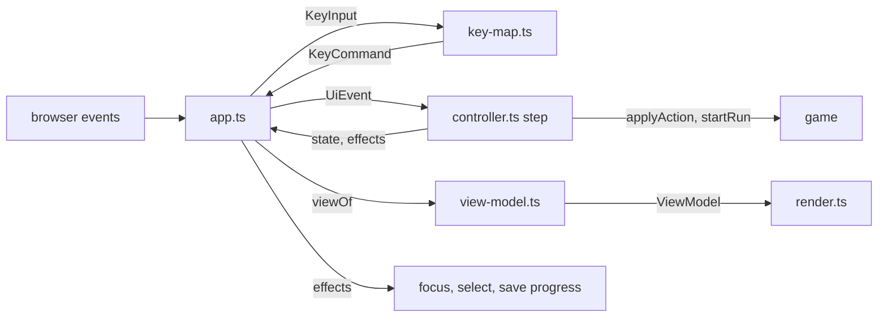

# Design Document

## Overview

The Grid_UI is the browser layer of Grimsheet, under `src/ui/`. It is a thin DOM layer over the Game_Module. It owns no rules. It reads a Run_State through the game read API, changes it only through `applyAction` and `startRun`, and turns it into a table, a formula bar, a status bar and three screen states.

The main ideas:

1. **State machine plus dumb renderer.** All behaviour lives in one pure function, `step(state, event, env) -> { state, effects }`. The DOM modules only translate browser events into `UiEvent` values, call `step`, render the new state, and run the effects (focus, select text, save progress). No rule is decided in a DOM file.
2. **Render is a function of state.** `viewOf(state, env)` builds a plain `ViewModel`. `render` writes it to a DOM that is built once and updated in place. Rendering twice gives the same DOM.
3. **Keys are decided by one pure table.** `mapKey(input, context)` takes a plain description of the key and the focus, never a DOM event, and returns a command plus a `preventDefault` flag.
4. **Only `textContent` and attributes.** Level text never goes through `innerHTML`.
5. **Injected seams.** Levels and storage come in through `mountApp`. `src/ui/` never imports `src/levels/` and never reads `localStorage` except in one helper.

### Decisions

Decisions 1 to 22 are the confirmed decisions of the requirements, in the same numbers. The table says where each one lands. Nothing is left open: every choice that used to be a review question is a numbered row here.

| # | Decision | Where it lands |
| --- | --- | --- |
| 1 | Arrows play; Ctrl/Command+Arrow, Enter, F2 select and edit. | `key-map.ts` table (see "Key_Map"). Tab and Shift+Tab are never handled. |
| 2 | Vitest with `happy-dom`, exact pin. | `happy-dom` `21.0.4` (verified with `npm view`), selected per file with a docblock. See "Testing Strategy". |
| 3 | Injected level list and storage. | `MountOptions` in `types.ts`; `src/main.ts` is the composition root; Playwright uses a fixture entry under `tests/fixtures/`. |
| 4 | Exactly three screens, no title screen. | `data-screen` is set from `run.status`; `#end-banner` plus buttons. |
| 5 | NECRONOMICELL is UI-only text in row 13. | `STRINGS.panelTitle` in the one Separator_Cell built by `render.ts`. |
| 6 | Barrel-only imports. | Import allow-list in `module.test.ts`; `tabLabel` from the model barrel, `formatValue`, `parseAddress`, `formatAddress` from the engine barrel. |
| 7 | Restart uses the original Level_Document. | `env.entries[levelIndex].doc` is the same value that was passed to `startRun`, so the state holds only the index. |
| 8 | `N` is next level, won screen only. | `mapKey` emits `next-level` only when `screen === 'won'` and `hasNext`. |
| 9 | Confirm before replacing a run in progress. | `confirmation.ts` reducer plus rule P of the controller. |
| 10 | Tab bar: a tab is enabled when its level id is in `cleared` or it is the first uncleared level (the first index whose id is not in `cleared`). Others are disabled. Start-up never uses a disabled level. | `isTabEnabled`, `firstUnclearedIndex` and `startIndexFor` in `progress.ts`; `viewOf` sets `enabled`; `step` ignores a `tab` for a disabled level; a click on the current tab is a restart. See "Progress". |
| 11 | Changed_Marker by Value comparison. | `changedAddresses` in `view-model.ts`; the set is computed at the accepted transition and stored in the state. |
| 12 | Blocked and occupied moves are silent. | `refusalMessage` in `messages.ts` returns `undefined` for them. |
| 13 | DOM reach: only `src/ui/`, the browser entry `src/main.ts` and the test-only fixture entry touch the DOM. `main.ts` only calls `document.getElementById` and passes the root to `mountApp`; it also calls `browserStorage` from `src/ui/index`. `localStorage`, `window`, `sessionStorage` and `AudioContext` stay inside `src/ui/`. | `browserStorage` lives in `src/ui/app.ts` (the only file that names `localStorage`). `module.test.ts` scans `src/main.ts` and `tests/fixtures/main.ts` (see "Module scan"). |
| 14 | A `parse-error` Refusal message appears only in `#formula-alert` and leaves the Message unchanged. Every other edit Refusal shows its message in the Message and sets no alert. | "Edit refusals" in the controller; `state.alert`. |
| 15 | Click-away: when the Formula_Bar loses focus during Edit_Mode, the edit is cancelled with no Action and no ink. | `formula-blur` transition. A blur with no edit is a no-op, which covers the blur that follows a commit or Escape. |
| 16 | Cell markup: Cell_Text in a `.cell-text` child; the entity glyph and the padlock are further child elements. | `render.ts`; tests and later specs read `.cell-text`. The `td`'s own `textContent` also holds the glyph and padlock text, by design. |
| 17 | Enter starts an edit only when focus is neither in a text field nor on a button (a focused button keeps native Enter). F2, double-click and Formula_Bar focus also start an edit; F2 works from a button too. | Key_Map rows 12 and 20; `cell-dblclick` and `formula-focus` events. |
| 18 | Quiet turn: an accepted move or wait with an empty Damage_Log sets the Message to the level hint. On a loss the damage summary stays. | `accept` in the controller. |
| 19 | Focus model: the Grid_Table is the single tab stop and exposes the Selection through `aria-activedescendant`; Grid_Cells are not tab stops. | See "Focus management". |
| 20 | The padlock is the character U+1F512, a placeholder that `skin-and-sound` may replace. | `STRINGS.padlock`. |
| 21 | Levels in the list that share an id share Progress. A documented limitation. | `progress.ts` works by id; saved `current` resolves to the first entry with that id. |
| 22 | Tab labels are read defensively from the raw Level_Documents before `startRun`; after a successful start, the Level in the Run_State is the source of truth. | `describeLevels` gives the tab labels; the Status_Bar label is `tabLabel(run.level)`. |

## Architecture

```
ui -> game -> model -> engine
```

`src/ui/` imports `src/game/index.ts`, `src/model/index.ts` and `src/engine/index.ts` and nothing deeper. It never imports `src/levels/`, `src/title.ts` or `src/styles/`. The CSS file is imported by the composition roots (`src/main.ts` and the test fixture entry), not by `src/ui/`.



### Files under `src/ui/`

Pure modules reference no browser global. DOM modules may.

| File | Kind | Purpose |
| --- | --- | --- |
| `types.ts` | pure | All shared types: `StorageLike`, `MountOptions`, `AppHandle`, `Progress`, `LevelEntry`, key types, `AppState`, `UiEvent`, `Effect`, `ViewModel`. |
| `strings.ts` | pure | `STRINGS`: every player-visible text (full list below). |
| `key-map.ts` | pure | `mapKey`: key description and focus context to command. |
| `confirmation.ts` | pure | `Pending` type, `decide`, `isSame`, `promptFor`: the confirmation reducer. |
| `messages.ts` | pure | `damageSummary`, `refusalMessage`, `endMessage`, `terrainWord`, `cellLabel`. |
| `progress.ts` | pure | `PROGRESS_KEY`, `parseProgress`, `serializeProgress`, `createProgressStore`, `describeLevels`, `firstUnclearedIndex`, `isTabEnabled`, `startIndexFor`. Storage is injected, so it touches no global. |
| `view-model.ts` | pure | `viewOf`, `changedAddresses`, `moveSelection`, `ERROR_CLASS`. |
| `controller.ts` | pure | `createInitialState`, `step`, `keyContext`. Calls `startRun` and `applyAction`, which are DOM-free. |
| `render.ts` | DOM | `createView(root)`: builds the skeleton once, `update(viewModel)` writes it. |
| `app.ts` | DOM | `mountApp`, `browserStorage`: listeners, dispatch loop, effects, error guard. |
| `index.ts` | pure | Barrel: named exports only. |
| `strings.test.ts`, `key-map.test.ts`, `confirmation.test.ts`, `messages.test.ts`, `progress.test.ts`, `view-model.test.ts`, `controller.test.ts` | test | Node environment. |
| `render.test.ts`, `app.test.ts` | test | `happy-dom` environment (docblock). |
| `module.test.ts` | test | Source scan (Requirements 1 and 15). Node environment. |

Styles: `src/styles/grid-ui.css`, minimal and functional (table layout, square monospace cells with a system monospace stack, selected-cell outline, focus rings, padlock position, entity overlay, `[hidden]`). Text and background pairs are black on white or white on near-black, well above 4.5:1. No inline styles anywhere (Requirement 14.1), no `url(`, no `@import`.

### Which files may touch browser globals

- `app.ts`: `document` (through `root.ownerDocument`), and the only file that may mention `localStorage` (in `browserStorage`). It never names `window` or `sessionStorage`.
- `render.ts`: `document` (through `root.ownerDocument.createElement`), element types.
- Every other file under `src/ui/`: none.
- `src/main.ts` (browser entry) and `tests/fixtures/main.ts` (test-only entry): the single call `document.getElementById`, and nothing else from the browser. They never name `localStorage`, `sessionStorage` or `window`.

Requirement 1.1 says only `src/ui/` and the browser entry `src/main.ts` touch the DOM, and that `localStorage` (through `browserStorage`), `window`, `sessionStorage` and `AudioContext` are used only inside `src/ui/`. Requirement 1.4 says some `src/ui/` modules must be DOM-free. Both hold: the module scan (non-test files only, like `src/model/module.test.ts`) enforces the narrower per-file list above. See "Module scan".

### Composition root

`src/main.ts` becomes:

```ts
import { mountApp, browserStorage } from './ui/index';
import { STUB_LEVELS } from './stub-levels';
import './styles/grid-ui.css';

const root = document.getElementById('app');
if (root) mountApp(root, { levels: STUB_LEVELS, storage: browserStorage() });
```

`main.ts` only calls `document.getElementById` and passes the root to `mountApp`; it gets its storage from `browserStorage()` (defined in `src/ui/app.ts`, exported by `src/ui/index.ts`), so it never names `localStorage`. The test-only fixture entry `tests/fixtures/main.ts` does the same with the fixture level list. `src/stub-levels.ts` exports one tiny Level_Document list. The `levels` spec deletes it and passes the five real levels. The existing `src/title.ts` stays; `strings.ts` repeats the literal and a test asserts the two are equal.

## Components and Interfaces

### Game, model and engine surface used

Checked against `.kiro/specs/game-rules/design.md`, `src/model/index.ts` and `src/engine/index.ts`.

| Need | Export | Notes |
| --- | --- | --- |
| Start | `startRun(doc)` | `{ ok: true, state }` or `{ ok: false, errors }`. |
| Act | `applyAction(state, action)` | Never throws; result carries `damage` when `ok`. |
| Read state | fields `hero`, `monsters`, `hp`, `ink`, `turn`, `status`, `level` | `level.startingHp`, `level.ink`, `level.hint`, `level.id`, `level.title`. |
| Read cells | `cellValue`, `cellRawText`, `isCellLocked`, `cellName`, `isPlaying`, `canUndo` | `describeCellError` is not used here (`error-monsters`). |
| Refusals | `REFUSAL_REASONS`, `RefusalReason` | Used by the message tables. |
| Text | `formatValue(v)` (engine), `tabLabel(level)` (model) | `Value` is a union with the discriminant `kind`: `number`, `string`, `boolean`, `error` (with `.error`), `rule`. |
| Addresses | `parseAddress`, `formatAddress` (engine) | `GridPoint` is `{ col, row }`, 1-based. |

### Public API of `src/ui/index.ts`

```ts
export function mountApp(root: HTMLElement, options: MountOptions): AppHandle;
export function browserStorage(): StorageLike;
export type { MountOptions, AppHandle, StorageLike, Progress };
```

```ts
// types.ts
export interface StorageLike {
  getItem(key: string): string | null;
  setItem(key: string, value: string): void;
}

export interface MountOptions {
  readonly levels: readonly unknown[]; // Level_Documents, passed to startRun unchanged
  readonly storage: StorageLike;
}

export interface AppHandle {
  destroy(): void; // removes every listener and empties the root
}

export interface Progress {
  readonly version: 1;
  readonly cleared: readonly string[]; // level ids, no duplicates
  readonly current: string | null;     // null only before the first level starts
}

export interface LevelEntry {
  readonly id: string;     // doc.id, or `level-<n>` when unreadable
  readonly title: string;  // doc.title, or STRINGS.unreadableLevel
  readonly label: string;  // tabLabel({id,title}) when id starts with two digits, else `Sheet<n>: <title>`
  readonly doc: unknown;
}
```

`browserStorage()` returns a wrapper over `localStorage`. If reading the global throws (blocked storage), it returns an in-memory `StorageLike`. It is the only place that names `localStorage`.

### Key types

```ts
export type Direction = 'N' | 'S' | 'E' | 'W'; // from the game barrel

export interface KeyInput {
  readonly key: string;        // event.key
  readonly ctrlKey: boolean;
  readonly metaKey: boolean;
  readonly altKey: boolean;
  readonly shiftKey: boolean;
  readonly composing: boolean; // event.isComposing
}

export type FocusKind = 'text' | 'button' | 'other';

export interface KeyContext {
  readonly screen: Status | 'none';          // 'none' when no run is loaded
  readonly focus: FocusKind;
  readonly editing: boolean;
  readonly pending: 'restart' | 'switch' | undefined;
  readonly hasNext: boolean;
}

export type KeyCommand =
  | { readonly type: 'move'; readonly dir: Direction }
  | { readonly type: 'wait' }
  | { readonly type: 'undo' }
  | { readonly type: 'restart' }
  | { readonly type: 'next-level' }
  | { readonly type: 'select-move'; readonly dir: Direction }
  | { readonly type: 'edit-start' }
  | { readonly type: 'edit-commit' }
  | { readonly type: 'edit-cancel' }
  | { readonly type: 'confirm' }
  | { readonly type: 'cancel' };

export function mapKey(
  input: KeyInput,
  context: KeyContext,
): { readonly command: KeyCommand; readonly preventDefault: boolean } | undefined;
```

### Controller types

```ts
export interface Pending {
  readonly kind: 'restart' | 'switch';
  readonly levelIndex: number;       // target level; the current index for a restart
  readonly restoreMessage: string;   // Message shown before the prompt
}

export interface AppState {
  readonly levelIndex: number;                 // index into env.entries
  readonly run: RunState | undefined;          // undefined when no level could be started
  readonly selection: string;                  // canonical Address, never in row 13
  readonly edit: { readonly text: string } | undefined; // Edit_Mode and its pending text
  readonly pending: Pending | undefined;
  readonly message: string;
  readonly alert: string;                      // parse-error text beside the Formula_Bar
  readonly changed: ReadonlySet<string>;       // Changed_Marker addresses
  readonly progress: Progress;
}

export interface Env {
  readonly entries: readonly LevelEntry[];
}

export type UiEvent =
  | { readonly type: 'command'; readonly command: KeyCommand }
  | { readonly type: 'tab'; readonly levelIndex: number }
  | { readonly type: 'cell-click'; readonly address: string }
  | { readonly type: 'cell-dblclick'; readonly address: string }
  | { readonly type: 'formula-input'; readonly text: string }
  | { readonly type: 'formula-focus' }
  | { readonly type: 'formula-blur' }
  | { readonly type: 'dismiss-pending' };

export type Effect =
  | { readonly type: 'focus'; readonly target: 'grid' | 'formula-bar' }
  | { readonly type: 'select-formula-text' }
  | { readonly type: 'save-progress'; readonly progress: Progress };

export function createInitialState(env: Env, progress: Progress): AppState;
export function step(
  state: AppState,
  event: UiEvent,
  env: Env,
): { readonly state: AppState; readonly effects: readonly Effect[] };
export function keyContext(state: AppState, env: Env, focus: FocusKind): KeyContext;
```

Buttons become commands in `app.ts`: Undo is `undo`, Recover is `restart`, Next level is `next-level`. A Tab_Bar button is the `tab` event. The previous Run_State is not stored: `changedAddresses(prev, next)` runs inside the accepted transition and its result is kept in `changed`. This holds the same information with less state.

### View model types

```ts
export interface CellView {
  readonly address: string;
  readonly row: number;
  readonly col: number;
  readonly region: 'map' | 'rules';
  readonly text: string;                       // formatValue of the Value
  readonly errorKind: ErrorKind | undefined;   // from Value.kind === 'error'
  readonly name: string | undefined;
  readonly locked: boolean;
  readonly entity: { readonly type: 'hero' } | { readonly type: 'monster'; readonly id: string } | undefined;
  readonly selected: boolean;
  readonly changed: boolean;
  readonly ariaLabel: string | undefined;      // only when an entity stands here
}

export interface TabView {
  readonly levelIndex: number;
  readonly label: string;                      // LevelEntry.label (Decision 22)
  readonly current: boolean;                   // aria-current="page"
  readonly enabled: boolean;                   // id in cleared, or first uncleared level (Requirement 2.3)
}

export interface ViewModel {
  readonly screen: 'playing' | 'won' | 'lost';
  readonly tabs: readonly TabView[];
  readonly nameBox: string;                    // "B15 MOVE_M1" or "B15"
  readonly formula: { readonly text: string; readonly readOnly: boolean; readonly locked: boolean; readonly alert: string };
  readonly status: { readonly label: string; readonly hp: string; readonly ink: string; readonly turn: string };
  readonly message: string;
  readonly banner: { readonly kind: 'lost'; readonly title: string; readonly body: string } | undefined;
  readonly buttons: { readonly undoEnabled: boolean; readonly recoverEnabled: boolean; readonly nextVisible: boolean };
  readonly activeCell: string;                 // for aria-activedescendant
  readonly rows: readonly (readonly CellView[])[]; // 19 entries: rows 1-12 and 14-20, in order
}
```

`viewOf(state, env)` is total. With `run === undefined` every cell has empty text, no entity, and Undo and Recover are disabled. `status` is `playing`-like: `screen` is `playing`.

Derived fields: `tabs[i].enabled` is `isTabEnabled(env.entries, state.progress.cleared, i)`; `tabs[i].current` is `i === state.levelIndex`; `status.label` is `tabLabel(run.level)` (the Run_State's Level is the source of truth once a run exists, Decision 22); `status.hp` is `HP <max(hp, 0)>/<level.startingHp>`; `buttons.undoEnabled` is `isPlaying(run) && canUndo(run)` (keyboard undo is not available on the won and lost screens, Requirement 8.5, so the button follows); `buttons.recoverEnabled` is `run !== undefined`; `buttons.nextVisible` is `screen === 'won'` and a next level exists; `formula.readOnly` is true when the Selection is locked or the Status is not `playing`; `formula.locked` is true only when the Selection has the Locked_Flag, and drives the locked note.

## Key_Map

`mapKey` is evaluated top to bottom; the first matching row wins. A row that returns a command also sets `preventDefault`. "Game key" means any key named in rows 5 to 20. Modifier-only keys (`Shift`, `Control`, `Alt`, `Meta`, `CapsLock`) always return `undefined` and never cancel a confirmation. Letters compare through `key.toLowerCase()`, so `R` and `r` are the same. Meta (Command) counts the same as Ctrl.

| # | Context | Key | Result | preventDefault |
| --- | --- | --- | --- | --- |
| 1 | `composing` | any | none | no |
| 2 | `screen === 'none'` | any | none | no |
| 3 | `focus === 'text'`, `editing` | Enter (no Ctrl/Meta/Alt) | `edit-commit` | yes |
| 4 | `focus === 'text'`, `editing` | Escape | `edit-cancel` | yes |
| 5 | `focus === 'text'` | anything else | none (typing, caret, native Ctrl+Z and Ctrl+Arrow keep working) | no |
| 6 | `pending` set, key is Escape | Escape | `cancel` | yes |
| 7 | `pending === 'restart'` | `r`, `R`, Enter (no Ctrl/Meta/Alt), focus `other` | `confirm` | yes |
| 8 | `pending === 'switch'` | Enter (no Ctrl/Meta/Alt), focus `other` | `confirm` | yes |
| 9 | `pending` set, `focus === 'button'` | Enter, Space | none: the native click of the focused button is the repeat (same button) or the click elsewhere (another button) and the controller decides | no |
| 10 | `pending` set | any other non-modifier key | `cancel` | yes if it is a game key, else no (Tab keeps moving focus) |
| 11 | `focus` is `other` or `button`, Ctrl/Meta, no Alt, no Shift | ArrowUp/Down/Left/Right | `select-move` N/S/W/E | yes |
| 12 | `focus === 'button'` | Enter, Space | none (native activation, Requirement 8.3) | no |
| 13 | `focus === 'button'` | `u`, `r`, `n`, plain arrows | none (Requirement 8.3) | no |
| 14 | `focus === 'other'`, `screen === 'playing'`, no modifier | ArrowUp/Down/Left/Right | `move` N/S/W/E | yes |
| 15 | `focus === 'other'`, `screen === 'playing'`, no modifier | Space (`' '`) | `wait` | yes |
| 16 | `screen === 'playing'`, no Ctrl/Meta/Alt | `u`, `U` | `undo` | yes |
| 17 | `screen === 'playing'`, Ctrl or Meta, no Shift/Alt, `focus === 'other'` | `z`, `Z` | `undo` | yes |
| 18 | any screen, no Ctrl/Meta/Alt, `focus === 'other'` | `r`, `R` | `restart` | yes |
| 19 | `screen === 'won'`, `hasNext`, no Ctrl/Meta/Alt, `focus === 'other'` | `n`, `N` | `next-level` | yes |
| 20 | `screen === 'playing'`, `focus` `other` or `button` (F2) / `other` (Enter), no modifier | F2; Enter | `edit-start` | yes |
| 21 | anything else | | none | no |

Rules in detail:

- **Plain arrow versus Ctrl+Arrow.** A plain arrow (no Ctrl, Meta, Alt or Shift) is a move, only with `focus === 'other'` and only while playing. Ctrl+Arrow or Command+Arrow is selection movement on every screen. Alt+Arrow and Shift+Arrow are never handled (browser history and text selection keep working). On the won and lost screens a plain arrow returns `undefined` (Requirement 8.5), so it is not prevented and may scroll the page.
- **Space on a focused button** is ignored (row 12) so that the native button click happens. On `other` focus it is `wait` and is prevented, which stops page scrolling.
- **Enter.** In the Formula_Bar while editing it commits (row 3). On the grid with a pending confirmation it confirms (rows 7 and 8). On the grid, playing, with no pending, it starts an edit (row 20). On a focused button it is native.
- **Escape.** In edit mode it cancels the edit (row 4). With a pending confirmation it cancels it (row 6). Otherwise nothing.
- **Reload, devtools and browser shortcuts.** Row 18 requires no Ctrl, Meta or Alt, so Ctrl+R and Command+R reload the page. Row 16 does the same for `u`.
- **Any other key while pending** (row 10) cancels and applies no Action. A game key is prevented so it cannot also scroll or act; Tab and other keys are not prevented.
- **Won and lost screens.** Only rows 11, 18, 19 and the pending rows apply there (Requirement 8.5).

`keyContext(state, env, focus)` builds the `KeyContext`: `screen` from `run?.status`, `editing` from `state.edit !== undefined`, `pending` from `state.pending?.kind`, `hasNext` from `levelIndex + 1 < entries.length`. `app.ts` classifies the event target: `input`, `textarea`, `select` or a content-editable element is `text`; `button` is `button`; everything else is `other`.

## Controller

`step` is pure apart from calling `startRun` and `applyAction`. It never throws; `app.ts` still guards it.

### Rule P: pending confirmation

Before any other handling, a `formula-blur` while `state.edit` is undefined returns the state unchanged (see "Transitions"), so a stray blur never clears a pending confirmation. Then, if `state.pending` is set:

- `command confirm`: carry out the pending command (see `startLevel` below).
- `command restart` while `pending.kind === 'restart'`: same as confirm. This is "the same command repeated" for `R` and for the Recover button.
- `tab` with `levelIndex === pending.levelIndex` while `pending.kind === 'switch'`, or a `tab` of the current level while `pending.kind === 'restart'`: same as confirm.
- `command cancel` and `dismiss-pending`: clear `pending`, set `message = pending.restoreMessage`.
- `cell-click`, `cell-dblclick`, `formula-focus`: clear `pending`, restore the Message, then handle the event normally (selection is not an Action).
- Every other event (`move`, `wait`, `undo`, `restart` of another kind, `next-level`, `edit-*`, `select-move`, other `tab`s, `formula-input`, `formula-blur` with an edit): clear `pending`, restore the Message, apply no Action, and stop. A click on a non-control area reaches the controller as `dismiss-pending` (see "Event wiring" in Data Models); a click on a button, the Formula_Bar or a Grid_Cell reaches it as that control's own event, so a click on Undo while a prompt shows clears the prompt and does not undo (Requirement 10.3).

`decide(status, pending, wanted)` in `confirmation.ts` returns `'prompt'`, `'execute'` or `'cancel'`: `'execute'` when the run is not `playing` (or there is no run) or when `pending` equals `wanted`; `'prompt'` when there is no pending; `'cancel'` otherwise. A `tab` for the current level is turned into a `restart` wanted command first (Decision 10). `promptFor(wanted, entries)` returns `STRINGS.confirmRestart` or `STRINGS.confirmSwitch(label)`.

### Transitions

| Event | Condition | Result | Effects |
| --- | --- | --- | --- |
| `command move/wait` | `status === 'playing'` | `applyAction`. Accepted: `accept` below. Refusal `blocked` or `occupied`: state unchanged, no message. Any other Refusal: `message = refusal.message`, state otherwise unchanged. | none |
| `command move/wait` | not playing | ignored | none |
| `command undo` | playing | `applyAction undo`. Accepted: `accept` with message `Undone.`. Refusal: `message = refusal.message`. | none |
| `command select-move` | any screen, run loaded | `selection = moveSelection(selection, dir)`; `alert = ''` | none |
| `command edit-start` | playing, selection locked | `message = STRINGS.lockedText`; no Edit_Mode | none |
| `command edit-start` | playing, selection unlocked | `edit = { text: cellRawText(...) ?? '' }`, `alert = ''` | focus formula-bar, select-formula-text |
| `cell-dblclick` | | `selection = address`, then as `edit-start` | as `edit-start` |
| `command edit-commit` | `edit` set | `applyAction({ kind: 'edit', address: selection, raw: edit.text })`. Accepted: leave Edit_Mode, `alert = ''`, `accept` with `Edited.`. Refusal: see "Edit refusals". | focus grid when leaving Edit_Mode |
| `command edit-cancel` | `edit` set | `edit = undefined`, `alert = ''`; no Action, no ink | focus grid |
| `formula-input` | `edit` set | `edit = { text }`, `alert = ''` | none |
| `formula-focus` | playing, not editing, selection unlocked | enter Edit_Mode as `edit-start` | select-formula-text |
| `formula-focus` | playing, selection locked | `message = STRINGS.lockedText`; no Edit_Mode | none |
| `formula-focus` | already editing, or not playing | unchanged (idempotent; the `focus formula-bar` effect of `edit-start` raises this event again) | none |
| `formula-blur` | `edit` set | Click-away (Requirement 7.7): `edit = undefined`, `alert = ''`; no Action, no ink; the Formula_Bar shows the Raw_Text again | none |
| `formula-blur` | `edit` undefined | no-op: returns the same state object. This is the blur that follows a committed edit or Escape, because the controller already cleared `edit` and the `focus grid` effect then moves focus out of the Formula_Bar | none |
| `cell-click` | valid map or rules address | `selection = address`, `alert = ''` | none |
| `command restart` | run loaded | `decide`: prompt sets `pending = { kind: 'restart', levelIndex, restoreMessage: message }` and `message = prompt`; execute calls `startLevel(levelIndex)` | focus grid on execute |
| `tab` | `levelIndex` is current | as `restart` | as `restart` |
| `tab` | other level, enabled | `decide` with `{ kind: 'switch', levelIndex }` | focus grid on execute |
| `tab` | other level, disabled | ignored | none |
| `command next-level` | `status === 'won'`, next level exists and its tab is enabled | `startLevel(levelIndex + 1)` at once | focus grid |
| `command confirm` / `cancel` | | rule P | |

Moving the Selection also clears `alert`. Edit_Mode never survives a Selection change. A mouse press on a Grid_Cell moves focus from the Formula_Bar to the Grid_Table first, so `formula-blur` (cancel, Requirement 7.7) arrives before `cell-click` (select): the result is cancel, then selection, and no Action is called.

`step` never calls `startRun` for a level whose tab is disabled (Requirement 2.3), whatever event asked for it.

Re-entrancy: effects run after the new state is stored and rendered, and they may raise events synchronously (a `focus` effect fires `formula-blur` or `formula-focus`). `app.ts` therefore assigns `state = next` and renders before it runs the effects, and `dispatch` reads the current `state` on every call.

### Edit refusals

`edit-commit` refusals follow Requirements 7.5 and 6.3 (Decision 14). A `parse-error` message goes only to `state.alert` and the Message is left unchanged, so a screen reader does not read it twice. Every other reason sets the Message to `refusalMessage(refusal)` (`STRINGS.lockedText` for `locked`, `refusal.message` otherwise) and leaves `alert` empty.

| Reason | Edit_Mode | Message | `alert` |
| --- | --- | --- | --- |
| `parse-error` | stays, text unchanged | unchanged | the Refusal message (starts with `Col N:`) |
| `no-ink`, `bad-address` | stays, text unchanged | the Refusal message | empty |
| `unchanged`, `reserved-row`, `not-playing`, `invalid-action`, `internal-error` | leaves, Formula_Bar shows the Raw_Text again | the Refusal message | empty |
| `locked` | leaves, Formula_Bar shows the Raw_Text again | `STRINGS.lockedText` | empty |
| any other reason (cannot happen for an edit) | leaves | the Refusal message | empty |

The first set is the constant `KEEP_EDIT = ['parse-error', 'no-ink', 'bad-address']`. Anything not in it leaves Edit_Mode and puts focus back on the grid.

### `accept(prev, result, fallbackMessage)`

On an accepted Action:

1. `run = result.state`.
2. `changed = changedAddresses(prev, result.state)`.
3. `message`:
   - status `won`: `endMessage('won', isLast)` (`Changes saved.`, or `Workbook saved. Your soul was not.` on the last level);
   - otherwise, a non-empty Damage_Log: `damageSummary(result.damage)`;
   - otherwise `fallbackMessage`: `Undone.` for undo (Requirement 9.3), `Edited.` for an edit with an empty log (Requirement 7.4), and the level `hint` for a move or wait with an empty log (Requirement 9.4, Decision 18), so a stale damage line never stays after a quiet turn.
4. If the status changed from `playing` to `won`: `progress` gains the level id in `cleared` (no duplicate) and a `save-progress` effect is emitted. The tab of the next level then becomes the first uncleared level, so it is enabled.
5. `alert = ''`.

On `lost`, the damage summary stays as the Message (it is the cause of death) and the banner carries the end text. Only a `lost` turn with an empty log falls back to the hint.

### `startLevel(index)`

1. `r = startRun(env.entries[index].doc)`.
2. On `ok: false`: `message = STRINGS.loadFailed`, `pending = undefined`; the previous run, selection and progress are kept; no progress write.
3. On success: `levelIndex = index`, `run = r.state`, `selection = r.state.hero`, `edit = undefined`, `alert = ''`, `pending = undefined`, `changed = empty`, `message = r.state.level.hint`, `progress.current = entries[index].id`, and effects `save-progress` and `focus grid`.

`createInitialState(env, progress)` runs `startLevel(startIndexFor(env.entries, progress))` (Requirement 2.1). `startIndexFor` returns the index of the saved `progress.current` (the first entry with that id) only when that tab is enabled; otherwise the first uncleared level; otherwise (all levels cleared) index 0. It never returns a disabled level. An empty level list, or a level that fails to start, gives `run = undefined` and the load-failed Message (Requirement 2.5); no exception escapes.

### Damage summary and messages (`messages.ts`)

```ts
export function damageSummary(log: DamageLog): string;      // '' when the log is empty
export function refusalMessage(r: Refusal): string | undefined; // undefined => show nothing
export function endMessage(kind: 'won', isLast: boolean): string;
export function terrainWord(cellText: string): string;
export function cellLabel(entity: EntityRef, address: string, cellText: string): string;
```

- `damageSummary`: total is the sum of the amounts; parts follow log order; `monster` is `<id> hit you`, `trap` is `trap`, `haunt` is `haunted`. Format: `-<total> HP: <part>; <part>`. Example: `-3 HP: M1 hit you; trap`. Two hits by two monsters read `-2 HP: M1 hit you; M2 hit you`. Amounts are whole numbers of at most `MAX_DAMAGE`, so the total is below `1e12` and prints without an exponent.
- `refusalMessage`: `undefined` for `blocked` and `occupied` when the Action was a move (Decision 12); `STRINGS.lockedText` for `locked`; the game's `message` otherwise.
- `terrainWord`: `.` is `floor`, `#` is `wall`, `X` is `exit`, `^` is `trap`, `''` is `empty`, anything else is the cell text itself.
- `cellLabel`: `Hero at B3 on floor`, or `Monster M1 at C4 on floor`.

### Changed_Marker

```ts
export function changedAddresses(prev: RunState | undefined, next: RunState): ReadonlySet<string>;
```

For each of the 228 rendered addresses, take `a = cellValue(prev, address)` and `b = cellValue(next, address)`. The address is changed when `a.kind !== b.kind` or `formatValue(a) !== formatValue(b)`. An error Value of another `ErrorKind` has a different `formatValue`, so it counts. With `prev === undefined` the set is empty. Only Values are compared, so a changed Raw_Text with the same Value is not marked (Decision 11). The set replaces the old one on every accepted Action (move, wait, edit, undo) and is emptied on a level start. Selection moves, refusals and typing leave it alone.

### Selection movement

`moveSelection(address, dir)` parses the address with `parseAddress`, moves one step, clamps to columns 1 to 12 and rows 1 to 20, and skips row 13 (down from row 12 gives row 14; up from row 14 gives row 12). It returns the canonical address with `formatAddress`.

## Data Models

### DOM structure

Built once by `createView(root)`; `update` only changes text and attributes.

```html
<!-- The App_Root is the element passed to mountApp (the page's #app). mountApp adds the class and data-screen to it and fills it with the children below. -->
<div id="app" class="grimsheet-app" data-screen="playing">
  <header class="title-bar"><span class="title-text">GRIMSHEET.XLS</span></header>
  <nav id="tab-bar" class="tab-bar" aria-label="Levels">
    <!-- enabled: level id in cleared, or the first uncleared level; aria-current on the current level only -->
    <button type="button" class="tab" data-control="tab" data-level-index="0" aria-current="page">Sheet1: The Corridor</button>
    <button type="button" class="tab" data-control="tab" data-level-index="1" disabled>Sheet2: The Chaser</button>
  </nav>
  <div class="formula-row">
    <div id="name-box" class="name-box" role="group" aria-label="Selected cell">B15 MOVE_M1</div>
    <input id="formula-bar" class="formula-bar" type="text" aria-label="Formula bar"
           spellcheck="false" autocomplete="off" aria-describedby="formula-note formula-alert" />
    <span id="formula-note" class="formula-note">This cell is locked and cannot be edited.</span>
    <!-- the only place a parse-error Refusal appears (Decision 14); empty otherwise -->
    <span id="formula-alert" class="formula-alert" role="alert">Col 3: ...</span>
  </div>
  <div class="toolbar">
    <button type="button" data-control="undo">Undo</button>
    <button type="button" data-control="recover">Recover</button>
    <button type="button" data-control="next" hidden>Next level</button>
  </div>
  <table id="grid-table" class="grid-table" role="grid" aria-label="Grimsheet workbook"
         tabindex="0" aria-activedescendant="cell-B3">
    <thead><tr><th class="corner"></th><th role="columnheader" scope="col">A</th> ...</tr></thead>
    <tbody>
      <tr><th role="rowheader" scope="row">1</th>
        <td id="cell-A1" role="gridcell" class="cell" data-address="A1" data-row="1" data-col="A"
            data-region="map" data-name="HP" data-locked="true" aria-readonly="true"
            data-selected="true" aria-selected="true" data-changed="true"
            data-entity="hero" aria-label="Hero at A1 on floor">
          <span class="cell-text">.</span>
          <span class="entity-glyph" aria-hidden="true">@</span>
          <span class="padlock" aria-hidden="true">🔒</span>
        </td> ...
      </tr>
      <!-- row 13 -->
      <tr class="separator-row"><th role="rowheader" scope="row">13</th>
        <td colspan="12" role="gridcell" data-separator="true" aria-readonly="true">NECRONOMICELL</td></tr>
    </tbody>
  </table>
  <div id="end-banner" class="end-banner" role="alert" hidden>
    <p class="banner-title">#REF! of the Dead</p>
    <p class="banner-body">GRIMSHEET.XLS has stopped responding</p>
  </div>
  <footer id="status-bar" class="status-bar">
    <span class="status-level">Sheet1: The Corridor</span>
    <span class="status-hp">HP 5/5</span> <span class="status-ink">Ink 3/3</span> <span class="status-turn">Turn 0</span>
    <p id="message" class="message" role="status" aria-live="polite">Walk to the exit.</p>
  </footer>
  <div id="screen-overlay"></div>
</div>
```

- **Attributes of Requirements 3 to 5.** `data-address` is the canonical address; `data-row` and `data-col` are the row number and the column letter; `data-region` is `map` for rows 1 to 12 and `rules` for rows 14 to 20; `data-name` appears only for named cells; the separator has `data-separator="true"` and no `data-address`. A Value of kind `error` sets `data-error` to the `ErrorKind` and adds the classes `cell-error` and one of `cell-error-ref`, `cell-error-name`, `cell-error-div0`, `cell-error-value`, `cell-error-cycle` (table `ERROR_CLASS`). `aria-selected` and `data-selected` exist only on the one selected cell. `data-locked`, `data-changed`, `data-entity`, `data-monster-id`, `data-error`, `data-name` and the `aria-*` attributes are removed when they do not apply.
- **Cell text, glyph, padlock.** Requirement 4.1 puts the Cell_Text in the Grid_Cell with `textContent`. The cell holds three children: `.cell-text` (the Cell_Text, set with `textContent`), `.entity-glyph` (present only with an entity) and `.padlock` (present only when locked). The `td`'s own `textContent` therefore also contains the glyph and the padlock text; tests and later specs read `.cell-text` (Decision 16). The padlock element holds U+1F512 from `STRINGS.padlock`, a placeholder (Decision 20).
- **Entity styling.** CSS overlays `.entity-glyph` on the cell and hides `.cell-text` visually when `[data-entity]` is set, so the glyph does not collide with the terrain text. The terrain text stays in the DOM, and `aria-label` states it for screen readers.
- **Aria label.** `cellLabel` builds `Hero at B3 on floor` or `Monster M1 at C4 on floor`, with the terrain word from the Cell_Text. Only entity cells have an `aria-label` (Requirement 4.3).
- **Updating in place.** Skeleton nodes are created once. `update(vm)` sets `textContent` of a node only when it differs, sets attributes through a helper that removes them for `undefined`, and adds or removes the glyph and padlock spans. The Formula_Bar `value` is written only when it differs from the view model text, so typing never moves the caret. No `innerHTML`.
- **Tab bar.** Buttons are created once from `env.entries`. `update` sets `disabled`, `aria-current` and label text.
- **Banner.** `#end-banner` is visible only when `vm.banner` is set (the lost screen). Its `role="alert"` announces the text when it appears. The won text goes through the Message, as Requirement 10.4 says ("in the Message area"). `#screen-overlay` is empty and left to `skin-and-sound`.

### Focus management

The Grid_Table has `tabindex="0"` and exposes the Selection through `aria-activedescendant`. Cells are not tab stops.

Why not a roving `tabindex`: arrow keys here are game keys, not navigation, and the Selection moves with Ctrl+Arrow or the mouse. A roving `tabindex` would move real focus on every selection change and cause scroll jumps. One tab stop with an active descendant gives screen readers the current cell and keeps Tab order short (tab bar, formula bar, buttons, grid).

- A click on a cell focuses the table, because the cell is not focusable and the table is the nearest focusable ancestor.
- Effects `focus grid` and `focus formula-bar` call `element.focus({ preventScroll: true })`.
- After a committed or cancelled edit, a level start, and a confirmed restart, focus returns to the grid.
- Game keys are listened to on the document, so they work when focus is on the body after a click on blank space.
- Moving focus out of the Formula_Bar during Edit_Mode (a click on a cell or a button, Tab) is a cancel with no Action (Decision 15). Focus that the app moves itself with a `focus grid` effect after a commit or Escape produces a second blur with no edit, which the controller ignores.

### Event wiring (`app.ts`)

| Browser event | Becomes |
| --- | --- |
| `keydown` on the document | `mapKey(input, keyContext(state, env, focusKind(target)))`; a handled key becomes `{ type: 'command' }`, and `preventDefault` is called only when `mapKey` says so (Requirement 8.4). |
| `click` on a `td[data-address]` | `cell-click` |
| `dblclick` on a `td[data-address]` | `cell-dblclick` |
| `input` on `#formula-bar` | `formula-input` |
| `focus` / `blur` on `#formula-bar` | `formula-focus` / `formula-blur` |
| `click` on a tab button | `tab` with its `data-level-index` |
| `click` on Undo, Recover, Next level | `command` `undo`, `restart`, `next-level` |
| `click` on anything that is not a button, the Formula_Bar or a `td[data-address]` | `dismiss-pending` (a no-op when nothing is pending) |

`focusKind(target)` is `text` for `input`, `textarea`, `select` and content-editable targets, `button` for `button`, otherwise `other`.

### Strings

`STRINGS` in `strings.ts` is the single source of player-visible text.

| Key | Text |
| --- | --- |
| `titleBar` | `GRIMSHEET.XLS` |
| `panelTitle` | `NECRONOMICELL` |
| `tabBarLabel` | `Levels` |
| `gridLabel` | `Grimsheet workbook` |
| `nameBoxLabel` | `Selected cell` |
| `formulaBarLabel` | `Formula bar` |
| `lockedText` | `This cell is locked and cannot be edited.` |
| `padlock` | the padlock character U+1F512 (a placeholder that `skin-and-sound` may replace, Decision 20) |
| `buttons.undo`, `buttons.recover`, `buttons.next` | `Undo`, `Recover`, `Next level` |
| `status.hp`, `status.ink`, `status.turn` | `HP`, `Ink`, `Turn` |
| `edited` | `Edited.` |
| `undone` | `Undone.` |
| `loadFailed` | `This level could not be loaded.` |
| `somethingWrong` | `Something went wrong.` |
| `won` | `Changes saved.` |
| `wonLast` | `Workbook saved. Your soul was not.` |
| `lostTitle` | `#REF! of the Dead` |
| `lostBody` | `GRIMSHEET.XLS has stopped responding` |
| `confirmRestart` | `Restart this level? Press R or Enter to confirm, Escape to cancel.` |
| `confirmSwitch(label)` | `Switch to <label>? Press Enter to confirm, Escape to cancel.` |
| `damage.total(n)` | `-<n> HP` |
| `damage.monster(id)` | `<id> hit you` |
| `damage.trap`, `damage.haunt` | `trap`, `haunted` |
| `entity.hero`, `entity.monster(id)` | `Hero`, `Monster <id>` |
| `terrain.floor`, `.wall`, `.exit`, `.trap`, `.empty` | `floor`, `wall`, `exit`, `trap`, `empty` |
| `unreadableLevel` | `Unreadable level` |

The refusal messages come from the game and are not repeated here, except `locked`, which uses `lockedText`.

### Progress

- **Key and shape.** `PROGRESS_KEY = 'grimsheet.progress'`. JSON: `{ "version": 1, "cleared": ["01-the-corridor"], "current": "02-the-chaser" }`. No mid-run state is stored.
- **Parser.** `parseProgress(text: string | null, knownIds: readonly string[]): Progress` never throws:
  1. `null` gives empty Progress (`cleared: []`, `current: null`).
  2. `JSON.parse` inside `try`; a failure gives empty.
  3. The value must be a non-null, non-array object with own `version === 1`, own `cleared` an array whose items are all strings, and own `current` a string or `null`. Anything else gives empty.
  4. `cleared` keeps the first occurrence of each id that is in `knownIds`. `current` is kept only when it is in `knownIds`, else `null`.
- **Serializer.** `serializeProgress(p)` is `JSON.stringify({ version: 1, cleared, current })`.
- **Store.** `createProgressStore(storage, knownIds)` has `load()` and `save(p)`. `load` wraps `getItem` in `try`; a throw means empty Progress. `save` wraps `setItem` in `try` and ignores a throw. The current Progress always lives in `AppState.progress`, so after a storage failure the run continues with Progress in memory only.
- **Writes.** On every successful level start (sets `current`), and on a win (adds to `cleared`). Both happen as `save-progress` effects.
- **Level entries.** `describeLevels(docs)` reads `id` and `title` defensively from each unknown document (`typeof doc === 'object' && doc !== null`, own string fields), before `startRun` (Decision 22). An unreadable one gets the id `level-<n>` and the title `Unreadable level`. The label is `tabLabel({ id, title })` when the id starts with two digits, else `Sheet<n>: <title>`. After a successful start the Status_Bar label comes from `tabLabel(run.level)`.
- **First uncleared level.** `firstUnclearedIndex(entries, cleared)` is the first index whose id is not in `cleared`, or `undefined` when every level is cleared.
- **Tab enabling.** `isTabEnabled(entries, cleared, index)` is true when `cleared` includes `entries[index].id`, or `index === firstUnclearedIndex(entries, cleared)` (Requirements 2.3 and 10; Decision 10). Replaying an earlier level never disables a cleared one, because enabling does not depend on the current level. The current level is always enabled, since only enabled levels are ever started.
- **Start index.** `startIndexFor(entries, progress)` returns the index of the first entry whose id equals `progress.current` when that tab is enabled; otherwise `firstUnclearedIndex`; otherwise `0` when all levels are cleared (Requirement 2.1). It never returns a disabled level.
- **Duplicate ids.** Entries that share an id share Progress: clearing one clears all of them, and a saved `current` resolves to the first match. This is a documented limitation (Decision 21).

## Error Handling

- **Handlers.** `app.ts` wraps every listener body in one `dispatch` function with `try/catch`. On a throw (from `step`, `viewOf` or `render`) the previous state is kept and the Message is set to `Something went wrong.`; if even that render throws, the failure is swallowed. The page stays responsive (Requirement 11.4).
- **`applyAction` and `startRun`.** They never throw by contract. `step` does not rely on that: a throw is caught by `dispatch`.
- **`startRun` failure.** `This level could not be loaded.` in the Message; nothing else changes. With no earlier run the grid shows empty cells and Undo and Recover are disabled.
- **Storage.** Reads and writes are guarded as described; `browserStorage()` falls back to memory.
- **Bad input.** `cell-click` and `cell-dblclick` addresses that fail `parseAddress` or sit in row 13 are ignored. A Level_Document that is not an object still gets a tab entry.
- **No HTML injection.** Level text only reaches the DOM through `textContent` and attribute setters. The module scan fails on `innerHTML`, `outerHTML`, `insertAdjacentHTML` and `document.write`.
- **Destroy.** `destroy()` removes the document and root listeners and clears the root, so tests do not leak listeners.

## Testing Strategy

Property-based testing is not used for this feature. The pure logic (key table, message formats, progress parser, selection step) is small and covered by exhaustive example tables. The DOM needs a document per case. The state properties are already tested in `game-rules`. The tests are example-based, with two Playwright flows for the real browser.

### Test tooling

- **Version.** `npm view happy-dom version` returns `21.0.4`, published 2026-10-20, with `engines.node >=20`. Vitest 5.1.0 lists `happy-dom` as an optional peer dependency (`*`), Node here is 24. Pin exactly: `"happy-dom": "21.0.4"` in `devDependencies`, installed with `npm install --save-exact --save-dev happy-dom@21.0.4`.
- **Per-file environment.** `vite.config.ts` keeps `environment: 'node'`, so the existing engine, model and game tests, and every pure UI test, stay in Node and stay fast. Only `src/ui/render.test.ts` and `src/ui/app.test.ts` start with the docblock `// @vitest-environment happy-dom`. The installed Vitest 5.1.0 still contains the `@vitest-environment` docblock handler (checked in `node_modules/vitest/dist`). No config change is needed. Vitest `projects` would also work but adds config for two files.
- **Speed.** The `test-on-save` hook runs `npm run test:fast` on every save under `src/` with a 120-second timeout. Two happy-dom files add a document each and run in parallel with the others. The pure UI tests add no environment cost. If the hook slows down, the two DOM files can be excluded from `test:fast` the same way `*.prop.test.ts` is.
- **Fixtures.** Unit tests and Playwright share `tests/fixtures/levels.ts`. Vitest does not collect tests from `tests/` (the include pattern is `src/**/*.test.ts`), and `tsc` already includes `tests`.

### Unit tests

| File | Cases |
| --- | --- |
| `key-map.test.ts` | One table-driven case per row of the Key_Map, including: plain arrow versus Ctrl, Meta and Alt arrows; Space on `other` versus `button`; `u`, `U`, Ctrl+Z, Command+Z, Ctrl+Shift+Z (none); `r` with Ctrl (reload, none); `n` only when `won` and `hasNext`; text focus ignores game keys; Enter and Escape while editing; pending rows 6 to 10 including Shift alone not cancelling; composing; won and lost screens; `preventDefault` flag on every row. |
| `confirmation.test.ts` | `decide` for every status and pending combination; `isSame`; both prompts. |
| `messages.test.ts` | `damageSummary` (empty, one source, `-3 HP: M1 hit you; trap`, haunt, two monsters); `refusalMessage` for every entry of `REFUSAL_REASONS` (blocked and occupied silent only for moves, locked text); `terrainWord` for the four glyphs, empty and an error text; `cellLabel`; `endMessage`. |
| `progress.test.ts` | Round trip; missing, not JSON, wrong `version`, wrong field types, non-string `cleared` items, unknown ids dropped, duplicates removed, `current` unknown; storage `getItem` throws; `setItem` throws; `describeLevels` with unreadable documents; `firstUnclearedIndex` (none cleared, some cleared, all cleared, a gap in `cleared`); `isTabEnabled` (cleared, first uncleared, later uncleared disabled, an earlier cleared level stays enabled when a later one is cleared); `startIndexFor` (saved current enabled, saved current disabled so first uncleared, no saved current, all cleared gives 0, duplicate ids resolve to the first match). |
| `view-model.test.ts` | `viewOf` on a started fixture run: 19 rows, hero and monster cells, labels, name box with and without a Cell_Name, locked cells, error classes, HP clamped at 0, tabs `enabled` by the cleared-or-first-uncleared rule and `current` on one tab only, Status_Bar label from `run.level`, Undo disabled on the won and lost screens, `formula.readOnly` when locked or not playing, exactly one selected cell; `changedAddresses` (moved terrain value, error kind change, same Value with new Raw_Text not marked, `prev` undefined); `moveSelection` (edges, skip of row 13). |
| `controller.test.ts` | Transitions from the table above on real runs of the fixture levels: accepted move and wait; silent blocked and occupied moves (state object unchanged); other refusals show the message; edit commit accepted (ink falls, `Edited.`, focus effect); each edit refusal keeps or leaves Edit_Mode, and a `parse-error` sets `alert` and leaves `message` byte-for-byte unchanged while every other reason sets `message` (the locked text for `locked`) and leaves `alert` empty; locked edit-start and locked `formula-focus` message; cancel costs no ink; `formula-blur` with an edit cancels with no Action and no ink; `formula-blur` after a committed edit or Escape returns the same state object; `cell-click` after `formula-blur` gives cancel then selection; a stray `formula-blur` does not clear a pending confirmation; accepted move or wait with an empty log sets the hint, with a log sets the summary, on `lost` the summary stays; undo sets `Undone.`; edit with an empty log sets `Edited.`; restart and switch with confirmation, repeat, Escape, other-key and click-elsewhere (`dismiss-pending`) clearing; won and lost immediate restart; next level; `tab` for a disabled level ignored (no `startRun`, no state change); `createInitialState` start index (saved current enabled, saved current disabled so first uncleared, all cleared gives index 0); a win makes the next tab enabled; progress effects on win and on level start; startRun failure; changed set kept across selection moves and replaced on the next accepted Action. |
| `render.test.ts` (happy-dom) | Skeleton: 228 `[data-address]` cells, one separator, 12 column headers; attributes of Requirements 3 to 5 on a hand-built view model; `.cell-text` content; glyph, padlock and label presence and removal; error classes; render twice gives equal `outerHTML`; no `innerHTML` use with markup in a cell text (a text such as `<b>x</b>` appears as text). |
| `app.test.ts` (happy-dom) | `mountApp` with fixture levels and a fake storage: initial render; arrow keys dispatched on `document` move the hero; Ctrl+Arrow moves the Selection; click selects; Enter enters Edit_Mode and the Formula_Bar is the active element; typing then Enter commits; parse error shows in `#formula-alert` while `#message` keeps its earlier text; a non-parse refusal shows in `#message` and leaves `#formula-alert` empty; Escape cancels and the blur it causes changes nothing; clicking a cell while editing cancels the edit (ink unchanged) and selects the cell; tabs: a disabled tab has `disabled`, a cleared tab and the first uncleared tab do not, and clicking a disabled tab does nothing; saved progress that names a disabled level starts the first uncleared level; keys typed in the Formula_Bar do not move the hero; a click on Undo while a prompt shows clears the prompt without undoing; keys on a focused button are ignored; `data-screen` follows the status; Recover prompt then confirm; `destroy()` stops key handling; a handler that throws shows `Something went wrong.`. |
| `strings.test.ts` | `STRINGS.titleBar` equals `TITLE` from `src/title.ts`; confirmation prompts match Requirement 10.3 word for word. |

### Correctness checks (examples, no properties)

These invariants are checked by the examples above, not by generated cases:

- Render is a function of the state: rendering the same view model twice gives identical DOM (`render.test.ts`), and the view model of equal states is equal (`view-model.test.ts`).
- Changed markers appear only after an accepted Action and vanish at the next accepted Action or level start (`controller.test.ts`, `app.test.ts`).
- Exactly one cell has `data-selected` and `aria-selected`.
- A pending confirmation is cleared by any other input and never survives a level start (`controller.test.ts`).
- `applyAction` is never called for a key that `mapKey` ignores, and a blocked move leaves the state object identical, so nothing is re-rendered or announced (`controller.test.ts`).
- Progress parsing never throws and never returns an id outside the level list (`progress.test.ts`).

### Module scan (`module.test.ts`)

Modelled on `src/model/module.test.ts`. It reads the non-test `.ts` files in `src/ui/` (and, for the entry-point check below, `src/main.ts` and `tests/fixtures/main.ts`), strips comments and string literals, and checks:

- The file list equals the table above and there are no subdirectories.
- `index.ts` uses named exports only and exports exactly `mountApp`, `browserStorage` and the types `MountOptions`, `AppHandle`, `StorageLike`, `Progress`.
- Pure files (everything except `app.ts` and `render.ts`) mention none of `document`, `window`, `localStorage`, `sessionStorage`, `navigator`, `location`, `AudioContext`, `HTMLElement`, `HTMLInputElement`, `Element`, `Event`, `KeyboardEvent`, `MouseEvent`, and import only other pure files, the three lower barrels and `./types`.
- `render.ts` and `app.ts` may use `document`; only `app.ts` may mention `localStorage`; neither may mention `window`, `sessionStorage`, `fetch` or `XMLHttpRequest`.
- `src/main.ts` (and `tests/fixtures/main.ts`): every occurrence of `document` is followed by `.getElementById`; the file mentions none of `window`, `localStorage`, `sessionStorage`, `AudioContext`, `navigator`, `location`, `fetch`; it imports `mountApp` and `browserStorage` from `./ui/index` (never a deeper `src/ui` path), and calls `browserStorage()` for its storage.
- All files: no `eval`, `new Function`, `Math.random`, `Date.now`, `new Date`, `innerHTML`, `outerHTML`, `insertAdjacentHTML`, `document.write`, and no `http://` or `https://` in string literals.
- Imports resolve only inside `src/ui/` or to `../game/index`, `../model/index` and `../engine/index` (or the bare directory form).
- No default export.
- No AI tool name other than Kiro in any `src/ui` file, `src/styles/grid-ui.css` or the spec files, using the same fragment-built deny-list as the `game-rules` scan so the test file does not spell the names.
- A second test reads `src/styles/grid-ui.css`: no `url(`, no `@import`, no `http`.
- The suite runs in Node with no DOM environment.

### End-to-end (Playwright)

- **Fixture entry.** A second Vite HTML entry, `tests/fixtures/index.html`, loads `tests/fixtures/main.ts`. That file imports `mountApp` and `browserStorage` from `src/ui/index`, the CSS, and the fixture levels from `tests/fixtures/levels.ts`, and mounts into `#app`. The existing `playwright.config.ts` already starts `npm run dev` on port 5173, and the Vite dev server serves any HTML file under the project root, so the page is `/tests/fixtures/index.html`. No config change is needed.
- **Why this and not a query parameter.** `vite build` uses only the root `index.html`, so neither the fixture page nor the fixture levels reach `dist/`. A query parameter would put fixture code into the production bundle.
- **Fixture levels** (`tests/fixtures/levels.ts`, plain objects of type `unknown`, each passing `startRun`):
  1. `01-fixture-corridor`: open floor, hero at `B2`, exit `X` at `D2`, no monsters, HP 5, ink 3, hint `Walk to the exit.`.
  2. `02-fixture-lab`: hero at `B2`, a far exit, one monster `M1` far from the hero, rule cells with labels in column A and names in column B: `MOVE_M1` at `B15` holding `"-"` and `ATK_M1` at `B16` holding `0`. HP 5, ink 3.
- **Flow 1, win and persist.** Open the fixture page; the first tab is current and the second is disabled. Press ArrowRight twice. `#app` has `data-screen="won"`, the Message reads `Changes saved.`, and `localStorage` holds `grimsheet.progress` with the first id in `cleared`. Press `N`; the second tab is current (`aria-current="page"`) and enabled, because winning the first level made it the first uncleared level. Reload; the second tab is still the current one and the first tab is enabled.
- **Flow 2, edit, refusal, fix.** The second level's tab is enabled only when the first level is cleared, so seed Progress that clears it: `page.addInitScript` writes `{"version":1,"cleared":["01-fixture-corridor"],"current":"02-fixture-lab"}` to `localStorage` under `grimsheet.progress`. The page starts the second level. The test never reloads, so the init script runs once. Click `[data-address="B15"]`, press Enter; the Formula_Bar is focused. Type `=1+` and press Enter; `#formula-alert` starts with `Col `, the status bar still reads `Ink 3/3`, and the Formula_Bar is still focused. Replace the text with `"S"` and press Enter; the status bar reads `Ink 2/3`, and the grid has focus.
- **What they cover that happy-dom cannot.** Real focus order, `activeElement` after edits, native button activation, Tab navigation and page scrolling. happy-dom does not do layout, so neither colour contrast nor overlay placement is checked by unit tests. Full WCAG validation needs manual testing with assistive technologies and expert review.

### Setup changes needed (design notes only, nothing changed now)

- `package.json`: add `"happy-dom": "21.0.4"` to `devDependencies` (exact pin), and refresh `package-lock.json`.
- `vite.config.ts`: no change (docblock selects the environment).
- `tsconfig.json`: no change. `lib` already has `DOM`, `types` has `vite/client`, and `include` already covers `src` and `tests`. A CSS side-effect import needs no type.
- `eslint.config.js`: `src/**/*.ts` already gets browser globals. `tests/**/*.ts` gets only Node globals, but `tests/e2e/*.spec.ts` (callbacks in `page.evaluate`) and `tests/fixtures/*.ts` use `document` and `localStorage`; add a block for `tests/e2e/**` and `tests/fixtures/**` with `{ ...globals.node, ...globals.browser }`.
- `playwright.config.ts`: no change.
- `src/main.ts`, `src/stub-levels.ts`, `src/styles/grid-ui.css`: new content as described above.

### Build order

`src/game/` currently has `types.ts`, `state.ts` and `random.ts`; `run.ts`, `monsters.ts`, `turn.ts` and the barrel `index.ts` (the read API this design uses) are not written yet. This design follows the approved `game-rules` design, so UI implementation follows the game barrel.
