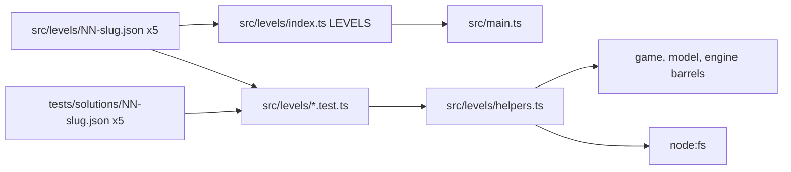

# Design Document

## Overview

The Levels_Module is data plus tests. It adds five Level_Files, one barrel and one shared helper under `src/levels/`, five Solution_Files under `tests/solutions/`, one `.gitattributes` and six test files. It changes no rule of the engine, the model or the game, and it adds no UI.

Two proofs carry the module:

1. **Winnable.** A stored action list is replayed through `startRun` and `applyAction`. Every action must be accepted and the last must win.
2. **Not winnable by walking.** For levels 2 to 5 an exhaustive breadth-first search over `move` and `wait` must end with no unexpanded state and no win. Together with the replay this means "tight but fair": the player must edit, and the stored edits are enough.

No test asserts elapsed time. The work of the search is bounded by its limits (100 turns, 1,000 distinct states) and by a size rule on the maps, not by a clock.

### What was checked and measured while writing this design

- The three barrels (`src/engine/index.ts`, `src/model/index.ts`, `src/game/index.ts`) exist and work. `startRun`, `applyAction`, `cellValue`, `cellRawText`, `loadLevel` and `serializeLevelText` were used by throwaway drafts of all five levels.
- All five draft levels loaded, all five stored solutions replayed to `won`, the edit-free search exhausted levels 2 to 5 and found a win on level 1, and the level 5 first-three-moves, loss-variant and minus-one-ink cases behaved as Requirement 8 states. The numbers are in the Measurements section.
- `tsc --noEmit` accepts `import level from './x.json'` with the current `tsconfig.json` (`moduleResolution: Bundler` turns on JSON modules), so no tsconfig change is needed.
- Tooling for a Node-using file under `src/`: `src/engine/constraints.test.ts` already imports `readdirSync` and `readFileSync` from `node:fs` and `join` and `resolve` from `node:path`, and uses `__dirname`. `npx eslint src/engine/constraints.test.ts` and `npx tsc --noEmit` both pass on the current tree. `@types/node` 24.19.2 is a devDependency. The `src/**/*.ts` block of `eslint.config.js` gives browser globals only, but the typescript-eslint recommended set turns `no-undef` off for TypeScript files, so Node imports pass. No change to `eslint.config.js` or `tsconfig.json` is needed (see Files). If `npm run lint` flags `src/levels/helpers.ts` anyway, the fix is to add `src/levels/helpers.ts` to the `files` list of the Node-globals block of `eslint.config.js`, and nothing else.
- All throwaway files were deleted: the measurement test file, the JSON import probe and the empty `src/levels/` directory they created. `git status` shows only the spec folder as new, next to three files that were already modified before this work (`.kiro/specs/game-rules/tasks.md`, `.kiro/specs/grid-ui/tasks.md`, `KIRO_USAGE.md`).

## Decisions

The confirmed decisions of `requirements.md` and where they land.

| # | Decision | Lands in |
| --- | --- | --- |
| 1 | `src/levels/index.ts` exports `LEVELS: readonly unknown[]`; `main.ts` imports it after grid-ui 5.2. | Components: Levels_Index. Files: deferred changes. |
| 2 | `src/stub-levels.ts` is deleted; `tests/fixtures/levels.ts` stays. | Files: deferred changes. |
| 3 | Level tests sit in `src/levels/`; they read `tests/solutions/` with `node:fs`. | Files, Testing Strategy. |
| 4 | Solution format `{ levelId, minimalInk, actions }`, no `undo`. | Data Models: Solution_File. |
| 5 | `.gitattributes` with two `eol=lf` lines; strict normalized-bytes test. | Testing Strategy: bytes and line endings. |
| 6 | No `RAND` in any raw text; seed equals level number. | Blueprints, `files.test.ts`. |
| 7 | All 144 map cells and all labels locked; only listed cells editable. | Blueprints, `files.test.ts`, `level-01.test.ts` to `level-05.test.ts`. |
| 8 | Edit-free search is breadth-first over `move` and `wait`; hitting a limit fails the test as inconclusive. | Components: search. |
| 9 | `minimalInk` is the stored solution's cost, not a proven global minimum. | Data Models; Blueprint 3 note. |
| 10 | Level 1 has ink 0. | Blueprint 1. |
| 11 | Level 5 is distance-gated, `startingHp` 6, chase range `<4`, attack range `<=2`. | Blueprint 5. |
| 12 | HP, ink and geometry of levels 1 to 4 may be adjusted; level 5 numbers are fixed. | Blueprints (no level was resized). |
| 13 | Hints are drafted; the design rewords none. The blueprints carry the final text, 49 to 105 characters, naming the required cells. | Blueprints. |
| 14 | Search limits are 100 turns and 1,000 distinct states (measured need: at most 14 turns and 172 states). | Components: search. |
| 15 | No test asserts elapsed time. Search tests carry a Vitest timeout of 60_000 ms. A level with a monster has at most 60 Walkable_Cells at load. | Components: search; Run-time bounds; `level-02.test.ts`, `level-05.test.ts`. |
| 16 | The helper is the non-test file `src/levels/helpers.ts`. Only test files import it. | Files, Components, `scan.test.ts`. |
| 17 | The one-edit routes to open the level 3 door (formula in a rune cell, fractional rune) are legal clever strategies; `=1337/RUNE_SALT` in `RUNE_ASH` is the stored solution (Requirement 6, revised). | Blueprint 3 note. |
| 18 | The State_Key is the exact joined text of the 240 cell values, not a hash. | Components: search. |
| 19 | The `main.ts` swap waits for grid-ui tasks 4.2 and 5.2. | Files: deferred changes. |

Decisions made in this design:

| Id | Decision | Reason |
| --- | --- | --- |
| D1 | `helpers.ts` reads files with `readFileSync` from `node:fs` and `new URL('...', import.meta.url)`, so it needs no `node:path` and no `__dirname`. | Requirement 15.3 allows the helper to import only the three barrels and `node:fs`. A `URL` argument is accepted by `readFileSync` and resolves the same way on every platform. |
| D2 | The JSON files are produced by a throwaway generator test that is deleted afterwards. | See Authoring workflow. |
| D3 | `search.test.ts` stays in the `test:fast` run. No `package.json` change. | The whole search file measured about 1.2 s once. See Run-time bounds. |

## Architecture

```
ui -> game -> model -> engine      (levels is data: it imports nothing at run time except its own JSON)
src/levels/index.ts  <-  src/main.ts      (after grid-ui 5.2)
src/levels/*.test.ts  ->  src/levels/helpers.ts  ->  game, model, engine barrels and node:fs only
```



`helpers.ts` is a non-test file, but only test files import it. `index.ts` imports only JSON and `src/main.ts` imports only `index.ts`, so the helper is not reachable from the application entry point and cannot enter the production bundle.

### Files

| File | Purpose |
| --- | --- |
| `src/levels/01-the-corridor.json` ... `05-the-lich.json` | The five Level_Files, each equal to `serializeLevelText` of its own loaded Level. |
| `src/levels/index.ts` | `LEVELS`, five JSON imports and one array, nothing else. |
| `src/levels/helpers.ts` | The shared helper (Decision 16). Imports only `../game/index`, `../model/index`, `../engine/index` and `node:fs`. |
| `src/levels/index.test.ts` | Requirement 1: directory content, export, order, deep equality with `JSON.parse`, source has no call and no extra import. |
| `src/levels/files.test.ts` | Requirements 2 and 3: loads, bytes, `.gitattributes`, ids, tab labels, hints, labels, locks, `RAND`, seeds, monster counts, exits. |
| `src/levels/level-01.test.ts` ... `level-05.test.ts` | One file per level. Each holds that level's facts from Requirements 4 to 8 (HP, ink, raw texts, positions, locked and editable set), the size rule of Requirement 11.4 where it applies (levels 2 and 5), and, for level 5, the arithmetic, first-three-moves, loss-variant and `LICH_HP`-edit-distance cases. The cross-level checks stay in `files.test.ts`, `solutions.test.ts`, `search.test.ts`, `index.test.ts` and `scan.test.ts`. |
| `src/levels/solutions.test.ts` | Requirements 9, 10, 12 and 13: Solution_File shape, replay, determinism snapshot, minus-one-ink refusal. |
| `src/levels/search.test.ts` | Requirement 11.1 to 11.3: the Edit_Free_Search on all five levels, outcomes only. |
| `src/levels/scan.test.ts` | Requirement 15: Deny_List scan, forbidden constructs and import lists of the test files, the helper and `index.ts`, and the check that no non-test file imports the helper. |
| `tests/solutions/01-the-corridor.json` ... `05-the-lich.json` | The five Solution_Files. |
| `.gitattributes` | `src/levels/*.json text eol=lf` and `tests/solutions/*.json text eol=lf`. |

Every test file imports the helper as `./helpers`, and the lower layers only through their barrels. Besides `vitest` and `node:` modules, a test file imports nothing else (Requirement 15.1).

Tooling, checked and not changed:

- `vite.config.ts` collects `src/**/*.test.ts` in the Node environment, so the six test files run. `helpers.ts` is not a test file and is collected by nothing.
- `tsconfig.json` already includes `src`, so `helpers.ts` is type-checked. `@types/node` is installed and `src/engine/constraints.test.ts` already shows that `node:fs` imports compile under the current `types` setting.
- `eslint.config.js`: the `src/**/*.ts` block sets browser globals, and `no-undef` is off for TypeScript files, which is why `constraints.test.ts` passes. `helpers.ts` uses only imports from `node:fs`, `URL` and `import.meta.url`, none of which `no-undef` would flag. No change is needed. Fallback if `npm run lint` reports otherwise: add `'src/levels/helpers.ts'` to the `files` array of the block with `globals.node`, that is `files: ['*.config.{js,ts}', 'tests/**/*.ts', 'scripts/**/*.mjs', 'src/levels/helpers.ts']`.
- `package.json`: no change.

Deferred until grid-ui tasks 4.2 and 5.2 land (Requirement 14, Decision 19). This is a waiting item, not an open question:

- `src/main.ts`: replace the `STUB_LEVELS` import from `./stub-levels` with `import { LEVELS } from './levels/index'` and pass `LEVELS` to `mountApp`. Nothing else changes.
- Delete `src/stub-levels.ts` and the assertions about it in `src/ui/fixture-levels.test.ts`. Keep `tests/fixtures/levels.ts`.
- Check the production build by hand: `npm run build`, then search `dist/` for the five level ids and for the two fixture ids (`01-fixture-corridor`, `02-fixture-lab`). This is a one-time task check, not a Vitest test, because a test would have to run a full build.

## Components and Interfaces

### Levels_Index (`src/levels/index.ts`)

```ts
import level01 from './01-the-corridor.json';
import level02 from './02-the-chaser.json';
import level03 from './03-the-locked-crypt.json';
import level04 from './04-the-trap-row.json';
import level05 from './05-the-lich.json';

export const LEVELS: readonly unknown[] = [level01, level02, level03, level04, level05];
```

No call, no browser global, no default export. The typed JSON elements widen to `unknown`, which is the parameter type `mountApp` and `startRun` take.

### Levels_Helpers (`src/levels/helpers.ts`)

```ts
import { readFileSync } from 'node:fs';
import type { Action, ActionResult, RunState } from '../game/index';
import type { Level } from '../model/index';

export const LEVEL_IDS: readonly string[];            // the five ids in order, '01-the-corridor' ...

export interface SolutionFile { levelId: string; minimalInk: number; actions: Action[] }
export interface LoadedLevelFile { id: string; text: string; doc: unknown; level: Level }

export interface ReplayStep { index: number; action: Action; result: ActionResult; state: RunState } // state is the state after an accepted action, else the state before it
export interface Replay { start: RunState; steps: ReplayStep[]; final: RunState; refusedAt: number | undefined }

export interface Snapshot {
  hero: string; monsters: string[]; hp: number; ink: number; turn: number; status: string;
  raws: string[];     // cellRawText of all 240 cells in reading order
  values: string[];   // kind letter + formatValue of all 240 cells
}

export interface SearchLimits { maxDepth: number; maxStates: number }
export interface SearchResult {
  outcome: 'exhausted' | 'won' | 'limit';
  states: number;       // distinct State_Keys seen
  depth: number;        // number of layers expanded; for 'won', the layer in which a win was found
  expansions: number;   // states expanded
  limit?: 'depth' | 'states';
}

export function readLevelText(id: string): string;                 // node:fs, ./<id>.json next to the helper
export function loadLevelFile(id: string): LoadedLevelFile;        // loadLevelText with createRandom(seed); throws with the Load_Errors printed
export function readSolutionText(id: string): string;              // ../../tests/solutions/<id>.json
export function readSolution(id: string): SolutionFile;            // JSON.parse + the Requirement 9 shape checks; throws with the first fault

export function replay(doc: unknown, actions: readonly Action[]): Replay;   // startRun, then applyAction per action; stops at the first refusal
export function finalSnapshot(state: RunState): Snapshot;
export function stateKey(state: RunState): string;
export function searchEditFree(doc: unknown, limits?: SearchLimits): SearchResult;   // defaults 100 / 1000
export function walkableCount(state: RunState): number;            // Map_Area cells whose Value is '.', 'X' or '^'

export function manhattan(a: string, b: string): number;           // from parseAddress points
export function boardText(state: RunState): string;                // for failure messages
export function describeStep(levelId: string, step: ReplayStep): string;
```

- `readLevelText` and `readSolutionText` call `readFileSync(new URL('./01-the-corridor.json', import.meta.url), 'utf8')` and `readFileSync(new URL('../../tests/solutions/01-the-corridor.json', import.meta.url), 'utf8')` with the id filled in (D1). They need `node:fs` and nothing else.
- `replay` never throws on a refusal. It records the refusal in `steps` and sets `refusedAt`. The calling test turns a refusal into a failure with `describeStep`.
- `loadLevelFile` uses `createRandom(seedOf(doc))` from the game barrel, as `startRun` does (Gap 7 of the requirements).
- `walkableCount` reads the Values of the 144 Map_Area cells through `cellValue` of a started run, so it counts the level 5 gate cell as not walkable at load (it shows `#`).
- The helper uses no `Math.random`, `Date.now`, `new Date`, `performance.now`, `eval` or `new Function`, and no clock of any kind. `stateKey`, `searchEditFree`, `finalSnapshot` and `walkableCount` read a Run_State only through `cellValue`, `cellRawText` and the public fields.

### Search design

`searchEditFree(doc, limits)`:

1. `startRun(doc)`; if it is not ok, throw (a load error is a test failure, not a search result).
2. `seen = new Set([stateKey(start)])`, `frontier = [start]`, `depth = 0`.
3. While the frontier is not empty:
   - If `depth >= maxDepth`, return `{ outcome: 'limit', limit: 'depth', ... }`.
   - For each state in the frontier whose Status is `playing`, apply the five actions `move N`, `move S`, `move E`, `move W` and `wait`. A Refusal is skipped. A result with Status `won` returns `{ outcome: 'won' }` at once. Any other new state is added to `seen` and to the next frontier. If `seen.size` exceeds `maxStates`, return `{ outcome: 'limit', limit: 'states', ... }`.
   - A state with Status `lost` is added to `seen` but never expanded.
   - `frontier = next; depth += 1`.
4. Return `{ outcome: 'exhausted' }`.

Inconclusive failure message, printed by the calling test when the outcome is `limit`:

```
Edit-free search of 02-the-chaser is inconclusive: stopped at the states limit
after 1001 states and 12 layers (limits: 100 turns, 1000 states).
Shrink the walkable area of the level before raising a limit.
```

**State_Key.** The exact text (Decision 18), not a hash, built from these fields in this order, joined with `|`:

1. `hero` (canonical Address).
2. `monsters`: for each monster in the state's order, `id@at`, joined with `,`.
3. `hp`, `ink` and `status`.
4. The 240 cell entries in reading order (A1, B1, ... L20). Each entry is the first letter of the Value `kind` plus `formatValue(value)` (a missing value is `-`). Joined with `|`.

A hash could collide, and a collision could hide a state and make the "unwinnable" proof unsound. The exact text costs about 0.1 ms per state (measured once, see Measurements). `turn` is excluded. This is sound because nothing reads it: the engine has no turn input, no rule in these levels uses `RAND` (Decision 6), so `rngState` cannot change any value, and the hero-dependent values follow from the hero position. Two states with equal keys therefore have equal futures under every action list, which is the only property the search needs. The edit record is also left out because the search never edits, so it is always empty.

**Why every search ends.** The key space is finite: positions come from at most 144 Map_Area cells, `hp` only goes down during edit-free play and `lost` states are not expanded, and map values do not change without edits (no level has a formula that reads the hero or `turn` except the level 3 door, the level 4 gap and the level 5 gate, which read panel cells that the search cannot change). BFS never expands a key twice, so the number of expansions is at most the number of distinct keys. Waiting in a safe spot returns to the same key, so it is not new. For level 5 there is a stronger bound: the cycle stays for the whole edit-free run, so every accepted turn costs at least 1 HP, and no path is longer than 6 turns before `lost` (the measured depth is 7, which includes the layer of `lost` states).

**Limits.** 100 turns and 1,000 distinct states (Decision 14). The measured need is at most 14 turns and 172 states, so the limits are 7 times and 5.8 times the need. Hitting either limit fails the test as inconclusive and never passes it.

## Data Models

### Solution_File

```json
{
  "levelId": "03-the-locked-crypt",
  "minimalInk": 1,
  "actions": [
    { "kind": "edit", "address": "B14", "raw": "=1337/RUNE_SALT" },
    { "kind": "move", "dir": "E" }
  ]
}
```

Two-space JSON, `\n`, one trailing newline, written as `JSON.stringify(value, null, 2) + '\n'`. Each action has exactly the keys of its kind. To keep the files short, the real files list one action per object, so level 1 is nine `move E` objects.

### Authoring workflow

The 144 map-cell specs plus the panel cells make each Level_File about 12 KB, so the files are produced, not typed.

1. A throwaway test file `src/levels/author.scratch.test.ts` holds a small `build(def)` function and the five definitions of the blueprints below. `build` makes a Level_Document: all 144 map cells as locked specs whose `raw` is the glyph, formula cells replacing their glyph, then for each panel row a locked label spec at `A<row>` and the named cell at `B<row>`.
2. The test calls `loadLevel(doc, createRandom(seed).next)`, fails on any Load_Error, and writes `serializeLevelText(result.level)` to `src/levels/NN-slug.json` and `JSON.stringify(solution, null, 2) + '\n'` to `tests/solutions/NN-slug.json` with `node:fs`. `writeFileSync` writes `\n` as given on every platform.
3. The scratch file is deleted. It does not ship, and the exact-file check of Requirement 1.1 (only the six named files besides `*.test.ts`) would not see it anyway once deleted. The JSON files are the only source of truth, so there is no generator to drift from them, and later hand edits are caught by the normalized-bytes test.
4. `.gitattributes` is created before the first `git add` of the JSON files, so that `core.autocrlf=true` cannot rewrite them (Requirement 2.3).

Normalization facts the blueprints rely on (sheet-model, Requirement 10): a cell spec is dropped only when it is unlocked, unnamed and equal to its map glyph, so all locked cells stay. A formula cell is written into `map` as `.`, and its formula stays in `cells`. The loaded counts are 146, 148, 152, 152 and 156 cell specs for levels 1 to 5.

### Blueprints

Common to all levels: `schemaVersion` 1; every map cell locked; every label cell (column A of the panel) locked; names are in column B of the panel; row 13 is empty; no `RAND` anywhere; `seed` equals the level number; monsters, where present, have `id` `M1`, `move` `MOVE_M1`, `atk` `ATK_M1`. Maps are shown as normalized (formula cells show `.`) and are indexed row 1 to row 12, column A to L.

#### Level 1, The Corridor (`01-the-corridor`)

Title `The Corridor`. `startingHp` 3, `ink` 0, `seed` 1. Hero `B6`. No monsters. Exit `X` at `K6`.

```
row 1  ############
row 2  ############
row 3  ############
row 4  ############
row 5  ############
row 6  #.........X#
row 7  ############
row 8  ############
row 9  ############
row 10 ############
row 11 ############
row 12 ############
```

Hint (76): `Walk east. The rules panel counts the steps in DIST_TO_EXIT. Someone has to.`

| Row | A (label, locked) | B (name) | raw | locked |
| --- | --- | --- | --- | --- |
| 14 | `Steps to the exit` | `DIST_TO_EXIT` | `=DIST(HERO,K6)` | yes |

Editable cells: none.

Solution (`minimalInk` 0): nine times `move E`. Hand check: the hero walks B6 to K6 over floor, there is no monster, no trap and no cycle, so `hp` stays 3 and the ninth move lands on `X`. `DIST_TO_EXIT` falls from 9 to 0.

#### Level 2, The Chaser (`02-the-chaser`)

Title `The Chaser`. `startingHp` 3, `ink` 2, `seed` 2. Hero `B6`. Monster `M1` at `H6`. Exit `X` at `K6`, behind the monster.

```
row 1  ############
row 2  ############
row 3  ############
row 4  #..........#
row 5  #..........#
row 6  #.........X#
row 7  #..........#
row 8  #..........#
row 9  ############
row 10 ############
row 11 ############
row 12 ############
```

Hint (49): `MOVE_M1 decides who gets chased. It is only text.`

| Row | A (label, locked) | B (name) | raw | locked |
| --- | --- | --- | --- | --- |
| 14 | `Move rule of M1` | `MOVE_M1` | `=IF(DIST(HERO,SELF)<4,TOWARD(HERO),"-")` | no |
| 15 | `Attack rule of M1` | `ATK_M1` | `=IF(DIST(HERO,SELF)<2,2,0)` | no |

Editable cells: `MOVE_M1`, `ATK_M1`. The walkable area is 10 by 5, 50 cells, within the limit of 60.

Solution (`minimalInk` 1, 14 actions): `edit B14 =IF(DIST(HERO,SELF)<1,TOWARD(HERO),"-")`, `move E` x4 (to F6), `move N` x2 (to F4), `move E` x5 (to K4), `move S` x2 (to K6).

Hand check:

- After the edit, `M1` moves only when `DIST(HERO,SELF)<1`, which needs the hero on the monster's cell, and a move onto a monster is refused, so `M1` never leaves `H6`.
- `ATK_M1` pays 2 only when `DIST<2`. The path cells and their distance to `H6`: C6 5, D6 4, E6 3, F6 2, F5 3, F4 4, G4 3, H4 2, I4 3, J4 4, K4 5, K5 4, K6 3. The minimum is 2, so no hit lands and `hp` stays 3.
- Ink 2, one spent: `ink` is 1 after step 0 and stays 1.

Edit-free impossibility is proven by the search (172 states, exhausted, no win, measured on the draft). In words: the monster wakes when the hero is at distance 3 or less, follows one cell per turn, and every turn it ends adjacent to the hero it deals 2; 3 `hp` allows one hit and not two, and the exit lies behind it.

#### Level 3, The Locked Crypt (`03-the-locked-crypt`)

Title `The Locked Crypt`. `startingHp` 3, `ink` 2, `seed` 3. Hero `B6`. No monsters. Door cell `G6`, exit `X` at `K6`.

```
row 1  ############
row 2  ############
row 3  ############
row 4  #.....#....#
row 5  #.....#....#
row 6  #.........X#      (G6 is the door formula, shown as '.')
row 7  #.....#....#
row 8  #.....#....#
row 9  ############
row 10 ############
row 11 ############
row 12 ############
```

Column G is wall in rows 4, 5, 7, 8, so the door is the only route. Door cell `G6`: raw `=IF(KEY=1337,".","#")`, locked. At load `KEY` is 8 x 190 = 1520, so the door reads `#`.

Hint (105): `The door asks KEY a question. Read what feeds KEY: RUNE_ASH, RUNE_SALT. Not every rune is on the payroll.`

| Row | A (label, locked) | B (name) | raw | locked |
| --- | --- | --- | --- | --- |
| 14 | `Rune of ash` | `RUNE_ASH` | `8` | no |
| 15 | `Rune of salt` | `RUNE_SALT` | `190` | no |
| 16 | `Rune of dust` | `RUNE_DUST` | `13` | no |
| 17 | `The key` | `KEY` | `=RUNE_ASH*RUNE_SALT` | yes |

Editable cells: `RUNE_ASH`, `RUNE_SALT`, `RUNE_DUST`. `RUNE_DUST` is read by no formula.

Solution (`minimalInk` 1, 10 actions): `edit B14 =1337/RUNE_SALT`, `move E` x9.

Hand check: after step 0 `B14` reads 1337/190 and `KEY` is (1337/190) x 190, which evaluates to exactly 1337 in the engine (checked by running it), so the door recalculates to `.` in the same turn. The hero then walks B6 to K6 (C, D, E, F, G, H, I, J, K = 9 moves) with `hp` 3 and `ink` 1. Edit-free the hero is confined to the 5 by 5 west chamber: 25 states, exhausted.

Slack route: `edit B14 7`, `edit B15 191`, `move E` x9 still wins (`KEY` 7 x 190 = 1330 after the first edit with the door shut, 7 x 191 = 1337 after the second) with `hp` 3 and `ink` 0. It uses the whole `ink` of 2.

Note (Decisions 9 and 17, revised): the Grimsheet Playtester confirmed twice on `main` at commit bea7a52 that one formula edit wins the level, for example `RUNE_ASH` set to `=1337/RUNE_SALT` or `RUNE_SALT` set to `=1337/RUNE_ASH`. Any door that checks one equation can be met with one formula edit, so the spec keeps the trick and makes it the stored solution instead of patching it. `RUNE_SALT` set to `167.125` (8 x 167.125 is exact in binary) is another 1-ink route. `minimalInk` 1 is the cost of the stored solution, not a global minimum. `ink` stays 2, which is `minimalInk` plus 1. No test claims that two edits are required.

#### Level 4, The Trap Row (`04-the-trap-row`)

Title `The Trap Row`. `startingHp` 5, `ink` 1, `seed` 4. Hero `B6`. No monsters. Exit `X` at `K6`. Gap row 6: `F6` is a locked formula cell, `G6` is floor.

```
row 1  ############
row 2  #....^^....#
row 3  #....^^....#
row 4  #....^^....#
row 5  #....^^....#
row 6  #.........X#      (F6 is the gap formula, shown as '.'; G6 is floor)
row 7  #....^^....#
row 8  #....^^....#
row 9  #....^^....#
row 10 #....^^....#
row 11 #....^^....#
row 12 ############
```

The band is columns F and G in rows 2 to 11 and fills the interior from wall to wall, so crossing it costs two trap steps. `F6` raw `=IF(RATIO>=0,".","#")`, locked. At load `RATIO` is `#DIV/0!`, and the error flows through the `IF`, so `F6` shows `#DIV/0!` and blocks.

Hint (71): `The #DIV/0! cell is a hole. Follow RATIO back to its cause. Traps bite.`

| Row | A (label, locked) | B (name) | raw | locked |
| --- | --- | --- | --- | --- |
| 14 | `Trap damage` | `TRAP` | `3` | yes |
| 15 | `Ratio` | `RATIO` | `=LOAD/DIVISOR` | yes |
| 16 | `Load` | `LOAD` | `6` | no |
| 17 | `Divisor` | `DIVISOR` | `0` | no |

Editable cells: `LOAD`, `DIVISOR`. Editing `LOAD` leaves `RATIO` at `#DIV/0!`, so it is a decoy.

Solution (`minimalInk` 1, 10 actions): `edit B17 1`, `move E` x9.

Hand check: after the edit `RATIO` is 6 / 1 = 6, `F6` is `.`, and the hero walks B6 to K6 through F6 and G6 without touching a `^`, so `hp` stays 5. A crossing over the traps costs 3 + 3 = 6 against 5 `hp`: one step onto `F5` leaves 2, the second step is fatal. Edit-free: 107 states, exhausted, no win (measured on the draft).

#### Level 5, The Lich (`05-the-lich`)

Title `The Lich`. `startingHp` 6, `ink` 2, `seed` 5. Hero `B6`. Monster `M1` at `I6`, `DIST` 7 from the hero start on a straight line of floor (`B6` to `I6`). Gate cell `K4`.

```
row 1  ############
row 2  ############
row 3  ############
row 4  #..........#      (K4 is the gate formula, shown as '.')
row 5  #..........#
row 6  #..........#
row 7  #..........#
row 8  #..........#
row 9  ############
row 10 ############
row 11 ############
row 12 ############
```

Gate `K4`: raw `=IF(LICH_HP<=0,"X","#")`, locked. It reads `#` until `LICH_HP` is 0 or below, so at load the walkable count is 49 (50 cells minus the gate) and the size rule of Requirement 11.4 holds with room (at most 60). The shortest route from `B6` to `K4` is 9 + 2 = 11 moves, which is at least 6.

Hint (85): `LICH_HP is just a number. Change it while he is far. HEX_A and HEX_B haunt the sheet.`

| Row | A (label, locked) | B (name) | raw | locked |
| --- | --- | --- | --- | --- |
| 14 | `Move rule of M1` | `MOVE_M1` | `=IF(DIST(HERO,SELF)<4,TOWARD(HERO),"-")` | yes |
| 15 | `Attack rule of M1` | `ATK_M1` | `=IF(DIST(HERO,SELF)<=2,LICH_HP,0)` | yes |
| 16 | `Lich HP` | `LICH_HP` | `=MAX(1,PHYLACTERY)` | no |
| 17 | `Phylactery` | `PHYLACTERY` | `4` | yes |
| 18 | `Hex A` | `HEX_A` | `=HEX_B+1` | no |
| 19 | `Hex B` | `HEX_B` | `=HEX_A+1` | no |

Editable cells: `LICH_HP`, `HEX_A`, `HEX_B`. At load `LICH_HP` is 4 and `HEX_A` and `HEX_B` are `#CYCLE!`.

Solution (`minimalInk` 2, 13 actions): `edit B16 0`, `edit B19 0`, `move N` x2 (to B4), `move E` x9 (to K4).

Hand simulation (measured on the draft, matching the turn rules):

| Step | Action | Hero | M1 | hp | ink | Why |
| --- | --- | --- | --- | --- | --- | --- |
| 0 | edit `LICH_HP` = 0 | B6 | I6 | 5 | 1 | Gate opens at step 3. The cycle is still present at step 6: haunt 1. `DIST` is 7, so `M1` sleeps. |
| 1 | edit `HEX_B` = 0 | B6 | I6 | 5 | 0 | `HEX_A` = 1. The step 3 sheet has no cycle: no haunt. |
| 2, 3 | `move N` x2 | B4 | I6 | 5 | 0 | `DIST` 8 then 9. |
| 4 to 8 | `move E` x5 | G4 | I6 | 5 | 0 | `DIST` from G4 to I6 is 4, still asleep. |
| 9 | `move E` | H4 | I5 | 5 | 0 | `DIST` 3: `M1` wakes and steps N. `ATK_M1` reads `LICH_HP` = 0: no damage. |
| 10 | `move E` | I4 | I5 | 5 | 0 | `M1` stays (target is the hero's cell). |
| 11 | `move E` | J4 | I4 | 5 | 0 | `M1` follows. No damage. |
| 12 | `move E` | K4 | J4 | 5 | 0 | Hero stands on `X`. Status `won`. |

Final: `hp` 5, `ink` 0, `turn` 13, one haunting turn (turn 1), as Requirement 8.4 states. The `LICH_HP` edit is accepted at `DIST` 7, which is greater than 2.

The three level 5 cases of Requirement 8, from the same draft:

- **First three moves toward `M1`** (`move E` x3): hero C6, D6, E6; `M1` stays on `I6`; each Damage_Log is `[{ haunt, 1 }]`; `hp` is 5, 4, 3; Status `playing`. `DIST` is 6, 5, 4 and the chase range is `<4`.
- **Loss variant** (`move E` x4, then `edit B16 0`, then `edit B19 0`): the 4th move puts the hero on F6, `DIST` 3, so `M1` wakes, moves W to `H6` (`DIST` 2) and hits for `LICH_HP` = 4 against 3 `hp`. Damage_Log `[{ monster M1, 4 }, { haunt, 1 }]`, `hp` -2, Status `lost`. The two edits after it are refused with `not-playing`, which the test also asserts. Haunting alone had taken 3 of 6 `hp`.
- **Minus-one-ink** (ink 1): step 0 is accepted, step 1 is refused `no-ink`.
- Without breaking the cycle: 1 haunt on the edit turn plus at least 6 more turns on the shortest route costs at least 7 `hp` against 6, so a player who keeps the curse cannot arrive alive.

### Hint, label and lock checks (Requirements 2 and 3)

| Check | Rule |
| --- | --- |
| Hint | One line, 1 to 120 characters, no `\r` or `\n`. Substrings: level 1 `DIST_TO_EXIT` and (case-insensitive) `rules panel`; level 2 `MOVE_M1`; level 3 `KEY` and `RUNE_ASH` or `RUNE_SALT` (both are present); level 4 `#DIV/0!` and `RATIO`; level 5 `LICH_HP` and `HEX_A` or `HEX_B` (both are present). |
| Labels | For every named cell in rows 14 to 20, the spec at the Address to its left has a `raw` of 1 to 24 characters. The longest is `Attack rule of M1` (17). |
| Locks | Every cell in rows 1 to 12 and every cell in column A of rows 14 to 20 is locked. The cells without the lock flag have exactly the names in the Editable cells line of the level. |
| `RAND` | No `raw` contains `rand`, case-insensitive. `seed` equals N. |
| Monsters | 0, 1, 0, 0, 1 monsters, each `M1` / `MOVE_M1` / `ATK_M1`. |
| Exits | Levels 1 to 4: a Map_Area cell with Value `X` after `startRun`. Level 5: `K4` has the gate raw text and its Value is `#`. |
| Size rule | For levels 2 and 5 (the levels with a monster), `walkableCount` of the started run is at most 60 (50 and 49 in the drafts). Requirement 11.4 says 50 for both; see the note under Measurements. |

## Measurements

Measured once while designing, not asserted by any test. Machine: Windows 11 Pro, Intel Core i9-14900HX (24 cores, 32 threads), 95.6 GB RAM, Node v24.18.0, Vitest 5.1.0. The project requires Node 22 or newer. Method: throwaway drafts of the five blueprints above, the search of this design with a clock around each `applyAction` and each `stateKey` (in the throwaway drafts only, not in any shipped file), one run in one process (so the first search includes JIT warm-up). `applies` counts all five actions per expansion, refusals included.

| Level | Outcome | States | Layers | Expansions | applyAction calls | Total ms | ms per applyAction | ms per stateKey |
| --- | --- | --- | --- | --- | --- | --- | --- | --- |
| 1 The Corridor | won | 10 | 8 | 9 | 45 | 39 | 0.686 | 0.121 |
| 2 The Chaser | exhausted | 172 | 11 | 98 | 490 | 453 | 0.804 | 0.105 |
| 3 The Locked Crypt | exhausted | 25 | 7 | 25 | 125 | 94 | 0.629 | 0.101 |
| 4 The Trap Row | exhausted | 107 | 14 | 89 | 445 | 349 | 0.672 | 0.102 |
| 5 The Lich | exhausted | 97 | 7 | 68 | 340 | 263 | 0.673 | 0.092 |
| Sum of the five | | | | | | about 1,200 | | |
| Worst-case size A: level 2 with a 10 by 10 room, `ATK` 0 | exhausted | 434 | 33 | 434 | 2,170 | 1,668 | 0.662 | 0.091 |
| Worst-case size B: same room, real `ATK_M1` | exhausted | 595 | 33 | 353 | 1,765 | 2,161 | 1.055 | 0.160 |

Findings:

- One accepted action costs about 0.7 to 1.1 ms (a fresh 240-cell Sheet each time, game-rules Decision 19). The State_Key costs about 0.1 to 0.16 ms, so the exact joined text is cheap enough and no hash is needed.
- The real levels are small: at most 172 states and about 0.45 s each, about 1.2 s for all five together.
- Size matters. A 10 by 10 open room with a chaser (100 walkable cells) took about 2 s for 595 states. No level was resized. The size rule (at most 60 Walkable_Cells for a level with a monster) keeps future edits to a level from growing the search unnoticed.
- Cost at the old limit: 20,000 states would be about 100,000 actions, over 80 s, before the test could say "inconclusive". That is why the limits are 100 turns and 1,000 states.
- Count note: the level 5 draft has 50 floor cells in its interior and the gate `K4` is one of them, so at load `walkableCount` is 49. Requirement 11.4 states 50 for levels 2 and 5 and also says the gate counts as not walkable at load. These two statements disagree by one for level 5. The test asserts the rule itself (at most 60), not the exact counts; see Remaining caveats.

### Run-time bounds

- No test measures or asserts elapsed time (Decision 15). Search tests are written `it('...', () => { ... }, 60_000)`, so each one has an explicit Vitest timeout of 60_000 ms. The timeout is a safety net only.
- The work is bounded by the limits (100 turns, 1,000 distinct states, Decision 14) and by the size rule (at most 60 Walkable_Cells for a level with a monster), which is a test in `level-02.test.ts` and `level-05.test.ts`.
- Replays and determinism: about 55 actions per replay, times 3 to 4 replays per level, about 1 ms each, so well under 1 s in total (estimate).
- `search.test.ts` measured about 1.2 s in total once and stays in the `test:fast` run (D3), which the save hook runs. The save hook's own timeout is 120 s, longer than the 60 s test timeout, so a search that overruns fails with a Vitest timeout message before the hook is killed. A synchronous endless loop would not be interrupted by either timeout, which is why the state and depth limits exist and are checked inside the loop.

## Correctness Properties

No generated-input tests are used here (see the note in `requirements.md`): the input is five fixed documents and five fixed action lists, so there is nothing to generate. These exhaustive checks stand in for them, each covering all the fixed data instead of a sample:

- **Replay.** Every stored solution is accepted action by action and ends `won` (Requirements 9, 10).
- **Edit-free search.** The whole reachable edit-free state space of levels 2 to 5 holds no win (Requirement 11).
- **Determinism snapshot.** Two replays give equal Final_Snapshots over all 240 cells (Requirement 12).
- **Ink bound.** One ink fewer makes the last edit fail with `no-ink` (Requirement 13).

Round trip and totality of the Loader are already covered by generated documents in `sheet-model`; determinism and undo of runs by `game-rules`.

## Error Handling

Failures print what an author needs to find the fault without a debugger.

- **Load fault:** `loadLevelFile` throws a message with the level id and each Load_Error as `path: code: message`.
- **Replay fault:** `describeStep` prints `Level <id>, step <index> (<action as JSON>): refused <reason>: <message>` followed by `boardText`, which prints the status line (`hp`, `ink`, `turn`, Status) and the 12 map rows from the cell values with `@` for the hero and `M` for each monster. `solutions.test.ts` fails with this text at the first refusal instead of continuing.
- **Search fault:** a win in levels 2 to 5 prints the depth and the board of the winning state; an inconclusive search prints the message shown under Search design.
- **Byte fault:** the normalized-bytes test reports the index of the first differing character and the kind of the difference (`\r`, byte order mark or content), not the whole file.
- **Solution shape fault:** `readSolution` throws with the file name and the path of the first bad field, for example `actions[3]: unexpected key "foo"`.

## Testing Strategy

Property-based testing does not apply (see Correctness Properties): the inputs are five fixed documents and five fixed action lists. All tests are example-based and run under Vitest in the Node environment with no DOM. No test calls a clock or asserts elapsed time.

### Cases per requirement

| Requirement | File | Cases |
| --- | --- | --- |
| 1 Files and Index | `index.test.ts` | The non-test entries of `src/levels/` are exactly the seven files `01-the-corridor.json` to `05-the-lich.json`, `index.ts` and `helpers.ts`, and there is no subdirectory. `LEVELS` has 5 entries and `Object.keys` of the module is `['LEVELS']`. Each element deep-equals `JSON.parse` of the file at the same position. The source of `index.ts` has exactly five imports of `./NN-slug.json`, one export, no `(` call and no default export. |
| 2 Loadable and normalized | `files.test.ts` | `loadLevelFile` is ok and `startRun` is ok with `playing`, `hp` and `ink` as in the document. `serializeLevelText(level)` equals the file text, which has no `\r` and no byte order mark. `.gitattributes` holds both lines. Ids equal file names; the number prefix equals the position; ids are unique; `tabLabel` equals `Sheet1: The Corridor` through `Sheet5: The Lich`. Hint and label rules from the table above. |
| 3 Shared rules | `files.test.ts` | Lock sets, no `RAND`, seeds, monster counts and the exits, as in the table above. |
| 4 to 8 Levels | `level-01.test.ts` to `level-05.test.ts` (one file per level; the across-all-levels lock and editable-set checks stay in `files.test.ts`) | Per level: `startingHp`, `ink`, hero, monster start, the exact raw texts and lock flags from the blueprint, the Editable cells, the Value of the key cells at load (level 3 door `#`, `KEY` 1520; level 4 `F6` and `RATIO` are `#DIV/0!`; level 5 `LICH_HP` 4, gate `#`, `HEX_A` and `HEX_B` `#CYCLE!`). Level 5: `manhattan(hero, M1)` is 7 and the cells between are floor; shortest route at least 6 (counted by a small flood fill on the Values; 11 in the draft); first three moves; loss variant; the `LICH_HP` edit is accepted while `manhattan(hero, M1)` is above 2; one haunting turn and final `hp` 5 for the stored solution. |
| 9 Solution_Files | `solutions.test.ts` | `readSolution` shape checks (kinds, keys, `dir`, no `undo`), edit count equals `minimalInk`, level 1 has 0, `levelId` equals the level id, the text equals `JSON.stringify(parsed, null, 2) + '\n'`. |
| 10 Replay | `solutions.test.ts` | Every action accepted; after each action but the last: `hp` above 0, `ink` at 0 or above, Status `playing`; after the last: `won`, `hp` above 0, the hero's cell Value is `X`. |
| 11.1 to 11.3 Edit-free search | `search.test.ts` | Level 1 outcome `won`. Levels 2 to 5 outcome `exhausted` with `states` above 1. Any `limit` outcome fails with the inconclusive message. Each test is `it('...', () => { ... }, 60_000)`. No clock, no elapsed-time assertion. |
| 11.4 Size rule | `level-02.test.ts`, `level-05.test.ts` | For each level with a monster (2 and 5), `walkableCount` of the started run is at most 60. |
| 12 Determinism | `solutions.test.ts` | Two replays from two `startRun` calls give `finalSnapshot` values that are `toEqual`. |
| 13 Tight but fair | `solutions.test.ts` | The ink table (0, 2, 2, 1, 2 with `minimalInk` 0, 1, 1, 1, 2 and `startingHp` 3, 3, 3, 5, 6); `ink` is `minimalInk` or one more. For levels with `minimalInk` 1 or more, the replay of a copy of the document with `ink` one lower stops at the last edit action with reason `no-ink`. |
| 14 Entry point | none in Vitest | Checked by hand when the grid-ui tasks land (see Files). |
| 15 Module constraints | `scan.test.ts` | See below. |

### Scan test (Requirement 15)

- Test files: each of the six `*.test.ts` files in `src/levels/` imports, besides `vitest` and `node:` modules, only `./helpers`, sibling files and the barrels `../game/index`, `../model/index` and `../engine/index`. None contains `Math.random`, `Date.now`, `new Date`, `eval` or `new Function`. As a design extra, none contains `performance.now` either, because Decision 15 forbids elapsed-time checks. The forbidden strings are built from fragments inside `scan.test.ts`, so the scan file does not match itself.
- `helpers.ts`: its import list is exactly `node:fs`, `../game/index`, `../model/index` and `../engine/index`, and it contains none of `Math.random`, `Date.now`, `new Date`, `performance.now`, `eval` or `new Function`.
- `index.ts`: its import list is exactly the five JSON files, it contains no `(` call and no browser global (`window`, `document`, `localStorage`, `navigator`).
- Bundle reach: no non-test `.ts` file under `src/` (this covers `src/main.ts` and `src/levels/index.ts`) contains an import of `levels/helpers` or `./helpers` that resolves to the helper. The scan walks `src/` with `node:fs` and checks import lines of non-test files.
- Deny_List: assembled from string fragments in the test, so no test file contains an entry as a whole word. Every file under `src/levels/` and `tests/solutions/` is scanned case-insensitively for each entry. This design lists none of the entries.

### Level 5 cases with the helpers

- **First three moves:** `replay(doc, [E, E, E])`; for each step assert `result.ok`, `state.status === 'playing'`, `state.monsters[0].at === 'I6'`, `result.damage` equals `[{ source: { kind: 'haunt' }, amount: 1 }]`; the last `hp` is 3.
- **Loss variant:** `const actions = [E, E, E, E, edit B16 0, edit B19 0]` is defined as data in the test; `replay` stops at the first refusal. Step 3 has `result.ok`, `state.status === 'lost'` and a `damage` entry `{ source: { kind: 'monster', id: 'M1' }, amount: 4 }`. Step 4 is refused with `not-playing`.
- **Minus-one-ink:** `replay({ ...doc, ink: minimalInk - 1 }, actions)`; `refusedAt` equals the index of the last `edit` action and the refusal reason is `no-ink`.
- **Determinism:** `finalSnapshot(replay(doc, actions).final)` twice, `toEqual`.

### Bytes, line endings and the Deny_List

- The normalized-bytes test compares the file text with `serializeLevelText(loaded.level)` strictly. It does not strip `\r`.
- `.gitattributes` is read and split into lines; both required lines must be present.
- The Deny_List scan covers the five Level_Files, the five Solution_Files, `index.ts` and `helpers.ts`.

## Remaining caveats

- Every number in this design (hp and ink per step, state counts, timings) comes from throwaway drafts of the blueprints, not from the final JSON files. The tests of the real files re-check each number; the search counts and timings are to be re-read when they exist.
- Timings varied between runs (about 0.66 to 1.06 ms per accepted action in one session). They are design-time evidence only; no test depends on them.
- Requirement 11.4 says levels 2 and 5 have 50 Walkable_Cells and also that the level 5 gate counts as not walkable at load. With the level 5 blueprint (a 10 by 5 room whose gate is one of the 50 interior cells) these give 49 for level 5. The size test asserts only "at most 60", so it passes either way. The parenthetical in the requirement could say "50 and 49".
- Requirement 14 waits for grid-ui tasks 4.2 and 5.2 (`mountApp` and the stub list do not exist yet). The `main.ts` change, the stub removal and the build check are deferred until then.
