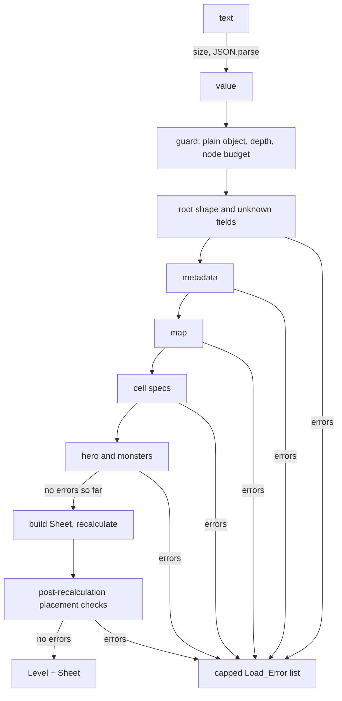

# Design Document

## Overview

The Sheet_Model is a DOM-free TypeScript module under `src/model/`. It turns a Level_Document (JSON) into a typed, immutable Level plus a recalculated engine Sheet, and turns a Level back into a canonical document and text. It holds no game rules. It imports the engine only through `src/engine/index.ts`.

The main parts:

1. **One loader module.** `loadLevel` runs a fixed sequence of small check functions that push into one error collector. Nothing in the loader throws.
2. **Level is held already normalized.** The loader builds the Level in the canonical form of Requirement 10, so serializing a Level is a re-ordering of its own fields and `load(serialize(level))` equals `level`.
3. **The Sheet is derived.** It is built last, from the validated Level data, and returned next to the Level. The Level never points at it.

### Resolved decisions

| Decision | Consequence |
| --- | --- |
| `Level` is an alias of `LevelDocument` in normalized form (Requirement 1.5). | The loader builds a normalized, deep-frozen copy. `game-rules` may derive any other in-memory form from it. |
| `wrong-type` owns every type fault, including non-string `raw`, `move`, `atk` and non-boolean `locked` (3.4, 5.6). | Each such fault is reported once, at the field's own path. `bad-raw` is only the 500-character limit. |
| Error order is the Requirement 8.1 order: scalar fields, `map`, `cells`, `hero`, `monsters`, then post-recalculation checks. | Post-recalculation checks run only when the collector is empty. No note error is added when they are skipped. |
| `JSON.parse` `RangeError` maps to `too-deep`; over 100,000 nodes maps to `too-large` (9.3, 12.3). | Property 6 holds whether the runtime parses a deep text or throws. |
| NECRONOMICELL title is UI-only; row 13 is empty. | The model rejects any Cell_Spec in row 13 and stores no title cell. |
| HP is not a Cell; `TRAP` is an optional named Cell. | `startingHp` is a Level field. The model never creates or requires `TRAP`. |
| The Loader takes a `Random_Source`. | `loadLevel(doc, random)` passes it to `recalculate`. The result depends only on the document and that function. |
| Property-based tests on Requirements 11, 12 and 13 only. | Everything else is example-based. |

## Architecture

```
ui -> game -> model -> engine
```



### Files

| File | Purpose |
| --- | --- |
| `src/model/types.ts` | Level, Level_Document, Cell_Spec, Monster_Spec, Load_Error, Load_Result, `LOAD_ERROR_CODES`, `Random_Source`. Types and one constant only. |
| `src/model/loader.ts` | `loadLevel`, `loadLevelText`, the guard, the error collector, all check functions, sheet construction. |
| `src/model/serializer.ts` | `serializeLevel`, `serializeLevelText`, `tabLabel`, and the shared `normalize` used by both the loader and the serializer. |
| `src/model/index.ts` | Public API. Named exports only. |
| `src/model/loader.test.ts` | Example tests for Requirements 2 to 9. |
| `src/model/serializer.test.ts` | Example tests for Requirements 1.6 and 10. |
| `src/model/module.test.ts` | Source scan for Requirements 14.3 and 15, and the export list. |
| `src/model/round-trip.prop.test.ts` | Requirement 11 properties. |
| `src/model/totality.prop.test.ts` | Requirement 12 properties. |
| `src/model/placement.prop.test.ts` | Requirement 13 properties. |
| `src/model/testing/arbitraries.ts` | All generators, the normalization oracle, `assertProperty`. Not exported from `index.ts`. |
| `src/model/testing/arbitraries.test.ts` | Sanity checks: generated valid documents load, invalid ones are rejected. |

## Components and Interfaces

### Engine surface the model uses

Checked against `src/engine/index.ts`:

| Need | Engine export | Status |
| --- | --- | --- |
| Parse and format Addresses (5.1, 7.1) | `parseAddress(text)` returns `{ ok, point, canonical }`; `formatAddress(point)` | Present |
| Cell_Name check (5.8) | `validateCellName` and `NameCheckFailure` in `names.ts` | **Gap: not exported.** Requirement 14 adds both. |
| Formula parse error text (5.5) | `parseFormula(raw)` returns `{ ok: false, error: { column, message, text } }` | Present. `error.text` is the `Col N: <message>.` string. |
| Set text and name (6.2) | `createSheet`, `setRawText`, `setCellName` | Present |
| Recalculate with hero and random (6.2) | `recalculate(sheet, { heroAddress, random })` | Present |
| Read Values (7.2, 7.7) | `getValueByAddress(sheet, address)` returns `{ ok, value }`; `formatValue` | Present |

The label checks need no engine help beyond the rows above: the pre-recalculation check reads only Effective_Raw text, and the post-recalculation check reads the label's computed Value with `getValueByAddress`. The model carries no numeric-literal pattern.

The one engine change is two exports in `src/engine/index.ts`: `export { validateCellName } from './names';` and `export type { NameCheckFailure } from './names';`. `src/engine/index.test.ts` gets `'validateCellName'` added to `EXPECTED_EXPORTS`. The engine changes in no other way.

### Types (`types.ts`)

```ts
export type RandomSource = () => number; // [0, 1)

export interface CellSpec {
  readonly address: string;  // upper case
  readonly raw: string;
  readonly locked?: true;    // present only when true (normalized form)
  readonly name?: string;    // upper case
}
export interface MonsterSpec {
  readonly id: string; readonly at: string; readonly move: string; readonly atk: string;
}
export interface LevelDocument {  // the shape as authored; also the shape of a Normalized_Document
  readonly schemaVersion: 1;
  readonly id: string; readonly title: string; readonly hint: string;
  readonly startingHp: number; readonly ink: number; readonly seed: number;
  readonly hero: { readonly at: string };
  readonly monsters: readonly MonsterSpec[];
  readonly map: readonly string[];       // 12 strings of 12 Terrain_Glyphs
  readonly cells: readonly CellSpec[];
}
export type Level = LevelDocument; // alias: a Level is a LevelDocument in normalized form, deep-frozen by the loader

export const LOAD_ERROR_CODES = [ /* see Load_Error codes */ ] as const;
export type LoadErrorCode = (typeof LOAD_ERROR_CODES)[number];
export interface LoadError { readonly path: string; readonly code: LoadErrorCode; readonly message: string }
export type LoadResult =
  | { readonly ok: true; readonly level: Level; readonly sheet: Sheet }
  | { readonly ok: false; readonly errors: readonly LoadError[] };
```

`Sheet` is the engine's type, imported from `src/engine/index.ts`. The authored document may hold `locked: false` or lower-case text; those are inputs, so the loader accepts `unknown`.

### Functions

```ts
// loader.ts
export function loadLevel(doc: unknown, random: RandomSource): LoadResult;
export function loadLevelText(text: string, random: RandomSource): LoadResult;

// serializer.ts
export function serializeLevel(level: Level): LevelDocument;   // Normalized_Document
export function serializeLevelText(level: Level): string;      // 2-space JSON, "\n", one trailing newline
export function tabLabel(level: Level): string;                // "Sheet1: The Corridor"
```

`tabLabel` is `Sheet${Number(level.id.slice(0, 2))}: ${level.title}`.

`index.ts` exports the functions above, `LOAD_ERROR_CODES`, and the types `Level`, `LevelDocument`, `CellSpec`, `MonsterSpec`, `LoadError`, `LoadErrorCode`, `LoadResult`, `RandomSource`. The spec's names Cell_Spec, Monster_Spec and Level_Document map to `CellSpec`, `MonsterSpec` and `LevelDocument` (project naming rule: `PascalCase`).

## Data Models

### Load_Error codes

| Code | Meaning | Requirements |
| --- | --- | --- |
| `not-an-object` | Root is not a plain object | 3.3 |
| `missing-field` | A root field is absent | 3.1 |
| `unknown-field` | Field not in the schema | 3.2 |
| `wrong-type` | Wrong JSON type, including non-finite numbers and non-string `raw`, `move`, `atk` | 3.4, 5.4, 5.6, 7.9 |
| `too-many-items` | More than 240 cells or 16 monsters | 3.5 |
| `bad-schema-version` | Not `1` | 2.1 |
| `bad-id` | Level id format or length | 2.2 |
| `bad-title` | Title length or characters | 2.3 |
| `bad-hint` | Hint length, newline or control characters | 2.4 |
| `bad-hp` | `startingHp` not a safe integer of 1 or more | 2.5 |
| `bad-ink` | `ink` not a safe integer of 0 or more | 2.6 |
| `bad-seed` | `seed` not an integer 0 to 4294967295 | 2.8 |
| `bad-map-size` | Map does not have 12 rows | 4.1 |
| `bad-map-row` | Row is not 12 characters | 4.2 |
| `bad-map-glyph` | Character not in `# . X ^` | 4.3 |
| `bad-address` | Malformed or out-of-range Address; hero or monster outside rows 1 to 12 | 5.1, 7.1, 7.6 |
| `reserved-row` | Cell_Spec in row 13 | 5.2 |
| `duplicate-address` | Two specs on one Address | 5.3 |
| `bad-raw` | `raw` longer than 500 characters | 5.4 |
| `formula-parse` | Engine refused the formula | 5.5 |
| `bad-name` | Cell_Name failed the engine check | 5.8 |
| `duplicate-name` | Two Cells share a name | 5.9 |
| `missing-label` | Named Rules_Panel Cell has no label: label cell absent, empty or starting with `=`, or column A | 5.11 |
| `label-is-named` | A label cell carries a name | 5.12 |
| `bad-label-value` | After recalculation, the label's literal reads as a number (checked on the computed Value) | 5.14 |
| `bad-monster-id` | Id format or length | 7.4 |
| `duplicate-monster-id` | Repeated id | 7.5 |
| `entity-overlap` | Monster on the hero or on an earlier monster | 7.8 |
| `unknown-rule` | `move` or `atk` is not a Cell_Name of the Level | 7.9 |
| `bad-rule-cell` | Rule cell outside rows 14 to 20 or empty | 7.10 |
| `hero-blocked` | Hero start is not walkable after recalculation | 7.2 |
| `monster-not-on-floor` | Monster start is not `.` after recalculation | 7.7 |
| `engine-refused` | Engine refused an input the earlier checks should have caught | 6.5 |
| `too-large` | Text over 200,000 characters, or value over the node budget | 9.2, 12.3 |
| `invalid-json` | Text is not JSON | 9.3 |
| `too-deep` | Nesting over 100 levels | 12.3 |
| `internal-error` | Unexpected fault caught at the boundary | 12.4 |
| `too-many-errors` | Cap marker | 8.2 |

Acceptance of `ink: 0` (2.7), `locked` default (5.7), map-area names without labels (5.13), hero start check (7.3) and empty monsters (7.12) are accept paths and need no code.

### Check order

`loadLevel` is one function with this body, all inside one `try`:

1. **Guard** (`guardValue`). Not a plain object gives `not-an-object` at path `""`. Then an iterative walk (explicit stack, no recursion) measures nesting depth and counts nodes. Depth over 100 gives `too-deep`; more than 100,000 nodes gives `too-large`. Either one ends the load with a single error. The walk only reads `Object.keys` and values; it writes nothing.
2. **Root shape** (`checkRoot`). Missing fields in Requirement 1 order, unknown fields (lists the allowed ones), type of each field, list-size caps (`cells` over 240, `monsters` over 16). Entries of `cells` and `monsters` get the same treatment (object, unknown fields, field types).
3. **Metadata** (`checkMetadata`). `schemaVersion`, `id`, `title`, `hint`, `startingHp`, `ink`, `seed`, each only if its type check passed.
4. **Map** (`checkMap`). Row count, row length, glyphs.
5. **Cells** (`checkCells`). Per index: address (`parseAddress`, row 13), duplicate address, `raw` length and `parseFormula` for formulas, `locked`, `name` (`validateCellName`), duplicate name. Then the pre-recalculation label checks for named Rules_Panel Cells: the left neighbour's Effective_Raw must be non-empty and must not start with `=` (`missing-label`, with a column A message when there is no left neighbour), and must not itself be named (`label-is-named`). The label's computed Value is not known yet; it is checked in phase 8. This phase builds `effective: Map<address, string>` (map characters, then spec raws) and `names: Map<canonicalName, address>`.
6. **Hero and monsters** (`checkEntities`). Addresses, id format and uniqueness, overlaps, rule names (`unknown-rule`, `bad-rule-cell`).
7. **Build** (`buildSheet`), only if the collector is empty. `createSheet`; `setRawText` for the 144 map cells, then for every spec; `setCellName` for every name; `recalculate` with `heroAddress` from `parseAddress(hero.at).point` and the caller's `random`. A refusal becomes `engine-refused` with the engine's error text.
8. **Post-recalculation** (`checkPlacement`), in the Requirement 8.1 order. Reads `getValueByAddress` for the hero and each monster: hero must be the string `.`, `X` or `^`; monsters must be `.`. Then, for each named Rules_Panel Cell in `cells` order, reads the Value of its label Cell: labels are plain text, so a Value that is a number (a numeric literal label) gives `bad-label-value` at `cells[i].name`, naming the Cell_Name, the label Address and the Value found (through `formatValue`, quoted with `quote`).
9. **Finish.** If the collector holds errors, return them (capped). Otherwise `normalize` builds the Level, `deepFreeze` freezes it, and the result is `{ ok: true, level, sheet }`.

An outer `catch` returns a single `internal-error` (see Totality).

### Skipping dependent checks (Requirement 8.5)

The collector exposes `has(pathPrefix)`, true when any error was recorded at that path or below it. A check that reads a field calls `has` first and returns quietly when the field already failed. Examples:

- `cells[3].name` failed, so the duplicate-name and label checks skip cell 3.
- `cells[3].raw` failed, so a neighbour's label check skips when the left cell is cell 3, and `bad-rule-cell` skips a rule that points at cell 3.
- `hero.at` failed, so overlap checks skip the hero. A monster `at` that failed is skipped by the overlap check.
- A cell whose name is valid but whose `raw` or `locked` failed is still entered in `names`, so a monster naming it does not get a second, derived `unknown-rule`.
- Rule of Requirement 8.1: phases 7 and 8 (placement and label-value checks) run only when the collector is empty. Any earlier error skips them entirely, and the result carries no note about the skipped checks.

### Error cap and messages

The collector keeps the first 50 errors and a count of the rest. Checks keep running after the cap so that the count is exact. At the end, `dropped > 0` appends `{ path: '', code: 'too-many-errors', message: 'N more errors not shown.' }`.

Messages come from one `makeError(path, code, text)` helper. It clamps the text to 300 characters (cut plus `...`) and guarantees at least one character. Quoted document text goes through `quote(s)`: take the first 200 UTF-16 units, cut to 40 code points, `JSON.stringify` the result so control characters are escaped, and add `...` when anything was cut. Messages are built from templates only; they never include exception names, stack text or file paths. The engine's `Col N: <message>.` text is embedded unchanged (at most 80 characters of message by the engine design, so the clamp does not cut it).

### Normalization (`normalize` in `serializer.ts`)

Input: any Level-shaped value whose fields already passed validation. Output: a new LevelDocument.

1. For each Address in the Map_Area (rows 1 to 12), compute `effective(address)`: the spec's `raw` if a spec exists there, else the map character at that position.
2. `map[r]` is the 12 characters, one per column. Each is `effective` itself when that is one of `# . X ^`, otherwise `.`.
3. Upper-case every spec Address and name. Drop `locked` unless it is `true`.
4. Omit a spec that is unlocked and unnamed and whose `raw` equals `map[r][c]` (Map_Area), or equals `''` (any other row).
5. Sort the remaining specs in Reading_Order (row, then column; no duplicates exist after validation).
6. Upper-case each monster `move` and `atk`. Keep monster order.
7. Build objects with keys in the fixed order of Requirement 10.6 (root, cell, monster). Spread-free construction, so the order does not depend on the input.
8. `serializeLevelText` is `JSON.stringify(doc, null, 2) + '\n'`. `JSON.stringify` writes `\n` only.

The loader calls `normalize` on the validated document, so a Level is canonical from the start. `serializeLevel` runs `normalize` again. `normalize` is idempotent: step 2 only reads the effective value, which after the first pass is either a glyph or a kept spec with the same raw; step 4 removes exactly the specs that step 2 makes redundant. Hence `serializeLevel(level)` has the same content as `level`, and `load(serializeLevel(level))` produces the same Level.

A Map_Area spec with `raw` of `""` is kept (its raw differs from the map glyph), and a spec such as `raw: "X"` over a `.` glyph is folded into the map and removed. Both reload to the same Effective_Raw.

## Correctness Properties

*A property is a characteristic or behavior that should hold true across all valid executions of a system-essentially, a formal statement about what the system should do. Properties serve as the bridge between human-readable specifications and machine-verifiable correctness guarantees.*

Prework found that only Requirements 11, 12 and 13 are universal over a large input space (Requirement 10 is covered through 11.1). Reflection merged: 11.2 and 11.3 into Property 2 (the text path reuses the object path's generator); 12.1 and 12.5 into Property 4; 13.1, 13.2 and 13.3 into Property 7. All other criteria are examples or smoke checks.

### Property 1: Serialization equals the independent normalization

*For any* valid Level_Document (0 to 16 monsters, 0 to 240 Cell_Specs, shuffled order, lower-case letters, explicit `locked: false`, restated or overriding map cells, removable specs), `serializeLevel(loadLevel(doc))` is deeply equal to the oracle's normalization of `doc`.

**Validates: Requirements 10.1, 10.2, 10.3, 10.4, 10.5, 10.6, 11.1**

### Property 2: Level round trip and text idempotence

*For any* valid Level_Document, with `level` the loaded Level: `loadLevel(serializeLevel(level))` yields a Level deeply equal to `level`; `loadLevelText(serializeLevelText(level))` yields a Level deeply equal to `level`; and serializing the reloaded Level gives text character-for-character identical to the first text.

**Validates: Requirements 10.7, 10.8, 11.2, 11.3**

### Property 3: Normalization preserves computed Values

*For any* valid Level_Document, the Sheet loaded from `doc` and the Sheet loaded from `serializeLevel(loadLevel(doc))`, each with a fresh seeded Random_Source of the same seed, hold equal Values in all 240 Cells.

**Validates: Requirements 6.4, 11.4**

### Property 4: The loader is total and does not mutate its input

*For any* JSON-compatible value, and *for any* valid Level_Document with one random mutation (field removed, field retyped, value replaced, unknown field added, address changed, map character changed), `loadLevel` returns a Load_Result without throwing, every Load_Error has a code from `LOAD_ERROR_CODES` and a message of 1 to 300 characters, and the input is deeply equal to a clone taken before the call.

**Validates: Requirements 8.3, 12.1, 12.5**

### Property 5: The text loader is total

*For any* string of 0 to 300,000 characters (arbitrary strings, JSON text, repeated-character strings), `loadLevelText` returns a Load_Result without throwing.

**Validates: Requirements 9.2, 9.3, 12.2**

### Property 6: Deep nesting is refused, not crashed on

*For any* array or object nested more than 100 levels deep (depth 101 up to several thousand, as a value and as JSON text), the loader returns `ok: false` with a `too-deep` error and does not throw.

**Validates: Requirements 12.3**

### Property 7: Accepted levels satisfy the placement invariants

*For any* Level_Document the loader accepts: the hero Cell holds `.`, `X` or `^`; every monster Cell holds `.`; no two entities share an Address; every monster `move` and `atk` names exactly one non-empty Cell in rows 14 to 20; every named Rules_Panel Cell has a label Cell whose Effective_Raw is non-empty and does not start with `=`, and whose computed Value is a non-empty string; all Cell_Names are unique and pass `validateCellName`; row 13 holds no Cell.

**Validates: Requirements 7.2, 7.3, 7.7, 7.8, 7.9, 7.10, 5.9, 5.11, 5.14, 5.2, 13.1, 13.2, 13.3**

### Property 8: Rejected levels produce errors and no Sheet

*For any* Level_Document the loader rejects (hero on a blocking Cell, monster on a wall, exit, trap or error Cell, invalid map characters, duplicate names, unknown rule names, rule names outside the Rules_Panel, missing labels, labels whose computed Value is not a non-empty string), the result is `ok: false`, `errors` is non-empty, and the result has no `sheet`.

**Validates: Requirements 5.14, 8.1, 13.4**

## Error Handling

- **Loader never throws.** Layers: the guard stops hostile shapes before any field access; every check reads fields through type guards; `loadLevel` has an outer `try/catch` returning `[{ path: '', code: 'internal-error', message: 'The level could not be read because of an internal fault.' }]`. A getter or Proxy that throws on read ends up here.
- **Depth.** `guardValue` is iterative with an explicit stack, so a 100,000-deep array cannot overflow the call stack. A cyclic object is not JSON, but the same walk reaches depth 101 and reports `too-deep`.
- **Size.** Text over 200,000 characters returns `too-large` before `JSON.parse`. Values over 100,000 nodes return `too-large`. A string `raw` over 500 characters is refused before `parseFormula` sees it. `map` rows are length-checked before any glyph scan.
- **Text.** `JSON.parse` is wrapped: a `SyntaxError` becomes `invalid-json` with the position text the runtime gives, if any; a `RangeError` (stack exhaustion on extreme nesting) becomes `too-deep`.
- **No mutation.** The loader reads the input and builds new objects. The Level is a fresh, deep-frozen copy; no input object or array is shared with it.
- **Unknown keys.** `__proto__` as a JSON key is an own property after `JSON.parse`, so `Object.keys` lists it and it is reported as `unknown-field`. Lookups use `Object.hasOwn`.
- **Engine refusals.** After validation `setRawText`, `setCellName` and `recalculate` should accept. If one refuses, the loader returns `engine-refused` with the engine's `kind`, and no Sheet.
- **Serializer.** `serializeLevel` runs `normalize`, which only indexes into validated structures and does not throw for a Level the loader produced.

## Testing Strategy

PBT applies to this feature: the loader and serializer are pure functions over a large structured input space, with round-trip, metamorphic and totality properties. Properties use fast-check (already a project dependency). Each runs at least 100 cases; Property 5 uses 100 with a size-limited string mix because a 300,000-character case is slow. Each test carries a tag comment, for example `// Feature: sheet-model, Property 2: Level round trip and text idempotence`. Each property is one `assertProperty` call.

### Generators (`src/model/testing/arbitraries.ts`)

Following `src/engine/testing/arbitraries.ts`: this file owns every generator and one `assertProperty(property, numRuns)` that calls `fc.assert` and reads `FC_SEED` from the environment. No `Math.random`; Random_Sources come from a small seeded function of an integer.

- `validDocumentArbitrary`: builds a map (12x12 from `# . X ^`); a Rules_Panel of 0 to N named rule cells, each preceded by a label in the column to its left, which is a non-empty text literal that does not read as a number; 0 to 16 monsters on floor cells with distinct ids, a hero on a walkable cell; Cell_Specs with formulas (generated with the engine's `validAstArbitrary` printed to text, plus plain literals), strings with quotes and Unicode, `locked` true/false/absent, lower-case column letters and names, extra map-area specs that restate or override a glyph, and removable specs; the cell list is shuffled. Floor cells are kept from being overridden by blocking specs where a monster or hero stands.
- `invalidDocumentArbitrary`: a valid document plus one targeted fault from Requirement 13.5 (hero on a blocking cell; monster on wall, exit, trap or an error cell such as `=1/0`; bad map glyph; duplicate name; unknown rule name; rule name outside the Rules_Panel; missing label; label whose raw is a numeric literal such as `5`). Each invalid document carries exactly one fault, so the label-value fault is not masked by an earlier error.
- `mutatedDocumentArbitrary`: a valid document plus one random mutation (Requirement 12.6).
- `jsonValueArbitrary`, `anyStringArbitrary` (arbitrary, JSON-like, and `'x'.repeat(n)` up to 300,000), `deepNestingArbitrary` (arrays and objects of depth 101 to 5,000, built iteratively, plus the JSON text form).
- `normalizeOracle(doc)`: written separately from `normalize`. It starts from the generated document, applies Requirement 10 rules 2 to 6 with different code (a `Map` keyed by address, explicit sorting by `(row, col)`, building the output key by key), and does not import `serializer.ts`.

### Property tests

| File | Properties | Generators |
| --- | --- | --- |
| `round-trip.prop.test.ts` | 1, 2, 3 | `validDocumentArbitrary`, `normalizeOracle` |
| `totality.prop.test.ts` | 4, 5, 6 | `jsonValueArbitrary`, `mutatedDocumentArbitrary`, `anyStringArbitrary`, `deepNestingArbitrary` |
| `placement.prop.test.ts` | 7, 8 | `validDocumentArbitrary`, `invalidDocumentArbitrary` |

Failures report the shrunk counterexample and seed (fast-check default), and the run fails.

### Example tests

- `loader.test.ts`: one test group per requirement.
  - Req 2: each metadata field at its boundary (HP 1, ink 0, id of 40 and 41 characters, seed 0 and 4294967295).
  - Req 3: not-an-object (null, array, number), missing, unknown field with allowed-fields list, wrong type, NaN, list caps.
  - Req 4: row counts and lengths, the glyph message with row, column and character.
  - Req 5: every criterion, including the engine `Col N:` text, row 13, duplicate address by case, name checks (pattern, reserved, function, address-like), label rules including column A, and `bad-label-value` for labels whose raw is a numeric literal (`5`, `-2.5`), plus its skip when an earlier error exists; labels that start with `=` give `missing-label`, never `bad-label-value`.
  - Req 6: two loads give independent Sheets; an edit to one does not change the other; `engine-refused` through a stubbed refusal where reachable.
  - Req 7: hero on wall and on `#DIV/0!`; monster on exit/trap; overlaps; rule-name messages; empty monsters.
  - Req 8: document order, the 50-error cap and its marker, truncation of a long quoted `raw`, skipped dependent errors.
  - Req 9: text over the limit, invalid JSON, value/text equality.
  - Req 12.4: a throwing getter gives `internal-error`.
- `serializer.test.ts`: `tabLabel` examples, field order, trailing newline, the removable-spec rule, glyph folding.
- `module.test.ts`: the export list of `index.ts` and no default export; a scan of the non-test files in `src/model/` for forbidden globals (`document`, `window`, `localStorage`, `sessionStorage`, `navigator`, `fetch`, `XMLHttpRequest`), `Math.random`, `Date.now`, `new Date`, `eval`, `new Function`, imports from `../game`, `../ui` or any engine path other than `../engine` / `../engine/index`, and the Cell_Name or Address rule patterns (Requirement 14.3).
- `src/engine/index.test.ts`: add `validateCellName` to `EXPECTED_EXPORTS`.
