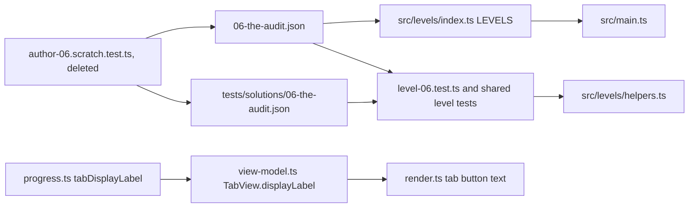

# Design Document

## Overview

This design extends the completed [levels design](../levels/design.md) with one epilogue, `06-the-audit`. It keeps the current engine, model, turn order, level schema, Solution_File format and the five shipped level documents. The new work is one level document, one solution file, one level test file, a short tab label, and the count and documentation updates that follow from a sixth level.

The attack lesson is direct. `ATK_M1` is a locked `=SUM(B16:B17)`. `BASE_CHARGE` at `B16` is locked at 1. `LIVE_CHARGE` at `B17` starts at 2 and is editable. `UNFILED_CHARGE` at `B18` is editable but outside the range. Attack damage is 3 after every accepted turn at load, regardless of distance. One edit, `B17` to `-1`, makes the attack 0. The movement rule is locked and does not read either editable cell.

Two things are separate work and are not written by this spec:

- The `skin-and-sound` amendment (sticky formula row, cue on unlocked cells) is done in another session. This spec only gates its final screenshot task on that amendment (Decision D6).
- `tasks.md`, code and level JSON are not part of this design stage. Nothing is committed.

## Decisions

| Id | Decision | Status |
| --- | --- | --- |
| D1 | Keep the single-room layout, the 13-action stored route and the numbers of [requirements.md](requirements.md). | Adopted |
| D2 | The two-lane fork variant (monster position matters). | Considered and not adopted |
| D3 | Candidate check: winners by replaying the stored route with the substituted edit; non-winners by a bounded exhaustive post-edit search local to `level-06.test.ts`. | Adopted |
| D4 | Tab scheme Option A: number plus title (`1: The Corridor` to `6: The Audit`). Options B and C stay in the comparison table, not chosen. | Adopted |
| D5 | The short label is the pure function `tabDisplayLabel` in `src/ui/progress.ts`. | Adopted |
| D6 | The screenshot task starts with a check that the dated `skin-and-sound` amendment exists with its tasks ticked, and stops if not. | Adopted |
| D7 | `06-the-audit.json` is produced by a throwaway generator test, as in the levels design. | Adopted |

### D1. Room and stored route

Keep the map, hero and monster starts, exit, panel, hint, HP, ink and seed of [requirements.md](requirements.md). The new room has 41 walkable cells, compared with The Lich's 49 at load. The hero starts `B8`, the monster starts `J7`, and the exit is `J4`; all three positions and the shape differ from level 5. All 144 map cells and the five label cells are locked. Only `B17` and `B18` are unlocked.

```text
       ABCDEFGHIJKL
 1–3   ############
 4     #........X##   exit J4
 5     #.........##
 6     #..####...##   middle wall separates the lanes
 7     #.........##   M1 starts J7
 8     #.........##   hero starts B8
 9–12  ############
```

The stored route has 13 actions: `edit B17 -1`, `move N` four times (`B7`, `B6`, `B5`, `B4`), then `move E` eight times (`C4` through `J4`). Its starting values are `HP 6`, `ink 1`, `ATK_M1 3`. The edit consumes the ink and a turn, changes the attack to 0 before the monster attacks, and leaves HP at 6. On every stored move the attack stays 0, so the hero wins on turn 13 with HP 6 and ink 0.

Under the existing `MOVE_M1 =IF(DIST(HERO,SELF)<4,TOWARD(HERO),"-")`, the monster stays at `J7` through the edit and the first eleven moves. After the hero reaches `J4` on the twelfth move, its distance from `J7` is 3, so the monster steps to `J6`; it does not enter `J4`. The replay test checks every action's acceptance, the monster's address after each action, and that it never occupies the next stored-route cell. This is an analytic route trace for the design; the replay through `startRun` and `applyAction` is the implementation gate.

No-edit play cannot reach `J4`: the attack deals 3 damage on the first accepted turn and another 3 on the second, ending the run at HP 0. The shortest geometric distance from `B8` to `J4` is 12 moves. The full Edit_Free_Search still must return `exhausted`, rather than rely only on this arithmetic. A `limit` result is inconclusive and fails.

### D2. Two-lane fork variant: considered and not adopted

The variant would move `M1` nearer the middle crossing and open a two-lane fork there. After the single attack edit, the locked chase rule could occupy one lane and force the hero into the other, so monster position would matter. It would need a fresh replay trace and a bounded search to show that the monster cannot block both lanes or produce an accidental no-edit win.

**Not adopted.** Level 2 already teaches monster position. This level's lesson is the attack formula, and the single-room route keeps the lesson on `ATK_M1` and its `SUM` range. The geometry of D1 stands. Requirement 1.6 still holds: the replay checks that the monster never blocks a stored move.

### D3. Solution and candidate checks

The solution file is `{ "levelId": "06-the-audit", "minimalInk": 1, "actions": [...] }`, with the 13 actions of D1. It uses two-space JSON, LF line endings, one trailing newline, and no `undo`. The shared arrays gain a sixth entry; the existing five entries remain unchanged.

The candidate check covers ten cell/value pairs: the raw values `-1`, `0`, `1`, `=1/0` and `=MISSING` at `B17`, and the same five at `B18`. Two methods are used, by expected outcome:

- **Winners** (`B17` = `-1`, `=1/0`, `=MISSING`): replay the stored route with the first action's `raw` replaced by the candidate value, using `replay` from `helpers.ts`. Assert that every action is accepted (`refusedAt` is `undefined`), the status is `won`, and the hero is on `J4`. For `-1` the substituted route is the stored solution itself.
- **Non-winners** (`B17` = `0`, `1`; all five `B18` values): apply the edit from a fresh `startRun` with `applyAction`, assert it is accepted, then search moves and waits exhaustively from the post-edit state. The search is breadth-first with the exact `stateKey`, the same 5 actions and the same rules as `searchEditFree`: refusals are skipped, lost states are counted but not expanded, a win ends the search and fails the test, and a `limit` result fails as inconclusive. The cap is 1,000 states and 100 turns, as in the levels spec. The arithmetic below shows the cap is far above the need.

Bounds for the non-winner searches. The edit is itself an accepted turn, so it already costs attack damage once. Start HP is 6.

| Edited cell and value | `ATK_M1` after edit | HP after the edit turn | Further accepted turns before HP 0 | Total turns including the edit |
| --- | ---: | ---: | ---: | ---: |
| `B17` = `0` | 1 | 5 | 5 | at most 6 |
| `B17` = `1` | 2 | 4 | 2 | at most 3 |
| `B18`, any of five | 3 | 3 | 1 | at most 2 |

The distance rule keeps the state space small. In the `B17` = `0` case the hero is at least 4 cells from `J7` throughout the 5 further turns (it starts 9 away), so `DIST(HERO,SELF)<4` is never true and the monster stays at `J7`. A state is then the hero's cell plus HP. The hero's cell after `k` further turns lies in the quadrant of `B8` within `k` steps, at most `(k+1)(k+2)/2` cells. Counting layers 1 to 5 gives at most 3 + 6 + 10 + 15 + 21 = 55 states, and at most 1 + 3 + 6 + 10 + 15 = 35 expansions (layer 5 is lost and not expanded). The `B17` = `1` case has at most 1 + 3 + 6 = 10 states and 4 expansions. Each `B18` case has at most 4 states and 1 expansion. All are far below 1,000 states and 100 turns.

The candidate search is local to `level-06.test.ts`. `searchEditFree` in `helpers.ts` has the signature `(doc: unknown, limits?: SearchLimits)` and calls `startRun(doc)` itself, so it cannot start from an already edited state, and its action list is not exported. The local function `searchAfterEdit(start: RunState, limits)` is about 30 lines, uses `applyAction` from the game barrel and `stateKey` from `helpers.ts`, and returns `{ outcome, states, expansions }`. Production code and `helpers.ts` gain no search API. The edit is fixed per candidate and the level has no `RAND`, so `stateKey` is sound for repeated-state detection, as in the levels design.

The `=MISSING` value gives `#REF!`. In `src/engine/evaluator.ts` a name that `env.resolveName` does not find returns `#REF!` with the cause "refers to MISSING, which is not a cell name" (line 377). It is not `#NAME?`, which is reserved for unknown function calls (lines 172 and 332). `SUM` passes an error argument through, so `ATK_M1` shows the same error kind as `B17`.

`minimalInk` remains the stored solution's cost, not a global claim about arbitrary formula text.

### D4. Tab scheme: Option A

Option A, number plus title, is chosen. The six visible tab labels are `1: The Corridor`, `2: The Chaser`, `3: The Locked Crypt`, `4: The Trap Row`, `5: The Lich` and `6: The Audit`. The full `SheetN: Title` stays in `tabLabel`, in the status bar and in the confirmation prompts. Options B and C stay in the comparison under [Tab layout](#tab-layout) as not chosen. The reasoning is in the recommendation there.

### D5. Where the short label lives

`tabDisplayLabel(label: string): string` goes in `src/ui/progress.ts`. That file is already pure (it imports only `tabLabel` from the model barrel and types), and it is where the full label is built (`describeLevels`), so the two sit together. `src/ui/messages.ts` is also pure but holds message text built from `STRINGS`, which does not fit. The function is described in Components and Interfaces.

### D6. Screenshot gate

The final screenshot task starts with a concrete check. `.kiro/specs/skin-and-sound/tasks.md` must hold a dated amendment (a dated file or dated section in that spec's requirements, design or tasks) that mentions the sticky formula row and the cue on unlocked cells, with its new tasks all ticked. At the time of this design, `skin-and-sound/tasks.md` has amendment tasks `7.1 Make the formula row sticky`, `7.2 Mark unlocked rules cells` and `7.3 Retake affected screenshots and finish`, and all three are unticked. If the check fails, the screenshot task stops and reports to the user; it does not retake the images or write the amendment. No other task in this spec waits for it.

### D7. Authoring method

The level file is generated, not typed (see Components and Interfaces, Authoring workflow). This keeps it normalized by construction.

## Architecture

The new level slots into the existing levels module. Nothing outside the listed files changes in structure.

```text
ui -> game -> model -> engine
src/levels/06-the-audit.json   (new)       <- src/levels/index.ts (sixth import)  <- src/main.ts
tests/solutions/06-the-audit.json (new)    <- src/levels/helpers.ts readSolution
src/levels/level-06.test.ts (new)          -> helpers.ts (replay, readSolution, finalSnapshot, lockReport, stateKey, describeLimit, walkableCount, manhattan)
src/ui/progress.ts  tabDisplayLabel (new)  -> src/ui/view-model.ts (TabView.displayLabel) -> src/ui/render.ts (button text)
```



Files touched by area:

| Area | Files | Change |
| --- | --- | --- |
| Level data | `src/levels/06-the-audit.json`, `tests/solutions/06-the-audit.json` | New. |
| Level code | `src/levels/index.ts`, `src/levels/helpers.ts` (`LEVEL_IDS`) | Sixth entry. |
| Level tests | `src/levels/level-06.test.ts` (new); `index.test.ts`, `files.test.ts`, `helpers.test.ts`, `solutions.test.ts`, `search.test.ts`, `scan.test.ts` | New file; sixth entry and count 5 to 6 in the others. |
| UI | `src/ui/progress.ts`, `types.ts`, `view-model.ts`, `render.ts` | `tabDisplayLabel`, `TabView.displayLabel`, button text. |
| UI tests | `progress.test.ts`, `view-model.test.ts`, `render.test.ts` | New and updated expectations (see Testing Strategy). |
| E2E | `tests/e2e/grid-layout.spec.ts`, `layout-shift.spec.ts`, `skin.spec.ts` | Sixth level, six tabs, width check. |
| Docs | `README.md`, `docs/BRIEF.md` section 6a and level count lines, `.kiro/steering/product.md`, `structure.md`, dated pointer in `.kiro/specs/levels/` | Counts and tab names. |
| Screenshots | all seven PNGs in `docs/screenshots/`, `docs/screenshots/README.md` | Retaken, gated by D6. |

`src/play/headless.ts` and `scripts/play.mjs` read `LEVELS` dynamically (no count hit), so they need no change; `src/play/headless.test.ts` has level-id lists that do.

### Current hits (as of this design)

Run over 209 text files (`.ts`, `.mjs`, `.md`, `.json`, `.yaml`, `.yml`, `.html`, `.css`), excluding `node_modules`, `dist`, `dist-play`, `.git`, `.playwright-mcp`, `package-lock.json` and the `sixth-level` spec. Patterns: `five`, `Five`, `5 levels`, `LEVEL_IDS`, `toHaveLength(5)`, `length).toBe(5)`, `Sheet5`, `[0-4]`, `levels/0` (case sensitive). A second pass looked for `05-the-lich`, `LEVELS`, `Lich` and `Sheet[1-5]` in the files named by the request. The tasks re-run both searches before editing, and the list below is not frozen.

| File | Hits | Lines | Needs change? |
| --- | ---: | --- | --- |
| `README.md` | 8 | 17, 49, 61, 63, 156, 163, 171, 173 | Yes: 17 (`five hand-built puzzle levels`), 61 (heading `The five levels`), 63 (tab names), 156, 163 (`all five levels`). The level table below line 63 has no hit and needs a row. No: 49 (five error kinds), 171 (five beeps), 173 (five steering files). |
| `docs/BRIEF.md` | 4 | 116, 125, 171, 182 | Yes: 116 (section 6a, `Sheet1: The Corridor` through `Sheet5: The Lich`), 125 (`Five hand-written levels`), 182 (`the five levels`). 171 is the dated schedule: leave. |
| `.kiro/steering/product.md` | 1 | 49 | Yes (`Five hand-written JSON levels`, list of titles). |
| `.kiro/steering/structure.md` | 1 | 15 | Yes (`the five level JSON files`). |
| `src/levels/helpers.ts` | 2 | 19, 20 | Yes (`LEVEL_IDS` and its doc comment). |
| `src/levels/helpers.test.ts` | 6 | 5, 79 to 83 | Yes (`holds five unique ids`, `toHaveLength(5)`, `Set size toBe(5)`). |
| `src/levels/index.test.ts` | 5 | 13, 21, 31, 34, 43, 46 | Yes (file list, `toHaveLength(5)` twice, test titles). |
| `src/levels/files.test.ts` | 10 | 6, 10, 14, 55 to 59, 69, 181, 182 | Yes (tab label list lines 10 to 14, `toHaveLength(5)` twice, `Set size`, `five distinct tab labels`). |
| `src/levels/solutions.test.ts` | 2 | 4, 18 | Yes (ink table and level list). |
| `src/levels/scan.test.ts` | 1 | 173 | Check; likely a list of files. |
| `src/levels/level-05.test.ts` | 1 | 110 | No (level 5 facts). |
| `src/levels/search.test.ts` | 0 (second pass: 30) | 30 | Yes (level list in the search test). |
| `src/play/headless.test.ts` | 1 (second pass: 9) | 125; 26, 27, 74, 75, 81, 109, 131 | Yes: 125 (`lists the five level ids`) and 131 (id list); lines 26 and 27 are an HP and ink table that gains level 6. |
| `src/play/headless.ts` | 0 | 96, 98, 108 read `LEVELS` | No. |
| `scripts/play.mjs` | 0 | none | No. |
| `src/ui/progress.test.ts` | 0 | 125, 131, 138 hold `Sheet` labels | No change to them; gains `tabDisplayLabel` tests. |
| `src/ui/render.test.ts` | 1 | 187 (five error kinds, noise); tab fixtures 49, 50, 396 | Yes: 49 and 50 (`TabView` fixtures need `displayLabel`) and 396 (`textContent` of a tab button). Status label 450 stays. |
| `src/ui/view-model.test.ts` | 0 | tab fixtures 269, 321 to 323, 347 | Yes: `TabView` expectations gain `displayLabel`; status label 347 stays. |
| `src/ui/strings.test.ts` | 0 | 24, 25 (`Sheet2: The Chaser`) | No: confirmation prompts keep the full label. |
| `src/model/serializer.test.ts` | 0 | 32, 36 | No: `tabLabel` stays full. |
| `tests/e2e/grid-layout.spec.ts` | 2 | 88, 113 | Yes (`five tab buttons` title; `toHaveLength(5)`). |
| `tests/e2e/layout-shift.spec.ts` | 4 | 7, 23, 66, 70 | Yes (`LEVEL_IDS` list, test title `all five levels`; loop uses `LEVEL_IDS.length`). |
| `tests/e2e/skin.spec.ts` | 4 | 3, 17, 18, 97 | Yes (`LEVEL_IDS` list; the layout loop uses it). |
| `tests/e2e/error-monsters.spec.ts` | 1 | 24 | Check; likely `five error kinds` noise. |
| `src/ui/error-css.test.ts`, `src/engine/values.test.ts`, `src/styles/error-monsters.css` | 3 (1 each) | 15, 42, 1 | No (five error kinds). |
| `KIRO_USAGE.md` | 43 | 43, 67, 360, ... 1187 | No, except the new dated entry. It is an append-only log. |
| Other specs | 114 | `levels` 54 (design 20, requirements 15, tasks 19), `skin-and-sound` 33, `error-monsters` 15, `grid-ui` 6, `formula-engine` 4, `hosting` 1, `sheet-model` 1 | No, except one dated pointer in `.kiro/specs/levels/`. These are historical or unrelated. |

Totals: 10 files under `src/` need a count or tab-label change (`helpers.ts`, `helpers.test.ts`, `index.test.ts`, `files.test.ts`, `solutions.test.ts`, `search.test.ts`, `headless.test.ts`, `render.test.ts`, `view-model.test.ts`, plus `scan.test.ts` to check), 3 e2e files, `README.md`, `docs/BRIEF.md` and 2 steering files. The patterns to give to `tasks.md` are `five`, `Five`, `5 levels`, `LEVEL_IDS`, `toHaveLength(5)`, `length).toBe(5)`, `Sheet5`, `[0-4]`, `levels/0`, `05-the-lich`, and, in `tests/e2e`, `Sheet`.

## Components and Interfaces

### New level file blueprint (`06-the-audit`)

| Field | Value |
| --- | --- |
| Id, files | `06-the-audit`; `src/levels/06-the-audit.json`; `tests/solutions/06-the-audit.json` |
| Title, tab | `The Audit`; `Sheet6: The Audit` (displayed as `6: The Audit`) |
| Hint | `ATK_M1 bills every turn. Check the SUM range before changing a charge.` (70 characters) |
| Numbers | Hero `B8`, monster `M1` at `J7`, `startingHp` 6, `ink` 1, `seed` 6, exit `J4` |
| Normalized cell specs | 144 map cells + 5 label cells (`A14` to `A18`) + 5 panel cells (`B14` to `B18`) = 154. The map has no formula glyph cell. This extends the levels design's 146, 148, 152, 152, 156. |

The map and the panel table are in Data Models.

### Authoring workflow

The file is produced, not typed, following the levels design (Decision D2 there):

1. A throwaway test `src/levels/author-06.scratch.test.ts` builds the Level_Document: all 144 map cells as locked specs whose `raw` is the map glyph, then for each panel row a locked label spec at `A<row>` and the named cell at `B<row>`. `B14`, `B15` and `B16` are locked. `B17` and `B18` are **not** locked in the generator, as they are the level's two editable cells. The map rule "all 144 map cells locked" holds, because `B17` and `B18` are panel cells, not map cells.
2. The test loads the document with `loadLevel` and `createRandom(6)`, fails on any Load_Error, writes `serializeLevelText(level)` to `src/levels/06-the-audit.json` and `JSON.stringify(solution, null, 2) + '\n'` to `tests/solutions/06-the-audit.json`.
3. The scratch file is deleted before the task ends, so the exact-file check in `index.test.ts` never sees it. Because the file is the serializer's own output, it is normalized by construction, and the existing normalized-bytes test in `files.test.ts` checks it. Later hand edits are caught by that test.
4. `.gitattributes` already covers `src/levels/*.json` and `tests/solutions/*.json`, so the new files get LF endings.

### Short-label function

```ts
// src/ui/progress.ts, pure, named export
export function tabDisplayLabel(label: string): string;
```

- **Rule:** the display label is the full `tabLabel` with the leading `Sheet` removed. `Sheet1: The Corridor` becomes `1: The Corridor`, and `Sheet10: X` becomes `10: X`.
- **Fallback:** a label that does not start with `Sheet` is returned unchanged.
- **Where applied:** `TabView` in `src/ui/types.ts` gains `readonly displayLabel: string`. `tabsOf` in `src/ui/view-model.ts` sets `displayLabel: tabDisplayLabel(entry.label)` and keeps `label` as the full label. `updateTabs` in `src/ui/render.ts` shows `tab.displayLabel` (currently `setText(b, tab.label)`, line 318).
- **Unchanged:** the status bar (`vm.status.label`, built from `tabLabel(run.level)` in `viewOf`) and the confirmation prompts (`STRINGS.confirmSwitch`) keep the full label.
- **Accessibility:** the visible text is the button's accessible name, so it is contained in it and no `aria-label` is added. Disabled tabs follow the same rule. No tooltip is needed, because every title is visible.

### Helper reuse

| Helper (`src/levels/helpers.ts`) | Use in level 6 |
| --- | --- |
| `readSolution` | Stored solution, shape and `minimalInk` check. |
| `replay`, `finalSnapshot` | Stored replay, determinism, winner-candidate replays. |
| `lockReport` | Only `LIVE_CHARGE` and `UNFILED_CHARGE` open; no open map or label cell. |
| `searchEditFree`, `describeLimit` | Edit-free proof of Requirement 3. |
| `stateKey` | Local post-edit search. |
| `walkableCount`, `manhattan` | At most 60 walkable cells; 12-move route distance. |
| `LEVEL_IDS` | Gains `'06-the-audit'`. |
| `describeStep` | Failure messages. |

## Data Models

### Level_Document contents

Map (monster and hero are entities over floor, so they appear as `.`):

```text
############
############
############
#........X##
#.........##
#..####...##
#.........##
#.........##
############
############
############
############
```

Panel (labels at `A<row>`, all locked):

| Cell | Label at left | Name | Raw text | Lock |
| --- | --- | --- | --- | --- |
| `B14` | `Audit movement` | `MOVE_M1` | `=IF(DIST(HERO,SELF)<4,TOWARD(HERO),"-")` | Locked |
| `B15` | `Audit attack` | `ATK_M1` | `=SUM(B16:B17)` | Locked |
| `B16` | `Base charge` | `BASE_CHARGE` | `1` | Locked |
| `B17` | `Live charge` | `LIVE_CHARGE` | `2` | Unlocked; inside the range |
| `B18` | `Unfiled charge` | `UNFILED_CHARGE` | `2` | Unlocked; outside the range, a decoy |

The monster is `{ id: "M1", at: "J7", move: "MOVE_M1", atk: "ATK_M1" }`. No raw text uses `RAND`. At load `ATK_M1` is 3.

### Solution_File: the 13 actions

| # | Action | Hero after | HP | Ink |
| ---: | --- | --- | ---: | ---: |
| 1 | `edit B17` raw `-1` | `B8` | 6 | 0 |
| 2 to 5 | `move N` x4 | `B7`, `B6`, `B5`, `B4` | 6 | 0 |
| 6 to 13 | `move E` x8 | `C4` to `J4` | 6 | 0 |

The file is `{ "levelId": "06-the-audit", "minimalInk": 1, "actions": [...] }`, one action per object, two-space JSON, LF, one trailing newline.

### Candidate table

| Edited cell | Candidate raw | Expected `ATK_M1` after edit | Method | Continuation can win? |
| --- | --- | --- | --- | --- |
| `B17` | `-1` | 0 | Replay of the stored route | Yes; stored solution |
| `B17` | `0` | 1 | Post-edit search, exhausts | No; HP 6 is exhausted before 12 moves |
| `B17` | `1` | 2 | Post-edit search, exhausts | No; HP is exhausted sooner |
| `B17` | `=1/0` | `#DIV/0!` | Replay with the edit substituted | Yes; error attack is harmless |
| `B17` | `=MISSING` | `#REF!` | Replay with the edit substituted | Yes; error attack is harmless |
| `B18` | `-1`, `0`, `1`, `=1/0`, `=MISSING` | 3 | Post-edit search, exhausts | No; the cell is outside `B16:B17` |

## Tab layout

### Measurement basis (estimate)

The widths below are estimates computed from the CSS and a per-character advance, not browser results. The earlier figures (925 px for six full names, 786 px for five, 715 px for Option A, 372 px for Option B) used Pillow's `getlength`, which rounded the `VT323` advance at 18 px to 7.0 px. A browser uses 0.4 em, or 7.2 px at 18 px, so every width is recomputed at 7.2 px per character.

Budget, from `src/styles/chrome.css`:

- `.grimsheet-app` is `52rem` = 832 px wide.
- `.window` has a 2 px border and 2 px padding on each side, leaving 832 - 8 = 824 px.
- `.tab-bar` has `padding: 0 0.25rem`, 4 px per side, leaving **816 px for buttons**.
- Each `.tab` has `font-size: 1.125rem` (18 px), `padding: 0 0.5rem` (8 px per side) and a 2 px border per side, so the shell is **20 px** beyond the text. Buttons are `flex: 0 0 auto` with `white-space: nowrap`, and the bar is `flex-wrap: nowrap`.

Character counts: the five current full names are 20, 18, 24, 20 and 16 characters, 98 in all. The six full names, with `Sheet6: The Audit` at 17, are 115. Option A labels are 15, 13, 19, 15, 11 and 12 characters, 85 in all. Option B labels are 6 characters each, 36 in all.

| Case | Characters | Text at 7.2 px | Shells | Total | Spare of 816 px |
| --- | ---: | ---: | ---: | ---: | ---: |
| Today, five full names | 98 | 706 px | 5 x 20 = 100 px | about 806 px | about 10 px |
| Six full names (no change) | 115 | 828 px | 120 px | about 948 px | about -132 px (over) |
| A: number plus title | 85 | 612 px | 120 px | about 732 px | about 84 px |
| B: `Sheet1` to `Sheet6` | 36 | 259 px | 120 px | about 379 px | about 437 px |
| C: active full, others `SheetN`, Sheet1 active | 20 + 30 = 50 | 360 px | 120 px | about 480 px | about 336 px |
| C, Sheet2 active | 18 + 30 = 48 | 346 px | 120 px | about 466 px | about 350 px |
| C, Sheet3 active (worst) | 24 + 30 = 54 | 389 px | 120 px | about 509 px | about 307 px |
| C, Sheet4 active | 20 + 30 = 50 | 360 px | 120 px | about 480 px | about 336 px |
| C, Sheet5 active | 16 + 30 = 46 | 331 px | 120 px | about 451 px | about 365 px |
| C, Sheet6 active | 17 + 30 = 47 | 338 px | 120 px | about 458 px | about 358 px |

The 832 px window and its 816 px tab budget are the same at 1280x1024 and 1366x768; vertical scrolling does not change the horizontal space. Today's five tabs leave only about 10 px, so the six full names cannot fit. All three options clear a 24 px margin on paper.

**The browser decides.** A Playwright bounding-box test at both viewports measures the real widths: the last button's right edge must be at least 24 px inside the tab bar's content box (the 816 px budget), no button may wrap or clip, and `document.documentElement.scrollWidth` must equal `clientWidth`. The 24 px minimum spare applies to this measured number, not to the estimate above. If the measured spare is under 24 px, the scheme falls back to Option B.

### Comparison

| Option | Visible labels, in order | Estimated width | Spare | Result |
| --- | --- | ---: | ---: | --- |
| A: number plus title (chosen) | `1: The Corridor`, `2: The Chaser`, `3: The Locked Crypt`, `4: The Trap Row`, `5: The Lich`, `6: The Audit` | about 732 px | about 84 px | Meets the 24 px margin; every title visible |
| B: sheet number (not chosen) | `Sheet1`, `Sheet2`, `Sheet3`, `Sheet4`, `Sheet5`, `Sheet6` | about 379 px | about 437 px | Most room; titles move to status, accessible name and tooltip |
| C: current tab full (not chosen) | Inactive: `Sheet1` to `Sheet6`; active: its `SheetN: Title` | about 451 to 509 px | about 365 to 307 px | Meets margin; tab widths change on selection |

### Impact of each option

The common screenshot set is all seven existing files: `01-title.png`, `02-level-play.png`, `03-monster-formula.png`, `04-error-monster.png`, `05-death-dialog.png`, `06-win-dialog.png`, `07-small-viewport.png`. Every option touches all seven because every in-game shot includes the tab bar. The README tab sentence is in **The five levels** (currently line 63), naming `Sheet1: The Corridor` through `Sheet5: The Lich`. The level-count edits in the README (intro line 17, heading line 61, lines 156 and 163, and a new row in the level table) are common to every option.

| Option | Strings and UI | Tests | README and screenshots |
| --- | --- | --- | --- |
| A (chosen) | Keep `tabLabel` and the status bar's full `SheetN: Title` unchanged. Add `tabDisplayLabel`, `TabView.displayLabel` and render it on the button. Confirmation prompts keep full names. No new tooltip is needed, because the full title stays visible. | `src/ui/progress.test.ts` for `tabDisplayLabel`; `src/ui/view-model.test.ts` for `displayLabel` and the full status text; `src/ui/render.test.ts` for button text; `tests/e2e/grid-layout.spec.ts` for six tabs, one row, no horizontal scroll and 24 px spare; `tests/e2e/layout-shift.spec.ts` after extending its level list. `src/model/serializer.test.ts` and `src/levels/files.test.ts` keep full `tabLabel` expectations and gain Sheet6. | Rewrite the README tab sentence (current line 63) to show `1: Title` through `6: Title` and explain the full `SheetN: Title` in the status bar; update `docs/BRIEF.md` section 6a; retake all seven PNGs and review captions. |
| B (not chosen) | Show `Sheet1` to `Sheet6` on buttons. Keep `tabLabel`, status and confirmations full. Set each button's `aria-label` and `title` to its full `SheetN: Title`, including disabled tabs. | A's files, plus `render.test.ts` assertions for accessible name and tooltip on every tab and `view-model.test.ts` for separate full and display names. | Rewrite the README tab sentence to explain short tabs and the full status and tooltip; retake all seven. |
| C (not chosen) | Full `SheetN: Title` only on the current button, `SheetN` on the others; full names stay in status, confirmations, accessible names and tooltips. Button widths change when the active tab changes. | B's UI tests, plus `view-model.test.ts` for every active tab; `grid-layout.spec.ts` for the worst case (Sheet3) and each active position; `layout-shift.spec.ts` extended with a tab-switch check on all six levels. | Rewrite the README tab sentence to explain active expansion; retake all seven. |

**Recommendation: A**, and it is adopted (D4). It leaves about 84 px spare, shows every title without hover, preserves the full status and confirmation strings, and keeps tab widths stable while switching. The `tabLabel` model API remains full, so level-file naming and formula behavior do not change.

## Error Handling

| Situation | Handling |
| --- | --- |
| The generator's document fails `loadLevel` | The scratch test fails on any Load_Error and prints each `path: code: message`. No file is written. |
| A stored or substituted route is refused | `replay` stops at the first refusal and sets `refusedAt`; the test fails with `describeStep`, which prints the board. |
| The no-edit search or a candidate search returns `limit` | The test fails as inconclusive and prints `describeLimit`; the room is shrunk before any limit is raised. |
| A winner candidate does not win, or a non-winner wins | The test fails with the candidate's cell, raw text, post-edit `ATK_M1` and the search result. |
| A post-edit `ATK_M1` differs from the table | The test fails before any search result is trusted, so a broken edit cannot give a false pass. |
| `tabDisplayLabel` gets a label without the `Sheet` prefix | Returned unchanged; it never throws. |
| Measured tab spare is under 24 px | The e2e test fails; the fallback is Option B. |
| The skin-and-sound amendment is missing or not ticked | The screenshot task stops and reports to the user (D6). |

## Testing Strategy

Property-based testing does not apply to this feature. The level data, the ten candidate pairs and the six tab labels are fixed, finite inputs, so the checks are example-based and exhaustive over those inputs. The Correctness Properties section lists them as exhaustive example checks, not generated-input tests. No new `*.prop.test.ts` file is added, and no test asserts elapsed time.

### Per-file test list

| File | Added or changed | Requirements |
| --- | --- | --- |
| `src/levels/level-06.test.ts` (new) | Level facts: hero, monster, HP, ink, seed, hint, raw texts, locked set, `ATK_M1` 3 at load and 0 after `B17` = `-1`; `B18` leaves it at 3; `MOVE_M1` independent of both unlocked cells; at most 60 walkable cells (41); the stored replay with a per-step monster-address check; ink table row; minus-one-ink refusal (`no-ink`, turn 0); ten candidate-pair tests. | 1, 2, 3, 4 |
| `src/levels/index.test.ts` | Six files, six `LEVELS`, six JSON imports. | 1.1 |
| `src/levels/files.test.ts` | Six ids, six tab labels, normalized bytes, locks, no `RAND`, seed 6. | 1.2, 1.3 |
| `src/levels/helpers.test.ts` | `LEVEL_IDS` has six unique ids in order. | 1.1 |
| `src/levels/solutions.test.ts` | Shape, replay, determinism, ink table with level 6. | 2.1 to 2.4 |
| `src/levels/search.test.ts` | Edit-free search on level 6: `exhausted`, more than one state, no win. | 3.1 |
| `src/levels/scan.test.ts` | Deny_List scan includes the new test file. | 1.3 |
| `src/play/headless.test.ts` | Six ids, level 6 row in the HP and ink table. | 6.1 |
| `src/ui/progress.test.ts` | `tabDisplayLabel` table. | 5.2 |
| `src/ui/view-model.test.ts`, `render.test.ts` | `TabView.displayLabel`; button text is the display label; status and confirmation text stay full. | 5.2 |
| `tests/e2e/grid-layout.spec.ts` | Six tabs, one row, no horizontal scroll, measured 24 px spare at 1280x1024 and 1366x768. | 5.1, 5.2 |
| `tests/e2e/layout-shift.spec.ts`, `skin.spec.ts` | Sixth level in the level lists and progress fixtures. | 5.3 |

### Candidate tests

One test per cell/value pair, ten in all, each with an explicit timeout as the third argument: `it('B17 = -1 ...', () => { ... }, 60_000)`. Every pair first applies the edit from a fresh `startRun`, asserts it was accepted, and asserts the post-edit `ATK_M1` value or error from the candidate table, then runs its method (winner replay or non-winner search).

### Test time estimate

The estimate uses about 1 ms per `applyAction`, 5 actions per expansion and about 0.1 ms per `stateKey`, the figures measured in the levels design. State counts are from D3.

| Test group | applyAction calls | stateKey calls | Estimated time |
| --- | ---: | ---: | ---: |
| Edit-free search of level 6 (HP 6, attack 3: at most 3 + 9 states) | at most 20 | at most 12 | about 0.03 s |
| `B17` = `0` search: 35 expansions x 5 + 1 edit | about 176 | at most 56 | about 0.2 s |
| `B17` = `1` search: 4 expansions x 5 + 1 edit | about 21 | at most 10 | about 0.03 s |
| `B18` x 5 searches: 1 expansion x 5 + 1 edit, each | about 30 | at most 20 | about 0.03 s |
| Winner replays: 3 x 13 actions | 39 | 0 | about 0.04 s |
| Stored replay (twice), minus-one-ink case, load checks | about 30 | 0 | about 0.05 s |
| Total added | about 320 | about 100 | **about 0.4 s** |

At 10 times these costs the addition would still be about 4 s, well inside the save hook's 120 s limit for `npm run test:fast` (`.kiro/hooks/test-on-save.json`, `timeout: 120`), and each candidate test sits under its own 60 s Vitest timeout. This is an estimate. The task runs `npm run test:fast` before and after, **measures and reports the real time**, and adds no wall-clock assertion.

### Requirement coverage

| Requirement | Covered by |
| --- | --- |
| 1 Content and rules | `level-06.test.ts`, `files.test.ts`, `index.test.ts`, `scan.test.ts` |
| 2 Solution and ink | `level-06.test.ts`, `solutions.test.ts` |
| 3 No-edit proof | `search.test.ts`, `level-06.test.ts` |
| 4 Candidate check | `level-06.test.ts` (ten tests) |
| 5 Tabs | `progress.test.ts`, `view-model.test.ts`, `render.test.ts`, `grid-layout.spec.ts`, `layout-shift.spec.ts`, `skin.spec.ts` |
| 6 Documentation and gate | Text searches in the task, the D6 check, `npm run verify`, `npm run e2e` |

### Documentation and screenshots

The enumerated locations are the search-based list in the Current hits table, plus `docs/BRIEF.md` section 6a, which names the tabs as `Sheet1: The Corridor` through `Sheet5: The Lich`. The completed levels spec gets one dated pointer to this spec and is otherwise unchanged. The hosting spec and `.kiro/specs/hosting/.config.kiro` stay in place; the eventual `KIRO_USAGE.md` entry records that fact.

The last task starts with the D6 check. If it passes, it follows task 6.2 of `.kiro/specs/skin-and-sound/tasks.md` and the `Screenshots stay current` rule in `.kiro/steering/sheet-ui.md`: clean profile, progress seeded through `grimsheet.progress`, the exact seven filenames and viewport sizes, a poll of `document.getAnimations()` until no finite animation runs, a look at every image, and a caption review. It then runs `npm run verify` and `npm run e2e`. No eighth screenshot is taken. No commit or push is part of this spec.

## Correctness Properties

*A property is a characteristic or behavior that should hold true across all valid executions of a system-essentially, a formal statement about what the system should do. Properties serve as the bridge between human-readable specifications and machine-verifiable correctness guarantees.*

This feature does not use property-based testing. Each property below is an exhaustive example check over a small fixed input set (the listed candidates and labels), not a generated-input test.

### Property 1: The stored solution wins for every accepted candidate winner

For all candidate raw values in {`-1`, `=1/0`, `=MISSING`} at `B17`, replaying the stored route with the first action's raw replaced by the candidate accepts every action and ends `won` with the hero on `J4`.

**Validates: Requirements 4.1, 4.2**

### Property 2: The non-winner candidates exhaust with no win

For all candidates in {`B17` = `0`, `B17` = `1`} and {`B18` = each of the five raw values}, an accepted edit is followed by a post-edit search over moves and waits that returns `exhausted` with no win and never `limit`.

**Validates: Requirements 4.1, 4.2**

### Property 3: The post-edit attack matches the candidate table

For all ten cell/value pairs, the value of `ATK_M1` after the accepted edit equals the table entry: 0, 1, 2, `#DIV/0!`, `#REF!` for `B17`, and 3 for every `B18` value.

**Validates: Requirements 4.3**

### Property 4: The short tab label is a pure function of the full label

For all six level labels `Sheet1: The Corridor` to `Sheet6: The Audit`, `tabDisplayLabel` returns the same label with the leading `Sheet` removed (`1: The Corridor`, `2: The Chaser`, `3: The Locked Crypt`, `4: The Trap Row`, `5: The Lich`, `6: The Audit`), and for any label that does not start with `Sheet` it returns the label unchanged. Repeated calls return equal strings.

**Validates: Requirements 5.2**
