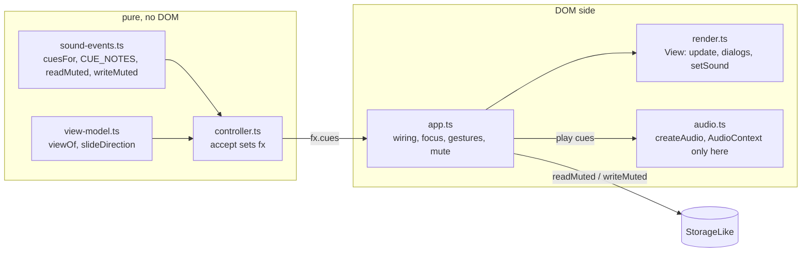
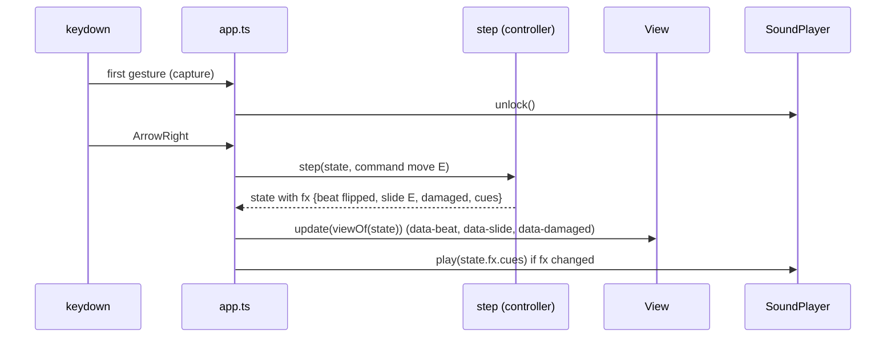

# Design Document: skin-and-sound

## Overview

`skin-and-sound` changes how Grimsheet looks and sounds and nothing else. No file under `src/engine/`, `src/model/`, `src/game/` or `src/levels/` changes. Everything lands in `src/ui/`, three new stylesheets plus edits to two old ones, `public/`, the HTML entry pages, the tests, and the README.

The design has five parts:

1. **Skin.** A grey late-1990s window drawn in CSS (bevels from borders and `box-shadow`), one self-hosted pixel font (VT323), a navy title bar with three decorative buttons, sheet tabs at the bottom, a divided status bar. The sizes are fixed from real measurements (next section), not guesses.
2. **Motion.** Three CSS animations (flash 400 ms, hero slide 120 ms, shake 300 ms) replayed by a one-bit `data-beat` on the App_Root. The signal is a new `AppState.fx`, set by the controller on every accepted Action.
3. **Screens.** A title dialog (modal, `inert` on the window), the death dialog (the restyled `#end-banner`, non-modal alertdialog) and a win dialog (non-modal, in `#screen-overlay`).
4. **Sound.** A pure mapper (`cuesFor`) in `sound-events.ts`, and `audio.ts`, the only file that names `AudioContext`. Square-wave beeps with a click-free envelope. Silent until the first user gesture. A mute toggle stored in `localStorage` through the existing `StorageLike` seam.
5. **Assets and proof.** `public/favicon.svg`, `public/fonts/*`, a README credit, and seven README screenshots taken last.

Layering is unchanged: `ui -> game -> model -> engine`. `sound-events.ts` is pure. `audio.ts` has no DOM and no storage; it receives an `AudioContext` factory. `app.ts` stays the only place that touches `document` and storage.

## Decisions

### Requirement decisions D1 to D21 and where they land

| # | Decision | Where it lands in this design |
| --- | --- | --- |
| D1 | Window buttons decorative | `render.ts` builds `span.window-buttons[aria-hidden=true]` with three `span.wb`; drawn in `chrome.css`. No handler, no tab stop. |
| D2 | Tabs move to the bottom in `render.ts` | Skeleton order: window = title bar, formula row, toolbar, table, ghost note, death dialog, **tab bar**, status bar. Tab order becomes toolbar, grid, death dialog button (when shown), tabs. |
| D3 | VT323 | Measurements section. Version 2.000, no Reserved Font Name. |
| D4 | `fonts.css` is the only `url(` | CSS design, `fonts.css`. Scan rule in the Module scan section. |
| D5 | No padlock on map cells | `render.ts`: padlock only when `cell.locked && cell.region === 'rules'`; drawn by CSS shapes. `STRINGS.padlock` removed. |
| D6 | 400 / 120 / 300 ms, two keyframe names per animation | `motion.css`; `data-beat` on the root. |
| D7 | `fx` on `AppState` | Interfaces: `Fx`, `NO_FX`, `accept()` in `controller.ts`. |
| D8 | Only the hero slides | `CellView.slide` is set only on the hero cell. |
| D9 | Title dialog only with `showTitle` | `MountOptions.showTitle`; closure flag `titleOpen` in `app.ts`; `main.ts` passes `true`. |
| D10 | Death dialog = restyled `#end-banner`; win dialog in `#screen-overlay` | Dialogs and focus section. |
| D11 | Sound on by default, silent until first gesture, no key, no refusal sound | Sound design. Mute store key `grimsheet.muted`. |
| D12 | One grey theme | `grid-ui.css` loses both dark blocks. Error-monsters keeps its own light and dark pairs. |
| D13 | `public/favicon.svg` | Favicon section. |
| D14 | No sprites | Glyphs stay; no image files. |
| D15 | No property-based tests | Correctness Properties section. |
| D16 | 1280 by 1024 screenshots, plus one 1366 by 768 shot; layout checks at both | Screenshot task. Measured layout in the Measurements section. |
| D17 | Column A 7.5rem (approved) | Labels at 1rem VT323 are up to 109 px wide; 7.5rem leaves 5.9 px spare. Requirement 9.4 and this design agree. |
| D18 | Measure first | Done; numbers below. |
| D19 | Ship the TTF unchanged | `public/fonts/vt323-regular.ttf` (153,116 bytes, upstream byte for byte, renamed) and `public/fonts/OFL.txt`. `fonts.css` uses `format('truetype')`. No conversion, no new tool. |
| D20 | Sticky Status_Bar | `position: sticky; bottom: 0` on `#status-bar`, a direct child of `#window`, which is not a scroll container. See "Sticky status bar". |
| D21 | `R` restarts on the lost screen with focus on a button | One new Key_Map row (13a) in `key-map.ts`. See "Key_Map change (D21)". |
| D22 | `R` restarts and `N` advances on the won screen with focus on a button | Extends Key_Map row 13a in `key-map.ts`: on the lost or won screen `r` restarts; on the won screen with a next level `n` advances. Row 13 is unchanged while playing. Found when the win dialog took focus and row 13 swallowed both keys. |

### Decisions made in this design

| # | Decision | Reason |
| --- | --- | --- |
| S1 | **Column A is 7.5rem, not 6rem.** Rules labels use 1rem VT323; Columns B to L stay 2.5rem square. | The widest label (17 characters) is 109 px at 1rem. 6rem (96 px) would clip it. A 0.875rem label would fit 6.75rem but reads smaller than the 1.25rem values next to it. |
| S2 | **Error text becomes `0.75rem` (12 px).** The strip keeps its geometry (`padding: 0 1px`); it is 4 px taller. | 0.5rem VT323 is not legible; 0.75rem is crisp and fits with 3 px to spare. 0.875rem clips. |
| S3 | **Type scale:** map glyphs and hero/monster `1.75rem`; rules-panel values `1.25rem`; rules labels `1rem`; chrome (buttons, formula bar, title) `1.25rem`; status bar `1.125rem`; error text `0.75rem`. | VT323 is a small face (cap height 0.56 em); at 1rem it reads like 10 px sans. Measured at 16, 20, 24 and 28 px; 28 px glyphs are clear, 16 px is thin. |
| S4 | **A wrapper `div#window.window` holds everything except `#screen-overlay`.** `inert` goes on it. | `#screen-overlay` is a child of the root, so `inert` on the root would also disable the dialog. A wrapper keeps `root` children at two: `#window`, `#screen-overlay`. |
| S5 | **Slide stays inside the cell.** `td.cell` keeps `overflow: hidden`. The glyph animates from `translate(±100%, 0)` to 0, so it enters across the cell edge. | Relaxing the overflow would draw the glyph over neighbours and error shapes (z-index fights) and would unclip long cell texts. The clipped entry reads as "arriving from that side" in 120 ms. |
| S6 | **Flash:** `background-color` on ordinary cells, an inset ring on error cells. | A yellow background under white-on-black `#DIV/0!` text would break the contrast floor for 400 ms. The ring leaves the text pair alone. |
| S7 | **The dialog Recover button has `data-control="recover-dialog"`**, the toolbar one stays `recover`. The Win_Dialog buttons are `win-next` and `win-ok`. | Existing unit and e2e tests use `[data-control="recover"]` and expect one match. The new controls map to the same commands in `app.ts`. |
| S8 | **Title dialog has no Escape.** Win dialog closes on Escape. Death dialog does not close (it only leaves through Recover or a tab). | The title has one action. The win dialog is informational. The death dialog is the lost state. |
| S9 | **`Cue`, `Fx` and `SoundPlayer` types live in `types.ts`.** `sound-events.ts` and `audio.ts` import them. | `AppState.fx` needs `Cue`, and `types.ts` is the home of every shared UI type. |
| S10 | **Stylesheet import order:** `fonts.css`, `grid-ui.css`, `error-monsters.css`, `chrome.css`, `motion.css`. | `chrome.css` overrides base rules by order at equal specificity; `motion.css` last. |
| S11 | **The e2e fit check is strengthened.** It compares the text box to the cell's inner width, not `scrollWidth <= clientWidth` of the text element. | The old check passes at 14 px although the cell clips the text (measured: text 41 px wide, cell inner width about 39 px). |
| S12 | **`scripts/check-dist.mjs` skips font files and `OFL.txt` in its URL scan.** | `OFL.txt` contains `http://scripts.sil.org/OFL`, which the hosting check would report as an external URL. |
| S13 | **No pointer-shape property in any stylesheet, and the name of that CSS property is avoided in new files.** | The Module_Scan lower-cases files and looks for the AI tool names; a CSS pointer-shape property matches one of them. |
| S14 | **`inert` is written as an attribute** (`setAttribute('inert', '')`). | happy-dom does not need to implement the property; tests read the attribute. Chromium honours it. |
| S15 | **Font preload** in `index.html` only: `<link rel="preload" href="/fonts/vt323-regular.ttf" as="font" type="font/ttf" crossorigin>`. | Cuts the swap flash with `font-display: swap`. The fixture pages skip it. A font preload needs `crossorigin` even on the same origin. |
| S16 | **Tabs are one row: `flex-wrap: nowrap`, tab font `1.125rem`, tab padding `0 0.5rem`.** | Measured: at `1.25rem` and `0 0.75rem` the five tabs wrap to two rows (+24 px) and push the real app past 1024 px. One row fits the 824 px bar. |
| S17 | **The sticky Status_Bar needs `#window` to have no `overflow` other than `visible`.** The window shadow is drawn with `box-shadow`, not clipped. | Measured: `overflow: hidden` on `#window` breaks the stickiness at 1366 by 768. |

## Measurements

All measured before any size was fixed (D18).

- **Machine and browser.** Chrome 156.0.0.0 (Chromium, through the Playwright MCP) on a 64-bit Windows desktop, viewport 1280 by 1024, device pixel ratio 1. Vite 8.3.6 dev server on `localhost:5173`. Real app at `/`, errors fixture at `/tests/fixtures/errors.html`. A clean profile (storage cleared) was used for the "before" view.
- **Font file.** Downloaded from `https://github.com/google/fonts/raw/main/ofl/vt323/VT323-Regular.ttf` (153,116 bytes) and `.../OFL.txt` (4,367 bytes). Name table: copyright "Copyright 2011, The VT323 Project Authors (peter.hull@oikoi.com)"; family VT323; style Regular; unique id `2.000;UKWN;VT323-Regular`; **version string "Version 2.000"**; designer Peter Hull; license text "SIL Open Font License, Version 1.1" with URL `http://scripts.sil.org/OFL` (name ids 13 and 14). 587 glyphs, 1000 units per em, ascender 800, descender -200, no line gap, cap height 560, x-height 400.
- **Reserved Font Name.** Not declared. The `OFL.txt` has only the generic definition sentence ("Reserved Font Name" refers to any names specified as such after the copyright statement) and no declaration after the copyright line; the name table copyright (id 0) carries none. The TTF ships unchanged (D19), so it is not a Modified Version and the question does not arise. The coverage check found every glyph the game and UI use (`#.X^@M`, digits, upper and lower case letters, `_-+*=<>(),:;`).
- **Advance width.** Every glyph is 0.4 em wide (`hmtx` of `zero` is 400/1000). Canvas `measureText`:

| Font size | `0` | `#NAME?` (6) | `#REF!` (5) | `#DIV/0!`, `#VALUE!`, `#CYCLE!` (7) |
| --- | --- | --- | --- | --- |
| 8 px (0.5rem) | 3.2 | 19.2 | 16.0 | 22.4 |
| 10 px | 4.0 | 24.0 | 20.0 | 28.0 |
| 12 px (0.75rem) | 4.8 | 28.8 | 24.0 | 33.6 |
| 14 px (0.875rem) | 5.6 | 33.6 | 28.0 | 39.2 |
| 16 px (1rem) | 6.4 | 38.4 | 32.0 | 44.8 |
| 18 px | 7.2 | 43.2 | 36.0 | 50.4 |
| 20 px (1.25rem) | 8.0 | 48.0 | 40.0 | 56.0 |

- **Cell.** A map cell is 40 by 40.67 px (2.5rem plus the collapsed 0.67 px border). Inner width is about 39.3 px. The error `.cell-text` has `padding: 0 1px`, so the text box is `7 x 0.4 x size + 2`.
- **Error text size.** Measured with the real error fixture at 8, 10, 12, 13 and 14 px. Text box widths for `#DIV/0!` (bold as in `.cell-error`): 24, 30, **36**, 38, **41** px. Zoomed (3x pixel-exact) strips of B9, D9, F9, H9 and J9 were read:
  - 8 px (current): blurry and under 5 px tall. `#NAME?` and `#DIV/0!` are hard to read. **Not legible.**
  - 10 px: readable but soft; strokes merge.
  - **12 px (0.75rem): crisp, every character separate. Smallest size judged legible and comfortable. Fits with 3.3 px spare.**
  - 13 px: legible, 0.9 px spare. Too tight for a font fallback or subpixel rounding.
  - 14 px: the last `!` is cut at the cell edge (41 px box in a 39 px cell). Clips.
  
  **Chosen: `0.75rem`.** The text box height goes from 8 px to 12 px (line height 1 em), so the strip is 4 px taller; its width is 36 px of the 39 px cell. The shapes behind stay recognisable in all five kinds (checked in the same strips). No change to the strip's `padding` or `z-index`.
- **Pixel grid.** The font's outlines sit on a 40-unit step, so one font pixel is 1/25 em. The "16 px native height" assumption in the requirements does not hold: a font pixel lands on a whole screen pixel only at 25 px (or 12.5 px, where one font pixel is half a screen pixel). 12 px is not an exact multiple but renders crisp in practice (strokes are two font pixels wide, 0.96 px). Exact-multiple sizes are not needed.
- **Map glyph size.** Row 6 strips at 16, 20, 24 and 28 px: `#` is 9, 11, 13 and 16 px tall. 16 px is thin, 28 px reads clearly and still fits any one-character terrain. The floor dot `.` is inherently small (it is a 2-pixel dot in VT323) at every size. **Chosen: `1.75rem` for map-region `.cell-text` (non-error) and `.entity-glyph`.** Values in the rules panel use `1.25rem` (8 px per character, four characters fit in a cell; the largest value in the levels, `KEY = 1520`, is four characters).
- **Rules labels.** All labels of the five level files, in VT323 at 1rem (6.4 px per character):

| Level | Labels (characters) | Width at 1rem |
| --- | --- | --- |
| 1 | Steps to the exit (17) | 108.8 px (measured 109) |
| 2 | Move rule of M1 (15), Attack rule of M1 (17) | 96.0, 108.8 |
| 3 | Rune of ash (11), Rune of salt (12), Rune of dust (12), The key (7) | 70.4 to 76.8 |
| 4 | Trap damage (11), Ratio (5), Load (4), Divisor (7) | 25.6 to 70.4 |
| 5 | Lich movement (13), Lich attack (11), Lich life (9), Phylactery (10), Hex one (7), Hex two (7) | 44.8 to 83.2 |

  Widest: **108.8 px**. Candidates: 6rem (96 px): clips. 6.75rem with 0.875rem labels (95.2 px): fits with 4 px, labels small. **7.5rem (120 px) with a 0.25rem left padding and no right padding: inner width about 118.7 - 4 = 114.7 px, 5.9 px spare** at 1rem. Injected into the real level 1 and level 5, every label had `scrollWidth == clientWidth`. Table width becomes 3rem + 7.5rem + 11 x 2.5rem = **38rem** (608 px); measured 608.67 with the border.
- **Level maps (column A).** For all five level files: column A rows 1 to 12 is `#` in every row (12 of 12, five of five), no entity start, no formula cell, no exit, no floor, no trap. The hero starts on **B6** in all five. Rules-panel labels sit in A14 and below (levels 1 to 5 use 1, 2, 4, 4 and 6 label rows); every named rules cell is in column B, so columns C to L of rows 14 to 20 are empty in all five levels. **No flag.** Level 1 and level 5 were viewed with the wider column A: the left wall is a wider band of `#` and the playable map (B to L) is unchanged and readable.
- **Before (current app, level 1, 1280 by 1024).** White page, title text "GRIMSHEET.XLS" in plain monospace at the top left, five default grey browser buttons for tabs right under it, the name box "B6", a white formula input and a bold locked note, a row with greyed Undo and a Recover button, then a 33rem white table with a blue 3 px focus ring and colour padlocks on all 144 map cells. The only label cell, A14, shows "Step" ("Steps to the exit" clipped). The status bar is plain text at y about 975 and fits the 1024 px page. The console shows one error: 404 for `/favicon.ico`.
- **After mock (font and sizes only, level 5).** With VT323, `1.25rem` chrome text, column A at 7.5rem, labels at 1rem, error text at 0.75rem: the labels "Lich movement", "Lich attack", "Phylactery" and the others are complete; `B14` and `B15` formulas clip as before (expected); the two `#CYCLE!` cells show text and ghost. Table 608.67 by 822.67 px; the cell B6 is still 40 by 40.67 px.
- **Font file size.** TTF 153,116 bytes served unchanged (D19); gzip about 43 KB (43,222 bytes at level 9) on the wire if the host compresses. No conversion and no new tool.
- **Layout (sticky status bar, D20).** See the next subsection.

### Layout measurement (window, sticky status bar)

Method: Playwright MCP, Chrome 156, Vite dev server, VT323 loaded from a temporary copy of the TTF. The real chrome CSS does not exist yet, so the measurement script restructured the DOM of the real app at `/` (progress seeded to level 1) and of the errors fixture to the proposed shape (`div#window` wrapping title bar, formula row, toolbar, table, ghost note, banner, tab bar, status bar; tab bar after the table; a decorative window-button span; a Sound button) and injected the minimal layout CSS of the CSS section below (palette, bevel borders, type scale, column A 7.5rem, 38rem table, one-row tabs, sticky status bar). Measured with `getBoundingClientRect` at scroll 0, at half of the maximum scroll and at the maximum scroll. Level 5 could not be loaded through the seeded progress in the second and third runs (the same level 1 text came back), so the level 5 and errors layouts are covered by the first run's errors fixture, which has the same chrome and a 7-column status text.

First run (tabs wrapped, as in S16 before the fix), real app, level 1:

| Viewport | Document height | Window box (w x h) | Result |
| --- | --- | --- | --- |
| 1280 by 1024 | 1044 | 832 x 1036 | Over by 20 px: the tab bar wrapped to two rows (+24 px). Not acceptable; led to S16. |
| 1366 by 768 | 1044 | 832 x 1036 | Same height, scrolls 276 px. |

Final run (S16 applied: tabs in one row), real app, level 1:

| Item | 1280 by 1024 | 1366 by 768 |
| --- | --- | --- |
| Document `scrollHeight` / `scrollWidth` | 1024 / 1280 | 1018 / 1351 (client width 1351, vertical scrollbar 15 px) |
| Page scrolls vertically | No (max scroll 0) | Yes (max scroll 250 px) |
| `#window` box (x, y, w, h) | 224, 4, 832 x 1010 | 259.3, 4, 832 x 1010 |
| `#grid-table` height / width | 826.7 / 608.7 | 826.7 / 608.7 |
| Tab bar box height | 21.8 (one row, no overflow) | 21.8 |
| Status bar height | 49.6 (level label row plus Message row) | 49.6 |
| Status bar top / bottom at scroll 0 | 960.5 / 1010 | 718.4 / 768 |
| Status bar top / bottom at mid scroll | 960.5 / 1010 (scroll 0) | 718.4 / 768 (scroll 125) |
| Status bar top / bottom at max scroll | 960.5 / 1010 (scroll 0) | 710.5 / 760 (scroll 250) |
| Bottom at most `innerHeight` at all three | Yes (1010 of 1024) | Yes (768, 768, 760 of 768) |
| Horizontal scrollbar | No (`scrollWidth == clientWidth`) | No: window 832 px of 1351 px |
| Clipped controls (button or input beyond the viewport edge) | None | None |

At the maximum scroll at 1366 by 768 the bar rests at its natural place inside the window (760 bottom), 8 px above the viewport edge, because the window frame (2 px border, 2 px padding) and the 4 px body padding sit below it. It is never partly out of view.

Reading: at 1280 by 1024 the window plus body padding is 1018 px, 6 px under the viewport, so the page does not scroll and the status bar is simply in place. At 1366 by 768 the page scrolls 250 px and the sticky bar stays at the viewport bottom (top 718.4, bottom 768) for the whole scroll except the last 8 px of travel, where it rests at 760. The window is 832 px wide (52rem), so it needs 54rem (864 px) of viewport at the body `min-width`; 1366 px is far above that, so the horizontal scrollbar appears only below 864 px.

Control (negative test): with `overflow: hidden` added to `#window`, the status bar bottom was 1020 at scroll 0 and 890 at mid scroll at 1366 by 768 (outside the 768 px viewport). So the stickiness depends on the window having no overflow rule (S17).

Screenshots at both sizes were taken and read: title bar, formula row, toolbar, the table with the wide column A, one row of tabs and the two-row status bar (level label, HP, ink and turn with dividers; the Message on its own row) all fit; the 1366 by 768 bottom crop shows the tabs and status bar fully visible. One visual artefact of the injection only: an outline box on the Message row that extends past the window edge. Its cause was not investigated; it is not drawn by the injected CSS, and the implementation task checks that the real chrome shows no such box. The temporary files were deleted.

## Architecture





The motion data flows one way: controller writes `fx`, `viewOf` copies `beat`, `damaged` and the hero's `slide` into the view model, `render.ts` writes them as attributes, CSS animates. The sound data takes the other branch: `app.ts` hands `fx.cues` to the Sound_Player.

## Files

New files:

| File | Purpose |
| --- | --- |
| `src/ui/sound-events.ts` | Pure. `cuesFor`, `CUE_NOTES`, `MUTE_KEY`, `readMuted`, `writeMuted`. |
| `src/ui/audio.ts` | `createAudio(opts)`: the only file that names `AudioContext` and `globalThis`. |
| `src/ui/sound-events.test.ts`, `src/ui/audio.test.ts` | Unit tests. |
| `src/styles/fonts.css` | The single `@font-face`. |
| `src/styles/chrome.css` | Palette, window, title bar, bevels, formula row, toolbar, tabs, status bar, grid chrome, padlock shape, dialogs, mute toggle, focus ring. |
| `src/styles/motion.css` | Keyframes and the rules that select them; reduced-motion gate. |
| `public/fonts/vt323-regular.ttf`, `public/fonts/OFL.txt` | The font (upstream `VT323-Regular.ttf` byte for byte, renamed) and its license, unchanged text. |
| `public/favicon.svg` | Hand-drawn icon. |
| `docs/screenshots/01-title.png` to `07-small-viewport.png`, `docs/screenshots/README.md` | The Screenshot_Set, seven files (task last). |
| `tests/e2e/skin.spec.ts` | Title flow, mute persistence, layout and label fit, no 4xx. |

Changed files:

| File | Change |
| --- | --- |
| `src/ui/types.ts` | `Cue`, `Fx`, `SoundPlayer`; `AppState.fx`; `CellView.slide`; `ViewModel.beat`, `damaged`, `win`; `MountOptions.showTitle`, `createAudio`. |
| `src/ui/controller.ts` | `NO_FX`, `nextFx`, `accept()` takes the Action and sets `fx`; `startLevel` clears slide, damage and cues. |
| `src/ui/view-model.ts` | `slideDirection`; `ViewState.fx`; `cellViewOf` sets `slide`; `viewOf` sets `beat`, `damaged`, `win`. |
| `src/ui/render.ts` | `#window` wrapper, Window_Buttons, tabs after the table, `col.col-label`, padlock only in the rules region (CSS shape), Mute_Toggle, dialog markup, `data-beat`, `data-damaged`, `data-slide`; `View` gets `setSound`, `showTitle`, `hideTitle`, `setWinDialog`. |
| `src/ui/app.ts` | Sound_Player wiring, first-gesture unlock, mute click and store, title/win/death dialog flags and focus, Escape on the win dialog, `showTitle` guard. |
| `src/ui/strings.ts` | Add `title.*`, `buttons.ok/sound/start`; remove `padlock`. |
| `src/ui/key-map.ts`, `src/ui/key-map.test.ts` | D21: one new branch (row 13a) inside the `focus === 'button'` block, and five new test cases. See "Key_Map change (D21)". The mute toggle still has no key. |
| `src/ui/index.ts` | **Unchanged.** Exports stay `mountApp`, `browserStorage` and the four types. |
| `src/ui/module.test.ts` | See Module scan changes. |
| `src/styles/grid-ui.css` | Remove both `prefers-color-scheme` blocks, `font-family`, `background`, the emoji padlock rule; widen table; `col.col-label`; column A cell rule; end-banner border rule removed (chrome owns it). |
| `src/styles/error-monsters.css` | `font-size: 0.5rem` becomes `0.75rem` (one line). |
| `index.html`, `tests/fixtures/index.html`, `tests/fixtures/errors.html` | Favicon link; `index.html` also the font preload. (The brief says three fixture pages; the repo has two fixture pages: `index.html` and `errors.html`. Both get the link.) |
| `src/main.ts`, `tests/fixtures/main.ts`, `tests/fixtures/errors-main.ts` | Import the three new stylesheets in order S10. `src/main.ts` also passes `showTitle: true`. |
| `scripts/check-dist.mjs` | Skip the font binary (`*.ttf`) and `OFL.txt` in the text scans (S12). Add a presence check for `dist/fonts/vt323-regular.ttf` and `dist/favicon.svg`. |
| `README.md` | Font credit sentence (exact text in the Screenshot task section); screenshots section listing seven files. |
| `tests/e2e/recover-restart.spec.ts`, `tests/e2e/grid-layout.spec.ts` | New die-then-`R` test; layout checks at both viewports. See Testing Strategy. |
| `KIRO_USAGE.md` | One entry for this spec. |

Tests that change: `render.test.ts`, `strings.test.ts`, `view-model.test.ts`, `module.test.ts`, `key-map.test.ts` (new cases), `app.test.ts` (new cases), `controller.test.ts` (new cases), `tests/e2e/smoke.spec.ts`, `tests/e2e/error-monsters.spec.ts`, `tests/e2e/recover-restart.spec.ts`, `tests/e2e/grid-layout.spec.ts`.

## Components and Interfaces

### types.ts additions

```ts
export type Cue = 'move' | 'edit' | 'damage' | 'win' | 'death';

/** Turn_Effects: set by the controller on every accepted Action. */
export interface Fx {
  readonly beat: 0 | 1;
  /** Direction the hero travelled by exactly one cell; undefined for edits, waits, undo, level starts. */
  readonly slide: Direction | undefined;
  readonly damaged: boolean;
  readonly cues: readonly Cue[];
}

export interface SoundPlayer {
  unlock(): void;
  play(cues: readonly Cue[]): void;
  setMuted(muted: boolean): void;
  destroy(): void;
}

export interface MountOptions {
  readonly levels: readonly unknown[];
  readonly storage: StorageLike;
  readonly matchMedia?: (query: string) => MediaQueryLike;
  /** Show the Title_Dialog after mounting. Absent or false: no title dialog. */
  readonly showTitle?: boolean;
  /** Test seam. Default: `() => createAudio()`. */
  readonly createAudio?: () => SoundPlayer;
}

// AppState gains:  readonly fx: Fx;
// CellView gains:  readonly slide: Direction | undefined;   // set only on the hero cell
// ViewModel gains:
//   readonly beat: 0 | 1;
//   readonly damaged: boolean;
//   readonly win: { readonly title: string; readonly body: string; readonly hasNext: boolean } | undefined;
```

`CellView.region` and `CellView.locked` already exist, so the padlock rule needs no new view-model field: `render.ts` shows the padlock when `cell.locked && cell.region === 'rules'`.

### sound-events.ts (pure)

```ts
import type { Cue, Status, StorageLike } from './types';

export interface Note { readonly hz: number; readonly ms: number }

/** The Cue table of Requirement 7. Played in sequence, no gap. */
export const CUE_NOTES: Readonly<Record<Cue, readonly Note[]>> = {
  move:   [{ hz: 440, ms: 30 }],
  edit:   [{ hz: 660, ms: 50 }, { hz: 880, ms: 70 }],
  damage: [{ hz: 150, ms: 70 }, { hz: 110, ms: 90 }],
  win:    [{ hz: 523, ms: 90 }, { hz: 659, ms: 90 }, { hz: 784, ms: 90 }, { hz: 1047, ms: 90 }],
  death:  [{ hz: 392, ms: 140 }, { hz: 330, ms: 140 }, { hz: 262, ms: 140 }, { hz: 196, ms: 140 }],
};

/** What cuesFor needs to know about one accepted Action. Refused Actions never reach it. */
export interface AcceptedTurn {
  readonly kind: 'move' | 'wait' | 'edit' | 'undo';
  /** Status of the run after the Action. */
  readonly status: Status;
  /** True when the Damage_Log of the Action is not empty. Always false for undo. */
  readonly damaged: boolean;
}

export function cuesFor(turn: AcceptedTurn): readonly Cue[];

export const MUTE_KEY = 'grimsheet.muted';
export function readMuted(storage: StorageLike): boolean;          // true only for the exact value '1'; a throw gives false
export function writeMuted(storage: StorageLike, muted: boolean): void; // writes '1' or '0'; a throw is swallowed
```

The mapper (precedence of Requirement 7.1):

```ts
const NONE: readonly Cue[] = [];
const MOVE: readonly Cue[] = ['move'];
// EDIT, DAMAGE, WIN, DEATH likewise: module-level constants so the result is referentially stable.

export function cuesFor(turn: AcceptedTurn): readonly Cue[] {
  if (turn.status === 'lost') return DEATH;
  if (turn.status === 'won') return WIN;
  if (turn.kind === 'undo') return NONE;
  if (turn.damaged) return DAMAGE;
  if (turn.kind === 'edit') return EDIT;
  if (turn.kind === 'move') return MOVE;
  return NONE;
}
```

| `status` | `kind` | `damaged` | Cues |
| --- | --- | --- | --- |
| lost | any | any | `death` |
| won | any | any | `win` |
| playing | undo | (false) | none |
| playing | any other | true | `damage` |
| playing | edit | false | `edit` |
| playing | move | false | `move` |
| playing | wait | false | none |

The file must not use the bare identifier `Event` or `window` (the pure scan matches whole identifiers); `AcceptedTurn` and `Note` are fine.

### audio.ts (DOM side, no `document`, no storage)

```ts
import type { Cue, SoundPlayer } from './types';
import { CUE_NOTES } from './sound-events';

export interface AudioParamLike {
  value: number;
  setValueAtTime(value: number, time: number): unknown;
  linearRampToValueAtTime(value: number, time: number): unknown;
}
export interface AudioNodeLike { connect(destination: unknown): unknown; disconnect(): void }
export interface OscillatorLike extends AudioNodeLike {
  type: string;
  readonly frequency: AudioParamLike;
  start(time: number): void;
  stop(time: number): void;
  onended: (() => void) | null;
}
export interface GainLike extends AudioNodeLike { readonly gain: AudioParamLike }
export interface AudioContextLike {
  readonly currentTime: number;
  readonly destination: unknown;
  readonly state: string;
  createOscillator(): OscillatorLike;
  createGain(): GainLike;
  resume(): Promise<void> | undefined;
  close(): Promise<void> | undefined;
}

export interface AudioOptions {
  /** Returns a context or undefined when Web Audio is missing. May throw. Default: new globalThis.AudioContext(). */
  readonly createContext?: () => AudioContextLike | undefined;
}

export function createAudio(options?: AudioOptions): SoundPlayer;
```

Constants: `PEAK = 0.05`, `ATTACK = 0.004`, `RELEASE = 0.012`, `LEAD = 0.01` seconds.

Lifecycle and scheduling algorithm:

```ts
let ctx: AudioContextLike | undefined;
let failed = false, destroyed = false, muted = false;

unlock():   if destroyed return;
            try {
              if (ctx === undefined && !failed) { ctx = make(); if (ctx === undefined) failed = true; }
              if (ctx !== undefined && ctx.state === 'suspended') ctx.resume()?.catch(() => undefined);
            } catch { failed = true; ctx = undefined; }

play(cues): if (destroyed || muted || ctx === undefined) return;   // before unlock: no context, drop the Cue
            try {
              let t = ctx.currentTime + LEAD;
              for (const cue of cues) for (const note of CUE_NOTES[cue]) {
                const end = t + note.ms / 1000;
                const osc = ctx.createOscillator();  osc.type = 'square';
                osc.frequency.setValueAtTime(note.hz, t);
                const amp = ctx.createGain();
                amp.gain.setValueAtTime(0, t);
                amp.gain.linearRampToValueAtTime(PEAK, t + ATTACK);           // 4 ms attack
                amp.gain.setValueAtTime(PEAK, Math.max(t + ATTACK, end - RELEASE));
                amp.gain.linearRampToValueAtTime(0, end);                      // 12 ms release
                osc.connect(amp);  amp.connect(ctx.destination);
                osc.onended = () => { osc.disconnect(); amp.disconnect(); };   // cleanup
                osc.start(t);  osc.stop(end);
                t = end;                                                       // next note starts when this one ends
              }
            } catch { /* silent */ }

setMuted(b): muted = b;
destroy():   destroyed = true; try { ctx?.close()?.catch(() => undefined); } catch {} ctx = undefined;
```

Notes: a 30 ms `move` note has attack to 4 ms, hold to 18 ms, release 18 to 30 ms. Because `end - RELEASE` is never below `t + ATTACK` for the shortest note (30 ms), the `Math.max` is only a guard. `make` is `options.createContext ?? defaultContext`, where `defaultContext` reads `globalThis.AudioContext` and returns `undefined` when it is not a function. A throwing factory, `createOscillator`, `start` and so on are all caught: the player goes silent and never throws into `app.ts`.

The first Cue can follow `resume()` within the same gesture. The context may still read `suspended` for a few milliseconds; scheduled nodes then start when it resumes. The note is a little late, never lost.

### view-model.ts

```ts
/** Direction of a one-cell orthogonal step from `from` to `to`; undefined otherwise (same cell, farther, diagonal, bad address). */
export function slideDirection(from: string, to: string): Direction | undefined;
```

Uses `parseAddress` from the engine barrel: `dCol = to.col - from.col`, `dRow = to.row - from.row`. `(+1,0)` is `E`, `(-1,0)` is `W`, `(0,+1)` is `S`, `(0,-1)` is `N`, anything else `undefined`.

`ViewState` gains `readonly fx: Fx`. `cellViewOf` takes `fx` and sets `slide: entity?.type === 'hero' ? fx.slide : undefined`. `viewOf` adds:

```ts
beat: state.fx.beat,
damaged: state.fx.damaged,
win: screen === 'won'
  ? { title: STRINGS.titleBar, body: state.levelIndex + 1 < env.entries.length ? STRINGS.won : STRINGS.wonLast,
      hasNext: state.levelIndex + 1 < env.entries.length }
  : undefined,
```

### render.ts

The existing split stays: `update(vm)` writes everything derived from the view model; separate methods handle state that is not in `AppState` (the ghost already works this way).

```ts
export interface View {
  update(viewModel: ViewModel): void;
  setGhost(address: string | undefined): void;
  setSound(on: boolean): void;          // aria-pressed on the Mute_Toggle
  showTitle(): void;                    // builds the Title_Dialog on first call, shows it, sets inert on #window
  hideTitle(): void;                    // removes the dialog, removes inert
  setWinDialog(open: boolean): void;    // hides or shows the Win_Dialog (its text comes from update)
}
```

Skeleton (new order):

```html
<div class="grimsheet-app" data-screen data-beat>
  <div class="window" id="window">
    <header class="title-bar">
      <span class="title-text">GRIMSHEET.XLS</span>
      <span class="window-buttons" aria-hidden="true">
        <span class="wb wb-min"></span><span class="wb wb-max"></span><span class="wb wb-close"></span>
      </span>
    </header>
    <div class="formula-row">...unchanged...</div>
    <div class="toolbar">
      <button data-control="undo">Undo</button> <button data-control="recover">Recover</button>
      <button data-control="next" hidden>Next level</button>
      <button type="button" data-control="sound" aria-pressed="true">Sound</button>
    </div>
    <table class="grid-table" id="grid-table" data-damaged>...</table>
    <p class="visually-hidden" id="ghost-note"></p>
    <div class="end-banner dialog" id="end-banner" role="alertdialog"
         aria-labelledby="banner-title" aria-describedby="banner-body" hidden>
      <div class="dialog-title-bar"><span class="banner-title dialog-title" id="banner-title"></span>
        <span class="window-buttons" aria-hidden="true"><span class="wb wb-close"></span></span></div>
      <div class="dialog-body"><p class="banner-body" id="banner-body"></p>
        <div class="dialog-buttons"><button type="button" id="end-recover" data-control="recover-dialog" data-default>Recover</button></div></div>
    </div>
    <nav class="tab-bar" id="tab-bar" aria-label="Levels">...unchanged buttons...</nav>
    <footer class="status-bar" id="status-bar">...unchanged spans...</footer>
  </div>
  <div id="screen-overlay">
    <div class="dialog win-dialog" id="win-dialog" role="dialog" aria-labelledby="win-title" aria-describedby="win-body" hidden>
      <div class="dialog-title-bar"><span class="dialog-title" id="win-title"></span>
        <span class="window-buttons" aria-hidden="true"><span class="wb wb-close"></span></span></div>
      <div class="dialog-body"><p id="win-body"></p>
        <div class="dialog-buttons">
          <button type="button" id="win-next" data-control="win-next">Next level</button>
          <button type="button" id="win-ok" data-control="win-ok">OK</button></div></div>
    </div>
    <!-- Title_Dialog is appended here only by showTitle() -->
  </div>
</div>
```

Details:

- `colgroup`: `col.col-row-header`, then `col.col-label` (column A), then eleven `col.col-cell`. Still 13 columns.
- `CellParts.padlock` is created only when `cell.locked && cell.region === 'rules'`, with no text, `aria-hidden="true"`, class `padlock`. `data-locked` and `aria-readonly` stay on all locked cells.
- `updateCell` writes `data-slide` on the hero glyph only (`setAttr(glyph, 'data-slide', cell.slide)`); other glyphs get `undefined`.
- `update(vm)` writes `data-beat` on the root and `data-damaged` (`'true'` or removed) on the table.
- The win dialog's text, and the `win-next` visibility (`hidden = !vm.win.hasNext`) and `data-default` (on `win-next` when `hasNext`, else on `win-ok`), are written by `update(vm)`. Whether the dialog is shown is `setWinDialog`.
- The death dialog: `#end-banner` is hidden or shown from `vm.banner` as before; `#banner-title` and `#banner-body` get `lostTitle` and `lostBody`.
- `showTitle()` builds the Title_Dialog if absent and sets `inert` on `#window`:

```html
<div class="dialog title-dialog" id="title-dialog" role="dialog" aria-modal="true" aria-labelledby="title-heading" aria-describedby="title-premise">
  <div class="dialog-title-bar"><span class="dialog-title">GRIMSHEET.XLS</span>
    <span class="window-buttons" aria-hidden="true"><span class="wb wb-close"></span></span></div>
  <div class="dialog-body title-body">
    <h1 class="title-heading" id="title-heading">GRIMSHEET.XLS</h1>
    <p class="title-tagline">A roguelike where every monster is a formula.</p>
    <p class="title-premise" id="title-premise">A workbook found on a dead accountant's floppy disk. Its formulas are alive.</p>
    <p class="title-controls">Arrows move. Space waits. Ctrl+Arrows pick a cell. Enter edits it. U undoes. R restarts.</p>
    <div class="dialog-buttons"><button type="button" id="title-start" data-control="start" data-default>Start</button></div>
  </div>
</div>
```

  The heading does not use class `title-text`, so `.title-bar .title-text` stays unique (the smoke spec reads it).
- `hideTitle()` removes the dialog element and the `inert` attribute.

### app.ts

New closure state (not in `AppState`, like the ghost):

```ts
const audio = (options.createAudio ?? (() => createAudio()))();
let muted = readMuted(options.storage);
audio.setMuted(muted);
view.setSound(!muted);

let titleOpen = options.showTitle === true;
let winOpen = false;
let shownScreen: Status = 'playing';
```

First-gesture unlock (capture phase on the document, so it runs before the game handler of the same event, and the first Cue can sound):

```ts
const GESTURES = ['keydown', 'pointerdown', 'click'] as const;
const onGesture = (): void => {
  for (const type of GESTURES) doc.removeEventListener(type, onGesture, true);
  try { audio.unlock(); } catch { /* silent */ }
};
for (const type of GESTURES) doc.addEventListener(type, onGesture, true);
```

`destroy()` also removes these three listeners and calls `audio.destroy()`.

`dispatch` plays the Cues of an accepted Action. `fx` changes identity only in `accept` and `startLevel`, so a changed reference means "something was accepted or a level started":

```ts
const prevFx = state.fx;
...
state = result.state;
paint(vm, result.state.run);
if (state.fx !== prevFx) audio.play(state.fx.cues);   // startLevel sets cues: [] -> silent
```

`syncDialogs(vm)` runs at the end of `paint`:

```ts
function syncDialogs(vm: ViewModel): void {
  const prev = shownScreen;
  shownScreen = vm.screen;
  if (vm.screen === prev) return;
  winOpen = vm.screen === 'won';
  view.setWinDialog(winOpen);
  if (vm.screen === 'lost') focusId('end-recover');
  else if (winOpen) focusId(vm.win?.hasNext === true ? 'win-next' : 'win-ok');
}
```

Leaving `lost` or `won` (restart, next level, tab) goes through `startLevel`, whose `focus grid` effect runs after `paint`, so focus never stays on a hidden dialog button.

Key handling, in `onKeyDown`, before `mapKey`:

```ts
if (titleOpen) return;                                       // game keys are ignored; Enter/Space reach the Start button natively
if (winOpen && e.key === 'Escape' && !e.ctrlKey && !e.metaKey && !e.altKey) {
  e.preventDefault(); closeWin(); return;                    // hides the dialog, focuses the grid
}
```

Click handling, new `data-control` cases (all inside the existing `button` branch):

| `data-control` | Action |
| --- | --- |
| `start` | `titleOpen = false; view.hideTitle(); runEffect(focus grid)`. No `step`, no Action, no ink. |
| `sound` | `muted = !muted; writeMuted(options.storage, muted); audio.setMuted(muted); view.setSound(!muted); dispatch(dismiss-pending)` |
| `recover-dialog` | `command({ type: 'restart' })` (the lost screen executes at once, grid-ui Requirement 10) |
| `win-next` | `command({ type: 'next-level' })` |
| `win-ok` | `closeWin()` |

`onClick` also returns early while `titleOpen` and the target is not `#title-start` (the window is inert, so this is only a guard).

Failure tolerance: `mountApp` wraps the audio factory call in `try`; a throwing factory gives a no-op player. Everything else goes through the existing `guarded` and `fail` paths.

### controller.ts

```ts
export const NO_FX: Fx = { beat: 0, slide: undefined, damaged: false, cues: [] };
```

`createInitialState` sets `fx: NO_FX`. `startLevel` sets `fx: { ...state.fx, slide: undefined, damaged: false, cues: [] }`: the beat is kept, so a level start never replays an animation (there is no `data-changed`, `data-slide` or `data-damaged` after it).

`accept()` takes the Action as a new parameter and builds `fx` from the previous and next run:

```ts
function nextFx(prevFx: Fx, prev: RunState, run: RunState, action: Action, damaged: boolean): Fx {
  return {
    beat: prevFx.beat === 0 ? 1 : 0,
    slide: action.kind === 'move' ? slideDirection(prev.hero, run.hero) : undefined,
    damaged: action.kind === 'undo' ? false : damaged,
    cues: cuesFor({ kind: action.kind, status: run.status, damaged: action.kind === 'undo' ? false : damaged }),
  };
}
// in accept(): const damaged = result.damage.length > 0;  ... state: { ...state, run, changed, message, alert: '', progress, fx: nextFx(...) }
```

Both callers (`turn` and `commitEdit`) pass their Action. The rule for the slide: only an accepted `move` whose hero address changed by exactly one orthogonal cell gives a direction (travel direction: moving `E` gives `E`). Edits, waits and undo give `undefined`, as does a move that left the hero where it was (cannot happen for an accepted move, but the helper is total). The Damage_Log of an undo is treated as empty.

Test impact on the controller tests: none of the existing tests compares a whole `AppState` by value. They check identity (`toBe(state)`, which stays true because refused Actions return the same object and so the same `fx`), single fields, or spread a fresh state. `createInitialState` and `startLevel` set `fx`, so spreads keep it. New cases are added (see Testing).

## Dialogs and focus

| Screen | Dialog | Role | Modal | Focus on appear | Leaves through | Focus after |
| --- | --- | --- | --- | --- | --- | --- |
| Title | `#title-dialog` in `#screen-overlay` | `dialog`, `aria-modal=true` | Yes: `inert` on `#window` | `#title-start` | Start by click, Enter or Space | `#grid-table` |
| Lost | `#end-banner` in the window | `alertdialog` | No | `#end-recover` | Recover (restarts), `R` (restarts, D21), a tab (executes at once) | `#grid-table` (the `startLevel` effect) |
| Won | `#win-dialog` in `#screen-overlay` | `dialog` | No | `#win-next` if a next level exists, else `#win-ok` | Next level, OK, Escape | `#grid-table` (OK, Escape, Next via `startLevel`) |

- **Title.** Mounted with `showTitle`, `app.ts` paints, runs the old startup `focus grid` effect (a no-op, the window is inert only after the next step), then calls `view.showTitle()` and focuses `#title-start`. `showTitle()` must run after the initial effect so the inert attribute does not block it. While open, `onKeyDown` returns early, so Ctrl+Arrow and every game key do nothing; the Start button's own Enter and Space produce a click. Tab can only reach the Start button (everything else is inert). Escape does nothing. Start applies no Action, spends no ink and leaves `AppState` untouched. The page title (`<title>`) is not changed.
- **Death dialog.** `render.ts` shows it from `vm.banner`. `app.ts` moves focus to `#end-recover` on the transition into `lost`. **`R` works with focus on Recover (D21, Requirement 6.5).** The Key_Map has one new branch for it (next section), so the shortcut survives the move of focus. Enter and Space on the focused button keep their native click: they are separate keys and the new branch matches only `r` and `R`, so nothing is handled twice. Ctrl+Arrow still moves the selection (row 11 comes before row 13), so the player can read the dead sheet; clicking a cell moves focus to the grid, where `R` works through row 18 as before.
- **Win dialog.** The body is `STRINGS.won`, or `STRINGS.wonLast` on the last level (title bar `STRINGS.titleBar`, the same text the Message shows). With a next level: two buttons, Next level (default, focused) and OK. Without: only OK (`win-next` is `hidden`). Escape or OK sets `winOpen = false`, hides the dialog and focuses the grid; the sheet stays on the won screen (the toolbar Next button remains for later). Ctrl+Arrow selection works while it is open. Closing is not stored; it reopens only on a new transition into `won`.
- **Pending confirmation.** A pending restart or switch exists only while playing (`decide` executes at once on a won or lost screen). So no dialog coexists with a pending prompt. The Mute_Toggle click dismisses a pending confirmation like any other button click. The Message region is not used by the dialogs, except that the won text also stays in the Message as before.
- **Strings.** `STRINGS` today has `titleBar`, `lostTitle`, `lostBody`, `won`, `wonLast`, `buttons.recover` and `buttons.next`. To add (exact):

```ts
title: {
  tagline: 'A roguelike where every monster is a formula.',
  premise: "A workbook found on a dead accountant's floppy disk. Its formulas are alive.",
  controls: 'Arrows move. Space waits. Ctrl+Arrows pick a cell. Enter edits it. U undoes. R restarts.',
},
buttons: { undo: 'Undo', recover: 'Recover', next: 'Next level', ok: 'OK', sound: 'Sound', start: 'Start' },
```

  `padlock` is removed. The window-button spans and the dialog `aria-labelledby` need no extra strings.

## Key_Map change (D21)

**The existing widening.** The "just made" exception for a pending restart is in `src/ui/key-map.ts` inside the `pending !== undefined` block (row 7 of the table):

```ts
if (pending === 'restart' && noCtrlAltMeta) {
  if (letter === 'r' && (focus === 'other' || focus === 'button')) return result({ type: 'confirm' }, true);
  if (key === 'Enter' && focus === 'other') return result({ type: 'confirm' }, true);
}
```

The condition that lets `R` through while a button has focus is `letter === 'r' && (focus === 'other' || focus === 'button')` under `pending === 'restart' && noCtrlAltMeta`. It exists because the Recover button keeps focus after its click, and row 13 would otherwise swallow `r`. (The grid-ui design table still words row 7 as "focus `other`"; the code and `key-map.test.ts` already cover `button`.)

**The new rule (minimal, analogous).** One branch, inside the existing `if (focus === 'button')` block of `mapKey`, between row 12 and row 13:

```ts
if (focus === 'button') {
  // 12
  if (key === 'Enter' || key === ' ') return undefined;
  // 13a (D21): the lost screen's Recover button holds focus; R still restarts.
  if (screen === 'lost' && noCtrlAltMeta && letter === 'r') return result({ type: 'restart' }, true);
  // 13
  if (letter === 'u' || letter === 'r' || letter === 'n' || arrow !== undefined) return undefined;
}
```

- `letter` is the lower-cased key, so `r` and `R` (Shift allowed) match; `noCtrlAltMeta` excludes Ctrl, Meta and Alt, so Ctrl+R and Command+R still reload the page (they fall through to row 13 and return `undefined`).
- Only `screen === 'lost'`. On `playing` and `won` a focused button still ignores `R` (row 13), unless a restart is pending (row 7, which comes first).
- Row 12 comes first, so Space and Enter on the focused Recover button return `undefined` and keep their native click. `R` is a separate key, so nothing is handled twice. The result is `restart` with `preventDefault: true`, and the controller executes a restart on the lost screen at once (grid-ui Requirement 10), the same path as the button click.
- A `text` focus returns at row 5 before this block, so `r` typed in the formula bar on the lost screen is not a restart.

**Key_Map table changes** (grid-ui design, "Key_Map" table; the grid-ui documents are not edited by this spec, so the change is recorded here):

| # | Context | Key | Result | preventDefault |
| --- | --- | --- | --- | --- |
| 13 (changed) | `focus === 'button'` and not row 13a | `u`, `r`, `n`, plain arrows | none (Requirement 8.3) | no |
| 13a (new) | `screen === 'lost'`, `focus === 'button'`, no Ctrl/Meta/Alt | `r`, `R` | `restart` | yes |

Row 18 (`focus === 'other'`, any screen) is unchanged. Row 7 wording gains "or `button`" (documentation fix, no code change).

**`key-map.test.ts` cases** (use the file's `hit`, `miss`, `input`, `ctx` helpers; all under a `// Row 13a` comment, placed after the row 13 cases):

```ts
// Row 13a (D21)
hit('row 13a: r restarts on the lost screen with focus on a button', input('r'), ctx({ screen: 'lost', focus: 'button' }), { type: 'restart' }),
hit('row 13a: R restarts on the lost screen with focus on a button', input('R', { shiftKey: true }), ctx({ screen: 'lost', focus: 'button' }), { type: 'restart' }),
miss('row 13a: Ctrl+r on the lost screen with a button is left to the browser', input('r', { ctrlKey: true }), ctx({ screen: 'lost', focus: 'button' })),
miss('row 13a: Command+r likewise', input('r', { metaKey: true }), ctx({ screen: 'lost', focus: 'button' })),
miss('row 13a: Alt+r likewise', input('r', { altKey: true }), ctx({ screen: 'lost', focus: 'button' })),
miss('row 13a: r on a button while playing stays native', input('r'), ctx({ screen: 'playing', focus: 'button' })),
miss('row 13a: r on a button when won stays native', input('r'), ctx({ screen: 'won', focus: 'button', hasNext: true })),
miss('row 13a: r in the text field on the lost screen is typing', input('r'), ctx({ screen: 'lost', focus: 'text' })),
miss('row 13a: Enter on the lost Recover button stays native', input('Enter'), ctx({ screen: 'lost', focus: 'button' })),
miss('row 13a: Space on the lost Recover button stays native', input(' '), ctx({ screen: 'lost', focus: 'button' })),
miss('row 13a: u on a button on the lost screen stays native', input('u'), ctx({ screen: 'lost', focus: 'button' })),
```

The first two assert `preventDefault: true` through `hit`'s default. The five cases the requirement names are covered by the first, third, sixth, seventh and eighth lines. The existing test `row 13: u, r, n on a button is native` (won screen) keeps passing. The `app.test.ts` and `recover-restart.spec.ts` cases are listed in the Testing Strategy.

## CSS design

### Palette and contrast

Colours as custom properties on `:root` in `chrome.css`. Ratios computed with the WCAG relative-luminance formula in a throwaway node script (not kept in the repo).

| Name | Hex | Use |
| --- | --- | --- |
| `--face` | `#c0c0c0` | window, buttons, headers, status |
| `--white` | `#ffffff` | cells, fields, bevel light |
| `--glow` | `#dfdfdf` | inner bevel light |
| `--shadow` | `#808080` | bevel shadow, gridlines |
| `--dark` | `#000000` | text, bevel dark, pressed edge |
| `--title-a` / `--title-b` | `#000080` / `#1c4a9a` | title bar gradient (left to right) |
| `--disabled` | `#4a4a4a` | disabled text |
| `--alert` | `#800000` | parse-error text |
| `--ring` | `#000080` | focus ring |
| `--backdrop` | `#3f7f7f` | page behind the window |
| `--flash` / `--flash-ring` | `#fff2a8` / `#ffd600` | changed-cell flash |

Text pairs (every one at least 4.5):

| Pair | Ratio |
| --- | --- |
| Chrome text `#000` on face `#c0c0c0` (buttons, locked note, status, dialogs, name box labels) | 11.54 |
| `#000` on white (formula bar, name box, cells, active tab) | 21.00 |
| Title text `#fff` on `#000080` (left end) | 16.01 |
| Title text `#fff` on `#1c4a9a` (right end, the lightest point of the gradient) | 8.42 |
| Disabled text `#4a4a4a` on face | 4.87 |
| Parse-error text `#800000` on face | 6.02 |
| `#000` on flash `#fff2a8` (calculated: above 18; the lightest ordinary background) | not listed as a pair of its own |

Non-text pairs:

| Pair | Ratio | Requirement |
| --- | --- | --- |
| Focus ring `#000080` on face | 8.80 | at least 3 |
| Focus ring `#000080` on white | 16.01 | at least 3 |
| Selected cell outline `#000` on white | 21.00 | at least 3 |
| Pressed outer edge and slash `#000` on face | 11.54 | at least 3 |
| Window outline `#000` on backdrop `#3f7f7f` | 4.55 | not a state mark; listed for completeness |
| Disabled dashed border `#4a4a4a` on face | 4.87 | at least 3 |
| Gridline `#808080` on white | 3.95 | decorative, passes |
| Bevel light `#fff` on face / shadow `#808080` on face | 1.82 / 2.17 | **decorative edges, below 3**; no state is carried by them alone. Raised versus pressed is shown by the black outer edge (11.54) and, for the toggle, the slash. |

No text sits on the backdrop. The error-monsters colour pairs keep their own light and dark values from that spec.

### fonts.css (exact)

```css
@font-face {
  font-family: 'VT323';
  src: url('/fonts/vt323-regular.ttf') format('truetype');
  font-weight: 400;
  font-style: normal;
  font-display: swap;
}
```

The file is the upstream TTF, shipped unchanged (D19). The Module_Scan allows only `url('/fonts/<kebab-name>.ttf')`.

### Font stack and base (chrome.css)

```css
:root { --font-ui: 'VT323', ui-monospace, 'Cascadia Mono', Consolas, 'Liberation Mono', monospace; /* + the palette */ }

body { margin: 0; padding: 0.25rem 0; min-width: 54rem; background: var(--backdrop); }   /* min-width: narrow viewports scroll sideways (Req 1.6) */

.grimsheet-app { position: relative; width: 52rem; margin: 0 auto; font-family: var(--font-ui); font-size: 1.25rem; line-height: 1.1; color: var(--dark); }
.grimsheet-app button, .grimsheet-app input { font: inherit; color: inherit; }
```

`grid-ui.css` loses its `font-family`, `background` and `color` on `.grimsheet-app`, and both dark blocks. `.cell-text` gets `line-height: 1` in `grid-ui.css`.

### Bevel recipes

Borders carry the bevel (so forced-colors mode keeps a visible edge); `box-shadow` adds the second line.

```css
/* raised */
.btn-raised { border: 2px solid; border-color: var(--white) var(--dark) var(--dark) var(--white);
  box-shadow: inset -1px -1px 0 var(--shadow), inset 1px 1px 0 var(--glow); background: var(--face); }
/* sunken */
.btn-sunken { border: 2px solid; border-color: var(--shadow) var(--white) var(--white) var(--shadow);
  box-shadow: inset 1px 1px 0 var(--dark), inset -1px -1px 0 var(--glow); }
/* pressed (also [aria-pressed='true'] and :active) */
.btn-pressed { border: 2px solid; border-color: var(--dark) var(--glow) var(--glow) var(--dark);
  box-shadow: inset 1px 1px 0 var(--shadow); padding: 1px 0 0 1px; }
```

There are no such helper classes in the markup; the three recipes are applied by grouped selectors (toolbar buttons, dialog buttons, tabs: raised; name box, formula bar, status spans, message: sunken; `button:active`, `[aria-pressed='true']`: pressed).

### Window layout

```css
.window { position: relative; display: flex; flex-direction: column; gap: 2px; padding: 2px; background: var(--face);
  border: 2px solid; border-color: var(--white) var(--dark) var(--dark) var(--white);
  box-shadow: inset -1px -1px 0 var(--shadow), 0 0 0 1px var(--dark), 4px 4px 0 rgba(0, 0, 0, 0.35); }

.title-bar { display: flex; flex-wrap: nowrap; align-items: center; justify-content: space-between;
  padding: 2px 3px; background: linear-gradient(90deg, var(--title-a), var(--title-b)); color: #ffffff; }
.title-text { letter-spacing: 0.06em; }
.window-buttons { display: flex; gap: 2px; }
.wb { position: relative; width: 1rem; height: 0.9rem; background: var(--face); /* raised border-color recipe */ }
.wb-min::before   { content: ''; position: absolute; left: 3px; right: 3px; bottom: 3px; height: 2px; background: var(--dark); }
.wb-max::before   { content: ''; position: absolute; inset: 3px; border: 1px solid var(--dark); border-top-width: 2px; }
.wb-close::before, .wb-close::after { content: ''; position: absolute; left: 50%; top: 2px; width: 2px; height: 0.6rem; margin-left: -1px; background: var(--dark); transform: rotate(45deg); }
.wb-close::after { transform: rotate(-45deg); }

.formula-row { display: flex; flex-wrap: wrap; align-items: center; gap: 0.25rem; padding: 2px; }
.name-box    { min-width: 6.5rem; padding: 0 0.25rem; background: var(--white); }       /* sunken */
.formula-bar { flex: 1 1 12rem; padding: 0 0.25rem; background: var(--white); }         /* sunken */
.formula-note { flex: 0 0 auto; }  .formula-alert { color: var(--alert); }
.cell-explanation { flex: 1 0 100%; margin: 0; }

.toolbar { display: flex; flex-wrap: wrap; gap: 0.25rem; padding: 2px; }
.toolbar button { padding: 0 0.6rem; min-height: 1.5rem; }                              /* raised; pressed on :active */
.toolbar button[data-control='sound'] { position: relative; margin-left: auto; }

.grid-table { margin: 4px auto; background: var(--white); box-shadow: 0 0 0 1px var(--shadow), 1px 1px 0 1px var(--white); }
.grid-table th { background: var(--face); font-weight: 400; border: 1px solid; border-color: var(--white) var(--shadow) var(--shadow) var(--white); }
.separator-row td { background: var(--face); letter-spacing: 0.15em; font-weight: 400; }

.tab-bar { display: flex; flex-wrap: nowrap; align-items: flex-start; gap: 0; padding: 0 0.25rem; }   /* one row (S16): measured, five tabs fit 824 px */
.tab { flex: 0 0 auto; white-space: nowrap; font-size: 1.125rem; padding: 0 0.5rem; border-top-width: 0; }   /* raised, no top edge: hangs from the sheet */
.tab[aria-current='page'] { background: var(--white); position: relative; top: -2px; padding-bottom: 2px; }  /* taller + white: not colour alone */
.tab:disabled { color: var(--disabled); border-style: dashed; text-shadow: 1px 1px 0 var(--white); }

.status-bar { position: sticky; bottom: 0; z-index: 5; display: flex; flex-wrap: wrap; padding: 2px; font-size: 1.125rem;
  background: var(--face); box-shadow: 0 -1px 0 var(--dark); }                          /* sticky, opaque, own top edge: see "Sticky status bar" */
.status-bar > span { padding: 0 0.6rem; }
.status-bar > span + span { border-left: 1px solid var(--shadow); box-shadow: -1px 0 0 var(--white); }   /* CSS-drawn dividers */
.message { flex: 1 0 100%; margin: 2px 0 0; padding: 0 0.5rem; }                        /* sunken, second row */
```

The Message sits on its own row. The longest hint (105 characters) is 756 px at 1.125rem against about 812 px of status bar, so it never wraps to a third line.

**Height budget (measured, 1280 by 1024):** title bar 26, table 826.7, tab bar 21.8, status bar 49.6, the formula row, toolbar, gaps, window frame and body padding make the window 1010 px and the document 1018 px, 6 px under 1024. At 1366 by 768 the document is 1018 px and scrolls 250 px with the status bar sticky. Levers if a later change overflows: keep the tabs on one row (the biggest one, 24 px), the window `gap`, the toolbar `min-height`, the Message in the same row as the spans. See "Layout measurement" for the table.

### Sticky status bar (D20)

**How sticky resolves.** `position: sticky` pins an element against its *nearest scrolling ancestor* and keeps it inside its *parent's box*. Three conditions follow, and the DOM and CSS are built for them:

1. **The scrolling container is the page** (the viewport, i.e. `html`/`body`). No ancestor of the status bar may create another scroll container, which any `overflow` other than `visible` (`hidden`, `auto`, `scroll`, `clip` counts for `hidden`) does. The ancestors are `footer#status-bar` -> `div#window` -> `div.grimsheet-app#app` -> `body` -> `html`. Today `grid-ui.css` sets no `overflow` on any of them (only `td.cell` and `.cell-text` clip, and the status bar is not inside either). The rule: **`.window`, `.grimsheet-app`, `body` and `html` must never get an `overflow` value other than `visible`.** The window shadow is a `box-shadow` (it is not clipped), and the title and dialog clipping needs are met without `overflow`. Measured: adding `overflow: hidden` to `#window` leaves the bar at bottom 1020 and 890 (scroll 0 and mid) in a 768 px viewport.
2. **The sticky element is a direct child of the element that holds all the content it must stay below**, here `#window`. The Status_Bar is the *last* child of `#window`, so the window's box ends where the bar's natural position ends, and the bar can stick anywhere from its natural place up to the viewport bottom while the window is on screen. `#window` is a flex column; a sticky flex item works the same as a block child (measured).
3. **The DOM move.** Today `render.ts` appends title bar, tab bar, formula row, toolbar, table, ghost note, banner, status bar and overlay as flat children of the root. The change: put everything except the overlay inside one `div.window#window` (S4), in the order title bar, formula row, toolbar, table, ghost note, death dialog, tab bar, status bar. The status bar stays the last child of `#window` and a descendant of the page's scroll with nothing between. No new element is added for the sticky behaviour itself.

**Exact CSS** (in `chrome.css`; the `.status-bar` rule in the Window layout block carries the same declarations):

```css
html { scroll-padding-bottom: 3.5rem; }          /* keyboard focus and scrollIntoView stop above the bar */
.status-bar {
  position: sticky;
  bottom: 0;
  z-index: 5;
  background: var(--face);                        /* opaque: cells must not show through */
  box-shadow: 0 -1px 0 var(--dark);               /* a top edge, drawn outside the box so the height does not change */
}
```

- **Background.** The face colour `#c0c0c0` is opaque, so the table scrolling under the bar never shows through. The Message row inside has its own sunken white-edged border and no transparent area.
- **z-index.** The bar is `5`. In-cell layers are lower: error shapes `0`, error text `1`, entity glyph and padlock in an error cell `2`, the ghost `3` (all in `error-monsters.css`). `.window`, `.grimsheet-app` and `td.cell` set `position: relative` with `z-index: auto`, so none of them forms a stacking context, and the cell layers and the bar compete in one context where `5 > 3`: a scrolled ghost or error cell goes *under* the bar, never over it. The dialogs and the overlay are higher: `.dialog` `10`, `#screen-overlay` `20`. A dialog therefore draws over the bar if they overlap (the death and win dialogs sit above it at `bottom: 5.5rem`), and the Title_Dialog is above everything. Nothing needs `isolation`.
- **Focus ring safety.** The bar covers the lowest 49.6 px of the viewport. A focused element or a selected cell that scrolls into view must not end behind it. `scroll-padding-bottom: 3.5rem` (56 px, bar plus 6 px) on `html` makes the browser stop above the bar for `focus()` and `scrollIntoView`. The tab buttons, the last focusable controls, sit *above* the bar in the layout, so they are the elements most likely to be hidden; the layout test (below) focuses the last tab at 1366 by 768 and requires its box to be above the bar. The 3 px focus ring has a 2 px offset (5 px in all), which is inside the 6 px margin.
- **End dialog and title overlay.** The Title_Dialog and Win_Dialog live in `#screen-overlay`, a sibling of `#window` under the root (`z-index: 20`); the Death_Dialog is `#end-banner` inside `#window` (`z-index: 10`). The title overlay is `inert`-ing `#window`, which does not change stacking. The inert window may be scrolled under the sticky bar: still drawn below the dialog. At 1366 by 768 the page is 1018 px tall and the lower dialogs sit near the bottom of the root, below the first screen of the viewport; their buttons take focus on appearance and the browser scrolls them in, respecting `scroll-padding-bottom`.
- **Title bar and formula row.** Not sticky (open point 6). They need `overflow` nowhere, so adding `position: sticky; top: 0` to the formula row later does not conflict with this design.

### Grid chrome: column A, table width, type scale

```css
/* grid-ui.css */
.grid-table { border-collapse: collapse; table-layout: fixed; width: 38rem; }   /* 3rem + 7.5rem + 11 x 2.5rem */
.grid-table col.col-row-header { width: 3rem; }
.grid-table col.col-label { width: 7.5rem; }
.grid-table col.col-cell { width: 2.5rem; }
.grid-table td.cell[data-col='A'] { width: 7.5rem; }
```

How the leading columns are reached: the table has **two** leading columns. The row-number header column is `col.col-row-header` (3rem, the `th[role=rowheader]` cells and the `th.corner`). Column A is the *second* `col`, now classed `col-label`. With `table-layout: fixed` the width of a column comes from its `col` element (and the first row), so `col.col-label` sets the width of the A header cell, the A body cells and the row of the table in one rule. The explicit `td.cell[data-col='A']` width keeps the cells and the stylesheet consistent for D17 ("rule on the column A cells") and matches the existing `td.cell { width: 2.5rem }` pattern. The A header `th` has no `data-col`; it is covered by the `col`. No inline style anywhere.

```css
/* chrome.css: type scale (S3) and the label cell */
.grid-table td.cell:not(.cell-error)[data-region='map'] .cell-text,
.grid-table .entity-glyph { font-size: 1.75rem; }
.grid-table td.cell[data-region='rules'] .cell-text { font-size: 1.25rem; }
.grid-table td.cell[data-col='A'][data-region='rules'] { text-align: left; padding: 0 0 0 0.25rem; }
.grid-table td.cell[data-col='A'][data-region='rules'] .cell-text { font-size: 1rem; }
```

The `:not(.cell-error)` keeps the map-region rule from beating the error-monsters text size (specificity). A label that is longer than the column is clipped by `overflow: hidden`, as today; the five levels have none (5.9 px spare).

`error-monsters.css`: `font-size: 0.5rem;` becomes `font-size: 0.75rem;`. The browser's own minimum-font-size setting is an existing caveat of that spec.

### Padlock

```css
.padlock { position: absolute; top: 3px; right: 3px; width: 8px; height: 6px; background: currentColor; }
.padlock::before { content: ''; position: absolute; left: 1px; bottom: 6px; width: 4px; height: 3px;
  border: 1px solid currentColor; border-bottom: 0; border-radius: 3px 3px 0 0; }
```

Body 8 by 6 px, shackle on top; `currentColor` follows the cell's text colour, so it stays visible in every error cell (the error-monsters rule already puts `.padlock` at `z-index: 2`). The label cells (A14 and below) get a padlock at the top right; the label text is vertically centred and ends well left of it. `.padlock` appears only in the rules region.

### Dialogs

```css
.dialog { position: absolute; z-index: 10; width: 22rem; background: var(--face); /* raised */ }
.dialog-title-bar { display: flex; align-items: center; justify-content: space-between; padding: 2px 3px; background: linear-gradient(90deg, var(--title-a), var(--title-b)); color: #ffffff; }
.dialog-body { padding: 0.75rem; } .dialog-buttons { display: flex; justify-content: center; gap: 0.5rem; margin-top: 0.75rem; }
.dialog button { min-width: 6rem; }                                                    /* raised */
.dialog button[data-default] { border-color: var(--dark); box-shadow: inset 0 0 0 1px var(--white), inset -1px -1px 0 var(--shadow); }

#screen-overlay { position: absolute; inset: 0; z-index: 20; pointer-events: none; }
#screen-overlay .dialog { pointer-events: auto; }
.title-dialog { left: 50%; top: 9rem; width: 30rem; transform: translateX(-50%); }
.win-dialog, .end-banner { right: 1rem; bottom: 5.5rem; }                              /* over the empty columns F to L of the rules panel */
.title-heading { margin: 0; font-size: 3rem; font-weight: 400; letter-spacing: 0.08em; }
.title-body { background: var(--white) linear-gradient(#c8c8c8 1px, transparent 1px) 0 0 / 100% 1.6rem; }  /* faint sheet rules */
```

`.end-banner` is inside `.window` (positioned); `#screen-overlay` is inside the root (positioned). Both sit over rows 14 to 20, columns F to L, which are empty in all five levels, so the sheet and the error cells stay readable. The title dialog's paper lines are `#c8c8c8` on white and the text is black, so the worst text pair is `#000` on `#c8c8c8` (above 12). The existing `.grimsheet-app [hidden] { display: none }` (specificity 0,2,0) still wins over the dialog rules, which do not set `display`.

### Mute toggle

```css
[data-control='sound'][aria-pressed='true'] { /* pressed bevel: sound on */ }
[data-control='sound'][aria-pressed='false']::after {                                  /* slash: muted */
  content: ''; position: absolute; left: 3px; right: 3px; top: 50%; height: 2px; background: var(--dark); transform: rotate(-18deg); }
```

On is shown by the pressed bevel, off by the slash across the label and by `aria-pressed`; colour carries nothing.

### Focus ring

```css
:focus-visible { outline: 3px solid var(--ring); outline-offset: 2px; }
.grid-table:focus-visible { outline-offset: 0; }
.formula-bar:focus-visible { outline-offset: 0; }
```

The old dark-mode ring colour is dropped (D12). Every button, the formula bar, the table, the Mute_Toggle and the dialog buttons use this one rule.

### Forced colors

`error-monsters.css` already has a `forced-colors` block. `chrome.css` adds: `@media (forced-colors: active) { .window, .dialog { border: 2px solid CanvasText; } .padlock, .padlock::before { forced-color-adjust: none; background: CanvasText; border-color: CanvasText; } [data-control='sound'][aria-pressed='false']::after { background: CanvasText; forced-color-adjust: none; } }`. Bevel edges are real borders, so they survive; the box-shadow second lines are allowed to drop.

### motion.css

```css
@media (prefers-reduced-motion: no-preference) {
  /* changed cell: background flash, two names so the beat flip restarts it */
  .grimsheet-app[data-beat='0'] .grid-table td[data-changed='true']:not(.cell-error) { animation: cell-flash-a 400ms ease-out; }
  .grimsheet-app[data-beat='1'] .grid-table td[data-changed='true']:not(.cell-error) { animation: cell-flash-b 400ms ease-out; }
  .grimsheet-app[data-beat='0'] .grid-table td[data-changed='true'].cell-error { animation: cell-ring-a 400ms ease-out; }
  .grimsheet-app[data-beat='1'] .grid-table td[data-changed='true'].cell-error { animation: cell-ring-b 400ms ease-out; }

  /* hero slide: enters across the cell edge; the cell keeps overflow: hidden (S5) */
  .entity-glyph[data-slide='E'] { --sx: -100%; --sy: 0; }
  .entity-glyph[data-slide='W'] { --sx: 100%;  --sy: 0; }
  .entity-glyph[data-slide='S'] { --sx: 0; --sy: -100%; }
  .entity-glyph[data-slide='N'] { --sx: 0; --sy: 100%; }
  .grimsheet-app[data-beat='0'] .entity-glyph[data-slide] { animation: hero-slide-a 120ms ease-out; }
  .grimsheet-app[data-beat='1'] .entity-glyph[data-slide] { animation: hero-slide-b 120ms ease-out; }

  /* damage shake */
  .grimsheet-app[data-beat='0'] .grid-table[data-damaged='true'] { animation: sheet-shake-a 300ms linear; }
  .grimsheet-app[data-beat='1'] .grid-table[data-damaged='true'] { animation: sheet-shake-b 300ms linear; }
}

@keyframes cell-flash-a { from { background-color: var(--flash); } }
@keyframes cell-flash-b { from { background-color: var(--flash); } }
@keyframes cell-ring-a  { from { box-shadow: inset 0 0 0 4px var(--flash-ring); } }
@keyframes cell-ring-b  { from { box-shadow: inset 0 0 0 4px var(--flash-ring); } }
@keyframes hero-slide-a { from { transform: translate(var(--sx, 0), var(--sy, 0)); } }
@keyframes hero-slide-b { from { transform: translate(var(--sx, 0), var(--sy, 0)); } }
@keyframes sheet-shake-a { 0%, 100% { transform: none; } 20% { transform: translateX(-3px); } 40% { transform: translateX(3px); } 60% { transform: translateX(-2px); } 80% { transform: translateX(2px); } }
@keyframes sheet-shake-b { 0%, 100% { transform: none; } 20% { transform: translateX(-3px); } 40% { transform: translateX(3px); } 60% { transform: translateX(-2px); } 80% { transform: translateX(2px); } }
```

Why this replays: `data-changed`, `data-slide` and `data-damaged` can stay set across two accepted Actions. The browser restarts a CSS animation when its `animation-name` changes, so the beat flip (0 to 1 to 0) switches between `-a` and `-b`. No timer, no `offsetWidth` read, no `style` attribute. The hero glyph is also a new element when the hero enters a new cell, so it would replay anyway; it uses the same pair for uniformity. Shake moves the whole table by at most 3 px; the window has side room (the table is centred in a 52rem window) so nothing clips.

The existing reduced-motion block in `grid-ui.css` (`animation: none !important` on `.grimsheet-app *`) stays as a second guard. Reduced motion therefore runs no flash, slide or shake; the ghost drift is a JS timer decided in `app.ts` and is unchanged. Sound ignores the media query. With no `matchMedia` (happy-dom, node) the app treats motion as reduced, as it does today.

## Sound design

- **Where the state lives.** `muted` is a closure variable in `app.ts` (like the ghost), initialised from `readMuted(options.storage)`. It is not in `AppState`; `step`, `viewOf` and the Key_Map do not know it.
- **Mute toggle.** `button[type=button][data-control=sound][aria-pressed]` labelled `STRINGS.buttons.sound`, last in the toolbar, right-aligned. `aria-pressed` is `"true"` while sound is on. Click, Enter and Space toggle it (native button). Writes `grimsheet.muted` as `1` (muted) or `0`. No key shortcut.
- **When Cues play.** After every accepted Action and only then (refused moves and edits, selection moves, tab and level starts: silent). `wait` and `undo` map to an empty list, so they are silent. A win or a death is just the status after the same accepted Action: `fx.cues` is `['win']` or `['death']`, and no extra transition logic exists.
- **Before the first gesture.** No `AudioContext` exists and `play` drops the Cue. The first `keydown`, `pointerdown` or `click` (capture phase) calls `unlock()`, which creates the context and resumes it if suspended. A throwing factory or a missing `AudioContext` leaves the player permanently silent.
- **Lifecycle.** `destroy()` on the app handle closes the context and removes the three gesture listeners.
- **Headless test strategy.** The fake `AudioContext` records every oscillator (type, frequency, `start`, `stop`) and every gain event, has a controllable `currentTime`, `state` and `resume`/`close` spies, and can fire `onended`. The pure mapper is checked with a table. Real playback cannot be heard in headless runs and is not claimed as tested; the e2e only checks the toggle state and storage.

## Favicon and hosting

`public/favicon.svg` (hand-drawn, 32 by 32, only palette colours, no product mark):

```svg
<svg xmlns="http://www.w3.org/2000/svg" viewBox="0 0 32 32" shape-rendering="crispEdges">
  <rect width="32" height="32" fill="#c0c0c0"/>
  <rect width="32" height="7" fill="#000080"/>
  <rect x="2" y="9" width="28" height="21" fill="#ffffff"/>
  <path d="M11 9v21M20 9v21M2 16h28M2 23h28" stroke="#808080" stroke-width="1"/>
  <path d="M22 17h6v5l-1.5-1.2L25 22l-1.5-1.2L22 22z" fill="#2a0a5e"/>
  <rect x="23" y="18" width="1" height="1" fill="#e6dcff"/><rect x="26" y="18" width="1" height="1" fill="#e6dcff"/>
  <path d="M4 24l5 5M9 24l-5 5" stroke="#800000" stroke-width="1.5"/>
</svg>
```

A grey window with a navy title strip, a three-by-three sheet, a small ghost in the right cell (the colours of the cycle error) and a red X in the lower-left cell. Linked as `<link rel="icon" type="image/svg+xml" href="/favicon.svg">` in `index.html`, `tests/fixtures/index.html` and `tests/fixtures/errors.html`.

Vite copies `public/` to `dist/` unchanged, so `dist/favicon.svg` and `dist/fonts/vt323-regular.ttf` and `dist/fonts/OFL.txt` exist after `npm run build`, and the CSS `url('/fonts/...')` is kept (or base-prefixed) by Vite. The page requests no other origin (Requirement 2.4): the font URL is same-origin and there is no `@import`.

`check:dist` impact: the SVG has `xmlns="http://www.w3.org/2000/svg"`, already excluded by the script's `www.w3.org` exception. **`OFL.txt` contains `http://scripts.sil.org/OFL`**, and the TTF carries the same text in its name table, so the script would report an external URL (S12). The script change: skip the text scans for files matching `/\.ttf$|(^|[\\/])OFL\.txt$/` (with a comment that these hold license text that the page never loads), and add a presence check for `dist/fonts/vt323-regular.ttf` and `dist/favicon.svg`. The fixture-marker scan stays on everything else.

## Data Models

| Item | Shape |
| --- | --- |
| `AppState.fx` | `Fx { beat: 0 \| 1; slide: Direction \| undefined; damaged: boolean; cues: readonly Cue[] }`, initial `NO_FX` |
| `ViewModel` additions | `beat`, `damaged`, `win` (above); `CellView.slide` |
| Mute store | `localStorage['grimsheet.muted']` = `'1'` muted, `'0'` or missing = on. Separate from `grimsheet.progress` (version 1, unchanged). |
| Closure state in `app.ts` | `muted`, `titleOpen`, `winOpen`, `shownScreen` |
| `CUE_NOTES` | the table in Requirement 7 |

## Correctness Properties

Note: property-based testing is not enabled for this feature (D15). The only pure logic is `cuesFor`, a total function with five outputs that an example table covers completely, and the mute value, one character. The rest is CSS, DOM markup and wiring, which suit example, snapshot-style and browser tests. The project-wide properties (parse-print stability, recalculation order, totality, determinism, level round-trip) are untouched, because no engine, game or model file changes.

## Error Handling

| Failure | Behaviour |
| --- | --- |
| `AudioContext` missing, or the factory throws | The player becomes a silent no-op; no error reaches `app.ts`. |
| `createOscillator`, `connect`, `start` or `stop` throws | Caught in `play`; that Cue is dropped. |
| `resume()` rejects | Swallowed. |
| `localStorage` read or write throws for the mute value | `readMuted` returns `false` (sound on); `writeMuted` does nothing; the toggle still changes the in-memory state. |
| The `createAudio` option throws | `mountApp` falls back to a no-op player. |
| Font fails to load | The fallback stack applies; `font-display: swap` keeps text visible. Cells are fixed size, so only text size changes. |
| `inert` unsupported by a browser | The Title_Dialog still works; background controls stay clickable. Chromium, Firefox and Safari current versions support it. |
| Dialog focus target missing | `focusId` ignores a missing element inside the existing `try`. |
| Any handler throws | The existing `guarded`/`fail` path shows the "Something went wrong." message. |

## Module scan changes

Exact edits to `src/ui/module.test.ts`:

1. `EXPECTED_MODULES`: add `'audio'` and `'sound-events'` (sorted comparison, so position does not matter).
2. New `const AUDIO_FILES = ['audio.ts'];` and `Kind = 'pure' | 'dom' | 'audio' | 'entry'`.
3. `PURE_FORBIDDEN` and `DOM_FILE_FORBIDDEN`: add `'globalThis'`. `AudioContext` is already in `PURE_FORBIDDEN`; add it to `DOM_FILE_FORBIDDEN` as well. So only `audio.ts` may name `AudioContext` and `globalThis` (`sound-events.ts` stays pure).
4. `scanSource`: new branch `kind === 'audio'`: the `PURE_FORBIDDEN` list minus `AudioContext` and `globalThis` (so `document`, `window`, `localStorage`, `navigator`, `location` and the DOM class names stay forbidden), plus `sessionStorage`, `fetch`, `XMLHttpRequest`.
5. The "ui source constraints" test picks the kind: `DOM_FILES.includes(name) ? 'dom' : AUDIO_FILES.includes(name) ? 'audio' : 'pure'`.
6. A new universal check, run on comment-stripped text of the UI sources: `style write`: `/\.style\b|setAttribute\(\s*['"]style['"]/`. (Requirement 11.2 lists it; the scanner has no such check today.)
7. New check: no Product_Name in the new and changed UI sources, stylesheets and HTML: `/\b(Microsoft|Windows|Excel|Lotus)\b/` on `src/ui/*.ts`, the five stylesheets, `index.html` and `tests/fixtures/*`. The spec documents are not scanned for it.
8. Stylesheet checks: `['grid-ui.css', 'error-monsters.css', 'chrome.css', 'motion.css']` keep "no `url(`, no `@import`, no `http`". For `fonts.css`: no `@import`, no `http`, at least one `url(`, and every `url(` matches `/url\('\/fonts\/[a-z0-9-]+\.ttf'\)/` (the TTF is shipped, D19).
9. AI-name file list: add `src/styles/fonts.css`, `chrome.css`, `motion.css`, `index.html`, and `.kiro/specs/skin-and-sound/*`. This is why S13 bans the CSS pointer-shape property.
10. Entry files (`src/main.ts`, `tests/fixtures/main.ts`, `tests/fixtures/errors-main.ts`): additionally expect `import '<...>/styles/fonts.css'`, `chrome.css` and `motion.css` (`/import\s+['"][^'"]*styles\/(fonts|chrome|motion)\.css['"]/` three times). `scanSource(..., 'entry')` keeps forbidding `window`, `AudioContext` and other globals in the entries; `showTitle: true` needs none.
11. `index.ts` exports: unchanged (`browserStorage`, `mountApp`; types `AppHandle`, `MountOptions`, `Progress`, `StorageLike`).
12. Self-check test: add a snippet with `el.style.color = 'x'` that must report `style write`, and an `audio` kind snippet that allows `new globalThis.AudioContext()` but flags `document.title`.

## Testing Strategy

Property-based testing is off (see Correctness Properties). Unit and component tests use Vitest with happy-dom; end-to-end uses Playwright.

### Unit tests

- **`sound-events.test.ts`**: the `cuesFor` table (every row above, including `lost` with `damaged`, `won` after an edit, `undo` after nothing, `wait` with damage gives `damage`); `CUE_NOTES` equals Requirement 7 note for note; `readMuted` is true only for `'1'` and false for `null`, `'0'`, `'true'`, and a throwing `getItem`; `writeMuted` writes `'1'`/`'0'` and swallows a throwing `setItem`.
- **`audio.test.ts`** with a fake context: before `unlock()` the factory is not called and `play` is silent; `unlock()` creates the context once and calls `resume` only when `state` is `suspended`; `play(['edit'])` creates two oscillators of type `square` with frequencies 660 and 880, start/stop times `t, t+0.05` and `t+0.05, t+0.12` (`toBeCloseTo`); each gain gets `setValueAtTime(0, t)`, a ramp to `0.05` at `t+0.004`, a hold at `end-0.012`, a ramp to `0` at `end`; notes are sequential across several Cues; `onended` disconnects both nodes; muted drops the Cue; a throwing factory, a missing context and a throwing `createOscillator` do not throw; `destroy()` closes the context and later `play` and `unlock` do nothing.
- **Controller tests** (new `describe('fx')`): a move flips `beat` each time; `slide` is `E` for a move east, `N`/`S`/`W` likewise, and `undefined` for a wait, an edit and an undo; `damaged` and `cues` for a trap hit (`['damage']`), a quiet move (`['move']`), an edit (`['edit']`), a win (`['win']`), a death (`['death']`); a refused Action returns the same state object (same `fx`); `startLevel` keeps the beat and clears slide, damage and cues. `slideDirection` is tested for the four directions, a diagonal, a two-cell jump, the same cell and a bad address.
- **`view-model.test.ts`**: `stateOf` gets `fx: NO_FX`; `viewOf` copies `beat`/`damaged`; `slide` appears only on the hero cell; `win` is defined only on the won screen with `hasNext` true and false (last level uses `wonLast`).
- **`render.test.ts`**: padlock only in the rules region (map locked cell has `data-locked` and `aria-readonly` but no `.padlock`; rules locked cell has `.padlock[aria-hidden=true]` with empty text); the Window_Buttons are `aria-hidden` with no handler and no `tabindex`; DOM order is table, then banner, then `#tab-bar`, then `#status-bar`, all children of `#window`, with `#status-bar` the last child and `#screen-overlay` outside `#window` (the sticky precondition); the colgroup is `col-row-header`, `col-label`, then eleven `col-cell`, and the CSS has `col.col-label` and `width: 38rem`; the Mute_Toggle exists with `aria-pressed` and `setSound(false)` flips it; `data-beat`, `data-damaged` and `data-slide` are written and removed; `#end-banner` has `role="alertdialog"`, `aria-labelledby`, `aria-describedby` and the `recover-dialog` button; the win dialog text, `win-next` hidden state and `data-default`; `showTitle()` adds the dialog (`role=dialog`, `aria-modal`, `aria-labelledby`) and `inert` on `#window`, `hideTitle()` removes both; the overlay holds one child (the hidden win dialog) when no title is shown.
- **`strings.test.ts`**: the padlock test is replaced by one that checks the new strings (tagline and premise exact, non-empty controls line, `buttons.ok`/`sound`/`start`) and that the existing "all strings are plain text" collector still passes.
- **`app.test.ts`**: with `showTitle`, the dialog is shown, `#window` is inert, focus is on Start, an arrow key does not move the hero, and clicking Start hides it, removes `inert`, focuses the grid, and leaves ink, turn and hero unchanged; without `showTitle` there is no `#title-dialog`. A fake `createAudio` spy: the first `keydown` calls `unlock` once and later events do not; a move calls `play(['move'])`; a refused move, a wait and an undo call `play` with no Cue or not at all; clicking Sound writes `'1'`, calls `setMuted(true)` and sets `aria-pressed="false"`, clicking again writes `'0'`; a stored `'1'` at mount calls `setMuted(true)` and renders the toggle off; a throwing storage still toggles; `destroy()` calls `audio.destroy()`. Dialogs: reaching `lost` focuses `#end-recover`, and clicking it restarts the level with focus on the grid; reaching `won` focuses `#win-next` (`#win-ok` on the last level), Escape hides the dialog and focuses the grid, `win-ok` does the same, `win-next` starts the next level; Ctrl+Arrow still moves the selection while a dialog is open; `R` with focus on Recover restarts the level (D21) and Enter/Space (the native click) also restart it, each exactly once; on the playing screen `R` with focus on the toolbar Recover button still does nothing (without a pending confirmation).
- **`module.test.ts`**: as listed above.

### Playwright

- `smoke.spec.ts`: the existing assertion still passes on `/` (the header text is unchanged). Add: the title dialog is visible, Start has focus; Enter dismisses it and `#grid-table` has focus; every response of the page load has status below 400 (no 404, so the favicon request is satisfied).
- `error-monsters.spec.ts`: replace step 5 (the fit check). Wait for `document.fonts.ready` and `document.fonts.check('12px VT323')`, then require, for F9, H9 and J9, `text.getBoundingClientRect().width <= td.clientWidth` (S11), keeping the old `scrollWidth <= clientWidth` as well.
- `grid-layout.spec.ts`: the existing width-stability tests stay. The `describe` runs the file's tests at both viewports (1280 by 1024 and 1366 by 768, via `test.use({ viewport })` in two `describe` blocks), and one new check is added to each: `#window` is 832 px wide (52rem) and `document.documentElement.scrollWidth <= clientWidth` (no horizontal scrollbar at either size); the five tab buttons share one `top` (tabs on one row, S16); no `button` or `input` has its right edge beyond `clientWidth`. The wider column A does not disturb the width comparison.
- `edit-and-fix`, `win-and-persist`: unchanged. They load the fixture pages (no title dialog), read `#status-bar` and `#tab-bar button` by id and use `[data-control="recover"]`, which still has one match (the dialog button has `data-control="recover-dialog"`, S7).
- `recover-restart.spec.ts`: the existing test stays; a new test is added for D21 (Requirement 6.5): load `/tests/fixtures/errors.html` (its level has a `#CYCLE!` at J9 to L9 and 9 HP, so the sheet is haunted from turn 0; the index fixture has no damage source), press Space nine times until `data-screen="lost"`, assert `document.activeElement` is the dialog's Recover button (`#end-recover`), press `R`, then assert `data-screen="playing"`, the hero is back on B2, `#status-bar` shows `Turn 0` and `HP 9/9`, and `#end-banner` is hidden. A second step on the same page: die again, press Enter on the focused Recover button, assert one restart (Turn 0, HP 9/9), to show that Enter is still the native click.
- New lean `skin.spec.ts` (viewport 1280 by 1024 unless stated): (1) on `/` with a clean profile, Start is focused, Enter hides the dialog and the grid is focused; (2) click Sound: `aria-pressed` is `false` and `localStorage['grimsheet.muted']` is `'1'`; reload, press Start, the toggle is still `false`; (3) for each of the five real levels (progress seeded through `addInitScript`), every rules label has `scrollWidth <= clientWidth`, column B is 40 px wide, `#cell-A14` is 120 px wide, and `document.documentElement.scrollHeight <= 1024` and `scrollWidth <= 1280`. (4) **Sticky status bar**, a test run in two `describe` blocks with `test.use({ viewport: { width: 1366, height: 768 } })` and `{ width: 1280, height: 1024 }`: seed level 1, open `/`, press Start; for `y` in scroll 0, `Math.round(max / 2)` and `max` (`max = scrollHeight - innerHeight`; at 1280 by 1024 `max` is 0 and the three positions coincide), call `window.scrollTo(0, y)` and read `#status-bar.getBoundingClientRect()`: require `top >= 0` and `bottom <= innerHeight`, and, at 1366 by 768 only, that `max > 0` (the page does scroll) and that `bottom` at scroll 0 and at mid equals `innerHeight`. Also at 1366 by 768: focus the last tab (`#tab-bar button:last-child`) and require its bounding-box bottom to be at most the status bar top (`scroll-padding-bottom`). Audio is not asserted.

### Screenshot task (last task of the spec)

Playwright MCP, clean profile (start the dev server in the background; storage cleared with `localStorage.clear()` before the first shot), viewport 1280 by 1024, files in `docs/screenshots/`. Progress for later levels is seeded with `localStorage.setItem('grimsheet.progress', JSON.stringify({ version: 1, cleared: [...ids before the level], current: '<level id>' }))` followed by a reload; the ids are `01-the-corridor`, `02-the-chaser`, `03-the-locked-crypt`, `04-the-trap-row`, `05-the-lich`.

| File | Steps |
| --- | --- |
| `01-title.png` | Clear storage, reload `/`. Screenshot with the title dialog open and Start focused. |
| `02-level-play.png` | Click Start. Seed progress to level 3 (cleared 01, 02), reload, Start. Click `B17` (`KEY`), screenshot: NECRONOMICELL panel, formula bar with `=RUNE_ASH*RUNE_SALT`, padlocks only on the rules cells. |
| `03-monster-formula.png` | Seed level 2 (cleared 01), reload, Start. Click `B14` (`MOVE_M1`). Screenshot with `=IF(DIST(HERO,SELF)<4,TOWARD(HERO),"-")` in the formula bar and the monster `M` on H6. |
| `04-error-monster.png` | Seed level 4 (cleared 01 to 03), reload, Start. Click `F6` (the `#DIV/0!` cell); screenshot with the cause line on the toolbar row below the formula bar. |
| `05-death-dialog.png` | Seed level 5 (cleared 01 to 04), reload, Start. Press Space six times (the sheet is haunted from turn 0: HP 6 to 0, deterministic, verified with the headless play command). Screenshot with the "#REF! of the Dead" dialog and focus ring on Recover. |
| `06-win-dialog.png` | Seed level 1, reload, Start. Press ArrowRight nine times (B6 to K6). Screenshot with the "Changes saved." dialog and Next level focused. |
| `07-small-viewport.png` | Resize the viewport to **1366 by 768**. Clear storage, reload `/`, Start (level 1 in play). Scroll so the Status_Bar is at the viewport bottom; screenshot the full viewport showing the sticky Status_Bar (HP, Ink, Turn, Message) visible at the bottom while the top of the window is scrolled off. This is the only shot taken at 1366 by 768. |

Afterwards: `localStorage.clear()`, close the browser, stop the dev server, check `01`–`06` are 1280 by 1024 and `07` is 1366 by 768, and write `docs/screenshots/README.md` with one line per file for all seven. Check `document.documentElement.scrollHeight` is at most 1024 at 1280 by 1024 before the first shot.

README credit sentence (new "Credits" section), exact text:

> Font: VT323 by Peter Hull, SIL Open Font License 1.1, https://github.com/google/fonts/tree/main/ofl/vt323 (file shipped unchanged).

## Cross-spec edits

| File | Edit |
| --- | --- |
| `src/ui/render.test.ts` | `makeVm` adds `beat`, `damaged`, `win`; line 110 expects `alertdialog`; line 111 expects one overlay child; the "fixed column widths" test expects `col-label` and the new width regex; the padlock test (lines 211 to 222) is rewritten for the rules-only CSS padlock; the banner test (lines 381 to 396) still holds on text. |
| `src/ui/strings.test.ts` | Lines 42 to 44 (the padlock code point) are removed and replaced. |
| `src/ui/view-model.test.ts` | `stateOf` adds `fx: NO_FX`. |
| `src/ui/controller.test.ts` | New `fx` cases only; no existing whole-state comparison needs to change. |
| `src/ui/app.test.ts` | New cases above; the existing ones pass because the default `createAudio` finds no `AudioContext` in happy-dom and `showTitle` is absent. |
| `src/ui/module.test.ts` | As listed. |
| `tests/e2e/smoke.spec.ts`, `tests/e2e/error-monsters.spec.ts` | As listed. |
| `.kiro/specs/grid-ui` | Decision 20 (padlock placeholder) is superseded by D5 of this spec; the grid-ui spec documents are not edited. |
| `.kiro/specs/error-monsters` | D10 (`0.5rem`) is superseded by S2; its documents are not edited, its CSS line and e2e check are. |
| `.kiro/specs/hosting` | `check-dist` change (S12) is noted in this design; hosting task 1.2 and later stay open. |

## Open points for review

Resolved and removed: font format (TTF unchanged, D19), column A width (7.5rem, D17), the height budget (measured, see "Layout measurement"), the death dialog and the R key (D21, "Key_Map change (D21)").

1. **Column A in the level maps.** No flag: all five files hold only `#` in A1 to A12, the hero starts on B6, and all rules cells are in column B.
2. **Height margin at 1280 by 1024 is 6 px** (document 1018 px of 1024 with one-row tabs, S16). The tabs are the lever that decides it: they must stay on one row. A longer sheet title or a wider tab font wraps them and the page scrolls 20 px. The `skin.spec.ts` layout test fails in that case, which is the intended guard. Further levers, if needed: window `gap` 2 px to 1 px, toolbar `min-height`, the status Message in the same row as the spans.
3. **Level 5 and the errors fixture were not remeasured with the final CSS.** The seeded progress did not load level 5 in the final runs. The first run's errors fixture (same chrome, tabs wrapped) fits at 1020 px, and the final run covers level 1. The implementation task re-measures all five levels in `skin.spec.ts`.
4. **Unexplained outline box on the Message row** in the injected measurement (see "Layout measurement"). Check the real chrome for it.
5. **Last 8 px of scroll at 1366 by 768.** At the maximum scroll the sticky bar rests at its natural place, 8 px above the viewport edge (window frame and body padding below it). Accepted: it is fully visible. Removing the body bottom padding would make it 4 px.
6. **Title bar and formula row are not sticky (decided).** Only the Status_Bar is (D20). The title bar is decoration and the formula bar is only needed while a cell is selected; keeping them sticky would take about 100 px (title bar 26, formula row about 30, toolbar 30) of a 768 px viewport, which is 13 percent, and the grid, the thing the player plays on, would shrink to 668 px. The player edits by selecting a cell in the grid, which scrolls the page; the formula bar then sits above the viewport. If play testing shows that to be a problem, the cheap fix is to make the formula row sticky at `top: 0` (it is a direct child of `#window`, so the same rules apply, with `z-index` 6 and an opaque face background). Left out of this spec.
7. **Fixture pages.** The brief mentions three fixture pages; the repo has two (`index.html`, `errors.html`). Both get the favicon link.
8. **`font-display: swap` flash.** Without a preload the fixture pages can show the fallback font for a moment. The Playwright checks wait for `document.fonts.ready` before measuring.
9. **Browser minimum font size.** A browser setting that enlarges the 12 px error text can clip it again; the e2e fit check covers the default only (carried from the error-monsters spec).
10. **Requirement 10 filenames and the clean profile.** Seeding progress for levels 2 to 5 is part of the screenshot steps; the profile holds no personal data.
11. **End dialogs below the fold at 1366 by 768.** The Death_Dialog and Win_Dialog sit at `bottom: 5.5rem` of a 1010 px window, so at 768 px they start below the first screen; the focus move on appearance scrolls them in. The sticky bar does not hide them (z-index 10 versus 5). If play testing shows the jump is jarring, move them to a `top` offset over the map instead; left open.
