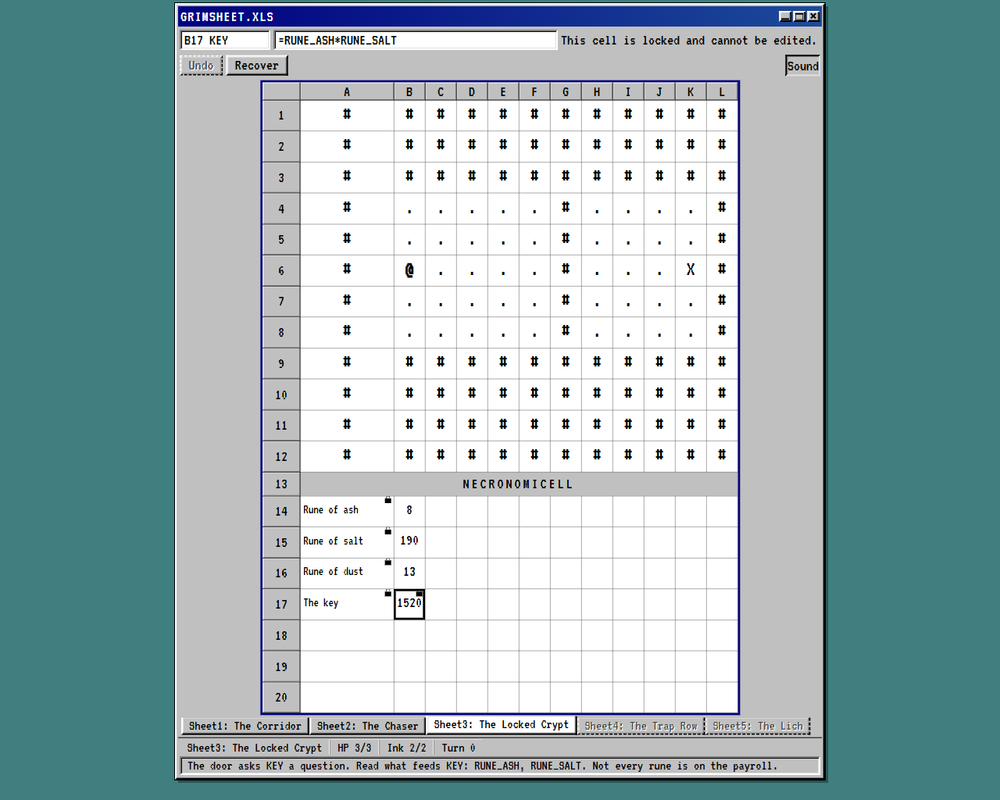
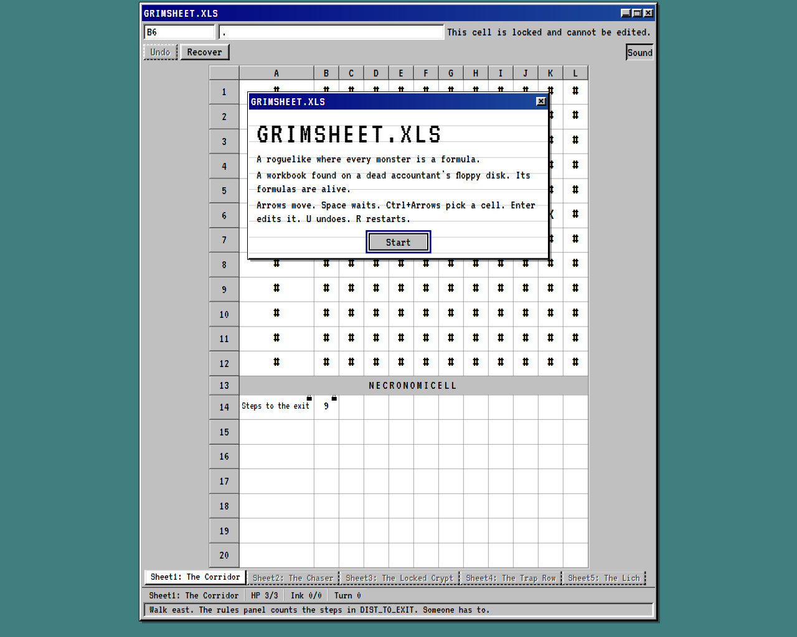
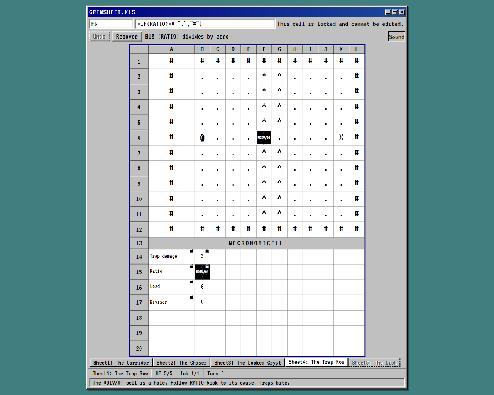
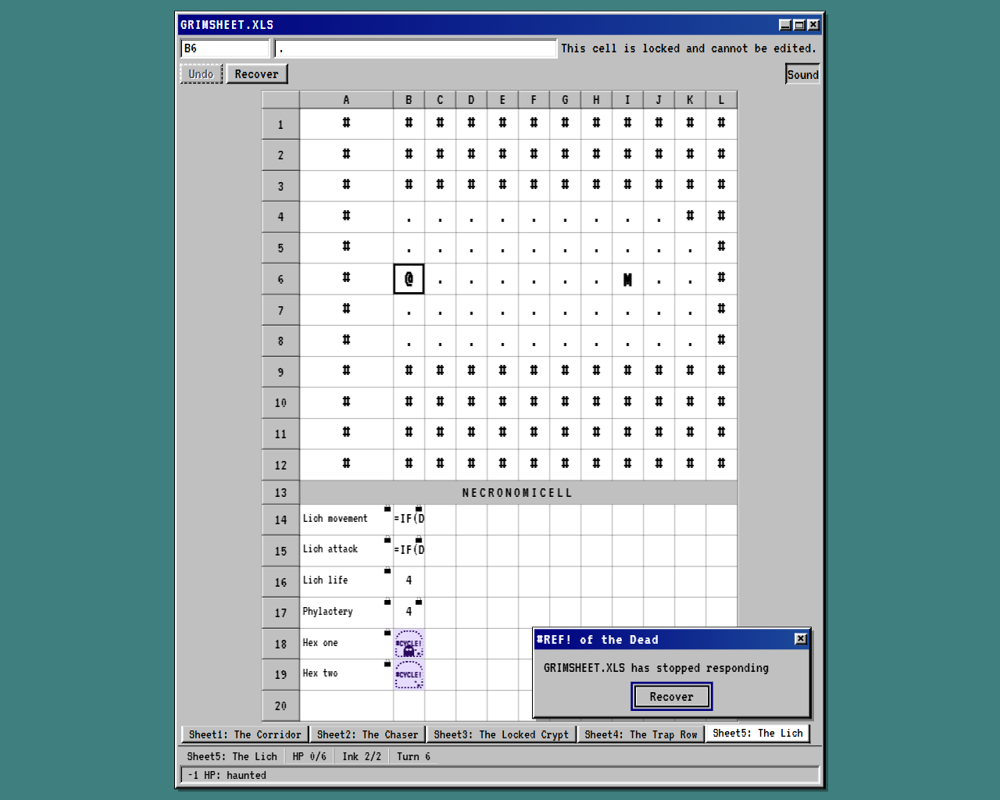

# Grimsheet

**A roguelike where every monster is a formula.**

Play it: **https://grimsheet.onrender.com**

A Kiroween 2026 entry (Frankenstein category).



## What it is

You opened GRIMSHEET.XLS, a workbook from a dead accountant's floppy disk. Its formulas are alive. The whole dungeon is a spreadsheet: columns `A` to `L`, rows `1` to `20`. The map lives in rows 1 to 12, where each cell's value is a terrain glyph, and the hero `@` and the monsters `M` stand on top of it.

The rules that animate the dungeon live in rows 14 to 20, a panel titled **NECRONOMICELL** — the book of formulas behind every monster. Each monster has a `move` rule and an `atk` rule, and both are ordinary named cells you can read. How a monster chases you, how hard it hits, when a door opens: all of it is a formula sitting in a cell, and editing those cells is reading from the forbidden book.

The errors are the monsters. A broken reference, an unknown name, a division by zero — these are not messages in the corner of the screen; they are the things in the dungeon that block your path or haunt the sheet. You survive by rewriting the formulas, spending a limited budget of **ink**, until the workbook lets you reach the exit.

## How to play

Select a cell with the mouse or arrow keys, read its formula in the formula bar, and edit it if it is not locked. Move with the arrow keys, wait with Space, and take a turn at a time.

| Key | Action |
|---|---|
| Arrow keys | Move the hero one cell |
| Space | Wait one turn |
| `F2` or Enter | Start editing the selected cell |
| Enter | Commit the edit in the formula bar |
| Escape | Cancel the edit, or dismiss a confirmation |
| `U` | Undo the last turn or edit |
| Ctrl+Z | Undo (while playing) |
| `R` | Restart the level (asks to confirm) |
| `N` | Go to the next level (on a win screen) |
| Ctrl + Arrow keys | Move the cell selection without moving the hero |

The rules that matter:

- **HP and ink.** You start each level with a fixed HP and a fixed ink budget. Committing a changed formula on an unlocked cell costs 1 ink. With no ink, you cannot edit. HP at 0 or below loses the level.
- **A turn.** You act — move, wait, or commit an edit. The sheet recalculates. Then each monster evaluates its `move` rule and steps one cell if the result is a direction onto empty floor, evaluates its `atk` rule and subtracts any positive number from your HP. A hero on a trap `^` loses the value of the `TRAP` cell. The sheet recalculates again; the hero on the exit wins.
- **Walls and floor.** `#` is a wall, `.` is floor, `X` is the exit, `^` is a trap. Any other value, including any error, blocks movement. Monsters only step onto empty floor.
- **One undo.** Undo reverts the last turn or edit and refunds the ink.
- **Locked cells** show a padlock and cannot be edited.
- **Haunting.** While any `#CYCLE!` error exists anywhere on the sheet, it is haunted and you lose 1 HP per turn until you break the cycle.

The key idea: **breaking a monster's formula is a legal strategy.** A monster whose `move` rule errors stands still. A monster whose `atk` rule errors cannot hurt you. A wall whose formula you fix can become floor. The puzzle is choosing which formula to change with the ink you have.

## Errors are monsters

Every evaluation ends as a value or an error — the engine never throws. The five error kinds each do a job in the dungeon:

| Error | Cause | In play |
|---|---|---|
| `#REF!` | A reference outside the sheet or to an unknown name | Blocks movement |
| `#NAME?` | An unknown function | Blocks movement |
| `#DIV/0!` | Division by zero | Blocks movement |
| `#VALUE!` | A wrong type, such as text where a number is needed | Blocks movement |
| `#CYCLE!` | A circular reference | Haunts: 1 HP per turn until the cycle is broken |

Hovering an error names its cause in plain English.

## The five levels

Each level is a tab in the workbook — "Sheet1: The Corridor" through "Sheet5: The Lich" — and each teaches one idea. The in-game hints, not solutions:

| # | Title | The idea |
|---|---|---|
| 1 | The Corridor | Movement and reading the sheet. The rules panel counts your steps; no ink to spend yet. |
| 2 | The Chaser | A monster's `move` rule is just text you can rewrite — decide who gets chased. |
| 3 | The Locked Crypt | Follow what feeds a cell. A door asks `KEY` a question; not every rune that feeds it counts. |
| 4 | The Trap Row | Trace an error to its cause. A `#DIV/0!` is a hole; follow a ratio back to what broke it, and mind the traps. |
| 5 | The Lich | Timing under a haunt. A boss's HP is just a number — change it while he is far, before the cycle bleeds you out. |

## Formula cheat sheet

A formula starts with `=`. A cell without `=` is a literal: a number, or text taken as-is. Numbers (`3`, `2.5`), quoted strings (`"#"`), and `TRUE` / `FALSE` are the literals.

**Operators**, by precedence: unary `-`; then `*` `/`; then `+` `-`; then `&` (text join); then the comparisons `=` `<>` `<` `>` `<=` `>=`. Parentheses group.

**References**: a cell (`B9`), a range (`A14:A20`, inside a function argument only), or a cell name (`HP`, `KEY`). Two special names: `HERO` is the hero's cell, and `SELF` is the monster whose rule is being evaluated (`#REF!` anywhere else).

**Functions**:

| Function | Meaning |
|---|---|
| `SUM(...)`, `MIN(...)`, `MAX(...)` | Over ranges or values (one or more arguments) |
| `ABS(x)` | Absolute value |
| `MOD(a, b)` | Remainder |
| `IF(cond, then, else)` | The untaken branch is not evaluated |
| `AND(...)`, `OR(...)`, `NOT(x)` | Logic |
| `ROW(ref)`, `COL(ref)` | 1-based row and column of a reference |
| `DIST(a, b)` | Manhattan distance between two references |
| `TOWARD(target)` | `"N"`, `"S"`, `"E"` or `"W"`, the step from `SELF` toward a target (ties go vertical), or `"-"` when already there |
| `RAND()` | A number in [0, 1) from the level's seed — same seed, same game |

Recalculation follows the dependency graph in topological order, so results never depend on the order cells were defined or edited. A parse error is reported as `Col N: <message>.` in the formula bar and the edit is refused, with no ink spent.

## Run it locally

Node 22 or newer.

```
npm install
npm run dev        # Vite dev server
npm test           # unit and property tests (Vitest + fast-check)
npm run verify     # tests, then type-check and lint
npm run e2e        # Playwright end-to-end tests
npm run build      # type-check and build the static site into dist/
```

### Headless play command

`scripts/play.mjs` plays a level without a browser, for automated playtesting. It uses only the public game and level APIs and touches no DOM. It prints JSON on stdout, exits `0` when it ran, and exits non-zero only for bad input (an unknown level, malformed actions).

Build the bundle once, and again whenever the `src/` code changes:

```
npm run build:play
```

This writes `dist-play/headless.js`, which the script imports, so `scripts/play.mjs` then runs with plain `node`. (`dist-play/` is build output and is git-ignored.)

Play a level with an action list. The list uses the same action format as `tests/solutions/*.json`: a JSON array of `{ "kind": "move", "dir": "N|S|E|W" }`, `{ "kind": "wait" }` and `{ "kind": "edit", "address": "B14", "raw": "..." }`. It may be a bare array, or a whole solution object with an `actions` array.

```
# actions as a positional JSON argument
node scripts/play.mjs 01-the-corridor '[{"kind":"move","dir":"E"}]'

# actions from a file (a stored solution works directly)
node scripts/play.mjs 01-the-corridor --actions-file tests/solutions/01-the-corridor.json

# actions from stdin
node scripts/play.mjs 02-the-chaser < tests/solutions/02-the-chaser.json
```

Inspect without playing, or list the levels:

```
node scripts/play.mjs 02-the-chaser --level-info
node scripts/play.mjs --list
```

`npm run play -- <args>` is the same as `node scripts/play.mjs <args>`.

The output is a JSON object with `levelId`; `start` (hero, hp, ink, turn, status, monsters) before any action; `steps`, one per action, each recording the action, whether it was `accepted`, the `reason` and `message` when refused, any `damage`, and the state after it; `final`, the same state view after the last action; and `sheet`, every non-empty cell as `address`, `raw`, `value`, `valueKind`, `locked` and `name`. `--level-info` prints the level's `map`, `cells`, `monsters`, `hp`, `ink` and the rest without playing.

## How it is built

TypeScript (strict) and Vite, no UI framework. The grid is a DOM table and CSS; only the UI layer touches the DOM, `localStorage` or Web Audio. The code is layered, and each layer imports only lower layers through their barrels:

| Layer | Path | What it does |
|---|---|---|
| Engine | `src/engine/` | Tokenizer, parser, AST, printer, evaluator, dependency graph, cycle detection, errors. DOM-free, no `eval`, no `new Function`. |
| Model | `src/model/` | Cell and level types, the level JSON schema, the loader, lossless round-trip. |
| Game | `src/game/` | Turns, movement, monsters, damage, traps, haunting, win and loss, ink, one-step undo, seeded RNG. DOM-free. |
| UI | `src/ui/` | The grid table, formula bar, status bar, screens, keyboard handling. |
| Levels | `src/levels/` | The five hand-written level JSON files and their barrel. |

Correctness is proven several ways:

- **Property tests** (fast-check): parse-print-parse is stable, recalculation is independent of definition order, evaluation is total (never throws), the same seed gives the same game, level JSON round-trips exactly, no two entities share a cell, ink never goes negative, undo restores the previous state exactly, and every loaded level starts the hero on a walkable cell.
- **Stored solutions replayed in tests:** each level has a solution in `tests/solutions/` that is replayed through the public game API and must end in a win within its ink and HP.
- **An exhaustive no-edit search per level:** for levels 2 to 5, a breadth-first search over moves and waits proves the level cannot be won by walking alone — you must edit.
- **A live playthrough in a real browser:** all five levels have been played through on the deployed site, driven by the Playwright MCP server, and ended on the HP and ink the tests expect.

## Built with Kiro

Grimsheet was built with Kiro, from a single input brief (`docs/BRIEF.md`) that Kiro turned into steering, specs and code. The running log of how Kiro was used, session by session, is in [`KIRO_USAGE.md`](KIRO_USAGE.md).

**Surfaces.** The Kiro IDE was used to write and review every spec and diff. The Kiro Crew Task Runner ran independent task batches in parallel on their own branches, merged after review. Kiro Web opened pull requests for spec documentation, the hosting spec with the Render static-site setup, and this README. The Kiro CLI ran the read-only reviewer agent on engine changes.

**Specs.** Eight spec folders in [`.kiro/specs/`](.kiro/specs/), each with `requirements.md`, `design.md` and `tasks.md`: `formula-engine`, `sheet-model`, `game-rules`, `grid-ui`, `error-monsters`, `levels`, `hosting` and `skin-and-sound`. All eight are built and shipped in the live build. The last one, `skin-and-sound`, gave the game its look and sound: the VT323 font shipped unchanged, beveled window chrome, a sticky status bar, five Web Audio beeps with a persistent mute, and title and end dialogs.

**Steering.** Five files in [`.kiro/steering/`](.kiro/steering/): `product.md`, `tech.md` and `structure.md` always on, with `formulas.md` scoped to `src/engine/**` and `sheet-ui.md` scoped to `src/ui/**`, `**/*.css`, `src/levels/**`, `index.html` and `public/**`. `sheet-ui.md` also says that any change a player can see retakes the affected screenshots in `docs/screenshots` (as in task 6.2 of the `skin-and-sound` spec), and that all seven are retaken after the last visible change before the 2026-11-28 feature freeze.

**Hooks.** Two in [`.kiro/hooks/`](.kiro/hooks/): run the fast tests on every save under `src/`, and run the full `npm run verify` before a task finishes. Both call `scripts/canonical-cwd.mjs`, a small wrapper that fixes the working-directory drive-letter case before running a command — without it, Vitest launched from a path with a lowercased drive letter loads two copies of itself and every suite fails.

**Agent.** One custom agent, `formula-reviewer` in [`.kiro/agents/`](.kiro/agents/): a strictly read-only reviewer that checks the formula engine against section 4 of the brief and the formula-engine spec, and reports findings without changing anything.

**MCP.** The Playwright MCP server in [`.kiro/settings/mcp.json`](.kiro/settings/mcp.json) was used to play levels in a real browser and take screenshots during UI work and the live playthrough.

## Screenshots



*The title dialog: Start hands the grid to the player.*



*A #DIV/0! error cell and its cause line, in plain English.*



*The death dialog, with Recover focused, on a haunted sheet of #CYCLE! cells.*

All seven screenshots are listed in [`docs/screenshots/README.md`](docs/screenshots/README.md).

## Credits

Font: VT323 by Peter Hull, SIL Open Font License 1.1, https://github.com/google/fonts/tree/main/ofl/vt323 (file shipped unchanged).

## Disclosure

Grimsheet was created from scratch during the Kiroween 2026 submission period. It uses standard open source libraries only; no other pre-existing code is incorporated.

## License

MIT. See [LICENSE](LICENSE).
